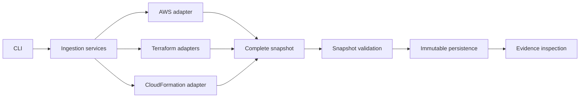
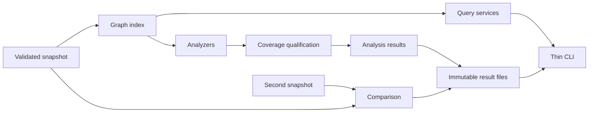

# Archdiscov implementation plan

This plan follows the four delivery increments in [README.md](README.md). Phases 1–2 and the cloud-platform foundation bridge 22.1–22.4 are complete. Phase 3 has implemented result contracts and integrity in step 23, the complete read-only graph index, composed acceptance, and synthetic profiling in steps 24.1–24.5, and the complete bounded query boundary (contracts, search, inspection, neighbours, paths, and the `query` CLI) in step 25, and analyzer execution, result persistence, the ownership analyzer in step 26, security-group impact analysis in step 27, and cross-account trust analysis in step 28; steps 29–33 remain planned below. Phase 4 provides direction and will be expanded when its prerequisites are complete.

The completed first milestone is a complete offline workflow:

**Load a mock snapshot → validate it → save it → inspect its evidence through the CLI.**

This establishes the contracts that discovery, analysis, and the assistant will depend on. Phase 2 has extended those contracts and delivered regional EC2/network, ALB/NLB, ECS, Lambda, RDS/Aurora, SQS, and account-wide IAM collection, including whole-supported-architecture async orchestration, plus offline Terraform state-export, plan, and CloudFormation JSON/YAML import through Python services and explicit CLI formats. Consolidated permissions, setup, supported boundaries, and offline host/container acceptance complete phase 2. Phase 3 delivered graph indexing, queries, five deterministic analyzers, immutable result persistence, and snapshot comparisons, closed by offline host and container acceptance.

## Current starting point

The existing code in [src/archdiscov/models/architecture.py](src/archdiscov/models/architecture.py) provides recursive resource models, a discriminated resource union, validated account/region containment, local/external/unresolved dependencies, fact-level evidence citations, and operation coverage. Dedicated resource models cover EC2/network, IAM, ELBv2, ECS, Lambda, RDS/Aurora, and SQS configuration; other types can use `UnknownResource`.

The installable package, Docker development environment, detached snapshot validation, immutable persistence, evidence inspection, offline `ingest`/`evidence` CLI, and minimal `Finding`/`Answer` contracts are implemented and verified. Models use package-relative imports. AWS discovery supports the documented regional service slices and account-wide IAM configuration through `collect`; Terraform state exports/plans and CloudFormation templates can be imported through Python services and explicit `ingest --format` selection. The five analyzers and snapshot comparison are implemented (phase 3); agent orchestration remains future work. The historical phase 1 strict-reference rules below remain accurate for schema `1`; their versioned extension was delivered in step 10 (schema `2`).

## 1. Models, snapshots, fixtures, and CLI foundation

### Step 1: Establish the package structure and development workflow

**Status:** Implemented. The `src/archdiscov` package separates models, ingestion, services, and CLI presentation. The CLI exposes help/version output through the installed `archdiscov` command and `python -m archdiscov`. Typer, packaging metadata, pytest/Ruff configuration, and development instructions are in place. Packaging tests verify imports and CLI execution from outside the repository. The existing MCP dependency is retained pending the open question below.

Set up an installable application package, a CLI entry point, and clear boundaries between models, ingestion, application services, and presentation.

Start with a small structure; add graph, analysis, and provider modules when their implementations arrive. Fix the enum import so model imports work through the installed package.

Keep Python 3.13 and uv. Add Typer now; add PyYAML when template ingestion begins. Configure pytest and Ruff, and replace the placeholder project description.

**Advice:** Verify imports and CLI execution from outside the repository directory. This catches packaging problems that running files directly can conceal.

**Open question:** The dependencies include `mcp`, but the README describes an internal tool interface and CLI. Is an MCP server intended? If so, treat it as a later interface unless it is a release requirement.

### Step 2: Add a reproducible Docker development environment

**Status:** Implemented and validated on Linux. The development image uses Python 3.13, uv 0.5.29, frozen lockfile installation, and a non-root user with configurable UID/GID. Compose mounts the checkout and a dependency cache; `/opt/venv` keeps container dependencies separate from the host environment. Image builds, Compose configuration, CLI execution, pytest, Ruff, network-isolated tests, live source visibility, writable cache/environment directories, and host file ownership checks passed. Runtime credential setup and Docker Desktop usage are documented; external credentials and other host platforms were not exercised. Devcontainer integration remains deferred.

Create the container files early so subsequent implementation can use a consistent Python and dependency environment:

- `Dockerfile` with a development target using Python 3.13, a pinned uv version, and development dependencies installed from `uv.lock` with frozen resolution.
- `compose.yaml` with a development service for an interactive shell, CLI commands, pytest, and Ruff. The CLI does not need a continuously running application server or exposed ports.
- `.dockerignore` excluding host virtual environments, Git data, IDE files, local credentials, and generated snapshots from the build context.

Bind-mount the source for immediate feedback, and keep the container virtual environment separate from the host `.venv`. Cache dependency downloads and install dependencies in a separate build layer so ordinary source edits do not trigger a complete reinstall. Run as a non-root user and arrange writable cache, environment, and output directories; account for host UID/GID where necessary to avoid root-owned files.

Document commands to build the environment, open a shell, run checks, and execute the CLI once it is available. Explain when changes to `pyproject.toml` or `uv.lock` require dependency synchronization or rebuilding. Maintain the same uv workflow for developers running directly on the host.

Plan an opt-in AWS credential setup for the collection increment: mount the required AWS configuration and credentials at runtime, read-only where supported, and select an explicit profile. Authenticate on the host for SSO workflows where practical. Pass provider credentials at runtime when provider integration arrives. Keep credentials out of images and committed configuration.

**Advice:** Start with one development image and one Compose service. Botocore Stubber and local fixtures cover the planned normal tests; add service containers only when a concrete integration needs them. A production image can be designed when deployment requirements are known.

**Acceptance check:** A clean checkout can build the environment and run the available checks; source edits appear immediately, and generated files have usable host permissions. Dependency installation may require network access, but the normal test suite must not require AWS or provider credentials or network calls.

**Open questions:**

- Which developer environments must be supported: Linux, Windows/WSL, macOS, or all three? This affects mounts and file permissions.
- Is Compose sufficient, or should a `.devcontainer` configuration also be provided for IDE integration?
- Which AWS authentication methods must work in the container: named profiles, SSO, configured assume-role access, or an external credential process? Credential processes may require additional runtime tooling.

### Step 3: Settle the snapshot contract

**Status:** Implemented. Schema `1` requires an explicit snapshot UUID, timezone-aware collection start/end, one discriminated source, and requested regional/account-wide coverage scope. Typed sources distinguish AWS observations, Terraform state, Terraform plans, CloudFormation declarations, and mock inputs; optional source export time and source-specific provenance are retained. Resource identities preserve physical IDs and logical addresses and derive stable, snapshot-independent IDs. Unsupported/missing schema versions are rejected without migration. Three representative JSON examples and contract tests cover round trips, invalid inputs, and identity stability. The README documents the contract and explicit IaC account/region requirements. Operation-level coverage and evidence remain Step 4; snapshot-wide integrity remains Step 5.

Extend `ArchitectureSnapshot` with explicit snapshot identity, timestamps, source information, and coverage. Distinguish live observations, Terraform state, Terraform plans, and CloudFormation declarations using validated fields.

Define how account-wide collection is represented and how source-specific metadata is retained. Establish handling for unsupported schema versions.

Define stable resource identity separately from snapshot identity. Preserve physical identifiers and IaC logical addresses so later comparisons have reliable matching inputs.

**Advice:** Write two or three representative JSON examples first, then refine the models against them. Do not leave fields that affect analysis hidden in generic `metadata`.

**Open questions:**

- Can one snapshot contain multiple source kinds, or should each source produce a separate snapshot? Separate snapshots are the simpler starting point and fit explicit comparison.
- How will account and region be supplied for IaC files that do not identify them?
- Should snapshot timestamps describe collection start/end, source export time, or both? Both are useful when available.

### Step 4: Complete evidence and coverage modeling together

**Status:** Implemented. Evidence requires snapshot/resource context and retains source paths; resource-relative JSON Pointer fact citations identify individual fields or rules without wrapping every field. Operation coverage distinguishes successful zero results, failures, skipped, unsupported, and incomplete collection, with validated scope, timestamps, retained counts, failures, and unresolved-value locations. Shared sanitization covers generic attributes/metadata and evidence values, with explicit redacted, omitted, and unresolved evidence states. The security-group/failed-route-table fixture and model tests demonstrate qualified evidence and missing coverage. README documents the chosen policies and adapter responsibilities; snapshot-wide reference integrity remains step 5.

The current `Evidence` model records source, locator, configuration path, and value. Add the resource and snapshot context required by the README, and decide how individual facts refer to evidence.

Resource-level evidence lists alone are too broad for conclusions such as “this rule permits this port.” Establish a way to associate a specific field or rule with its evidence without immediately wrapping every model field.

Define coverage records by account, region, service, and operation. They must distinguish successful collection with zero results from failed, skipped, unsupported, or incomplete collection. Retain timestamps, failures, and unresolved values.

**Advice:** Design this around one worked example: a security-group rule collected successfully while route-table collection fails. The resulting snapshot must support a qualified conclusion and explain the missing evidence.

**Open questions:**

- Should fact references use normalized model paths, source configuration paths, or both?
- Which sensitive fields must be excluded? Establish a shared sanitization policy before storing generic attributes or evidence values.
- Can evidence values be omitted after sanitization, and how will that limitation be recorded?

### Step 5: Strengthen resource and relationship validation

**Status:** Implemented and verified. A separate snapshot integrity pass indexes all recursive
regional/global resource trees, rejects duplicate IDs with storage locations, and enforces
snapshot account and enclosing-region scope. Names are optional without changing stable IDs;
nested subtype fields survive JSON round trips. Every evidence record belongs to this
snapshot and a stored resource; resource/fact citations resolve to owner-matched evidence,
and fact JSON Pointers resolve to existing JSON-mode values. Supplied coverage resource
references must exist locally. Dependencies require local endpoints, source-region grouping,
and source-owned evidence. The hierarchy fixture and isolated diagnostic tests cover these
rules. All 405 offline tests and Ruff lint/format and whitespace checks passed. Schema remains
`1`; external/cross-account/unresolved relationship representations are explicitly deferred.

Retain the recursive `children` model and discriminated union. Confirm that nested subtype fields survive JSON round trips.

Establish these snapshot-wide rules:

- Every resource is stored once and has a unique identity, matching the snapshot account and enclosing region.
- Attachments and other relationships use dependencies.
- Evidence references resolve within the selected snapshot and belong to the citing resource; fact pointers identify existing values.
- Dependencies are grouped by the source resource’s region, including `global`.
- Both dependency endpoints must exist locally; missing, external, and cross-account targets are rejected for now.

Keep AWS-specific placement decisions in ingestion adapters, consistent with the README’s generic containment model.

The existing `UnknownResource` uses `resource_type="unknown"` plus `aws_resource_type`. A previously unseen discriminator will therefore need explicit normalization into this representation; the union will not automatically accept it.

**Advice:** Separate ordinary field validation from a snapshot integrity pass. Reference checks become much clearer when the full snapshot is available.

**Decisions and deferred work:**

- Resource names may be absent or null; IDs remain independent of names.
- Explicit external/cross-account/unresolved dependency representations are deferred.
- Unresolved-parent placement and unsupported-type normalization belong in ingestion adapters; no parents or attachments are synthesized by snapshot validation.

### Step 6: Implement immutable snapshot persistence

**Status:** Implemented and verified. Public `validate_snapshot`, `load_snapshot`, and
`save_snapshot` services revalidate detached current data, load UTF-8 JSON, and save
sanitized normalized snapshots through synced same-directory temporary files and atomic
no-overwrite hard-link publication. Existing files, directories, and symlinks are conflicts;
publication is the commit point, with best-effort cleanup that cannot report a committed
save as failed. Typed diagnostics distinguish validation, unsupported versions, JSON,
encoding, conflicts, and filesystem failures without exposing raw input values. All five
fixtures round-trip; tests cover mutation, sanitization, concurrent writers, and injected
I/O/cleanup failures. All 462 offline tests, Ruff lint, and formatting checks (excluding
the execution-plan artifacts under `.junie`) passed. Paths select files; loaded models
remain mutable, UUID directory-wide uniqueness is not promised, and CLI ingestion remains
step 8. Parent directories must exist and local filesystems must support atomic hard links.

Define application services for loading, validating, and saving local JSON snapshots. Use atomic writes and avoid silently replacing an existing snapshot.

Make immutability an explicit storage rule. Pydantic models alone do not ensure that nested dictionaries and lists cannot change.

Handle malformed JSON, invalid model data, and unsupported schema versions with actionable errors. Preserve normalized facts and sanitized evidence across save/load operations.

**Advice:** Begin with explicit file paths. A snapshot registry, database, and migration framework can wait until actual usage requires them.

**Open question:** Should users select snapshots by path or by ID from a configured directory? Paths are sufficient for the first increment.

### Step 7: Create a small fixture set and meaningful model tests

**Status:** Implemented. The five small fixtures cover typed hierarchy, VPC-contained and
global unknown resources, source-evidenced dependencies, logical-only declarations, and
partial collection. Explicit before/after serialization assertions preserve subtype fields,
identities, citations, failure diagnostics, zero-result outcomes, and each incomplete-coverage
limitation. Rejection tests isolate missing failures and reversed timestamps and verify
schema-version diagnostics. Existing integrity and persistence coverage is retained;
unresolved relationships remain deferred. All 464 offline tests, Ruff lint/format checks
(excluding `.junie` artifacts), and whitespace checks passed. Production models and services
are unchanged.

Build fixtures for:

- A VPC → subnet → EC2 hierarchy.
- An account-wide resource and a VPC resource represented through `UnknownResource`.
- A dependency backed by evidence.
- Partial coverage; an unresolved-relationship fixture is deferred until an explicit representation is designed.
- A declared resource with a logical address but no physical identifier.

Test nested serialization, invalid resource discriminators, duplicate identities, evidence integrity, unresolved-reference handling, and schema-version rejection.

**Advice:** Keep fixtures small and understandable by inspection. Each should demonstrate a contract or limitation. These fixtures will become inputs for later analyzer and provider tests.

### Step 8: Deliver the first usable CLI workflow

**Status:** Implemented and verified. Thin Typer `ingest INPUT --output PATH` and
`evidence ID --snapshot PATH` commands use reusable persistence and evidence-inspection
services. Both support readable output and `--json`, including safe structured service
errors and documented exit codes. Ingestion preserves normalized snapshot data and refuses
existing destinations; inspection retains owner/subtype context, provenance, fact citations,
sanitized values, redactions, unavailable-value limitations, and same-region/service coverage
outcomes without claiming completeness. Tests cover all fixture imports, both installed entry
points outside the repository, malformed inputs, missing evidence, sanitization, limitations,
and no-overwrite behavior. All 525 offline tests, Ruff lint/format checks (excluding `.junie`),
and whitespace checks passed. Raw AWS/IaC adapters remain later work; Docker acceptance and
the remaining increment-closing contracts remain step 9. CLI usage errors retain Typer's
readable diagnostics even when `--json` is supplied.

Implement `ingest` for the project’s own snapshot JSON and `evidence` for retrieving a cited record. Support readable output and JSON output, with consistent exit codes.

Keep Typer commands thin: argument parsing and output formatting should call reusable application services.

Evidence output should show the selected snapshot, associated resource, source operation/file, configuration path, sanitized value, and relevant limitations.

**Advice:** Complete this workflow before adding more commands. It gives you an immediately reviewable result without AWS credentials or an LLM.

**Open question:** Should failed validation produce structured JSON errors when JSON output is requested? The recommended default is yes.

### Step 9: Close the increment with acceptance checks and documentation

**Status:** Implemented and verified. Minimal snapshot-scoped `Finding` and `Answer`
models define evidence/finding references, limitations, and `supported`, `partial`, and
`insufficient_evidence` statuses without analyzer-specific fields or provider-authored
conclusions. Shape/status validation is implemented; analyzer semantics and snapshot/tool
citation validation remain later increments. Installed-CLI acceptance tests run outside
the checkout without credential variables, preserve typed children and partial coverage,
inspect evidence, reject invalid references with safe diagnostics, and prove no overwrite.
Locked uv installation and the Docker development image build passed; all 554 tests
passed on the host and in Docker with networking disabled, and Compose acceptance passed.
Ruff lint/format checks (excluding `.junie` artifacts), documentation examples, and whitespace
checks passed. README documents installation, snapshot/fixture/API contracts, commands,
and reproducible host/container acceptance. The first offline increment is complete;
raw ingestion adapters, analyzers, and providers remain future work. Host verification
uses the local `.venv/bin/python`; Docker retains its separate `/opt/venv` environment.

Demonstrate that a user can install the project, import a fixture, inspect its evidence, and receive clear errors for invalid references. Verify the workflow both directly with uv and through the Docker development environment. Confirm that saved snapshots preserve typed children and coverage information.

Document installation, the snapshot contract, fixture usage, and supported commands. Define minimal `Finding` and `Answer` contracts now, particularly their evidence references, limitations, and statuses; defer analyzer-specific details.

**Completion criterion:** The offline workflow works, normal tests require no credentials or network access, and the snapshot/evidence contracts are stable enough for ingestion adapters to target.

## 2. AWS and infrastructure-as-code ingestion

**Phase 2 milestone:** Collect configured AWS accounts or import an IaC export → normalize and validate a source-specific snapshot → save without overwrite → inspect evidence and limitations.

Each snapshot remains one account and one source kind. Multi-account collection produces separate snapshots, not a merged account tree. Analysis, effective IAM evaluation, graph queries, comparisons, providers, and infrastructure execution remain out of scope.

Steps 10–22 are implemented, including all-supported-services collection with enabled-region discovery and bounded async orchestration around synchronous boto3 collectors, offline Terraform state-export, plan, and CloudFormation import through explicit CLI formats, and phase-closing permissions and offline acceptance; selective service collection remains available. Whole-architecture completeness is limited to the documented supported configuration inventory, not every AWS service.

### Step 10: Extend ingestion-facing snapshot contracts

**Status:** Implemented and verified (580 offline tests). `LocalTarget`, `ExternalTarget`, and `UnresolvedTarget` dependency targets, schema `"1"`/`"2"` support with schema `1` strict-reference loading retained, `ResourceLifecycle` (schema `2`, Terraform plans only), and the `tests/fixtures/snapshots/dependency-targets.json` fixture are in place.

Define discriminated local, external, and unresolved dependency targets before collecting relationships. Local targets must resolve to stored resources; external targets retain known identifiers/account context; unresolved targets require a sanitized reason and source location. All variants require a stored source, source-region grouping, and source-owned evidence. Never invent target resources or parents.

Use a versioned schema change for new relationship and IaC lifecycle fields. Plan schema `2` for new output while retaining schema `1` loading and its strict-reference semantics; specify any in-memory conversion and never rewrite historical files implicitly. Retain unknown AWS types through `UnknownResource` until a dedicated model is warranted. Known-null and unavailable values must remain distinguishable.

**Advice:** Design small local, cross-account, and unresolved-target fixtures first. Do not encode semantic contracts only in generic metadata.

**Acceptance check:** Old fixtures remain readable; new variants round-trip; malformed variants, dangling local endpoints, and invalid citations are rejected. Version diagnostics stay safe and actionable.

### Step 11: Establish adapter boundaries and configured AWS execution

**Status:** Implemented and verified (633 offline tests). `ingestion/requests.py` defines `SourceRequest`, `AwsCollectionRequest`, and strictly validated `AwsAccountConfig`; `ingestion/adapter.py` defines `SnapshotAdapter`, `AdapterContext` (clock, UUID, session seams), and `IngestionError`; `ingestion/aws.py` provides profile/assume-role sessions, STS identity verification, the operation allowlist, and the bounded `OperationRunner`; `services/ingestion.py` selects adapters and validates results. Adapters return one snapshot per configured account. The adapter currently returns a coverage-only skeleton; resource collection and the `collect` command are step 12.

Define typed source requests and an adapter interface returning a complete `ArchitectureSnapshot`. Share utilities for identity, evidence allocation, sanitization, containment, and relationship resolution without introducing a normalized-batch assembly service. Application services select adapters, coordinate work, validate results, and call existing persistence.

Define explicit account configurations using named profiles and optional configured assume-role access, expected account IDs, regions, service selection, bounded concurrency, SDK timeouts, and retries. Use STS to verify identity before resource collection; reject mismatched accounts. Never follow discovered trust principals into additional accounts. Establish the operation allowlist before issuing calls.

Create injected session/client and clock/UUID seams for offline tests. Aggregate paginated outcomes by account/region/service/operation, retaining results when later pages or per-resource detail calls fail. Distinguish failed, incomplete, skipped, unsupported, and successful-zero outcomes. Avoid duplicate aggregate coverage records.

**Advice:** Start with a small request model and shared operation runner, not a plugin framework. Account identity failure must not produce a misleading successful snapshot.

**Acceptance check:** Stubbed identity, account mismatch, profile/role configuration, pagination, exhausted retries, bounded execution, and partial-page preservation behave predictably without real credentials.

### Step 12: Deliver VPC/subnet/EC2 collection end to end

**Status:** Implemented and verified (646 offline tests). `ingestion/ec2.py` normalizes VPCs, subnets, and instances with whole-item and per-fact evidence, VPC → subnet → instance containment, and explicit `unresolved_parent` attributes; `AwsAdapter` collects them per region with per-operation coverage; `collect_and_save` and the thin `collect` command write one new file per account and report partial results. Tag values under secret-named keys are redacted. Other selected services have no collection or coverage yet.

Implement the first complete AWS snapshot using STS plus VPC, subnet, and EC2 operations. Normalize stable physical identities, names, tags, CIDRs, availability zones, and instance configuration with exact source evidence and normalized fact citations. Build VPC → subnet → EC2 containment where supported by observed configuration.

When a parent is unavailable, store the resource once at the appropriate regional root and explain the missing context; do not synthesize parents. Validate the complete snapshot before saving.

Expose a thin `collect` command around reusable collection services. Provide readable/JSON summaries and explicit new output paths. For multiple configured accounts, require distinct destinations and report per-account outcomes without overwriting files or hiding partial failures.

**Advice:** Make this narrow slice usable before expanding the service inventory.

**Acceptance check:** A stubbed collection can be saved and inspected through `evidence`; zero results and mid-collection failure remain distinguishable; multi-account output stays isolated; existing destinations are untouched.

### Step 13: Complete network configuration and attachment evidence

**Status:** Implemented and verified (691 offline tests). Dedicated `RouteTable`, `InternetGateway`, `NetworkAcl`, `SecurityGroup`, and `NetworkInterface` models carry typed routes, rules, entries, and addressing with per-entry fact citations. `ingestion/network/` places them under the VPC/subnet and builds `attached_to` dependencies (kinds in `AttachmentKind`) with local, external, or unresolved targets; the adapter emits schema `"2"`. The fact/relationship-to-operation mapping and permissions are in `docs/network-mapping.md`.

Add route tables and associations, internet gateways, NACLs, security groups/rules, and network interfaces needed to describe EC2 attachments. Retain routes, addressing, ports/protocols, rule references, and association provenance. Store each resource once and express attachments as evidence-backed dependencies rather than duplicated children.

Use explicit external/unresolved targets when referenced resources are outside collection scope or cannot be resolved. Record unavailable parent/detail facts as limitations. Do not derive internet-exposure conclusions during ingestion.

**Advice:** Publish a mapping from each collected fact and relationship to its supporting operation and source path. Extend the operation allowlist and required read-permission documentation with each service slice in steps 13–16, before issuing its calls; apply step 11's per-operation partial-result policy throughout.

**Acceptance check:** Small fixtures demonstrate attachment resolution, missing network parents, unsupported route targets, security-group references, and successful security-group collection with failed route collection.

### Step 14: Collect account-wide IAM configuration

**Status:** Implemented and verified (830 offline tests). Typed IAM roles, instance profiles, and referenced managed policies are stored once per verified account under `global_resources`, using source-provided IDs. The separate IAM runner aggregates bounded, paginated detail reads and preserves partial inventory and successful results. Sanitized trust, inline-policy, and default-version documents have exact request-context evidence; compute/profile/role/policy and trust references use source-owned citations with local, external, or unresolved targets, without effective-access claims. Repeatable `collect --service` supports IAM-only requests without regions and combined EC2/IAM collection while retaining the EC2 default. Permissions, fact/relationship mappings, coverage, and redaction limitations are documented in [docs/iam-mapping.md](docs/iam-mapping.md). Full pytest, Ruff lint/format (excluding `.junie`), and whitespace checks passed using `.venv/bin/python`; schema `1` remains readable.

Collect IAM roles, instance profiles, attached/inline policies, relevant policy versions, and trust documents once per account, outside regional loops. Store account-wide resources under `global_resources`; resolve compute/profile/role links after resources are collected. Retain trust principals and conditions, including named external accounts and unresolved principals, without expanding wildcard principals into invented identities.

Do not retrieve credentials, secret material, or perform effective-permission evaluation. Extend the allowlist and read-permission documentation as operations are introduced.

**Advice:** Separate observed trust configuration from proof that a principal can actually assume a role.

**Acceptance check:** Two requested regions still trigger only one account-wide collection; policy/detail failures preserve known roles; regional/global and external relationships remain evidence-backed.

### Step 15: Add load-balancer configuration and targets

**Status:** Implemented and verified (945 offline tests). Regional ALB/NLB inventory, listeners, ALB rules, target groups, registered targets and observed health use six allowlisted ELBv2 reads. Typed ARN-identified resources retain exact request/page/fact citations, sanitized configuration, partial coverage, and evidence-backed forwarding/attachment links. IAM and ELBv2 share bounded detail execution while the EC2 runner remains unchanged. `collect --service elasticloadbalancing` works alone or with EC2/IAM; see [load-balancing-mapping.md](docs/load-balancing-mapping.md) for permissions, redactions, and uncertainty boundaries.

Collect ALB/NLB configuration, listeners, listener rules, target groups, and target configuration/status needed to connect the architecture. Preserve schemes, subnets, security groups, ports/protocols, forwarding actions, and target identities. Normalize supported `forwards_to` and attachment relationships, retaining unresolved IP or unavailable targets explicitly.

**Advice:** Evidence should identify the specific listener action or target entry, not merely the load balancer.

**Acceptance check:** Stubbed pagination and per-load-balancer detail failures preserve complete portions; forwarding relationships resolve or explain their unavailable endpoints. No reachability claims are produced.

### Step 16: Add compute, database, and queue configuration

**Status:** Implemented and verified (1,112 offline tests). Focused service-local modules
collect ECS clusters/services/running tasks and referenced task definitions, Lambda
configuration, RDS/Aurora instances/clusters/subnet groups, and SQS configuration/policies.
Typed resources retain exact request/page/fact evidence and observed network, role,
database-cluster/subnet-group, and dead-letter references with local/external/unresolved
targets. Shared bounded execution supports service-specific pagination and partial results;
all reads are allowlisted. Safe source projections exclude environment values, commands,
code, credentials, queue messages, and database contents before evidence construction.
`collect --service` supports each service independently or in combination, preserving
EC2 defaults and immutable persistence. Service mappings and permissions are documented
in `docs/ecs-mapping.md`, `docs/lambda-mapping.md`, `docs/rds-mapping.md`, and
`docs/sqs-mapping.md`. Full pytest, Ruff lint/format (excluding `.junie`), and whitespace
checks passed using the local `.venv/bin/python`; no credentials or network were used.
ECS task inventory is explicitly limited to desired-running tasks; no effective-access
or reachability conclusions are produced.

Expand in small service-local slices: ECS clusters/services/tasks and relevant task-definition configuration; Lambda configuration; RDS/Aurora instances/clusters; and SQS queue configuration/policies. Retain networking, execution/task role references, database endpoints/ports, queue policies, and relevant lifecycle/configuration facts.

Select safe fields before persistence. Never collect workload contents, queue messages, function code, secret values, or database contents. Review environment variables and other sensitive configuration rather than relying exclusively on generic key-name sanitization. Keep unsupported resources explicit and relationships evidence-backed.

**Advice:** Finish each service's mapping, coverage, redaction, and tests before moving to the next.

**Acceptance check:** Each service has paginated/detail-failure cases, exact fact citations, and secret-exclusion assertions. Collection remains bounded and allowlisted.

### Step 17: Collect whole supported architectures with bounded async orchestration

**Status:** Implemented and verified (1,292 offline tests). All seven substeps
deliver typed scope/limits, verified enabled-region discovery, shared SDK budgets,
isolated deterministic assembly, bounded async scheduling, cancellation-safe
collection/persistence, and CLI controls. `collect --all-services` selects all seven
supported families across configured accounts and enabled regions, with explicit
overrides and qualified scope summaries. Selective defaults, account isolation,
source-owned evidence, secret exclusion, and immutable destinations are preserved.
Full pytest, Ruff lint/format (excluding `.junie`), and whitespace checks passed
using `.venv/bin/python`; no credentials or network were used. See
[whole-architecture collection](docs/collection-scope.md).

Deliver the following ordered substeps independently, implementing and verifying one before proceeding. Keep the parent planned/in progress until all seven acceptance checks pass. Collect the supported configuration inventory—EC2/network, IAM, ELBv2, ECS, Lambda, RDS/Aurora, and SQS—for explicitly configured accounts. “Entire architecture” does not mean every AWS service, effective access, reachability, or a transactionally consistent AWS snapshot; completeness is relative to the resolved supported scope.

Preserve the complete-snapshot adapter boundary and schema `"2"`: async services coordinate thread-backed synchronous boto3 collectors, while the AWS adapter owns deterministic account assembly. Keep scheduling, scope discovery, and concurrency primitives in focused ingestion modules, `aws.py` limited to adapter composition, `services/ingestion.py` to workflow coordination, and `cli.py` to options/presentation. Reuse `AwsService`, `AwsRegion`, coverage/status and operation enums; add named scope/discovery enums only for real contracts. Never discover or enter additional accounts through trust relationships.

#### Step 17.1: Define whole-architecture scope and execution limits

**Status:** Implemented and verified (1,158 offline tests). Typed account requests
support all-service selection and explicit/enabled region scope while retaining
selective defaults and IAM-only behavior. Strict run-wide/account SDK-call limits
and active-account/collector-job limits are defined; execution enforcement remains
step 17.3 and scheduling remains step 17.5. `ingestion/scope.py` defines validated,
credential-free resolved scope for existing snapshot metadata without a schema
change. Request/provenance tests, full pytest, and Ruff checks passed using
`.venv/bin/python`; no discovery, scheduling, or CLI changes were introduced.
See [the scope and limit contracts](docs/collection-scope.md).

- Extend typed requests in `ingestion/requests.py` with all-supported-services selection, discovery versus explicit region scope, and validated run-wide/per-account call limits plus active-account/collector-job limits.
- Reuse the enum-backed `COLLECTABLE_SERVICES` definition for all seven service families. Reject all-services plus explicit service selections; preserve EC2 defaults, selective requests, and IAM-only behavior.
- Define resolved-scope data carried into snapshot provenance using existing contracts; avoid a scheduling-only schema bump. Keep configured account/profile isolation and distinct output paths unchanged.

**Advice:** Establish contracts first without changing execution or exposing a CLI option that cannot yet work.

**Acceptance check:** Request tests cover mode conflicts, defaults, invalid limits, explicit overrides, and compatibility with existing selective requests. No AWS calls or scheduling changes are introduced.

#### Step 17.2: Resolve enabled regions for verified accounts

**Status:** Implemented and verified (1,199 offline tests). Focused region-scope
resolution runs allowlisted `DescribeRegions` after STS verification, retains
enabled regions and credential-free scope diagnostics, and bypasses discovery
for explicit regions. Bootstrap/authentication endpoints respect configured,
profile, and verified partition context; ambiguous scope, discovery denial, and
unsupported enabled regions raise safe account-level errors without publishing
empty snapshots. SDK-unavailable regional services have per-operation
`unsupported` coverage while successful siblings remain collected. Stubber/fake,
authentication, persistence, and collector regression tests, full pytest, and
Ruff checks passed using `.venv/bin/python`. No shared budgets, async scheduling,
or CLI discovery controls were introduced. **Prerequisite:** Step 17.1.
See [scope discovery and regional availability](docs/collection-scope.md).

- Add a focused region-scope module and allowlisted `DescribeRegions` operation in `ingestion/operations.py`; invoke discovery only after STS verification.
- Resolve bootstrap endpoints from explicit/profile/partition context without assuming a commercial endpoint, filter disabled opt-in regions, and bypass discovery for explicit regional scope.
- Retain resolved scope and safe diagnostics. Denial, ambiguous bootstrap, or discovered regions unsupported by `AwsRegion` produce actionable account-level errors rather than silently reduced scans or successful empty snapshots.
- Define how known regional service unavailability is qualified in coverage; unavailable services must not appear as successful zero inventory.

**Advice:** Keep discovery independent of resource normalization and document `ec2:DescribeRegions` permission with this slice.

**Acceptance check:** Stubber/fake tests cover enabled/disabled regions, partitions, explicit overrides, discovery failure, unsupported regions, service availability, and no discovery before identity verification.

#### Step 17.3: Enforce shared SDK-call budgets

**Status:** Implemented and verified (1,219 offline tests). Focused concurrency
primitives atomically reserve shared run-wide and per-account SDK-call capacity
through `AdapterContext`, `OperationRunner`, `DetailRunner`, configured assume-role
authentication, STS identity verification, and enabled-region discovery. Permits
remain held through blocking calls and SDK retries and are released on success
or failure; normalization, persistence, and nested scheduling hold none. Request
limits and one budget survive account persistence subrequests. Synchronization
tests prove overlapping nested pools respect both ceilings, safe failures release
capacity, and pagination/coverage regressions remain unchanged. Full pytest and
Ruff checks passed using `.venv/bin/python`; no credentials or network were used.
Async scheduling, isolated assembly, and CLI controls remain later substeps.
**Prerequisite:** Step 17.1. See [shared SDK-call budgets](docs/collection-scope.md).

- Add focused concurrency primitives and thread them through `AdapterContext`, `OperationRunner`, `DetailRunner`, and identity/discovery execution.
- Bound actual blocking SDK calls with shared run-wide and per-account permits, including nested detail pools; keep permits held through SDK retries until the underlying call returns.
- Release permits on every success/failure path. Never hold them during nested scheduling, normalization, or persistence. Preserve existing SDK timeout/retry settings and runner coverage semantics.

**Advice:** Introduce the budget under current synchronous orchestration before adding async scheduling; use synchronization tests rather than elapsed-time benchmarks.

**Acceptance check:** Concurrent runner tests prove total/account in-flight limits, no permit leaks or deadlocks, and unchanged pagination, retries, retained-page results, safe errors, and coverage counts.

#### Step 17.4: Separate isolated collection from deterministic account assembly

**Status:** Implemented and verified (1,226 offline tests). Focused enum-backed
service/region jobs return owned resources, evidence, coverage, and service-local
dependencies without mutating account trees. `AwsAdapter` collects jobs sequentially,
then assembles copied results in stable order and resolves cross-service links
against complete regional/global inventories using existing helpers. Missing,
duplicate, or unplanned job results are rejected; collected inputs remain unchanged
by assembly or returned snapshot mutations. Fixed clock/UUID tests across all seven
service families and two regions prove reversed/shuffled results preserve containment,
facts, exact citations, coverage ordering, redaction, successful zero results, and
retained pagination/detail failures. Full pytest, Ruff lint/format (excluding `.junie`),
and whitespace checks passed using `.venv/bin/python`; no credentials or network
were used. Async scheduling and CLI controls remain planned for subsequent substeps.
**Prerequisites:** Steps 17.2–17.3. See
[isolated collection and account assembly](docs/collection-scope.md).

- Refactor collector dispatch, including `configuration_services.py`, so service/region work returns isolated results instead of mutating shared resource trees, evidence maps, or dependencies.
- Keep execution sequential initially. Have `AwsAdapter` merge in stable service/region order after collection, then build complete indexes and resolve containment and cross-service links, including compute/network/IAM/ELB references.
- Reuse existing normalizers/resolvers; retain one resource and one operation coverage record per account/region/service/operation scope. Do not create a separate assembly service or invent parents, resources, endpoints, or relationships.

**Advice:** Review this as a behavior-preserving refactor before introducing concurrency.

**Acceptance check:** Combined-service regressions and deliberately reordered result inputs preserve normalized facts, containment, references, exact citations, coverage ordering, redaction, and partial results, including pagination/detail failures and successful-zero versus failed/incomplete outcomes (with clock/UUID seams fixed).

#### Step 17.5: Schedule bounded async account and collector jobs

**Status:** Implemented and verified (1,241 offline tests). A focused async
coordinator bounds active accounts and run-wide collector jobs around thread-backed
synchronous boto3 work, retaining shared SDK-call budgets and ordered account results.
Session factories and account Session/client preparation are serialized without
locking returned clients' API calls; cross-account Session reuse is rejected and
clock/UUID injection remains supported. IAM runs once per account; assembly waits
for isolated jobs and remains independent of completion order. Identity/discovery
errors isolate accounts, retained API failures qualify coverage, and unexpected
collector/validation errors propagate after siblings settle. Barrier/lock-based
tests, full pytest, Ruff lint/format (excluding `.junie`), and whitespace checks
passed using `.venv/bin/python`; no credentials or network were used.
Async persistence/cancellation and CLI controls remain steps 17.6–17.7.
**Prerequisite:** Step 17.4. See
[bounded async scheduling](docs/collection-scope.md).

- Add a focused account-local async coordinator using bounded thread-backed boto3 work; do not add an async AWS SDK dependency.
- Run independent account and service/region jobs concurrently, IAM once per account, respecting both scheduling limits and shared call budgets.
- Preserve dependent collector stages and sequential pagination. Prepare sessions/clients safely, avoiding concurrent boto3 Session mutation and cross-account credential reuse; retain session/client, clock, and UUID injection seams.
- Merge only after each account's selected collector jobs settle. Identity/discovery failure prevents that account's snapshot without stopping others; expected collector/API failures retain qualified siblings. Programming/validation failures must not be converted into successful empty results.

**Advice:** Async workers collect isolated data; the account adapter remains the single assembly owner.

**Acceptance check:** Barrier-based tests demonstrate real overlap, bounded nested calls, IAM single-pass behavior, deterministic completion-order independence, failure isolation, and safe session/client preparation.

#### Step 17.6: Deliver async workflows, sync compatibility, and cancellation

**Status:** Implemented and verified (1,265 offline tests). Public
`collect_snapshots_async` and `collect_and_save_async` services support existing
event loops, request-ordered results, independently validated snapshots, expected
account/save failure isolation, and distinct immutable destinations. Existing
synchronous APIs and injected sync-only adapters remain supported; sync wrappers
reject running-loop misuse actionably before starting work. Cancellation stops
later scheduling and SDK reads and asynchronously drains running threads, including
repeated cancellation, while retaining SDK permits and collector slots until completion.
Unfinished collection publishes nothing; started saves settle through the existing
atomic publication commit point, never overwrite, and preserve all committed
files. Synchronization/publication tests, full pytest, Ruff lint/format (excluding
`.junie`), and whitespace checks passed using `.venv/bin/python`; no credentials
or network were used. CLI scope controls and parent milestone completion remain
step 17.7. **Prerequisite:** Step 17.5. See
[async workflows and cancellation](docs/collection-scope.md).

- Add async collection and collection-to-persistence service APIs with request-ordered account outcomes; retain existing synchronous CLI/Python wrappers and adapter injection compatibility.
- Async APIs work inside an existing event loop. Sync wrappers must fail actionably rather than attempt a nested event loop when misused there.
- On cancellation stop scheduling, let running SDK threads settle under configured timeouts, retain their permits until completion, and publish no unfinished account snapshot.
- Preserve independently validated immutable snapshots and distinct paths. Define the existing atomic publication commit point as the boundary: already committed files remain intact, including a save that commits while cancellation is being handled. Never overwrite destinations.

**Advice:** Do not equate cancelling an await with stopping a thread or rolling back a committed file.

**Acceptance check:** Tests cover async/sync compatibility, ordered outputs, identity isolation, cancellation before/during calls and publication, permit retention, no-overwrite, and committed-file preservation.

#### Step 17.7: Expose all-services collection and verify the milestone

**Status:** Implemented and verified (1,292 offline tests). Thin CLI controls expose
all-service selection, region scope/bootstrap, run/account SDK budgets, active-account
and collector-job limits, and local runner concurrency. A focused presentation
module keeps request parsing and scope summaries out of collector logic. Whole scans
default to enabled-region discovery; explicit regions bypass it, conflicting flags
are rejected before collection, and selective EC2/IAM behavior remains compatible.
Readable/JSON outcomes report resolved supported scope and partial coverage.
Installed-entry-point checks and populated multi-account/multi-region offline journeys
verify all seven families, IAM once per account, retained siblings, exact evidence,
redaction, ordered output mapping, failure isolation, and no overwrite. Full pytest,
Ruff lint/format (excluding `.junie`), documentation, and whitespace checks passed
using `.venv/bin/python`. **Prerequisite:** Step 17.6. See
[CLI controls and supported boundaries](docs/collection-scope.md).

- Add thin `collect --all-services` options/presentation and scope/concurrency controls; reject conflicting service flags and preserve existing selective behavior.
- Default whole-architecture mode to enabled-region discovery, allow explicit overrides, and report resolved scope and qualified partial outcomes in readable/JSON output.
- Document supported inventory boundaries, regional availability, read permissions, limits, potentially expensive or throttled scans, and async/sync APIs; no claim of every AWS service or transactional completeness.
- Add installed-CLI and offline multi-account/multi-region journeys through collection, immutable persistence, and evidence inspection. Mark substeps and the parent implemented only after their corresponding checks pass.

**Advice:** Add the user-facing switch only once the underlying workflow is complete; keep `cli.py` presentation-only and selective collection available for targeted runs.

**Acceptance check:** All seven service families collect without repeated service flags, IAM runs once/account, failures preserve valid siblings with partial summaries, secrets remain excluded, and account/output mapping and no-overwrite hold. Run focused/full offline suites, Ruff, and whitespace checks using `.venv/bin/python`, injected clients, and Botocore Stubber; no credentials/network required.

### Step 18: Import Terraform state exports

**Status:** Implemented and verified (1,433 offline tests). Focused modules under
`ingestion/terraform/` parse public `terraform show -json` state exports, resolve
unambiguous account/region context, preserve nested logical addresses and physical
IDs, and construct complete schema `2` snapshots through the existing sync/async
service APIs. Recursive sensitivity masks run before normalization; allowlisted
facts carry exact file JSON-pointer evidence, unsupported types retain safe unknown
summaries, and missing references or unavailable details qualify coverage. Persistence
round trips, immutable destinations, context conflicts, malformed exports, redaction,
and absence of provider/network/execution calls are tested. Full pytest, Ruff
lint/format (excluding `.junie`), and whitespace checks passed using `.venv/bin/python`.
The documented initial mapping covers core EC2/network and IAM identity/configuration
facts; complex rules/routes/policy documents and other types remain explicit
limitations, not silently complete imports. See
[Terraform state mapping](docs/terraform-state-mapping.md). Plans and raw-source CLI
selection remain steps 19 and 21 respectively.

Accept state JSON produced by `terraform show -json`, validate supported input format versions, and recursively walk root/child modules. Require supplied account/region context when it cannot be established safely; reject conflicting or mixed-account input rather than silently selecting one context.

Map supported types, preserve full module/resource addresses and physical IDs where present, and retain unsupported summaries as unknown resources with limitations. Use source-file/configuration paths for evidence. Honor Terraform sensitive markers in addition to shared sanitization; do not execute Terraform or contact providers. Only infer relationships supported by exported facts.

**Advice:** Keep state import separate from Terraform backend/internal state-file handling.

**Acceptance check:** Local exports cover nested modules, logical/physical identity, sensitive marked values, unsupported types, incompatible formats, and missing context. Import and persistence require no network calls.

### Step 19: Import Terraform plans with uncertainty and actions

**Status:** Implemented and verified (1,607 offline tests). The separate
`TerraformPlanRequest`/`TerraformPlanAdapter` imports public plan exports through
the existing sync/async services, reusing state mappings, scope validation, evidence,
and immutable persistence. Exact ordered actions and explicit before/after value
scope preserve deletions and both replacement orders without merging prior values
into planned facts. Recursive unknown/sensitive masks run before mapping; unknown
facts have unresolved mask evidence and coverage rather than invented values or
dangling fact citations. Lists containing unknown descendants are conservatively
omitted without remapping indexes. Configuration references resolve only to uniquely
stored after resources; variables, dynamic expressions, and missing targets remain
unresolved. Errored plans fail safely, and deferred/incomplete plans retain qualified
coverage. Focused fixtures and regression tests, full pytest, Ruff lint/format
(excluding `.junie`), and whitespace checks passed using `.venv/bin/python`;
no credentials, Terraform execution, provider contact, or network were used.
See [Terraform plan mapping](docs/terraform-plan-mapping.md). Raw-source CLI
selection remains step 21; complex mapping limitations from step 18 still apply.

Add plan JSON ingestion after state mappings are stable. Preserve planned values, references available in exported configuration, unknown-value masks, sensitive masks, and create/update/delete/replacement action sequences through explicit lifecycle contracts defined in step 10.

Represent deleted resources and before/after scope deliberately; do not mislabel proposed configuration as observed state. Unknown facts use unresolved evidence/coverage rather than fabricated values. A fact citation must still point to a stored normalized field or rule.

**Advice:** A missing, unknown, and explicit-null value are different cases; replacement actions are not a simple update.

**Acceptance check:** Fixtures cover create, update, delete, replacement, nested unknowns, sensitive values, and unresolved references while retaining exact logical addresses and action order.

### Step 20: Import CloudFormation JSON/YAML safely

**Status:** Implemented and verified (1,935 offline tests). Focused modules under
`ingestion/cloudformation/` import bounded JSON/YAML declarations with explicit account,
region, stack context, parameters, and sensitive source paths. Restricted PyYAML parsing
rejects arbitrary object tags, duplicate keys, recursive aliases, malformed shapes, and
excessive input. Local intrinsic/condition evaluation preserves unknowns and exact source
provenance without fabricating physical IDs. Core EC2 facts use typed resources; other
types retain allowlisted summaries and mapping limitations. Local declaration references
and explicit unresolved imports/missing targets carry source-owned evidence. NoEcho,
sensitive markers, tag-pair redaction, and safe projections exclude protected values;
no nested templates are fetched and no stacks, macros, or arbitrary code are executed.
Sync/async services, immutable persistence, evidence inspection, equivalent JSON/YAML,
and negative/security cases are verified. Full pytest, Ruff lint/format (excluding
`.junie`), and whitespace checks passed using `.venv/bin/python`. See
[CloudFormation mapping](docs/cloudformation-mapping.md) for the supported intrinsic
subset and explicit limitations. Raw-source CLI format selection remains step 21.

Add PyYAML when this adapter begins. Use a safe loader with explicit intrinsic-tag constructors and rejection of arbitrary object construction. Accept supplied parameters and account/region/stack context. Resolve supported literal and local intrinsic expressions with bounded evaluation; preserve unsupported or unavailable expressions as sanitized unresolved evidence and coverage.

Honor `NoEcho` and sensitive source paths. Do not fetch external imports or nested templates automatically. Represent nested stacks as resources; unavailable nested contents and external imports remain explicit limitations/targets. Physical IDs must not be invented from logical IDs. Never deploy stacks or evaluate arbitrary template code.

**Advice:** Publish the supported intrinsic subset and failure/uncertainty rules rather than suggesting full CloudFormation evaluation.

**Acceptance check:** JSON and YAML equivalents normalize consistently; local references, missing parameters, external imports, nested stacks, unsupported intrinsics, malicious tags, and sensitive values have isolated tests.

### Step 21: Extend raw-source CLI ingestion without regressions

**Status:** Implemented and verified (2,104 offline tests). Explicit `ingest --format`
selection exposes snapshot JSON (the backward-compatible default), Terraform state,
Terraform plans, and CloudFormation JSON/YAML through a reusable `ingest_snapshot`
service. Context options reuse existing typed requests and conflict checks; bounded
parameter-file parsing and repeatable sensitive paths support protected template
inputs without inline secret values. Adapters retain source parsing; shared validation
and immutable persistence publish no invalid output and never overwrite destinations.
Readable/JSON summaries preserve snapshot IDs and paths while explicitly qualifying
partial coverage. Both installed entry points run outside the checkout for every
format through persistence and evidence inspection, including safe failures, redaction,
context inference, and no-overwrite checks. Full pytest, Ruff lint/format, documentation
link/example checks, and whitespace checks passed using `.venv/bin/python`;
see [raw-source CLI ingestion](docs/raw-source-ingestion.md). Phase closure is verified in step 22.

Extend `ingest` with explicit format selection for project snapshots, Terraform state, Terraform plans, and CloudFormation, plus required context options. Retain the existing project-JSON workflow as the backward-compatible default; avoid guessing ambiguous source formats.

Keep source parsing in adapters and coordination in services. All sources use shared validation, no-overwrite persistence, readable/JSON presentation, safe diagnostics, and documented exit behavior. Invalid inputs publish no output. Partial collection produces a clearly qualified saved result rather than an unqualified success summary.

**Advice:** Maintain one reusable Python API per workflow so future interfaces need no CLI dependency.

**Acceptance check:** Installed entry points run outside the checkout for every source kind; evidence remains inspectable; malformed/context-invalid imports fail safely; output conflicts preserve bytes.

### Step 22: Close phase 2 with permissions and offline acceptance

**Status:** Implemented and verified (2,128 offline tests). The consolidated
[AWS permissions and setup guide](docs/aws-permissions.md) publishes all 41
allowlisted operations, the 39-action inventory/discovery policy, separate optional
role assumption, resource-scope constraints, profile/SSO/runtime credential setup,
and supported scope/failure boundaries. Policy-parity tests prevent allowlist drift.
README records each supported service's collected facts and explicit limitations,
links source-format/intrinsic contracts, and documents the phase-closing journeys.
New Botocore Stubber acceptance covers real SDK request validation through partial
collection, immutable persistence, and exact evidence inspection; target-variant
acceptance preserves local/external/unresolved identifiers, reasons and citations.
Existing installed-CLI journeys cover every offline source, schema `1` remains
readable, and partial coverage is never reported as complete. All tests passed
using `.venv/bin/python` on the host and `/opt/venv/bin/python` in the rebuilt Docker
image with networking disabled and no credential mounts. Ruff lint/format
(excluding `.junie`), documentation links, and whitespace checks passed. Real AWS
smoke collection remains opt-in and outside normal pytest/CI; no live account
access was used. Graph/analyzer/provider work remains phases 3–4.

Publish the exact operation allowlist, required IAM actions, resource-scope constraints, profile/SSO/assume-role setup, supported regions/formats/intrinsics, configuration examples, and partial-result behavior. Keep credentials out of images, fixtures, and diagnostics; use runtime credential mounts only for opt-in collection.

Add botocore Stubber and local-file acceptance journeys covering source → validated snapshot → immutable persistence → evidence inspection. Run normal tests with no credentials/network, using `.venv/bin/python` on the host and `/opt/venv` in Docker. Keep real AWS smoke checks opt-in and outside normal pytest requirements.

**Advice:** Reuse the installed-CLI journeys in `tests/acceptance/test_offline_acceptance.py` and the isolated fixture-mutation patterns in `tests/models/test_snapshot_integrity.py`; qualify limitations at every stage, not only in the final summary.

**Completion criterion:** All documented source adapters work end to end, the README service inventory has explicit collected facts and limitations, external/unresolved relationships survive persistence, schema `1` remains readable, and partial coverage never masquerades as completeness. Graph/analyzer/provider work remains phases 3–4.

### Phase 2 decisions and deferred boundaries

**Agreed contracts:** Complete-snapshot adapters own source parsing and construction of a source-specific `ArchitectureSnapshot`; shared helpers provide primitives, not a separate normalized-batch assembly layer. Explicit local/external/unresolved dependency targets are introduced through versioned contracts before adapters emit them. These decisions extend rather than retroactively change phase 1's strict schema `1` references.

**Implemented contracts:** Step 10 defines target/lifecycle field shapes and schema compatibility. Step 11 defines typed account/source requests, not a configuration-file loader. Each service slice documents its exact operation/field mapping; step 17 delivers scope discovery and shared async scheduling limits, step 20 documents the bounded intrinsic subset, and step 22 verifies permissions and offline acceptance. Mapping limitations remain explicit rather than promises of full provider semantics.

**Design anchors:** Future adapters belong under `src/archdiscov/ingestion/`, coordination under `src/archdiscov/services/`, contract extensions under `src/archdiscov/models/`, and thin presentation in `src/archdiscov/cli.py`. Reuse `models/sanitization.py`, `services/snapshots.py`, and `services/evidence.py`; boto3 is already a dependency, while PyYAML waits for step 20. Planned scheduling, scope discovery, and shared call budgets belong in focused ingestion modules, preserving the complete-snapshot AWS adapter boundary. These are future implementation locations, not additions in this documentation update.

**Deferred:** No merged multi-account tree, automatic traversal into trusted accounts, Terraform execution, provider contact for IaC imports, stack deployment, external-template fetching, effective IAM evaluation, reachability conclusions, graph queries, comparisons, or LLM providers. Nested-stack contents and external imports remain explicit limitations unless supplied in a later supported workflow.

## Cloud-platform foundation before phase 3

This bridge introduces schema `3` without changing historical AWS schemas `1`–`2`,
AWS stable IDs, or schema `2` collector/importer output. Azure is an offline contract
slice, not live discovery. Cloud platforms are distinct from phase 4 LLM providers.
See [cloud snapshots](docs/cloud-snapshots.md).

### Step 22.1: Cloud scope, identity, and compatibility contracts
**Status:** Implemented and verified; final compatibility acceptance is recorded in step 22.4.
**Prerequisites:** Completed phase 2.

Add AWS account/partition and Azure subscription/tenant scope, discriminated
identities, and typed Azure VNet/subnet/VM models. Preserve AWS constructors,
imports, serialized fields, and stable IDs. Validate ARM subscription, resource
group, namespace, and hierarchical type; preserve original spelling separately
from lowercase physical matching. Logical identifiers remain distinct.

**Advice:** Extend platforms through explicit typed contracts, not fabricated AWS fields.

**Acceptance check:** AWS compatibility, ARM case equivalence, malformed identifiers,
cross-subscription noncollision, provider rejection, and recursive subtype preservation pass.

### Step 22.2: Shared schema-3 integrity and explicit AWS conversion
**Status:** Implemented and verified; final compatibility acceptance is recorded in step 22.4.
**Prerequisites:** Step 22.1.

Introduce `CloudSnapshot` with explicit platform/source format, scope, locations,
scope-wide resources, evidence, coverage, and target context. Reuse typed AWS models
and narrow integrity primitives, including the per-validation fact representation
cache. Unknown resources retain platform/native type without bypassing validation.
External targets keep their own context; never infer their account from the source.
Detached `upgrade_snapshot` preserves UUIDs, IDs, child order, subtype fields,
lifecycle, citations, redactions, dependencies, and coverage without file migration.

**Advice:** Keep provider-specific validation separate from shared integrity.

**Acceptance check:** All legacy fixtures convert without mutation; scope/placement,
duplicate, pointer, citation, endpoint, and lifecycle defects are rejected. Unknown
resources and cross-platform external targets retain explicit context.

### Step 22.3: Offline Azure persistence and evidence workflow
**Status:** Implemented and verified; final compatibility acceptance is recorded in step 22.4.
**Prerequisites:** Step 22.2.

Add the cited VNet → subnet → VM fixture with explicit attachments and successful-zero,
incomplete, and failed coverage. Containment is a fixture choice, not attachment proof.
Public validation, immutable persistence, default snapshot ingestion, and evidence
inspection support schemas `1`–`3`. Coverage matches complete platform/scope/location/
service context; known-null and unavailable facts remain distinct.

**Advice:** Preserve no-overwrite publication and cancellation policy; add no Azure SDK,
authentication, or live collection flags.

**Acceptance check:** Both clouds round-trip through saves/imports; conflicts preserve
bytes, invalid mutations publish nothing, and redaction leaves caller data unchanged.
Installed script/module evidence journeys work outside checkout without credentials/network.

### Step 22.4: Common access boundary and compatibility acceptance
**Status:** Implemented and verified: 2,342 offline tests passed using `.venv/bin/python`.
Ruff lint/format, documentation numbering/links/examples, and whitespace checks passed.
**Prerequisites:** Steps 22.1–22.3.

Expose detached read-only `SnapshotAccess` for scope, resources, containment,
dependencies, evidence, and coverage across supported versions. This is a contract
adapter, not a graph index or assembly layer. Document extension points and align
phase 3 with cloud-qualified identities and provider-specific semantics.

**Advice:** Extend typed contracts explicitly, not through speculative GCP models,
registries, or AWS interpretations of Azure NSGs/RBAC.

**Acceptance check:** Focused/full offline tests, installed journeys, Ruff lint/format
excluding `.junie`, documentation examples/links, and whitespace pass using
`.venv/bin/python`. Live Azure collection and semantic analyzers remain deferred.

## 3. Graph queries, findings, and comparisons

Prerequisite: verified steps 22.1–22.4. Generic graph mechanics, queries, and ownership
signals are cloud-neutral. Steps 27–31 initially implement AWS semantics only;
Azure inputs return an actionable unsupported result rather than applying AWS rules.

The target milestone for phase 3 is:

**Load a saved snapshot → build the graph index → run queries and deterministic analyzers → save immutable, evidence-backed findings → compare two snapshots → inspect results and limitations through the CLI.**

### Agreed decisions
- **Shared graph index:** each validated snapshot gets one read-only index covering containment, dependencies, evidence and coverage. All queries and analyzers go through it.
- **Immutable result files:** findings and comparisons are separate files referencing snapshot UUIDs. The foundation introduces schema `3`; analysis results require no additional snapshot-schema change and reuse atomic no-overwrite publication.
- **Any two snapshots:** a comparison can pair any source kinds (observed, Terraform state or plan, CloudFormation). Source kinds, plan deletions and coverage gaps are labelled explicitly.

### Step 23: Define analysis result contracts and integrity rules
**Status:** Implemented and verified (2,551 offline tests). Focused analysis model
modules define enum-backed analyzer kinds, typed parameters, deterministic finding
IDs, cloud-scoped resource references, ordered containment/dependency paths, and
structured coverage/unresolved-target limitations. The versioned `AnalysisResult`
envelope validates analyzer/parameter agreement, snapshot UUIDs, and unique IDs.
`validate_analysis_result` revalidates detached data and checks exact stored edges,
source-owned citations, path continuity, local resources, and complete coverage
context through `SnapshotAccess` across schemas `1`–`3`. Hand-made ownership and
partial-path fixtures and isolated rejection cases verify safe diagnostics and
round trips without changing legacy `Finding`/`Answer` contracts. Full pytest and
Ruff lint/format checks (excluding `.junie`) passed using `.venv/bin/python`;
documentation examples/links and whitespace checks passed. See
[analysis result contracts](docs/analysis-results.md). Graph indexing, analyzers,
result persistence, and analysis CLI commands remain subsequent steps.

Extend `models/results.py` into analysis contracts in focused modules. Add:
- an enum-backed `AnalyzerKind`;
- stable, deterministic finding IDs;
- cloud-aware resource references carrying platform and scope, without an AWS account assumption;
- ordered path steps, where each step is a dependency or containment edge with its own evidence IDs;
- typed analyzer parameters;
- structured limitations that can cite coverage scopes or unresolved targets.

Add a versioned `AnalysisResult` file contract. It records the snapshot UUID, the analyzer kind and version, the parameters, the creation time, and the findings. Keep the existing `Finding`/`Answer` validation rules and their compatibility.

Add a result-integrity pass against the loaded snapshot. Every resource ID, evidence ID and path edge must resolve within that snapshot. Path evidence must be owned by the edge's source resource. Limitations that reference coverage must point at real coverage records. Mismatched snapshot UUIDs are rejected.

**Advice:** Write two small hand-made result fixtures first: a supported ownership finding and a partial path finding. Do not hide meaning inside free-text summaries.

**Acceptance check:** Valid results round-trip. Dangling resource or evidence IDs, wrong snapshot UUIDs, and broken path edges are rejected with safe diagnostics. Existing `Finding`/`Answer` tests still pass.

### Step 24: Build the read-only snapshot graph index
**Status:** Implemented and verified (2,690 offline tests). Steps 24.1–24.5 deliver
detached cloud-neutral resource, containment, dependency/terminal, evidence, and
complete-context coverage indexes across schemas `1`–`3`. Composed AWS/Azure
acceptance, deterministic ordering, mutation isolation, documentation examples,
and reproducible wide/deep profiling passed without production optimizations.
Full pytest, Ruff lint/format (excluding `.junie`), documentation links, and
whitespace checks passed using `.venv/bin/python`. See the
[complete graph boundary](docs/graph-index.md#composed-graph-boundary) and
[profiling results](docs/graph-index-profile.md). Queries and analyzers remain
steps 25 onward.

Build one shared, read-only, cloud-neutral graph index per analysis run through
`SnapshotAccess`, handling schemas `1`–`3` without AWS-envelope checks in graph code.
The index owns detached, validated data and never mutates the input snapshot or
invents nodes, edges, parents, or evidence. Keep construction in focused modules;
bounded traversal, public query services, and analyzers remain later steps.

All five substeps below have passed their acceptance checks. Their individual
completion records preserve the reviewable progression to this verified boundary.

#### Step 24.1: Establish graph ownership and resource lookup
**Status:** Implemented and verified (2,595 offline tests). The focused `graph/`
package constructs `GraphIndex` through detached, validated `SnapshotAccess`
across schemas `1`–`3`. Private stable-ID and qualified physical-identity indexes
preserve typed regional/scope-wide resources, native unknown types, Azure ARM
canonical matching, and all ambiguous candidates in deterministic order. Public
resource/scope results are detached; input or returned-model mutations cannot
change index state. Logical-only resources remain outside physical lookup.
Full pytest, Ruff lint/format (excluding `.junie`), documentation example/link,
and whitespace checks passed using `.venv/bin/python`. See
[graph resource lookup](docs/graph-index.md). Adjacency, terminals, evidence/coverage
indexes, queries, and analyzers remain later steps.
**Prerequisites:** Steps 22.4 and 23.

- Establish a focused `src/archdiscov/graph/` package and index construction through `SnapshotAccess`, supporting schemas `1`–`3` without AWS-envelope branching in graph code.
- Own detached, validated data; keep internal indexes private and prevent returned mutable models from changing index state. Build once per run, not once per lookup.
- Index stable IDs and platform/scope/native-type-qualified physical identities. Reuse Azure canonical ARM identity and existing AWS identity rules; exclude logical-only resources from physical lookup and retain multiple candidates rather than guessing.

**Advice:** Establish ownership and lookup contracts before adding edges; do not equate a frozen outer object with deeply immutable contents.

**Acceptance check:** AWS legacy/schema-3 and Azure lookups preserve subtype data, distinguish scopes/types, handle ambiguous or absent physical IDs, and remain isolated from mutations to inputs and returned values.

#### Step 24.2: Index explicit containment
**Status:** Implemented and verified (2,612 offline tests). `GraphIndex` indexes
stored parent/child pairs through `SnapshotAccess.containment()` across schemas
`1`–`3`, with deterministic immutable edges, direct parent/child lookups, and
parentless regional/scope-wide roots. Frozen `ContainmentEdge` values remain
structural and uncited; no dependency, missing parent, or attachment is inferred.
Exact AWS/Azure fixtures, scope-wide children, reordered trees, empty lookups,
and input/returned-resource mutation tests verify the boundary. Full pytest,
Ruff lint/format (excluding `.junie`), documentation examples, and whitespace
checks passed using `.venv/bin/python`. See
[graph containment](docs/graph-index.md#explicit-containment). Dependency indexing,
terminals, evidence/coverage indexes, and queries remain later steps.
**Prerequisite:** Step 24.1.

- Add deterministic parent/child adjacency and explicit containment edges using stored `children`, including regional and scope-wide roots.
- Reuse `models/resource_tree.py` and `SnapshotAccess.containment`; never infer attachments or synthesize missing parents.
- Keep containment distinct from dependency edges, preserving structural edges that legitimately have no citations.

**Advice:** Keep tree placement separate from connectivity semantics.

**Acceptance check:** Hierarchy and Azure fixtures have exact parent/child pairs; roots have no invented parent; reverse containment agrees with forward containment and input data remains unchanged.

#### Step 24.3: Index dependencies and terminal targets
**Status:** Implemented and verified (2,634 offline tests). A focused dependency
index provides deterministic forward/reverse lookups filtered by existing
relationship and attachment-kind enums, preserving full attributes, location,
source-owned citations, parallel edges, and identical stored occurrences.
Local targets resolve to stored IDs; edge-specific external/unresolved terminals
retain complete target context and originating edge identity without becoming
resources or acquiring outgoing edges. Public edge/terminal results are detached,
including nested models and dictionaries. AWS schemas `1`–`2`, explicit schema-3
upgrades, Azure, network, IAM, and load-balancing cases verify exact edges,
isolation, filters, cycles, and absence of inferred relationships. Full pytest,
Ruff lint/format (excluding `.junie`), documentation examples/links, and whitespace
checks passed using `.venv/bin/python`. See
[graph dependencies and terminals](docs/graph-index.md#dependencies-and-terminal-targets).
Evidence/coverage indexes and queries remain subsequent steps.
**Prerequisite:** Step 24.2.

- Add deterministic forward/reverse adjacency keyed by existing relationship and attachment-kind enums, preserving attributes and source-owned evidence IDs.
- Retain distinct parallel edges and their separate citation sets; reverse adjacency is a lookup convenience, not a newly asserted relationship.
- Represent local, external, and unresolved targets distinctly. Nonlocal targets are explicit terminals, never fabricated resources; terminal references retain complete context and originating edge identity.

**Advice:** Reuse the source-indexing and citation-set patterns in `services/analysis_integrity.py` without importing its private validation context into graph code.

**Acceptance check:** Network, IAM, load-balancing, and dependency-target fixtures demonstrate exact edges, reverse/forward consistency, parallel-edge preservation, and distinguishable external/unresolved terminals. Dependency cycles can be indexed without traversal or inference.

#### Step 24.4: Index evidence and complete coverage context
**Status:** Implemented and verified (2,673 offline tests). Focused graph evidence
and coverage indexes provide detached lookups by evidence ID, owner, exact fact
pointer, and complete operation context across schemas `1`–`3`. Uncited evidence,
original fact-citation order, redactions, known-null/unavailable values, timestamps,
failures, and all coverage outcomes are retained without inference. Immutable
`CoverageKey` values share analysis integrity's scope matching and canonical Azure
service handling; scope-wide location is explicitly null. Missing coverage remains
distinct from successful zero results. Fixture fidelity, AWS/Azure context, exact
escaped pointers, input/return isolation, and deterministic ordering tests passed.
Full pytest, Ruff lint/format (excluding `.junie`), documentation examples/links,
and whitespace checks passed using `.venv/bin/python`. See
[graph evidence and coverage](docs/graph-index.md#evidence-and-exact-fact-citations).
Parent completion/profiling remains step 24.5; queries and analyzers remain later.
**Prerequisite:** Step 24.3.

- Add evidence lookup by ID, owner resource, and exact resource-relative fact pointer, preserving redactions, known-null values, and unavailable-value status.
- Index coverage by platform, full scope, location, canonical service key, and operation; reuse `models/cloud/context.py::canonical_service_key`.
- Preserve successful-zero, failed, incomplete, skipped, and unsupported records. Distinguish an absent coverage record from an operation that succeeded with zero results; do not infer completeness.

**Advice:** Use step 23's coverage-key pattern and existing citation contracts, not a second interpretation of evidence or coverage.

**Acceptance check:** Partial-coverage and Azure fixtures return precise fact citations and operation outcomes; Azure service casing matches consistently, scope-wide context remains explicit, and missing coverage is distinguishable from recorded success.

#### Step 24.5: Verify and document the complete graph boundary
**Status:** Implemented and verified (2,690 offline tests). Fourteen composed
acceptance cases verify exact inventories, cross-index joins, legacy/schema-3
equivalence, reordered storage, and mutation isolation across hierarchy, network,
IAM, load-balancing, dependency-target, partial-coverage, and Azure fixtures.
The complete API and ordering/isolation boundaries are documented in
[the graph guide](docs/graph-index.md). A standalone
[profiling harness](scripts/profile_graph_index.py) measures construction and
repeated scalar/detached lookups on wide 100/1,000-node and deep 16/64-node
synthetic snapshots; [recorded measurements](docs/graph-index-profile.md) state
methodology and limits without timing gates or speculative optimization.
All 120 focused graph tests, the full offline suite, Ruff lint/format (excluding
`.junie`), executable documentation examples, links, and whitespace checks passed
using `.venv/bin/python`. No production API, graph queries, analyzers, or
dependencies were added. **Prerequisite:** Step 24.4.

- Verify the composed index across AWS hierarchy, network, IAM, load-balancing, dependency-target, and schema-3 Azure fixtures, with schemas `1`–`3` represented.
- Document the graph API, ownership/isolation guarantees, deterministic ordering, identity qualification, terminal semantics, and evidence/coverage lookup behavior.
- Profile representative larger/deeper synthetic snapshots for construction and repeated lookup costs; avoid speculative optimization or brittle timing thresholds.
- Run focused/full offline tests, Ruff lint/format excluding `.junie`, and whitespace/documentation checks using `.venv/bin/python`; mark substeps and parent implemented only after their corresponding acceptance checks pass.

**Advice:** Keep construction/indexing separate from bounded traversal and public query services, which remain step 25.

**Acceptance check:** Exact composed-index contents and isolation checks pass; no nodes, edges, parents, or evidence are invented. Documentation accurately describes the available boundary without claiming queries or analyzers are implemented.

### Step 25: Expose bounded graph queries
**Status:** Implemented and verified (substeps 25.1–25.5).

Deliver reusable, cloud-neutral search, inspection, neighbour, and bounded path
services through the shared `GraphIndex`, with a thin `query` CLI. Preserve
provider-native type and scope context, exact citations, terminal targets, and
coverage/provenance limitations. Phase 4 tools reuse these services, not the CLI.

Implement and verify substeps 25.1–25.5 in order. Keep the parent planned until
every substep's acceptance checks pass; queries retrieve recorded structure,
not analytical conclusions.

#### Step 25.1: Define query contracts and safety boundaries
**Status:** Implemented and verified. **Prerequisite:** Step 24.5.

Typed query requests/results, filters, traversal limits, structured limitations,
edge orientation, truncation reasons, and safe errors are implemented. Matching
and deterministic ordering semantics are documented; query-contract tests, lint,
and formatting checks passed as confirmed by the user. Query execution remains
in substeps 25.2–25.5; parent step 25 remains planned.

- Define typed requests/results for search, inspection, neighbours, and paths, using existing resource identities, relationship/attachment enums, and graph edge identities.
- Specify filter semantics, direction, containment versus dependency selection, deterministic ordering, safe errors, and explicit truncation reasons.
- Retain default traversal depth 3; define validated depth, result, and traversal-work bounds. Align with existing `AnalysisDepth` and `AnalysisResultLimit` constraints where appropriate without coupling queries to analyzer parameters.
- Define structured coverage/provenance limitations, distinguishing unavailable records from successful-zero coverage. Structural containment remains legitimately uncited.

**Advice:** Keep query contracts separate from `AnalysisResult`; queries retrieve recorded structure, not analytical conclusions.

**Acceptance check:** Contract tests reject invalid filters/limits and preserve cloud scope, citations, terminal context, and truncation/limitation data through serialization.

#### Step 25.2: Deliver resource search and inspection services
**Status:** Implemented and verified (2,878 offline tests). Focused query services
search an existing `GraphIndex` by AND-combined native type, exact name, recorded
tag, stable ID, or qualified physical identity, preserving ambiguous candidates
and deterministic result-limit truncation. Inspection retains typed resources,
exact fact citations, all owner evidence, and full-context recorded coverage.
Missing/unavailable tag provenance and limited/missing coverage remain explicit;
successful-zero collection is not mistaken for a limitation. Requests are
revalidated and results remain detached without rebuilding the index. AWS schemas
`1`–`3`, Azure, logical-only identities, ambiguity, safe errors, and isolation are
covered. Full pytest, Ruff lint/format (excluding `.junie`), executable documentation
examples, links, and whitespace checks passed using `.venv/bin/python`. See
[recorded resource queries](docs/graph-queries.md). Neighbours, paths, and the CLI
remain steps 25.3–25.5; parent step 25 remains planned.
**Prerequisite:** Step 25.1.

- Implement resource search by native type, name, recorded tag, or identifier through an existing `GraphIndex`; preserve qualified physical-identity matching and ambiguous candidates.
- Implement stable-ID resource inspection with subtype fields, exact fact citations, provenance, and relevant recorded coverage.
- Make unavailable tag provenance explicit; absence of recorded tags is not proof that a resource has none.
- Preserve detached return values and deterministic limited results without rebuilding the index for each lookup.

**Advice:** Reuse `GraphIndex` resource/evidence/coverage APIs rather than inspecting snapshot envelopes or copying descendant trees repeatedly.

**Acceptance check:** AWS/Azure and schemas 1–3 cover each filter, logical-only identities, ambiguous physical IDs, absent resources, unavailable tags, result truncation, and mutation isolation.

#### Step 25.3: Deliver directional neighbour queries
**Status:** Implemented and verified (2,884 offline tests). `query_neighbours` returns
oriented, deterministically ordered steps over an existing `GraphIndex`, with
relationship/attachment filters, opt-in uncited containment, preserved parallel
edges and stored evidence, terminal limitations, and result-limit truncation.
Full pytest and Ruff lint/format (excluding `.junie`) passed using `.venv/bin/python`.
**Prerequisite:** Step 25.2.

- Expose incoming/outgoing neighbour queries with relationship and attachment-kind filters, plus explicitly selected containment adjacency.
- Preserve stored edge direction, attributes, parallel occurrences, and source-owned evidence even when traversing in reverse.
- Return external/unresolved terminals with limitations; never turn them into stored resources or infer attachments from containment.
- Include relevant coverage limitations without claiming that recorded neighbours are exhaustive.

**Advice:** Use `GraphIndex.outgoing_edges`, `incoming_edges`, `parent_id`, and `child_ids`; reverse lookup does not assert a new relationship.

**Acceptance check:** Exact fixtures verify both directions, filters, parallel edges, uncited containment, terminal handling, deterministic limits, and unchanged index state.

#### Step 25.4: Implement bounded, cycle-safe path traversal
**Status:** Implemented and verified (full offline suite, Ruff lint/format excluding
`.junie`, using `.venv/bin/python`). `query_paths` explores simple structural paths
breadth-first over an existing `GraphIndex`, returning every nonempty prefix
shortest-first in step-key order, with depth/result/work truncation, terminal
limitations, per-path detached steps, and coverage limitations for every resource
reached. Shared oriented adjacency lives in `services/adjacency.py`.
**Prerequisite:** Step 25.3.

- Implement reusable path traversal with the agreed direction and edge-selection contracts, default depth 3, validated maximum depth, and result/work bounds.
- Preserve ordered original edges and their evidence; distinguish traversal direction from the stored relationship direction.
- Stop cycles safely without discarding distinct legitimate paths or parallel-edge occurrences.
- End external/unresolved paths at their terminals with limitations; never follow guessed identities.
- Report depth/result/work truncation explicitly and retain relevant coverage gaps. Structural paths are not reachability or effective-access claims.

**Advice:** Bound expansion as well as returned results; a result limit alone does not bound work on dense cyclic graphs.

**Acceptance check:** Synchronization-free deterministic tests cover cycles, branching, parallel edges, depth boundaries, work/result truncation, missing coverage, and nonlocal terminals without timing thresholds.

#### Step 25.5: Expose the query CLI and verify the complete boundary
**Status:** Implemented and verified (full offline suite, Ruff lint/format excluding
`.junie`, using `.venv/bin/python`). `archdiscov query search|inspect|neighbours|paths`
loads the snapshot and builds the index once per call, with readable and `--json`
output, documented limits, safe errors, and exit codes. Routing is in
`cli_query.py`, presentation in `cli_query_output.py`. Every fixture (schemas
`1`–`3`, AWS, Azure) and installed script/module journeys outside the checkout are
covered. **Prerequisite:** Step 25.4.

- Add a thin `query` CLI for search, inspection, neighbours, and paths with readable/`--json` output, documented limits, safe errors, and exit codes.
- Load and construct the graph once per invocation; keep reusable query services independent of CLI presentation for future phase 4 tools.
- Document matching/filter semantics, direction, citation ownership, coverage uncertainty, truncation, and cloud-neutral boundaries.
- Add installed script/module journeys outside the checkout across AWS/Azure fixtures and supported schemas.
- Run focused/full offline tests, Ruff lint/format excluding `.junie`, documentation examples/links, and whitespace checks using `.venv/bin/python`. Mark each substep and the parent implemented only after their corresponding acceptance checks pass.

**Advice:** Follow `cli.py`’s thin-command pattern and existing focused presentation helpers; keep traversal and formatting out of the main CLI module.

**Acceptance check:** Fixture → query → exact evidence inspection journeys pass without credentials/network. JSON and readable output expose limitations/truncation, detached results cannot mutate the index, and no analyzer or persistence capability is falsely claimed.

### Step 26: Deliver analyzer execution, result persistence, and ownership findings
**Status:** Implemented and verified (substeps 26.1–26.5).

Deliver a small analyzer boundary over the shared `GraphIndex`, one shared
coverage-qualification helper, atomic result persistence, and the ownership
analyzer as the first end-to-end slice, with a thin `analyze` CLI and saved-result
inspection. Reuse the step 23 `AnalysisResult` contracts and integrity pass and the
step 25 query context; do not change legacy `Finding`/`Answer` rules.

Implement and verify substeps 26.1–26.5 in order. Keep the parent planned until
every substep's acceptance checks pass. Findings are ownership signals from
recorded data, not proof that nobody owns a resource.

#### Step 26.1: Define the analyzer protocol and coverage qualification
**Status:** Implemented and verified (full offline suite, Ruff lint/format excluding
`.junie`, using `.venv/bin/python`). `services/analyzers.py` defines the `Analyzer`
protocol, `build_result`, an immutable `AnalyzerRegistry` (empty `DEFAULT_REGISTRY`
until step 26.3), and `run_analyzer`, which validates parameters, checks the result's
snapshot, kind, version, and parameters, and returns a detached copy.
`qualify_status` in `services/analysis_qualification.py` downgrades supported
conclusions to partial and adds one deduplicated limitation per failed, incomplete,
skipped, or unsupported operation; successful-zero is not a limitation, existing
uncertainty is never upgraded, and absent coverage records are not interpreted.
Safe `AnalyzerError` codes cover unsupported analyzers, invalid parameters, and
invalid results. No real analyzer or persistence exists yet.
**Prerequisite:** Step 25.5.

- Define a small analyzer protocol taking a `GraphIndex` and typed `AnalyzerParameters`, returning an `AnalysisResult` bound to the index's snapshot UUID, analyzer kind, and version.
- Add one shared qualification helper that maps relevant coverage to `AnalysisStatus`: failed, incomplete, skipped, or unsupported contexts downgrade a result to partial or insufficient evidence and add structured limitations; successful-zero coverage is not a limitation.
- Reuse the step 25 coverage-context selection (`context_limitations`) rather than duplicating it; keep analyzers independent of query requests and the CLI.
- Provide a deterministic registry from `AnalyzerKind` to analyzer, rejecting kinds without an implementation with a safe error.

**Advice:** Build and test the helper before any analyzer exists so every analyzer interprets coverage identically.

**Acceptance check:** Synthetic analyzers prove each coverage status maps to the expected result status and limitations, deterministic ordering, detached results, and safe errors for unregistered kinds. No real analyzer or persistence is claimed.

#### Step 26.2: Persist and load analysis results atomically
**Status:** Implemented and verified (full offline suite, Ruff lint/format excluding
`.junie`, using `.venv/bin/python`). `save_analysis(result, path, *, snapshot)` publishes
only results that pass snapshot integrity, atomically and without overwriting;
`load_analysis(path, *, snapshot=None)` reads safely and checks the contract, plus
integrity when a snapshot is given. Atomic publication, JSON reading, and snapshot
error types moved from `services/snapshots.py` into `services/publication.py` and
`services/snapshot_errors.py`, shared by snapshots and analyses with unchanged
snapshot behavior. I/O, JSON, and conflict failures reuse the existing snapshot error
types (and so their exit-code categories); validation and integrity failures raise
`AnalysisValidationError`, now carrying the file path. Saved results round-trip against
legacy and schema-3 snapshots; existing destinations, concurrent saves, partial writes,
tampered files, and wrong snapshots are covered.
**Prerequisite:** Step 26.1.

- Add `save_analysis` / `load_analysis` services reusing the atomic, no-overwrite publication and safe-diagnostic patterns from `services/snapshots.py`.
- Validate on save and load with the step 23 contracts; add a load path that checks a result against its snapshot through `validate_analysis_result`.
- Map I/O, JSON, validation, conflict, and integrity failures to existing safe error types and exit-code categories.

**Advice:** Extract shared publication helpers instead of copying snapshot code.

**Acceptance check:** Results round-trip; existing destinations are never overwritten; partial writes leave no destination; malformed, tampered, and wrong-snapshot files are rejected with safe diagnostics that echo no sensitive values.

#### Step 26.3: Implement the cloud-neutral ownership analyzer
**Status:** Implemented and verified (full offline suite, Ruff lint/format excluding
`.junie`, using `.venv/bin/python`). `OwnershipAnalyzer` (`services/ownership.py`) reports
resources whose recorded `attributes.tags` have no non-blank, exactly (case-sensitively)
matching value for any configured key (default `Owner`, `Team`). A missing-tag signal is
supported only when the tag map is cited as present, with those citations; unavailable,
uncited, or non-present tag provenance yields insufficient evidence with a
`tags_unavailable` limitation. Shared qualification downgrades supported signals to
partial for failed, incomplete, skipped, or unsupported coverage. The analyzer never
branches on cloud platform. `run_analyzer` and `DEFAULT_REGISTRY` moved to
`services/analysis_execution.py` to avoid a circular import, and the default registry now
holds the ownership analyzer. Results pass the integrity check for AWS schemas `1`–`3`,
Azure, and coverage-limited snapshots.
**Prerequisite:** Step 26.2.

- Report resources missing every configured ownership key (default `Owner`, `Team`; configurable via `OwnershipParameters`) using recorded tags through common resource access, not AWS-specific collection assumptions.
- Cite exact tag evidence for present keys and for the tag map; when tag provenance is unavailable (reuse `tag_provenance`), report insufficient evidence instead of a missing-tag finding.
- Apply step 26.1 qualification so incomplete coverage yields partial results with limitations.
- Word summaries as ownership signals, not proof that nobody owns the resource; give findings deterministic IDs and stable ordering.

**Advice:** Keep provider tag differences inside resource/tag access; the analyzer must not branch on cloud platform.

**Acceptance check:** AWS and Azure fixtures across schemas `1`–`3` cover default and custom keys, case-sensitive matching, present/missing/empty values, unavailable and redacted tags, incomplete coverage, and results that pass the integrity check against their snapshot.

#### Step 26.4: Expose the analyze CLI and saved-result inspection
**Status:** Implemented and verified (full offline suite, Ruff lint/format excluding
`.junie`, using `.venv/bin/python`). `analyze --snapshot PATH --output PATH` (analyzer
defaults to and currently supports `ownership`; repeatable `--ownership-key`) loads the
snapshot and index once, runs the analyzer, and saves the integrity-checked result;
`findings RESULT --snapshot PATH` reloads it with full verification. Both offer readable
and `--json` output. Routing is in `cli_analysis.py`, presentation in
`cli_analysis_output.py`, and shared diagnostics in `cli_diagnostics.py`. Exit codes follow
existing categories: `1` unreadable files, `2` invalid requests, results, or snapshots
(including unsupported analyzers and mismatched snapshots), `3` existing output. Cited
evidence IDs resolve through the existing `evidence` command.
**Prerequisite:** Step 26.3.

- Add a thin `analyze --analyzer ownership --snapshot PATH --output PATH` command with repeatable `--ownership-key`, readable/`--json` output, safe errors, and exit codes following the existing categories.
- Add a `findings` command (or extend `evidence`) that loads a saved result with its snapshot, verifies integrity, and shows findings, citations, limitations, and status.
- Keep routing in a focused CLI module and presentation in a separate helper, following the `cli_query.py` pattern; load the snapshot and index once per invocation.

**Advice:** Reuse `cli_diagnostics` and the query output limitation formatting.

**Acceptance check:** CliRunner tests cover readable/JSON output, invalid keys, existing output paths, mismatched snapshots, and unknown analyzers, with stable exit codes and no tracebacks.

#### Step 26.5: Verify and document the complete ownership boundary
**Status:** Implemented and verified (full offline suite, Ruff lint/format excluding
`.junie`, documentation links, and whitespace checks, using `.venv/bin/python`).
Installed script and module journeys outside the checkout run
analyze → save → findings → evidence on AWS schemas `1`–`3` and Azure, confirm saved
results validate against their snapshots, and leave existing destinations untouched.
[Ownership analysis](docs/ownership-analysis.md) documents execution, qualification,
persistence, ownership semantics and limits, and CLI usage; README and result-contract
documentation describe only the ownership analyzer.
**Prerequisite:** Step 26.4.

- Add fixture → analyze → save → findings → evidence journeys across AWS and Azure fixtures and supported schemas, including installed script/module runs outside the checkout.
- Document analyzer execution, qualification rules, persistence, ownership semantics and their limits, and CLI usage; update README and status text without claiming other analyzers.
- Run focused/full offline tests, Ruff lint/format excluding `.junie`, documentation examples/links, and whitespace checks using `.venv/bin/python`. Mark each substep and the parent implemented only after their corresponding acceptance checks pass.

**Advice:** Keep documentation precise about what is a recorded signal versus a conclusion.

**Acceptance check:** Credential-free offline journeys pass; saved results validate against their snapshot, existing destinations stay untouched, and documentation accurately describes only the ownership analyzer.

### Step 27: Analyze security-group impact
**Status:** Implemented and verified (substeps 27.1–27.5).

Deliver a security-group impact analyzer over the shared `GraphIndex`, reusing the
step 26 analyzer protocol, coverage qualification, persistence, and CLI patterns.
It is initially AWS-only; Azure returns an actionable unsupported result. For a
selected AWS security group it lists direct attachments (ENIs, instances, load
balancers, ECS, Lambda, RDS) and rule references to and from other groups, then
traces downstream dependencies to the configured depth, returning cited paths.

Direct impact is labelled observed; indirect impact is labelled potential.
Unresolved or external references and failed collection of attaching services become
limitations. Results are recorded structure, not reachability or effective access.

Implement and verify substeps 27.1–27.5 in order. Keep the parent planned until
every substep's acceptance checks pass.

#### Step 27.1: Define the security-group impact result vocabulary
**Status:** Implemented and verified (full offline suite and Ruff lint/format excluding
`.junie`, using `.venv/bin/python`). `AnalysisFinding.impact` (`SecurityGroupImpact`) adds
`ImpactKind` (direct attachment, rule reference, downstream dependency), `ImpactLabel`
(observed/potential, validated against the kind), and rule direction/reference side for
rule references. Labels are part of finding identity; findings without impact keep
their existing IDs (pinned by a test). Envelope and integrity checks require
`security_group_impact` parameters matching the selected group, which must exist and be a
security group when impact findings are present. `UNSUPPORTED_PLATFORM_CODE` and the
`resource_not_found`/`unsupported_resource` analyzer errors cover unsupported clouds and
selections. See [analysis result contracts](docs/analysis-results.md).
**Prerequisite:** Step 26.5.

- Extend the analysis contracts with an observed/potential impact label, a direct-attachment versus rule-reference distinction, and rule direction, keeping `SecurityGroupImpactParameters` (resource, `max_depth`, `result_limit`) as the request.
- Decide how impact kinds map onto `AnalysisFinding` status, resource references, path steps, and limitations without changing the legacy `Finding`/`Answer` contracts or finding-ID stability for existing analyzers.
- Add a safe error/limitation for unsupported platforms and for a selected resource that is not a security group.
- Document the vocabulary and the integrity rules for new fields, including that labels are part of finding identity.

**Advice:** Keep labels in structured fields, not free-text summaries.

**Acceptance check:** Contract tests round-trip every label, reject invalid combinations, and preserve cloud scope, citations, and deterministic IDs; existing analysis tests still pass.

#### Step 27.2: Resolve direct attachments through recorded edges
**Status:** Implemented and verified (full offline suite and Ruff lint/format excluding
`.junie`, using `.venv/bin/python`). `SecurityGroupImpactAnalyzer`
(`services/security_group_impact.py`, not yet registered) lists one observed
`direct_attachment` finding per `security_group_membership` edge into the selected group
(incoming lookups, edges never reversed), citing the stored edge. EC2, ENI, load-balancer,
ECS, Lambda, and RDS attachers are covered by a synthetic schema-2 fixture
(`tests/support/security_group_data.py`); VPC/subnet containment is never an attachment.
Attaching-resource coverage goes through `qualify_status`. A group-level
insufficient-evidence finding reports limited attaching-service coverage per recorded
operation, `coverage_unrecorded_<service>` for services with no recorded collection (no
operation invented), and `result_limit_reached` truncation. Missing groups and
non-groups raise `resource_not_found`/`unsupported_resource`; non-AWS snapshots return an
`unsupported_platform` result. Membership references that cannot be tied to the selected
group are not reported. Shared builders live in `security_group_findings.py`.
**Prerequisite:** Step 27.1.

- Find resources attached to the selected group using `security_group_membership` dependencies (ENIs, instances, load balancers, ECS, Lambda, RDS) through `GraphIndex.incoming_edges`, with their source-owned citations.
- Label each attachment observed; do not infer attachment from VPC or subnet containment, and keep external or unresolved membership targets as limitations.
- Report failed, incomplete, skipped, or unsupported attaching-service coverage through the shared qualification helper, and identify missing ENI/service coverage without inventing operations.
- Return deterministic, bounded results with explicit truncation.

**Advice:** Attachment direction is resource-to-group; use incoming lookups and never reverse stored edges.

**Acceptance check:** Fixtures for each attaching service, an unattached group, a missing group, containment-only placement, and failed attaching-service coverage behave as specified.

#### Step 27.3: Resolve rule references to and from other groups
**Status:** Implemented and verified (full offline suite and Ruff lint/format excluding
`.junie`, using `.venv/bin/python`). `services/security_group_rules.py` turns recorded
`security_group_reference` edges into observed `rule_reference` findings for both sides
(the selected group's rules referencing others, and other groups' rules referencing it),
with ingress/egress taken from the recorded edge, the edge's protocol/port context kept
verbatim, and exact citations. A self-reference is reported once. Cross-account
(external) and unresolved references remain terminals with `external_target` or
`unresolved_target` limitations and no invented resource; prefix-list references are not
groups and are skipped. A reference with no recorded direction becomes a
`rule_direction_unrecorded` group-level limitation, and failed ec2 collection downgrades
rule findings to partial. Nothing evaluates whether traffic is allowed.
**Prerequisite:** Step 27.2.

- Report groups referenced by the selected group's rules and groups whose rules reference it, using recorded `security_group_reference` dependencies and rule data with exact citations.
- Distinguish ingress from egress and preserve referenced account IDs; cross-account references to groups not in the snapshot remain external terminals with limitations, never invented resources.
- Label referencing as observed structure, and add limitations when rule collection is missing or incomplete.
- Keep protocol/port/CIDR context as recorded; do not evaluate whether traffic is actually allowed.

**Advice:** Reuse the existing reference edges; do not reparse rule documents differently.

**Acceptance check:** Same-account, cross-account, external, unresolved, ingress, egress, and self-referencing rule fixtures, plus missing rule coverage, produce cited, correctly labelled results.

#### Step 27.4: Trace potential downstream impact with bounded paths
**Status:** Implemented and verified (full offline suite and Ruff lint/format excluding
`.junie`, using `.venv/bin/python`). `services/security_group_downstream.py` traces
outgoing dependencies (never containment) from each reported attached resource and
referencing group with the shared `query_paths`, to `max_depth`, as `potential`
`downstream_dependency` findings with ordered cited paths, external/unresolved terminal
limitations, and coverage qualification along the traced resources. `QueryPathsRequest`
gained `exclude_resource_ids` (seeded as visited, so excluded resources are never entered
and never reported as truncation) so the selected group is not re-entered. Depth, result,
and work truncation become `depth_limit_reached`, `result_limit_reached`, and
`work_limit_reached` group-level limitations; downstream tracing shares a fixed work
budget. Fixtures cover chains, cycles, parallel edges, depth boundaries, cross-account
ends, and truncation without timing thresholds.
**Prerequisite:** Step 27.3.

- From each directly impacted resource and referencing group, trace dependencies to the configured depth using the step 25 bounded, cycle-safe path traversal, returning ordered cited paths labelled potential.
- Honour `max_depth` and `result_limit`, report depth/result/work truncation explicitly, and end paths at external or unresolved terminals with limitations.
- Keep indirect findings clearly separated from observed direct impact, and qualify results with coverage gaps along the traced resources.

**Advice:** Reuse `query_paths`; do not add a second traversal or treat a path as reachability.

**Acceptance check:** Direct and indirect fixtures, cycles, branching, parallel edges, depth boundaries, cross-account references, and truncation behave deterministically without timing thresholds.

#### Step 27.5: Register, expose, and verify the security-group boundary
**Status:** Implemented and verified (full offline suite, Ruff lint/format excluding
`.junie`, documentation links, and whitespace checks, using `.venv/bin/python`). The
analyzer is registered; `analyze --analyzer security_group_impact` accepts
`--resource-id`, `--max-depth`, and `--result-limit` (options for another analyzer are
rejected as invalid parameters), and `findings` shows each impact's label, kind, and rule
direction/side. Results save atomically and verify against their snapshot. Installed
script and module journeys run analyze → save → findings → evidence on AWS schemas `1`–`3`
and the Azure unsupported case, confirming existing destinations stay untouched.
[Security-group impact analysis](docs/security-group-impact.md) documents semantics,
limits, and CLI usage; README and result-contract docs describe only the ownership and
security-group impact analyzers.
**Prerequisite:** Step 27.4.

- Register the analyzer, add Azure/unsupported-platform behavior, and extend `analyze` with `--analyzer security_group_impact`, `--resource-id`, `--max-depth`, and `--result-limit`; show observed versus potential impact in `findings`.
- Save results through the existing atomic persistence and verify them against their snapshot.
- Add fixture → analyze → save → findings → evidence journeys on AWS schemas `1`–`3` and the Azure unsupported case, including installed script/module runs.
- Document semantics, limits, and CLI usage; update README and status text without claiming other analyzers.
- Run focused/full offline tests, Ruff lint/format excluding `.junie`, documentation links, and whitespace checks using `.venv/bin/python`. Mark each substep and the parent implemented only after their acceptance checks pass.

**Advice:** Keep documentation precise about observed structure versus potential impact.

**Acceptance check:** Credential-free journeys pass; saved results validate against their snapshot, existing destinations stay untouched, and documentation describes only implemented analyzers.

### Step 28: Analyze cross-account trust
**Status:** Implemented and verified (substeps 28.1–28.5).

Deliver a cross-account trust analyzer over the shared `GraphIndex`, reusing the step 26
analyzer protocol, coverage qualification, persistence, and CLI patterns. It is initially
AWS-only; Azure RBAC is not IAM trust and returns an actionable unsupported result.
It extracts AWS role trust principals and supported resource-policy principals
(initially SQS queue policies) and classifies each as: same account; named external
account; service; federated; wildcard; or unresolved.

Conditions and `Deny` / `NotPrincipal` context are kept and the exact statements are
cited. Configured trust permission alone is never reported as effective access, and
conditional trust is reported as conditional.

Role trust principals reuse the recorded IAM `trust_principal` dependencies and
`TrustPrincipalKind`. SQS queue policies have no stored principal edges today, so step
28.2 records them at ingestion with the same sanitization and principal rules, keeping
one source of truth instead of a second document parser in the analyzer.

Implement and verify substeps 28.1–28.5 in order. Keep the parent planned until every
substep's acceptance checks pass.

#### Step 28.1: Define the cross-account trust result vocabulary
**Status:** Implemented and verified (full offline suite and Ruff lint/format excluding
`.junie`, using `.venv/bin/python`). `AnalysisFinding.trust` (`CrossAccountTrust`) adds
`TrustSource` (role trust policy, resource policy), `TrustClassification` (same account,
external account, service, federated, wildcard, unresolved), `TrustEffect`
(`Allow`/`Deny`), strict `conditional` and `not_principal` flags; `NotPrincipal` must be
unresolved. Every field is part of finding identity and findings without `trust` keep
their IDs. Findings carry at most one analyzer-specific block, trust findings name the
trusting resource, and results with them require `cross_account_trust` parameters;
integrity requires an IAM role or SQS queue matching the source
(`trust_source_mismatch`). `UNSUPPORTED_PLATFORM_CODE` moved to the shared reference
module. See [analysis result contracts](docs/analysis-results.md).
**Prerequisite:** Step 27.5.

- Extend the analysis contracts with a trust classification (same account, named external account, service, federated, wildcard, unresolved), the statement effect (`Allow`/`Deny`), a conditional flag, a `NotPrincipal` flag, and the trust source (role trust policy versus resource policy), keeping `CrossAccountTrustParameters` as the request.
- Decide how these map onto `AnalysisFinding` status, resource references, path steps, and limitations without changing legacy `Finding`/`Answer` contracts or the identities of findings from other analyzers; make classification, effect, and conditionality part of finding identity.
- Add a safe unsupported-platform limitation (reusing the existing code) and document that a finding is configured trust, never effective access.

**Advice:** Keep classification in structured fields, not free-text summaries.

**Acceptance check:** Contract tests round-trip every classification, reject invalid combinations, and preserve cloud scope, citations, and deterministic IDs; existing analysis tests still pass.

#### Step 28.2: Record SQS queue-policy principals at ingestion
**Status:** Implemented and verified (full offline suite and Ruff lint/format excluding
`.junie`, using `.venv/bin/python`). Principal extraction moved from IAM trust ingestion
into `ingestion/policy_principals.py`, shared by IAM role trust policies (edges unchanged)
and SQS queue policies. `ingestion/queues/relationships.py` emits one
`resource_policy_principal` dependency per principal entry of each stored queue-policy
statement, citing the principal entry and its whole sanitized statement (so `Effect` and
`Condition` stay only in that evidence), with `principal_kind` and `not_principal`
attributes; wildcard, negative, ambiguous, and unsupported forms stay unresolved,
account/ARN/service/federated principals become external targets, and ARNs of collected
roles resolve locally. It is wired into live account assembly using the policies
queue collection already stores, with no new API calls. Terraform and CloudFormation
imports do not ingest queue policies today, so they emit nothing. Queues without a cited
policy emit nothing.
**Prerequisite:** Step 28.1.

- Emit principal dependencies from SQS queues for each stored policy statement, with a dedicated attachment kind, principal and statement citations, and `principal_kind`/`not_principal` attributes mirroring IAM trust edges.
- Share the principal target rules (wildcard, negative, ambiguous, and unsupported forms stay unresolved targets; account and ARN principals become external targets) with IAM trust instead of copying them.
- Keep the stored statements sanitized; record `Effect` and `Condition` only through the cited statement evidence, never invented attributes.
- Cover live collection, CloudFormation, and Terraform queue policies where a policy is already ingested; confirm existing snapshots, schemas, and fixtures stay valid.

**Advice:** Do not widen collection permissions or add new API calls; use the policy documents queue ingestion already stores.

**Acceptance check:** Fixtures cover allow/deny, `NotPrincipal`, wildcard, service, account, ARN, conditional, malformed, and absent policies with exact citations; IAM trust edges are unchanged.

#### Step 28.3: Analyze role trust principals
**Status:** Implemented and verified (full offline suite and Ruff lint/format excluding
`.junie`, using `.venv/bin/python`). `CrossAccountTrustAnalyzer`
(`services/cross_account_trust.py`, not yet registered) reports one finding per recorded
IAM `trust_principal` edge, classifying it from the recorded target, `principal_kind`, and
cited principal entry (same account by comparing the recorded account with the snapshot
scope; wildcard from the cited entry; `NotPrincipal` always unresolved) without re-parsing
trust documents. `Effect` and `Condition` come from the cited statement evidence; `Deny`,
`NotPrincipal`, and conditional context are kept, both citations are returned, and
external or unresolved principals stay terminals with limitations. A statement without a
valid `Effect` yields an insufficient-evidence finding, never trust. Findings are
qualified by IAM coverage, bounded by the new `result_limit` parameter (default 100) with
a group-level notice when truncated, and Azure returns the shared unsupported-platform
result. `target_limitations` and the unsupported-platform finding moved into
`services/analysis_limitations.py`, shared with security-group impact. Nothing claims
effective access.
**Prerequisite:** Step 28.2.

- Classify each recorded role `trust_principal` edge: same account (snapshot scope), named external account, service, federated, wildcard, or unresolved, using the edge target, `principal_kind`, and the cited principal evidence rather than re-parsing trust documents.
- Read `Effect` and `Condition` from the cited sanitized statement evidence; report conditional trust as conditional, keep `Deny` and `NotPrincipal` context, and cite exact statements and principal entries.
- Report external or unresolved principals as terminals with limitations; never invent resources, and never claim effective access or assumability.
- Return deterministic, bounded results with explicit truncation.

**Advice:** A matching trust principal is configured permission only; keep summaries and labels precise.

**Acceptance check:** Fixtures cover explicit and conditional cross-account trust, same-account principals, wildcards, services, federated, `Deny`, `NotPrincipal`, and unresolved principals with cited statements and deterministic ordering.

#### Step 28.4: Add resource-policy principals and qualify IAM/SQS collection
**Status:** Implemented and verified (full offline suite and Ruff lint/format excluding
`.junie`, using `.venv/bin/python`). `CrossAccountTrustAnalyzer` now also reads
`resource_policy_principal` edges from SQS queues with the same classification and
statement handling, labelled `resource_policy` and summarized as a queue policy. Findings
are qualified by the recorded IAM and SQS coverage of their resource; a group-level
insufficient-evidence finding reports limited IAM/SQS operations from recorded coverage,
`coverage_unrecorded_iam`/`coverage_unrecorded_sqs` for services with no record (no
operation invented), and `result_limit_reached`. A role without a stored trust document
is `trust_document_unavailable` and a queue with an explicitly omitted policy is
`policy_unavailable` (both insufficient evidence); a queue with no policy is normal and
silent. The per-service coverage-gap helper moved into `services/analysis_limitations.py`,
shared with security-group impact.
**Prerequisite:** Step 28.3.

- Extend the analyzer to the SQS queue-policy principal edges from step 28.2 using the same classification and statement handling, labelled as resource-policy trust.
- Qualify results with IAM and SQS coverage through the shared helper: failed, incomplete, skipped, or unsupported detail operations downgrade findings to partial, and unrecorded collection is reported without inventing operation names.
- Report unavailable trust documents or policies as insufficient evidence rather than absence of trust.

**Advice:** Reuse `qualify_status` and the step 27 group-level limitation pattern for unrecorded services.

**Acceptance check:** Fixtures cover SQS allow/deny/conditional/wildcard policies, IAM detail failures, missing policy documents, and unrecorded IAM or SQS coverage, with correctly qualified status.

#### Step 28.5: Register, expose, and verify the trust boundary
**Status:** Implemented and verified (full offline suite, Ruff lint/format excluding
`.junie`, documentation links, and whitespace checks, using `.venv/bin/python`). The
analyzer is registered; `analyze --analyzer cross_account_trust` accepts `--result-limit`
(options for other analyzers are rejected as invalid parameters), and `findings` shows each
trust finding's source, classification, effect, and conditional/`NotPrincipal` qualifiers.
Results save atomically and verify against their snapshot. Installed script and module
journeys run analyze → save → findings → evidence on AWS schemas `1`–`3` (schema 1 holds
only local principals) and the Azure unsupported case, confirming existing destinations stay
untouched. [Cross-account trust analysis](docs/cross-account-trust.md) documents
semantics, limits, and CLI usage; README and result-contract docs describe only the
ownership, security-group impact, and cross-account trust analyzers.
**Prerequisite:** Step 28.4.

- Register the analyzer, keep the Azure unsupported result, and extend `analyze` with `--analyzer cross_account_trust` (and any bounds the parameters define); show classification, effect, and conditionality in `findings`.
- Save results through the existing atomic persistence and verify them against their snapshot.
- Add fixture → analyze → save → findings → evidence journeys on AWS schemas `1`–`3` where applicable and the Azure unsupported case, including installed script/module runs.
- Document semantics, limits, and CLI usage; update README and status text without claiming other analyzers.
- Run focused/full offline tests, Ruff lint/format excluding `.junie`, documentation links, and whitespace checks using `.venv/bin/python`. Mark each substep and the parent implemented only after their acceptance checks pass.

**Advice:** Keep documentation precise about configured trust versus effective access.

**Acceptance check:** Credential-free journeys pass; saved results validate against their snapshot, existing destinations stay untouched, and documentation describes only implemented analyzers.

### Step 29: Define supported network-path evaluation primitives
**Status:** Implemented and verified (substeps 29.1–29.6).

Deliver a catalogue of the network cases supported initially, with its uncertainty rules,
and reusable AWS primitives over the shared `GraphIndex`. Azure networking is not
evaluated: primitives return an actionable unsupported result for non-AWS snapshots.
Steps 30 and 31 (database access and internet exposure) consume these primitives; this
step adds no analyzer and no CLI.

The primitives are:
- security-group rule matching (CIDR, referenced group, protocol, port range);
- ordered, stateless NACL evaluation;
- subnet route-table selection, with the main-table fallback only when it is observed;
- internet-gateway routes;
- public addressing on ENIs and instances;
- load-balancer scheme, listener and target forwarding.

Each primitive returns allow, deny or unknown, together with evidence and blockers.
Missing or unsupported elements always give unknown, never allow. IPv6, prefix lists, NAT,
transit gateways, peering and endpoints are explicitly unsupported at first. A decision
describes recorded configuration, not live reachability.

Implement and verify substeps 29.1–29.6 in order. Keep the parent planned until every
substep's acceptance checks pass.

#### Step 29.1: Publish the supported-case catalogue and decision vocabulary
**Status:** Implemented and verified (full offline suite and Ruff lint/format excluding
`.junie`, using `.venv/bin/python`). `models/network_path.py` defines `NetworkResult`
(allow/deny/unknown with cited evidence) and structured `NetworkBlocker`s (`denied`,
`missing_evidence`, `unsupported_element`, `coverage_limited`, `unsupported_platform`);
an allow is always cited with no blockers, a deny is explained only by `denied` blockers,
and unknown always explains itself. `services/network_decisions.py` provides constructors,
`all_of`/`any_of`/`first_match` composition (empty compositions are unknown, never
vacuous), `qualify_coverage` (limited relevant collection turns allow/deny into unknown
with one blocker per recorded operation), and `require_aws` for the shared non-AWS
result. [Network-path primitives](docs/network-path-primitives.md) publishes the supported
and unsupported catalogue and uncertainty rules. No primitive exists yet.
**Prerequisite:** Step 28.5.

- Document the supported and explicitly unsupported cases and the uncertainty rules (missing, unsupported, or limited-collection input is always `unknown`, never `allow`).
- Define typed results shared by every primitive: allow/deny/unknown decisions, cited evidence, structured blockers (code, resource, evidence, reason), and an explicit unsupported marker.
- Define how decisions compose (ordered first-match, any-of, all-of) so allow requires every needed element to allow and any deny or unknown propagates conservatively.
- Provide one shared coverage-qualification helper so failed, incomplete, skipped, or unsupported collection of a relevant operation turns an apparent allow or deny into `unknown`, reusing the existing coverage-context selection.
- Add the non-AWS unsupported result shared by all primitives.

**Advice:** Keep the vocabulary independent of any analyzer so steps 30 and 31 reuse it unchanged.

**Acceptance check:** Contract and composition tests cover every decision combination, blocker serialization, deterministic ordering, detached results, and coverage downgrades without any real primitive.

#### Step 29.2: Match security-group rules
**Status:** Implemented and verified (full offline suite and Ruff lint/format excluding
`.junie`, using `.venv/bin/python`). `evaluate_security_group`
(`services/network_security_groups.py`) decides one direction of traffic against a
group's recorded ingress or egress rules for a `Peer` (IPv4 address or CIDR, and/or stored
group membership, each of which may be unknown) with a protocol (name or number) and
port. IPv4 CIDRs must contain the peer network; same-account group references match the
peer's group membership; protocols match by name, number, or all-protocol, with inclusive
port ranges. A matching cited rule allows (any-of); with no match, a deny is returned only
when the group has recorded evidence, otherwise unknown. IPv6, prefix-list,
cross-account, and unrecognized-protocol rules (and queries) are unsupported and give
unknown unless another supported rule allows; uncited or incompletely recorded rules,
unknown peer data, and unrecorded groups give unknown. Limited `DescribeSecurityGroups`
collection turns any decision into unknown, and non-AWS snapshots return the shared
unsupported result. Statefulness is not modelled.
**Prerequisite:** Step 29.1.

- Decide whether a source (CIDR address or referenced security group) can reach a destination protocol and port through a group's recorded ingress or egress rules, reusing recorded rules and reference edges rather than reparsing them.
- Match IPv4 CIDR, referenced same-account group, protocol (including all-protocol `-1`), and port range; treat IPv6, prefix lists, cross-account references, and unrecognized protocols as unsupported (`unknown`).
- Security groups only allow: no matching rule is a deny only when rule collection is observed complete; otherwise unknown. Cite the matching rules and report blockers for missing or incomplete rule data.

**Advice:** Do not model statefulness here; evaluate one direction per call.

**Acceptance check:** Isolated tests cover allow, deny, unknown, and unsupported for CIDR, group-reference, protocol, port-range, all-ports, empty-rule, and failed-collection cases.

#### Step 29.3: Evaluate NACLs statelessly and in order
**Status:** Implemented and verified (full offline suite and Ruff lint/format excluding
`.junie`, using `.venv/bin/python`). `evaluate_network_acl` (`services/network_acls.py`)
decides one direction for a subnet and an IPv4 address with a protocol and port. The ACL
is the subnet's single observed association (none or several give unknown; no default ACL
is assumed). Entries of the direction are evaluated in rule-number order through
`first_match`; the first match cites the entry and the association, and the implicit final
deny cites the ACL's evidence. IPv6 and unrecognized-protocol entries, entries without a
port range, uncited matches, and ACLs with entries omitted during normalization give
unknown when they could precede the decision. Limited `DescribeNetworkAcls` collection
turns any decision into unknown, and non-AWS snapshots return the shared unsupported
result. Protocol, port, and CIDR screening and the implicit deny are shared with
security-group matching in `services/network_matching.py`.
**Prerequisite:** Step 29.2.

- Evaluate a subnet's associated network ACL entries in rule-number order for one direction, protocol, port, and IPv4 address, first match wins, with the implicit final deny.
- Evaluate each direction independently (stateless); callers compose both directions explicitly.
- Treat IPv6 entries, unrecognized protocols, missing or ambiguous subnet associations, and missing ACL data as `unknown`, and downgrade on failed or incomplete NACL collection; cite matched entries.

**Advice:** Do not assume the default ACL for a subnet unless its association is observed.

**Acceptance check:** Isolated tests cover rule ordering, allow before deny and the reverse, implicit deny, per-direction results, missing association, unsupported entries, and failed collection.

#### Step 29.4: Select subnet routes and internet-gateway routes
**Status:** Implemented and verified (full offline suite and Ruff lint/format excluding
`.junie`, using `.venv/bin/python`). `evaluate_subnet_route` (`services/network_routes.py`)
takes a subnet, an IPv4 address, and a `RouteReach` (local or internet gateway). The
table is the subnet's single observed explicit association, or the VPC's single observed
main table only when the subnet has no explicit association (none or several give
unknown). The longest-prefix active route decides: allow when it leads to the requested
target, deny for no matching route, a blackhole, or another supported target. An
internet-gateway allow also needs the gateway recorded as available and attached to the
subnet's VPC. NAT, transit gateway, peering, endpoint, and prefix-list routes give unknown
(IPv6 routes cannot match an IPv4 address and are ignored); ties, unrecorded states, and
uncited routes give unknown. Limited route-table or gateway collection turns any decision
into unknown. Citations include the route, the association, and the gateway attachment.
Association lookup, citation, and implicit-deny logic are shared with the NACL and
security-group primitives in `services/network_matching.py`.
**Prerequisite:** Step 29.3.

- Select a subnet's route table from observed explicit associations, using the main-table fallback only when the main table is observed and the subnet has no explicit association; otherwise unknown.
- Resolve the best matching IPv4 route by longest prefix and report whether it reaches a local target or an internet gateway attached to the VPC; blackhole or inactive routes are not allowed.
- Treat NAT, transit gateway, peering, endpoint, prefix-list, and IPv6 routes as unsupported, never as allow, and downgrade on failed or incomplete route collection; cite the routes and associations used.

**Advice:** A route to an internet gateway is a recorded route, not proof of internet reachability.

**Acceptance check:** Isolated tests cover explicit and main-table selection, longest-prefix choice, local and internet-gateway routes, blackholes, unsupported targets, missing association, and failed route collection.

#### Step 29.5: Evaluate public addressing and load-balancer forwarding
**Status:** Implemented and verified (full offline suite and Ruff lint/format excluding
`.junie`, using `.venv/bin/python`). `evaluate_public_address`
(`services/network_addressing.py`) allows an ENI or instance with a recorded public IPv4
address (cited fact; instances now cite `/attributes/public_ip_address`), denies a recorded
absence citing the resource's evidence, ignores IPv6, and is unknown for unrecorded
resources, omitted addresses, or limited collection. `evaluate_load_balancer_scheme` and
`evaluate_load_balancer_forwarding` (`services/network_load_balancers.py`) allow
internet-facing balancers (internal denies; an internet-facing balancer without a public
IPv4 address is unknown), and follow a listener accepting the port and protocol through its
default and non-default forward actions to target groups with registered targets that
resolve to recorded resources and have recorded (uninterpreted) health. No matching
listener or no registered targets denies. Other listener actions, zero-weight groups,
unresolved or IP targets, and missing targets or health are unknown, as is limited
listener, rule, target-group, or target-health collection.
**Prerequisite:** Step 29.4.

- Report whether an ENI or instance has a recorded public IPv4 address (allow), a recorded absence (deny), or no evidence (unknown), citing the address facts and ignoring IPv6.
- Evaluate load-balancer scheme (internet-facing versus internal), listener ports and protocols, and target forwarding to recorded targets, using recorded listener, rule, and target-group structure.
- Treat unsupported listener actions, unresolved targets, and missing target or health data as unknown, and cite the listener, rule, and target records.

**Advice:** Do not infer target health or security-group permission here; leave that to composition.

**Acceptance check:** Isolated tests cover public and private ENIs and instances, internet-facing and internal load balancers, forwarded and unsupported listener actions, unresolved targets, and missing evidence.

#### Step 29.6: Verify the composed catalogue and publish the boundary
**Status:** Implemented and verified (full offline suite, Ruff lint/format excluding
`.junie`, documentation link and whitespace checks, using `.venv/bin/python`).
`tests/network/test_network_composition.py` composes the primitives with `all_of` on a
public-subnet topology (route, ingress and egress NACLs, security groups, public address)
and a load-balancer topology: all elements allowing compose to an allow, a NACL, missing
return-path, or port denial denies, failed or incomplete route or NACL collection
downgrades to unknown, and a recorded denial still dominates an unknown element. Every
primitive also runs over every resource of the AWS fixtures (schemas 1 and 2) and returns
the shared unsupported result for the Azure fixture (schema 3).
`docs/network-path-primitives.md` publishes the supported/unsupported catalogue by element
and the composition boundary, and the README status row describes only the primitives.
**Prerequisite:** Step 29.5.

- Verify every primitive across AWS fixtures and supported schemas, and confirm non-AWS snapshots return the actionable unsupported result.
- Test composition of the primitives on small end-to-end topologies without adding an analyzer or CLI, including failed route and NACL collection downgrading to unknown.
- Complete the catalogue documentation, update README and status text without claiming database-access or exposure analyzers, and run focused/full offline tests, Ruff lint/format excluding `.junie`, documentation links, and whitespace checks using `.venv/bin/python`. Mark each substep and the parent implemented only after their acceptance checks pass.

**Advice:** Keep documentation precise that decisions describe recorded configuration, not live reachability.

**Acceptance check:** Isolated tests for each primitive cover allow, deny, unknown, and unsupported cases plus failed route or NACL collection; documentation describes exactly the supported cases and no analyzers beyond those implemented.

### Step 30: Analyze database access
**Status:** Implemented and verified (substeps 30.1–30.6).

Deliver a database-access analyzer over the shared `GraphIndex`, reusing the step 26
analyzer protocol, coverage qualification, persistence, and CLI patterns, and composing the
step 29 AWS primitives. It is initially AWS-only; Azure returns an actionable unsupported
result. For a selected RDS instance or cluster and port, it identifies compute resources
(EC2 instances, ECS tasks, Lambda functions) with a supported potential network path to the
database and reports each candidate with its per-element decisions, blockers, and citations.

Findings describe network permission from recorded configuration only: never successful
authentication, credentials, IAM database access, or live reachability. A source in another
VPC, or any path needing peering, transit gateways, NAT, endpoints, or IPv6, is unsupported
and never allowed. Any unresolved element makes the candidate unknown, not allowed.

Step 29's primitives already define allow/deny/unknown, evidence, and blockers; this step
adds no new primitive. `DatabaseAccessParameters` already carries `resource_id` and `port`;
step 30.1 adds the result bound.

Implement and verify substeps 30.1–30.6 in order. Keep the parent planned until every
substep's acceptance checks pass.

#### Step 30.1: Define the database-access result vocabulary
**Status:** Implemented and verified (full offline suite and Ruff lint/format excluding
`.junie`, using `.venv/bin/python`). `AnalysisFinding.database_access` (`DatabaseAccess`)
records the `AccessSourceKind` (EC2 instance, ECS task, Lambda function), the requested
port, the composed network decision, and per-element decisions (`AccessElement`: source
egress, database ingress, source NACL, database NACL, route; unique and canonically ordered)
with sorted blocker codes validated by the shared network blocker rules
(`validate_blocker_codes`). The composed decision must follow the `all_of` rule. The source
is the finding's first resource and the selected database its second; an `unknown`
decision can never be `supported`. Every field is part of finding identity, a finding
carries at most one analyzer-specific block (now enforced from one table), and results
with these findings require `database_access` parameters that the second resource and port
must match. `DatabaseAccessParameters` gained `result_limit` (default 100). Integrity
requires the source to match its kind (`database_source_mismatch`) and the database to be
an RDS instance or cluster (`database_target_mismatch`). See
[analysis result contracts](docs/analysis-results.md).
**Prerequisite:** Step 29.6.

- Extend the analysis contracts with a database-access block on `AnalysisFinding`: the source kind (EC2 instance, ECS task, Lambda function), the composed network decision, and the per-element decisions (source egress, database ingress, NACLs, route) as structured fields reusing the network decision and blocker vocabulary, plus the requested port.
- Add `result_limit` to `DatabaseAccessParameters` and decide how decisions map onto `AnalysisFinding` status, resource references, path steps, evidence, and limitations (allow as a potential path, deny as a recorded denial, unknown as insufficient evidence) without changing legacy `Finding`/`Answer` contracts or the identities of findings from other analyzers; make source, port, and decisions part of finding identity.
- Reuse the shared unsupported-platform limitation and document that a finding is network permission from recorded configuration, never authentication or effective access.

**Advice:** Keep decisions in structured fields, not free-text summaries, so steps 31 and 33 can reuse them.

**Acceptance check:** Contract tests round-trip every decision and source kind, reject invalid combinations, and preserve cloud scope, citations, and deterministic IDs; existing analysis tests still pass.

#### Step 30.2: Resolve the target database and its network placement
**Status:** Implemented and verified (full offline suite and Ruff lint/format excluding
`.junie`, using `.venv/bin/python`). `resolve_database_placement`
(`services/database_placement.py`) returns a `DatabasePlacement` for an RDS instance or
cluster: stored subnet and security-group IDs as sorted sets (from recorded membership
edges, the instance's or cluster members' own subnets, and the stored subnet group), the
single stored VPC containing the subnets (checked against the recorded VPC ID), the
recorded endpoint ports, a `PortStatus` (match, mismatch, or unrecorded against the
requested port), cited placement evidence, and limitations. A cluster takes its stored
member instances (`DATABASE_CLUSTER` edges) and reports unrecorded or unstored members.
Missing subnets or groups, unresolved or external targets, an unresolved, ambiguous, or
conflicting VPC, and an unrecorded or mismatched port are limitations
(`database_*` codes, shared `unresolved_target`), never absence of access. An unknown
selection raises `resource_not_found` and a wrongly typed one `unsupported_resource`, as
the other analyzers do; the analyzer handles non-AWS snapshots first (step 30.5). Engines
are not filtered: placement is engine-agnostic.
**Prerequisite:** Step 30.1.

- Resolve the selected RDS instance or cluster (a cluster through its recorded members) to its recorded VPC, subnet-group subnets, security groups, and endpoint port, using recorded attributes and dependencies instead of re-parsing source data.
- Compare the requested port with the recorded endpoint port; a mismatch or an unrecorded port is reported rather than assumed.
- Report an unknown, wrongly typed, or non-AWS selection, missing subnet group, subnets, or security groups, and an unsupported engine or resource as limitations or insufficient evidence, never as absence of access.

**Advice:** A database with several possible subnets or interfaces has no single recorded address; keep the placement as a set and let evaluation treat it conservatively.

**Acceptance check:** Fixtures cover instances, clusters with members, mismatched and unrecorded ports, missing placement, and unknown or wrongly typed selections with cited placement facts.

#### Step 30.3: Discover candidate compute sources and their placement
**Status:** Implemented and verified (full offline suite and Ruff lint/format excluding
`.junie`, using `.venv/bin/python`). `discover_sources` (`services/database_sources.py`)
lists EC2 instances, ECS tasks, and Lambda functions as `CandidateSource`s for a
`DatabasePlacement`: each has `SourceInterface`s (stored subnet, security groups, and recorded
private IPv4 addresses) that evaluation treats as alternatives, a `SourceStatus`
(`placed`, or `incomplete` with limitations when no interface can be established), cited
evidence, and limitations. Instances use their stored interfaces, else their own facts
(instances now cite `/attributes/private_ip_address`); awsvpc tasks and VPC functions get one
interface per recorded subnet, with addresses from stored task interfaces. Non-awsvpc tasks,
missing subnets or security groups, Lambda without VPC configuration, and unrecorded
addresses are limitations. Sources in other VPCs are unsupported and only counted
(`other_vpc_ids`, one `sources_other_vpc` limitation) rather than listed, and discovery needs
the resolved database VPC (`sources_unfiltered` otherwise). Candidates are ordered by status,
kind, and ID, bounded by the result limit with `total` and `truncated`. Shared limitation
collection moved to `services/placement_collection.py`, also used by database placement.
**Prerequisite:** Step 30.2.

- Identify EC2 instances, ECS tasks (awsvpc), and Lambda functions in the database's VPC, with their recorded subnets, security groups, and private IPv4 addresses (through instance interfaces where recorded), reusing recorded attachments and facts.
- Report compute resources whose placement cannot be established (no subnet, no security group, non-awsvpc ECS tasks, Lambda without VPC configuration, no private address) as candidates with insufficient evidence, and sources in other VPCs as unsupported.
- Order candidates deterministically and keep discovery bounded by the result limit, with explicit truncation.

**Advice:** Do not infer which compute resource a database client really runs on; candidates are placements, not usage.

**Acceptance check:** Fixtures cover each source kind, multiple interfaces and subnets, missing or partial placement, other-VPC sources, and deterministic ordering and truncation.

#### Step 30.4: Evaluate the network path for each candidate
**Status:** Implemented and verified (full offline suite and Ruff lint/format excluding
`.junie`, using `.venv/bin/python`). `evaluate_candidate` (`services/database_access_paths.py`)
composes the step 29 primitives for a `CandidateSource` and `DatabasePlacement` on tcp and
the requested port: source security-group egress, database security-group ingress (by
CIDR or group reference through the source's recorded groups), both subnets' NACLs
(request on the requested port and return on ephemeral port 49152, omitted inside one
subnet), and local routes in both directions. Elements combine with `all_of`; a source's
interfaces, addresses, and security groups are alternatives and the best alternative (allow,
else unknown, else deny) supplies the reported `AccessElementDecision`s,
composed decision, citations, and limitations (blockers become limitations). The database
sits in one unrecorded subnet, so every possible database subnet must work (worst case).
Incomplete
candidates are unknown on every element. Because neither the database address nor a
source's address may be recorded, the primitives now accept a CIDR bounding an unknown
address (`Peer.within`, NACL and route CIDR queries): a range covering the whole bound
matches, a disjoint one does not, and a partial overlap is unknown.
**Prerequisite:** Step 30.3.

- Compose step 29's primitives explicitly for each candidate: the source's security-group egress to the database, the database's security-group ingress for the source (CIDR with the source address, or reference through the source's group membership), and NACLs and the local route for both subnets, evaluating each direction separately and the return path on an ephemeral port.
- Use `all_of` across required elements and `any_of` across alternative subnets or interfaces, so a recorded denial dominates and any unresolved element keeps the candidate unknown.
- Keep unsupported elements (IPv6, prefix lists, cross-account references, peering, transit gateways, NAT) as blockers and never as allow; cite the rules, entries, routes, and placement used.

**Advice:** A security-group reference match needs the source's recorded membership; do not match groups by name or by address range.

**Acceptance check:** Fixtures cover access through security-group references and CIDRs, denied rules, NACL denial and missing return path, unsupported elements, and missing subnet or NACL evidence, with the expected decision, blockers, and citations.

#### Step 30.5: Qualify collection and bound the results
**Status:** Implemented and verified (full offline suite and Ruff lint/format excluding
`.junie`, using `.venv/bin/python`). `DatabaseAccessAnalyzer` (`services/database_access.py`)
resolves the placement, evaluates every discovered candidate, and returns one finding per
source: allow and deny are `supported`, unknown is `insufficient_evidence`, each qualified by
the recorded coverage of the source and the database through `qualify_status` (limited
operations downgrade to `partial` with their coverage limitations; the primitives already make
limited NACL, route, and security-group collection `unknown`). Findings are ordered by
decision (allow, unknown, deny), source kind, and identity before `result_limit` applies and
saved in finding-ID order. A group-level insufficient-evidence finding reports limited or
unrecorded EC2, RDS, ECS, and Lambda coverage (`coverage_unrecorded_<service>` without invented
operations), the placement limitations (port, subnets, groups, VPC, members), sources in other
VPCs, and `result_limit_reached`. Azure returns the shared unsupported-platform result, an
unknown selection `resource_not_found`, and a wrongly typed one `unsupported_resource`.
`blocker_limitation` and `evaluate_candidate` already supply the structured blockers.
**Prerequisite:** Step 30.4.

- Qualify each finding with the recorded coverage of the operations it relied on (EC2, RDS, ECS, Lambda) through the shared helper: failed, incomplete, skipped, or unsupported operations downgrade findings, and unrecorded collection is reported without inventing operation names.
- Add a group-level insufficient-evidence finding for limited or unrecorded services and for `result_limit_reached`, following the step 27 and 28 patterns.
- Return deterministic, bounded results ordered by decision, source kind, and identity, and return the shared unsupported-platform result for Azure.

**Advice:** Reuse `qualify_status` and the shared limitation helpers instead of adding analyzer-specific copies.

**Acceptance check:** Fixtures cover RDS, EC2, ECS, and Lambda collection failures, unrecorded services, truncation, and Azure, with correctly qualified status and stable ordering.

#### Step 30.6: Register, expose, and verify the database-access boundary
**Status:** Implemented and verified (full offline suite, Ruff lint/format excluding
`.junie`, documentation links, and whitespace checks, using `.venv/bin/python`). The analyzer
is registered; `analyze --analyzer database_access` takes `--resource-id`, `--port`, and
`--result-limit` (options for other analyzers are rejected as invalid parameters, and `--port`
is rejected for the others), and `findings` shows each finding's source kind, decision, port,
and every element's decision with its blocker codes. Results save atomically and verify
against their snapshot. Installed script and module journeys run analyze → save → findings →
evidence on AWS schemas `1`–`3` and the Azure unsupported case, confirming an existing
destination stays untouched. [Database access analysis](docs/database-access.md) documents
semantics, limits, and CLI usage; README and result-contract docs describe only the
ownership, security-group impact, cross-account trust, and database-access analyzers.
**Prerequisite:** Step 30.5.

- Register the analyzer, keep the Azure unsupported result, and extend `analyze` with `--analyzer database_access --resource-id ID --port N` and `--result-limit`; show the source kind, decision, and blockers in `findings`.
- Save results through the existing atomic persistence and verify them against their snapshot.
- Add fixture → analyze → save → findings → evidence journeys on AWS schemas `1`–`3` where applicable and the Azure unsupported case, including installed script/module runs.
- Document semantics, limits, and CLI usage; update README and status text without claiming the internet-exposure analyzer.
- Run focused/full offline tests, Ruff lint/format excluding `.junie`, documentation links, and whitespace checks using `.venv/bin/python`. Mark each substep and the parent implemented only after their acceptance checks pass.

**Advice:** Keep documentation precise that findings are network permission from recorded configuration, not authentication or live reachability.

**Acceptance check:** Credential-free journeys pass; saved results validate against their snapshot, existing destinations stay untouched, and documentation describes only implemented analyzers.

### Step 31: Analyze internet exposure
**Status:** Implemented and verified (substeps 31.1–31.5).

Deliver an internet-exposure analyzer over the shared `GraphIndex`, reusing the step 26
analyzer protocol, coverage qualification, persistence, and CLI patterns, the step 29
primitives, and the step 30 placement, qualification, and result patterns. It is initially
AWS-only; Azure returns an actionable unsupported result. It traces supported AWS public
ingress through:
- internet-gateway routes;
- public addressing;
- security groups;
- NACLs;
- internet-facing load-balancer listeners;
- registered targets.

Two kinds of entry point are reported as candidate exposure, each with its per-element
decisions, blockers, and citations:
- a resource with a recorded public IPv4 address (EC2 instance or network interface), through
  its subnet's route to an attached internet gateway, NACLs, and security groups;
- an internet-facing load balancer, through its subnets' routes and NACLs, its security
  groups and listeners, and forwarding to registered targets.

Any unresolved path element makes the result uncertain. A route to an internet gateway, a
public address, or an open security group is recorded configuration, not proof of
reachability. Observed target health is reported as an observation (never used to decide
the path), and a private backend behind a public load balancer is reported as reached through
the load balancer, not as publicly addressed. NAT, transit gateway, peering, endpoint,
prefix-list, and IPv6 elements are unsupported and never allowed. `InternetExposureParameters`
already carries `max_depth` (how many steps beyond the entry point are traced, default 3) and
`result_limit`; no port is requested, so exposed ports are derived from recorded rules and
listeners.

Implement and verify substeps 31.1–31.5 in order. Keep the parent planned until every
substep's acceptance checks pass.

#### Step 31.1: Define the internet-exposure result vocabulary
**Status:** Implemented and verified (full offline suite and Ruff lint/format excluding
`.junie`, using `.venv/bin/python`). `AnalysisFinding.internet_exposure` (`InternetExposure`)
records the `ExposureEntryKind` (public address, load balancer), `ExposureProtocol` (tcp,
udp), an inclusive port range, the composed network decision, per-element decisions
(`ExposureElement`: public address, scheme, route, NACL, security group, listener, target;
unique, canonically ordered, and limited to the elements of the entry kind) and a separate
`observed_target_health` list (load balancers only, sorted and unique) that is never an
element and never changes the decision. Element decisions and blocker-code rules are shared
with the database-access vocabulary (`ElementDecision`, `validate_composition`,
`compose_decisions`). The entry point is the finding's first resource, an `unknown` decision
can never be `supported`, every field is part of finding identity, a finding carries at most
one analyzer-specific block, and results with the block require `internet_exposure`
parameters. Integrity requires the entry to match its kind (`exposure_entry_mismatch`). See
[analysis result contracts](docs/analysis-results.md).
**Prerequisite:** Step 30.6.

- Extend the analysis contracts with an internet-exposure block on `AnalysisFinding`: the entry kind (public address, internet-facing load balancer), the exposed protocol and port (or port range), the composed network decision, per-element decisions (public address or scheme, route, NACL, security group, listener, target) reusing the network decision and blocker-code rules and the shared composition, and the observed target health as a separate observation field that never changes the decision.
- Reuse the step 30.1 decisions: allow and deny are supported, unknown is insufficient evidence; make entry kind, port, decisions, and observation part of finding identity without changing other analyzers' IDs; require `internet_exposure` parameters for results that carry the block, and integrity checks that the entry resource matches its kind.
- Decide how resources and path steps map (the entry point first, then the backend targets reached through a load balancer) and reuse the shared unsupported-platform limitation.
- Document that a finding is candidate exposure from recorded configuration, never proof of reachability.

**Advice:** Keep the observation vocabulary separate from the decision vocabulary so health can never be read as reachability.

**Acceptance check:** Contract tests round-trip every entry kind, decision, element, and observation, reject invalid combinations, and preserve cloud scope, citations, and deterministic IDs; existing analysis tests still pass.

#### Step 31.2: Evaluate public-address entry points
**Status:** Implemented and verified (full offline suite and Ruff lint/format excluding
`.junie`, using `.venv/bin/python`). `public_entries` and `evaluate_public_entry`
(`services/exposure_addresses.py`) find network interfaces and interface-less instances whose
public IPv4 address is recorded or unknown (a recorded absence is not an entry, and an
instance with stored interfaces is represented by them), reusing the step 30.3 interface
placement. `internet_open_ports` (`services/exposure_ports.py`) derives tcp and udp ranges
from ingress rules for `0.0.0.0/0`, merged per protocol; rules naming referenced groups,
prefix lists, or IPv6 are reported (`exposure_rule_unsupported`) and never an exposure, and
prefix-list, IPv6, incomplete, or omitted rules make a no-port result unknown. Ranges are
split at the boundaries of other rules and ACL entries and adjacent identical pieces are merged,
so each reported range is uniformly decided. Each range composes the public address, the
subnet's route to an attached internet gateway (for the documented probe address
203.0.113.10, since an unbounded query would always meet the local route), the ACLs for
request and return path, and the security-group ingress, the latter two for the internet
bounded as `0.0.0.0/0` so a rule or entry covering only part of it is unknown. An entry with
no open range is a cited denial on tcp 1–65535; an entry without placement is unknown.
`ExposureEvaluation` (`services/exposure_evaluation.py`) and the per-element summaries
(`services/element_results.py`, shared with database access) feed the step 31.4 analyzer.
**Prerequisite:** Step 31.1.

- Identify EC2 instances and network interfaces with a recorded public IPv4 address (step 29's public-address primitive), with their recorded subnets and security groups, reusing the step 30.3 placement discovery where it fits and keeping unplaceable resources as insufficient evidence.
- Derive the candidate ingress ports from the recorded security-group rules that admit the internet (an IPv4 CIDR covering `0.0.0.0/0`), merging overlapping ranges deterministically and bounded; rules naming only referenced groups, prefix lists, or IPv6 are unsupported and reported, never an exposure.
- Compose the primitives per resource and port: the subnet's route to an attached internet gateway for a representative public address, the NACLs for the request and return path, and the security-group ingress from the internet; unsupported route targets (NAT, transit gateway, peering, endpoint) and missing routing or NACL evidence are unknown.

**Advice:** Use one documented representative public address for route and NACL queries, and do not infer exposure of resources that only share a subnet with a public one.

**Acceptance check:** Fixtures cover a public IP with open, blocked, and partially open ingress, a private instance in a public subnet, missing or failed routing evidence, unsupported route targets, and deterministic port ranges.

#### Step 31.3: Evaluate internet-facing load balancers and their targets
**Status:** Implemented and verified (full offline suite and Ruff lint/format excluding
`.junie`, using `.venv/bin/python`). `load_balancer_entries` and `evaluate_load_balancer_entry`
(`services/exposure_load_balancers.py`) evaluate every recorded load balancer per listener and
client protocol (`TCP_UDP` listeners give both): the scheme (an internal balancer is a cited
denial on tcp 1–65535), the route to an attached internet gateway and the NACLs of the
balancer's best subnet (any one node may carry the traffic), the balancer's security-group
ingress (omitted for a network balancer with no groups, unknown when its groups are
unrecorded), `evaluate_listener` (new primitive: a listener accepts the port and protocol),
and forwarding to registered targets. Within `max_depth` (at least 2) targets are followed to
recorded backend instances whose security groups must admit the balancer's groups on the
target port (bounded by each balancer subnet's CIDR), and those instances are returned as
reached targets; unresolved, IP, and non-instance targets, and unsupported listener actions,
are unknown. Observed target health is returned as an observation only: forwarding now takes a
`TargetWalk` so exposure neither requires nor interprets it, while the step 29 forwarding
primitive keeps requiring recorded health by default. Limited balancer collection makes the
decision unknown. Shared composition helpers (`groups_allow`, `nacl_round_trip`,
`subnet_network`) live in `services/network_composition.py`.
**Prerequisite:** Step 31.2.

- Identify internet-facing load balancers (step 29's scheme primitive; internal balancers are denied) and evaluate each recorded listener port and protocol: the balancer's subnets' routes to an attached internet gateway and NACLs, the balancer's security-group ingress from the internet on the listener port, and listener forwarding to registered targets.
- Follow forwarding to the recorded targets within `max_depth`, report resolved backends (instances) and unresolved or IP targets as terminals with limitations, and check that each target's security groups admit the balancer's groups on the target port.
- Record observed target health as an observation only; an unhealthy or unknown target never changes the decision. A private backend is reported as reached through the balancer, never as publicly addressed.

**Advice:** Do not infer reachability from health, and do not treat the backend's own subnet routes as exposure.

**Acceptance check:** Fixtures cover a public load balancer with a private backend, an internal balancer, a blocked listener, unsupported listener actions, unresolved targets, unhealthy targets, and missing routing evidence.

#### Step 31.4: Qualify collection, order, and bound the analyzer results
**Status:** Implemented and verified (full offline suite and Ruff lint/format excluding
`.junie`, using `.venv/bin/python`). `InternetExposureAnalyzer` (`services/internet_exposure.py`)
evaluates every public-address entry and load balancer (`max_depth` for backends) and returns
one finding per entry, protocol, and uniformly decided port range: allow and deny are
`supported`, unknown is `insufficient_evidence`, each qualified by the recorded coverage of the
entry and the backends it reached through `qualify_status` (the primitives already make limited
routing, NACL, security-group, and balancer collection `unknown`). Candidates are ordered by
decision (allow, unknown, deny), entry kind, identity, and port before `result_limit` applies,
and saved in finding-ID order. A group-level insufficient-evidence finding reports limited or
unrecorded EC2 and load-balancing coverage (`coverage_unrecorded_<service>` without invented
operations) and `result_limit_reached`. Azure returns the shared unsupported-platform result.
**Prerequisite:** Step 31.3.

- Add the analyzer producing one finding per exposed entry point and port, qualified by the recorded coverage of the EC2 and load-balancing operations it relied on through the shared helper, with unrecorded collection reported without inventing operation names.
- Add a group-level insufficient-evidence finding for limited or unrecorded services, placement gaps, unsupported elements, and `result_limit_reached`, following the step 27, 28, and 30 patterns.
- Return deterministic, bounded results ordered by decision, entry kind, and identity before the limit applies, and return the shared unsupported-platform result for Azure.

**Advice:** Reuse `qualify_status`, the shared limitation helpers, and `distinct_limitations` instead of adding analyzer-specific copies.

**Acceptance check:** Fixtures cover EC2 and load-balancing collection failures, unrecorded services, truncation, and Azure, with correctly qualified status and stable ordering.

#### Step 31.5: Register, expose, and verify the internet-exposure boundary
**Status:** Implemented and verified (full offline suite, Ruff lint/format excluding
`.junie`, documentation links, and whitespace checks, using `.venv/bin/python`). The analyzer
is registered, so every analyzer kind is now available; `analyze --analyzer internet_exposure`
takes `--max-depth` and `--result-limit` (options for other analyzers are rejected as invalid
parameters), and `findings` shows each finding's entry kind, decision, protocol and ports,
every element's decision with its blocker codes, and any observed target health. Results save
atomically and verify against their snapshot. Installed script and module journeys run analyze
→ save → findings → evidence on AWS schemas `1`–`3` (a public interface and a public load
balancer in front of a private backend) and the Azure unsupported case, confirming an existing
destination stays untouched. [Internet exposure analysis](docs/internet-exposure.md) documents
semantics, limits, and CLI usage; README and result-contract docs describe all five analyzers
and none as proof of reachability.
**Prerequisite:** Step 31.4.

- Register the analyzer, keep the Azure unsupported result, and extend `analyze` with `--analyzer internet_exposure`, `--max-depth`, and `--result-limit`; show the entry kind, decision, ports, elements, blockers, and health observation in `findings`.
- Save results through the existing atomic persistence and verify them against their snapshot.
- Add fixture → analyze → save → findings → evidence journeys on AWS schemas `1`–`3` where applicable and the Azure unsupported case, including installed script/module runs.
- Document semantics, limits, and CLI usage; update README and status text so that all five analyzers are described and none is described as proof of reachability.
- Run focused/full offline tests, Ruff lint/format excluding `.junie`, documentation links, and whitespace checks using `.venv/bin/python`. Mark each substep and the parent implemented only after their acceptance checks pass.

**Advice:** Keep documentation precise that findings are candidate exposure from recorded configuration, not proof of reachability.

**Acceptance check:** Credential-free journeys pass; saved results validate against their snapshot, existing destinations stay untouched, and documentation describes only implemented analyzers.

### Step 32: Compare explicitly selected snapshots
**Status:** Implemented and verified (substeps 32.1–32.6; full offline suite and Ruff lint/format
excluding `.junie`, using `.venv/bin/python`). See the [comparison result
contract](docs/comparison-results.md).

Compare any two snapshots, including cross-cloud pairs, through common access (one read-only
`GraphIndex` per snapshot). Match by platform, complete scope, native type, and physical
identity first. Apply Azure ARM canonical matching only to Azure identities; preserve AWS
matching rules. Equal names or short IDs across clouds/scopes never imply equivalent
resources. Without a physical identity, match logical addresses only within compatible
platform, scope, native type, and IaC context. Names are never matching keys. Report:
- matched resources with field-level differences and cited evidence on both sides;
- unmatched resources on each side, reported separately;
- ambiguous matches, reported without choosing one.

Label source kinds and timestamps on each side. Terraform plan deletions and replacements
are reported as planned lifecycle, not as observed absence. Differences in scopes with failed
or incomplete coverage are qualified rather than reported as removals.

Save comparisons as immutable result files that reference both snapshot UUIDs. Add a thin
`compare` CLI.

A comparison is not an analyzer: it has its own result contract and file, separate from
`AnalysisResult`, and never changes either snapshot. It is deterministic, never guesses, and
describes recorded data only.

**Advice:** These rules answer the existing open question about plan deletions and incomplete coverage.

**Acceptance check:**
- Observed vs observed, observed vs Terraform state or plan, and observed vs CloudFormation comparisons work.
- Module addresses, planned deletions, unknown values and unresolved references are handled.
- Ambiguous matches are reported, never guessed.
- Results pass integrity checks and are never overwritten.

Implement and verify substeps 32.1–32.6 in order. Keep the parent planned until every
substep's acceptance checks pass.

#### Step 32.1: Define the comparison result vocabulary
**Status:** Implemented and verified (full offline suite and Ruff lint/format excluding
`.junie`, using `.venv/bin/python`). `ComparisonResult` (`models/comparison`, schema version
`"1"`, separate from `AnalysisResult`) has a labelled `left` and `right` `ComparisonSnapshot`
(snapshot UUID, platform, complete scope, `SnapshotSourceKind`, optional source label,
collection window), a creation time, `MatchedPair`s (both references, `MatchBasis`, and
`FieldDifference`s with `DifferenceSubject`, JSON-pointer path, `DifferenceKind` including
`indeterminate`, both values, and evidence on each side), `UnmatchedResource`s (qualified only by
planned lifecycle or coverage on their own side), `AmbiguousMatch`es (every candidate listed, at
least three in total), and structured `ComparisonLimitation`s. `Qualification`s are structured
by `QualificationKind` (planned lifecycle with the plan's actions, limited coverage with the
recorded operation, unrecorded coverage with only the service, and unknown, unresolved, or
redacted values). Every entry has a deterministic ID over all semantic fields, every list is
unique and canonically ordered, matched pairs share a complete scope, references carry the scope
of their side, and no resource appears in two entries on its side. Canonical JSON hashing moved to
`models/canonical.py`, shared with finding IDs. See [comparison result
contract](docs/comparison-results.md).
**Prerequisite:** Step 31.5.

- Define a versioned `ComparisonResult` contract, separate from `AnalysisResult`: an envelope referencing both snapshot UUIDs with a labelled side for each (platform, scope, source kind, source label, and collection timestamps), creation time, and deterministic findings.
- Define the entries: matched pairs (both resource references, the match basis, field differences, and citations on both sides), unmatched resources per side, ambiguous matches (all candidates listed, none chosen), and the qualifications (planned lifecycle, limited coverage, unknown or unresolved values) as structured fields, not summaries.
- Make every semantic field part of entry identity with deterministic IDs and canonical ordering, reject invalid combinations (for example a matched pair with no basis, an ambiguous group with fewer than two candidates on either side, or a resource that is both matched and unmatched), and keep side labels explicit so left and right are never swapped silently.
- Document that a comparison reports recorded differences and qualified absences, never proof that a resource was added or removed.

**Advice:** Keep matching basis, difference kind, and qualification in enums and structured fields so later steps and documentation never parse text.

**Acceptance check:** Contract tests round-trip every entry kind, match basis, difference kind, and qualification, reject invalid combinations, and preserve scopes, citations, and deterministic IDs.

#### Step 32.2: Match resources by identity without guessing
**Status:** Implemented and verified (full offline suite and Ruff lint/format excluding
`.junie`, using `.venv/bin/python`). `match_resources` (`services/comparison_matching.py`) pairs
two `GraphIndex`es and returns resource IDs only: `MatchedIds` with a `MatchBasis`, the
unmatched IDs on each side, `AmbiguousIds`, and the limitation kinds. Snapshots whose scopes
differ at all (`cross_cloud` for different clouds, `scope_mismatch` otherwise) match nothing.
Within a scope, a physical identity matches on native type and the scope-qualified identity
(region and service included for AWS; Azure ARM IDs and types compare case-insensitively, AWS
unchanged) and never falls back to a logical address; a resource without one matches its
logical address, including module paths and indexes, only when both sides share an IaC context
(Terraform state or plan, or CloudFormation, from the new `GraphIndex.source_kind`). Names and
short IDs are never keys. Keys shared by several resources of a side are reported ambiguous with
every candidate listed and none chosen. See the matching rules in the [comparison result
contract](docs/comparison-results.md#matching-rules).
**Prerequisite:** Step 32.1.

- Build match keys from platform, complete scope (AWS account and region, Azure tenant and subscription), native type, and physical identity; apply Azure ARM canonical (case-insensitive) matching only to Azure identities and keep the AWS rules unchanged.
- For resources without a physical identity, match logical addresses (including Terraform module addresses) only within compatible platform, scope, native type, and IaC context; never use names or short IDs, and never match across clouds or scopes.
- Report matched pairs with their basis, unmatched resources on each side, and ambiguous matches (several candidates on either side for one key) with every candidate listed and none chosen; matching one-to-one is deterministic and independent of side order apart from labels.
- Keep matching a pure service over two indexes with deterministic ordering and bounded work.

**Advice:** A physical identity match is stronger than a logical one; do not fall back from an ambiguous physical key to a logical or name guess.

**Acceptance check:** Fixtures cover AWS, Azure ARM case differences, cross-account, cross-region, and cross-cloud pairs, equal names or short IDs in different scopes, module addresses, duplicate keys, and logical-only identities, with the expected matched, unmatched, and ambiguous results.

#### Step 32.3: Compare matched resources field by field
**Status:** Implemented and verified (full offline suite and Ruff lint/format excluding
`.junie`, using `.venv/bin/python`). `FieldComparer` (`services/comparison_fields.py`) turns each
matched pair into `FieldDifference`s: the resource document (name, type, typed fields,
attributes, and tags, with lists compared by position), the containment parent, and outgoing
dependencies (relationship, attachment kind, and location, with local targets compared by
matched identity). Each side cites the fact at the path or its nearest cited ancestor, an edge's
own evidence, or else the resource's evidence, never an invented one. Redacted values, fields
absent from a side with unknown or omitted values, and dependency groups holding unresolved
references are `indeterminate` with a qualification. See [field
comparison](docs/comparison-results.md#field-comparison).
**Prerequisite:** Step 32.2.

- Compare each matched pair's typed fields, attributes, tags, and containment parent, and their dependency edges (relationship and attachment kind, with targets compared by matched identity), producing deterministic field-level differences with JSON-pointer paths, change kind (added, removed, changed), and both values.
- Cite evidence on both sides for every difference through the recorded fact citations, and fall back to the resource's own evidence when a fact has none; never invent a citation.
- Treat unknown plan values and unresolved references as indeterminate rather than as differences, and never compare redacted or omitted values by content; report them as qualified fields.
- Ignore fields that are not comparable by design (identifiers that differ only by snapshot, evidence IDs, and source-specific bookkeeping) and document the list.

**Advice:** A difference is a difference between recorded snapshots, not a drift verdict; keep source-specific fields qualified rather than flattening them into false changes.

**Acceptance check:** Fixtures cover equal resources, changed, added, and removed fields, tags, containment and dependency differences, redacted and omitted values, and plan unknown values and unresolved references, each with citations on both sides.

#### Step 32.4: Qualify lifecycle, source kinds, and coverage
**Status:** Implemented and verified (full offline suite and Ruff lint/format excluding
`.junie`, using `.venv/bin/python`). `comparison_snapshot` labels each side (platform, scope,
source kind, a source label that never includes a role or credential, collection window) from the
new `GraphIndex.source_label` and `collection_window`. `EntryBuilder`
(`services/comparison_qualification.py`) builds `MatchedPair`s and `UnmatchedResource`s: a
resource's planned Terraform lifecycle qualifies its entry on its own side, citing the plan's
action evidence, and recorded coverage is read with the shared `contextual_coverage` helper
(limited operations, else unrecorded with only the service). An unmatched resource is qualified by
the coverage of the side where it is absent (same scope only) and each difference by both sides'
coverage, so the contract now lets an unmatched resource carry coverage of either side while a
lifecycle stays on its own side. `snapshot_limitations` adds `source_kind_mismatch` and the
matching limitations. See [qualification](docs/comparison-results.md#qualification).
**Prerequisite:** Step 32.3.

- Label each side's source kind and timestamps from the snapshot, and carry the planned Terraform lifecycle of a resource (including module-addressed resources) on its entry: a planned deletion or replacement is a planned lifecycle, never an observed absence or removal.
- Qualify unmatched resources and field differences whose scope has failed, incomplete, skipped, or unsupported recorded coverage, using the shared contextual coverage helper, so an absence there is reported as qualified and never as a removal; unrecorded coverage is reported without inventing operations.
- Report snapshot-level limitations for pairs of different source kinds (for example a declaration compared with an observation) and for cross-cloud pairs, where nothing can match.

**Advice:** Reuse the existing coverage-selection helpers instead of adding comparison-specific coverage logic.

**Acceptance check:** Fixtures cover Terraform plan creates, updates, deletes, and replacements, state and CloudFormation declarations against observations, failed and incomplete coverage on either side, and unrecorded coverage, with the expected qualifications.

#### Step 32.5: Compare, persist immutably, and verify
**Status:** Implemented and verified (full offline suite and Ruff lint/format excluding
`.junie`, using `.venv/bin/python`). `compare_snapshots` (`services/comparison.py`) composes
matching, `FieldComparer`, and `EntryBuilder` into one deterministic `ComparisonResult` over one
read-only index per snapshot. `ComparisonResult.result_limit` (1–10000, default 1000) bounds each
kind of entry and each side's unmatched resources, with a `result_limit_reached` limitation.
`save_comparison`/`load_comparison` (`services/comparison_results.py`) reuse atomic no-overwrite
publication and verify a result by recomputing it from both snapshots with its recorded limit
(`snapshot_mismatch` for swapped or wrong snapshots, `comparison_mismatch` for any other
difference), raising safe `ComparisonValidationError` diagnostics that share their parsing helpers
with analysis results.
**Prerequisite:** Step 32.4.

- Add the comparison service that loads two selected snapshots through their indexes and composes matching, field comparison, and qualification into one deterministic `ComparisonResult`, bounded by explicit limits with truncation reported.
- Add atomic, no-overwrite persistence for comparison files, reusing the analysis persistence patterns, with loading that revalidates the file and verifies it against both snapshots: both UUIDs match, every referenced resource and citation exists on its own side, and the qualifications match recorded coverage and lifecycle.
- Return safe, stable errors for unreadable, mismatched, or conflicting inputs and outputs, and never mutate either snapshot or an existing result.

**Advice:** Reuse the snapshot access, safe error, and atomic write helpers so left and right inputs fail the same way as analysis inputs.

**Acceptance check:** Service and integrity tests cover observed vs observed, observed vs Terraform state and plan, and observed vs CloudFormation pairs, swapped or wrong snapshots, tampered results, existing destinations, and truncation.

#### Step 32.6: Expose, document, and verify the comparison boundary
**Status:** Implemented and verified (full offline suite and Ruff lint/format excluding
`.junie`, whitespace checks, and documentation links, using `.venv/bin/python`). The `compare`
(`--left`, `--right`, `--output`, `--result-limit`, `--json`) and `comparison` (show a saved result
after verifying it) commands (`cli_comparison.py`, `cli_comparison_output.py`) label both sides and
list matched, unmatched, and ambiguous entries with qualifications and citations. Journeys cover
observed pairs on schemas `1`–`3`, observed vs Terraform state, plan, and CloudFormation, and a
cross-cloud pair, through the installed script and module. README, status text, and
[docs](docs/comparison-results.md) describe the implemented comparison without claiming drift
detection.
**Prerequisite:** Step 32.5.

- Add the thin `compare` CLI (`--left SNAPSHOT --right SNAPSHOT --output RESULT`, plus a way to show a saved comparison after verifying it against its snapshots), with readable and JSON output that labels both sides, lists matched, unmatched, and ambiguous entries with qualifications and citations, and never overwrites an existing path.
- Add fixture → compare → save → show → evidence journeys for observed pairs, observed vs Terraform state and plan, and observed vs CloudFormation, including installed script/module runs, schema `1`–`3` snapshots where applicable, and a cross-cloud pair.
- Document the matching rules, qualifications, limits, result file contract, and CLI usage; update README and status text so that comparisons are described as implemented without claiming drift detection or provider behaviour.
- Run focused/full offline tests, Ruff lint/format excluding `.junie`, documentation links, and whitespace checks using `.venv/bin/python`. Mark each substep and the parent implemented only after their acceptance checks pass.

**Advice:** Keep documentation precise that a comparison reports recorded differences and qualified absences, not verified drift or proof of change.

**Acceptance check:** Credential-free journeys pass; saved comparisons validate against both snapshots, existing destinations stay untouched, and documentation describes only implemented behaviour.

### Step 33: Close phase 3 with acceptance and documentation
**Status:** Implemented and verified (substeps 33.1–33.5; 4,303 offline tests on the host and in
Docker without network). Phase 3 is complete; providers and validated answers remain phase 4.

Document the following in `docs/` and the README, without claiming more than is supported:
- each analyzer's supported cases, uncertainty rules, parameters and limitations;
- query limits;
- result file contracts;
- comparison rules.

Add installed-CLI journeys outside the checkout: fixture → snapshot → queries → each analyzer → saved results → evidence inspection → comparison. They must run without credentials or network, using `.venv/bin/python` on the host and `/opt/venv` in Docker with networking disabled.

**Completion criterion:**
- All five analyses and comparisons pass the README acceptance scenarios that are not about providers.
- Every finding cites evidence and paths and states coverage limitations.
- Partial coverage never produces unqualified conclusions.
- Results stay immutable and pass integrity checks.
- Offline AWS/Azure foundation journeys cover all supported schemas and generic
  mechanics, while Azure semantic analyses explicitly remain unsupported. This is
  not acceptance of full Azure discovery or analysis.

Providers and validated answers remain phase 4.

Implement and verify substeps 33.1–33.5 in order. Keep the parent planned until every
substep's acceptance checks pass.

#### Step 33.1: Reconcile the documentation with the implemented behaviour
**Status:** Implemented and verified (full offline suite and Ruff lint/format excluding
`.junie`, using `.venv/bin/python`). The new [analyzer reference](docs/analyzers.md) compares the
five analyzers (supported cases, parameters with bounds and defaults, uncertainty rules,
limitations, Azure unsupported result, errors), [result file contracts](docs/result-contracts.md)
compare analysis and comparison files (immutability, integrity, safe diagnostics, limits), and
[graph queries](docs/graph-queries.md#limits-at-a-glance) tabulate the query limits. Stale README
and docs text (delivery table, "planned" analysis and command sections, phase status, acceptance
scenario list) now matches the code. `tests/documentation` fails when documented analyzer kinds,
parameters, defaults, ranges, query and comparison limits, or command options differ from the
executable definitions, when a documented invocation uses an unknown option, when README status
text regresses to known stale claims, or when a relative link or anchor in `README.md` or
`docs/` does not resolve.
**Prerequisite:** Step 32.

- Add one analyzer reference that lists, for each of the five analyzers, its supported cases, uncertainty rules (what is allow, deny, unknown, or insufficient evidence), parameters with their bounds and defaults, limitations, and the Azure unsupported result, linking to the existing per-analyzer guides instead of copying them.
- Document the query limits (depth, result limits, truncation reporting) in one place, and add an index of the result file contracts (analysis results and comparison results: versions, immutability, integrity checks, and safe diagnostics).
- Correct text that no longer matches the code: the README delivery table and "planned" analysis sections, the phase and increment status text, the CLI command list, and the "Later acceptance scenarios" list, which must separate the scenarios implemented offline from the provider scenarios that remain phase 4.
- Add documentation-drift tests, in the style of the permissions documentation test, that fail when the documented analyzer kinds, parameter bounds, default limits, or CLI options differ from the executable definitions, and a link check over `README.md` and `docs/`.

**Advice:** State only implemented behaviour, and keep every analyzer described as candidate exposure, configured trust, or recorded signal rather than proof of reachability, effective access, ownership, or drift.

**Acceptance check:** Every documented analyzer, parameter, limit, command, and contract matches the code under test, links resolve, and no text calls an implemented capability planned or a planned one implemented.

#### Step 33.2: Audit the completion criteria across analyzers and comparisons
**Status:** Implemented and verified (full offline suite and Ruff lint/format excluding
`.junie`, using `.venv/bin/python`). `tests/support/audit_scenarios.py` holds one populated AWS
scenario per `AnalyzerKind` with schema `1`–`3` and coverage variants, and
`tests/support/audit.py` restates the criteria over finished results. The audit
(`test_phase_three_audit.py`) runs every analyzer on schemas `1`–`3`: findings cite evidence and
paths, states limitations, and compose decisions from their elements; with failed, incomplete,
skipped, or unsupported coverage no finding is `supported` and each states a coverage
limitation; with no recorded coverage every analyzer except ownership (which does not
interpret absent records) reports a `coverage_unrecorded_<service>` limitation; unavailable tags,
unknown elements, and external or unresolved terminals lower conclusions; Azure semantic
analyses return the `unsupported_platform` result while queries and comparison still work; and
saved results are immutable, tamper-evident, and rejected against another snapshot. It fails for
an analyzer kind without a scenario, and when a finding loses its citations or qualification
(checked against a deliberately broken ownership qualification). The comparison audit
(`test_phase_three_comparison_audit.py`) covers every ordered `SnapshotSourceKind` pair:
labels, source-kind and cross-cloud limitations, identity matching, qualification by the other
side's recorded, failed, or unrecorded coverage and by planned lifecycle, immutability, and
swapped-snapshot rejection. The audit found a circular import that made
`import archdiscov.graph` fail first in a fresh interpreter; the comparison services now import
the graph lazily, and a subprocess test imports each public package first.
**Prerequisite:** Step 33.1.

- Add a cross-cutting audit over the committed and generated fixtures that runs every analyzer on AWS schemas `1`–`3` and the Azure fixture, and the comparison on every source-kind pair, and asserts the phase criteria: every finding cites evidence and paths where it makes a path claim, states its coverage limitations, and is never `supported` when its relevant coverage is failed, incomplete, skipped, or unsupported; a service with no recorded coverage is reported as a `coverage_unrecorded_<service>` limitation.
- Assert that unknown, unresolved, redacted, and external elements lower a conclusion rather than allow it, that Azure semantic analyses return the actionable unsupported result while generic mechanics (queries, comparison) still work, and that comparison qualifications follow recorded coverage and lifecycle.
- Assert immutability and integrity for every saved result: existing destinations stay byte-identical, results validate against their snapshots, and tampered or mismatched results are rejected with safe diagnostics.

**Advice:** Drive the audit from the public services and enums so a new analyzer kind or qualification kind fails the audit until it is covered, instead of listing cases by hand.

**Acceptance check:** The audit passes for all five analyzers and comparisons, fails if a finding loses its citations or coverage qualification, and covers every analyzer kind and comparison source-kind pair.

#### Step 33.3: Add the installed-CLI end-to-end journey
**Status:** Implemented and verified (full offline suite and Ruff lint/format excluding
`.junie`, using `.venv/bin/python`). `tests/acceptance/test_installed_end_to_end.py` runs, in a
directory outside the checkout through both the installed script and module, fixtures → `ingest`
(snapshot, Terraform plan, and CloudFormation inputs, with an existing destination refused) →
`query` search, inspect, neighbours, and paths → each of the five analyzers → saved results →
`findings` → `evidence` → three comparisons (an observed pair with cited differences, observed
vs plan, observed vs template) → `comparison`, checking JSON and readable output at each stage,
no overwrite on a repeated save, and that no fixture changes. The child's whole `PYTHONPATH` is
the test-only offline guard (`tests/support/offline_guard.py`, a `sitecustomize` outside the
package) that fails and records any internet connection or name lookup, and the journey asserts
that none was attempted. Snapshot, finding, and comparison entry identifiers are asserted equal
between the script and module runs. `run_installed` (`tests/support/installed_cli.py`) is the
shared helper; the journey takes about 160 seconds because each run starts about 100 CLI
processes.
**Prerequisite:** Step 33.2.

- Add one credential-free journey run outside the checkout through the installed script and module: fixture → ingest → snapshot → query (search, inspect, neighbours, paths) → each analyzer → saved results → findings → evidence inspection → comparison of two snapshots → comparison display, with JSON and readable output checked at each stage.
- Scrub credential variables and the `PYTHONPATH`, and assert that no network is used (for example by failing any socket creation in the child through a test-only startup hook that is not part of the package), using `.venv/bin/python` on the host.
- Assert each stage's exit code, safe stderr without tracebacks, stable result identifiers across the script and module entry points, and no change to any input file.

**Advice:** Reuse the existing installed-command helpers and fixtures, and keep the journey a thin sequence over public commands so it exercises routing, not analysis internals.

**Acceptance check:** The journey passes through both entry points on the host without credentials or network, and every saved result verifies against its snapshots.

#### Step 33.4: Map the README acceptance scenarios to tests
**Status:** Implemented and verified (full offline suite and Ruff lint/format excluding
`.junie`, using `.venv/bin/python`). The README "Acceptance scenarios" table maps each of the 12
non-provider scenarios to tests that assert the qualified outcome (blockers, limitations,
planned lifecycle, or indeterminate differences). Existing analyzer, ingestion, and comparison
tests cover the first nine; `tests/acceptance/test_readme_scenarios.py` adds end-to-end
scenarios through the real Terraform plan and CloudFormation importers and the comparison for
module addresses, planned deletions, unknown values, unresolved references, and safe matching
of observed and declared resources. `tests/documentation/test_scenario_mapping.py` fails when a
listed test is renamed or removed (or asserts nothing) and when a scenario has no test; the
provider scenarios stay listed as phase 4. Writing the scenarios exposed two comparison
defects, now fixed with tests: an unknown plan value stored as a typed null was reported as a
change (it is now an indeterminate `unknown_value` unless a citation makes the null known), and
the Terraform-only `terraform_type` attribute appeared as an added field (source bookkeeping, now
ignored and documented). CI now runs `tests/acceptance` in its own `acceptance` job
(`--dist loadgroup`, keeping the installed-CLI journey on one worker) and the other tests in
the `tests` job (`--ignore=tests/acceptance`).
**Prerequisite:** Step 33.3.

- For each non-provider scenario in the README (public load balancer with a private backend, public IP with blocked ingress, missing routing evidence, database access without an authentication claim, direct and indirect security-group dependencies, explicit and conditional cross-account trust, missing ownership tags and configurable keys, Terraform module addresses, planned deletions, unknown values, CloudFormation unresolved references, and safe matching of observed and declared resources), identify the test that covers it and add a focused scenario test where none does.
- Record the mapping in the README as a table from scenario to test module, and add a test that fails when a listed test no longer exists.
- Keep the provider scenarios (fabricated citations, malicious imported text, provider errors, tool-call limits) listed as phase 4.

**Advice:** Prefer extending an existing journey test over adding a duplicate, and assert the scenario's qualified outcome (blockers, limitations, planned lifecycle), not only that a command ran.

**Acceptance check:** Every non-provider scenario maps to an existing, passing test that asserts its qualified outcome, and the mapping test fails on a stale entry.

#### Step 33.5: Verify offline in Docker and close the phase
**Status:** Implemented and verified. The image was rebuilt from the locked dependencies
(`docker compose build dev`), and the full suite, including the installed-CLI journey and the
audits, passed 4,303 tests in Docker with `--network none` and no credential mounts using
`/opt/venv/bin/python -m pytest -n 8 --dist loadgroup`, and 4,303 tests on the host using
`.venv/bin/python`. `ruff check .`, `ruff format --check`, the documentation link and drift
tests, and the whitespace check passed. The README has a "Phase 3 offline acceptance" section
with the commands, and its delivery table, the plan introduction, and the starting-point text now
describe phase 3 as complete and phase 4 as planned, without describing the Azure foundation as
Azure discovery or analysis.
**Prerequisite:** Step 33.4.

- Run the journey and the full suite in Docker with networking disabled, using `/opt/venv/bin/python` and no credential mounts, and on the host with `.venv/bin/python`; document the commands.
- Run Ruff lint/format excluding `.junie`, documentation links, and whitespace checks; update the README delivery table, the status text, and this plan so that phase 3 is described as complete and phase 4 (providers and validated answers) as planned.
- Mark each substep and the parent implemented only after their acceptance checks pass, and record the final offline test count.

**Advice:** Do not describe the Azure foundation as full Azure discovery or analysis, and keep real-AWS and provider checks opt-in.

**Acceptance check:** The Docker and host runs pass without credentials or network, documentation matches the code, and the plan marks phase 3 complete with providers remaining phase 4.

### Phase 3 decisions and deferred boundaries

**Agreed decisions:**
- **Shared graph index:** Each validated snapshot gets one read-only index covering containment, dependencies, evidence, and coverage. All queries and analyzers access snapshot data through this index, which never mutates the snapshot or invents nodes or edges.
- **Immutable result files:** Findings and comparisons are separate immutable files referencing snapshot UUIDs. The foundation adds schema `3`; analysis itself needs no additional snapshot-schema change.
- **Any-two-snapshot comparisons:** Comparisons pair any two snapshots regardless of source kind (observed, Terraform state or plan, CloudFormation), reporting matched, unmatched, and ambiguous resources explicitly.

**Answers to open questions:**
- **Default traversal depth:** Graph queries and relationship impact tracing use a default depth of 3, with configurable depth limits, maximum result limits, and explicit truncation reporting. Paths ending at unresolved or external terminals stop with limitations rather than guessing identities.
- **Plan deletions and incomplete coverage:** Terraform plan deletions and replacements are reported as planned lifecycle actions rather than observed resource absences. Differences within scopes having failed or incomplete coverage are qualified with limitations instead of being reported as deletions or removals.
- **Supported network cases:** Initial path evaluation primitives support IPv4 security-group rules (CIDRs, group references, ports/protocols), stateless NACLs, subnet route tables with observed main-table fallback, internet-gateway routes, public IPs, and ALB/NLB listener/target forwarding. Missing or unsupported elements evaluate to unknown, never allow. IPv6, prefix lists, NAT gateways, transit gateways, VPC peering, and VPC endpoints are explicitly unsupported initially.

**Design anchors:** Future graph indexing belongs under `src/archdiscov/graph/`, analyzer implementations under `src/archdiscov/analysis/`, query and comparison services under `src/archdiscov/services/`, result models under `src/archdiscov/models/`, and thin presentation commands under `src/archdiscov/cli.py`. Reusable persistence logic reuses `services/snapshots.py` publication patterns, and evidence inspection reuses `services/evidence.py`.

**Deferred:** Effective IAM policy evaluation, SCP/organization policy evaluation, full packet simulation, application-level behavior, live AWS mutation/remediation, and LLM providers / tool validation (deferred to phase 4).

## 4. Providers, orchestration, and validated answers

**Phase 4 milestone:** Ask a question about a selected snapshot → the assistant calls bounded tools → the answer is validated against tool-returned findings and evidence → render a qualified, evidence-backed answer or a deterministic failure explanation.

The assistant explains deterministic results; it never creates architecture facts. It receives no credentials, shell, code execution, filesystem, or mutation tools. Steps 34–38 and the fake provider need no credentials or network; real providers (steps 40–42) are opt-in. Phase 3 analyzers, queries, comparisons, and persistence are reused unchanged; this phase adds `src/archdiscov/assistant/` (contracts, tools, orchestration, validation, rendering, provider adapters), thin `ask`/`evaluate` presentation in the CLI, and answer models under `models/`.

Implement steps 34–44 in order, verifying each before the next. Keep this phase planned until step 44 passes. API keys are supported through environment variables for the Anthropic and OpenAI-compatible adapters; Bedrock uses AWS credentials.

### Step 34: Define provider-neutral contracts and the fake provider
**Status:** Planned.
**Prerequisite:** Completed phase 3.

- Define typed messages, tool declarations, tool calls, tool results, final answers, token usage, and provider errors, independent of any vendor SDK. Define a `Provider` protocol with one operation: take the conversation, tool declarations, and limits, and return a message or tool calls.
- Define provider configuration separately from analysis: provider kind, model, endpoint, protocol, credentials source (an environment variable or profile name, never a value; API keys are never accepted as CLI arguments, which leak into shell history and process listings), timeouts, retries, output-token limit, and request/tool-call/latency limits. Reject unknown fields and secret values in configuration files, and exclude credentials from `repr`, logs, and diagnostics.
- Implement a scripted fake provider that replays transcripts (tool calls, final answers, malformed output, errors, and delays) deterministically, so orchestration and validation are tested without a network.
- Add explicit capability flags (tool calling, parallel calls, structured output) so unsupported providers are rejected clearly rather than degraded silently.

**Advice:** Keep the interface small; write the fake provider first and let a second implementation prove the abstraction. Decide the retry boundary now: the provider retries transport errors only, and the orchestrator never retries a rejected answer except through step 38.

**Acceptance check:** Contracts round-trip through JSON; scripted transcripts replay identically; configuration rejects secrets, unknown fields, and unsupported capabilities; no import of vendor SDKs is required for the contracts or fake provider.

Implement and verify substeps 34.1–34.5 in order. Keep the parent planned until every substep's acceptance checks pass. Put the code in `src/archdiscov/assistant/` (conversation contracts, `config.py`, `provider.py`, `fake.py`), reuse the `Model` base from `models/architecture.py`, and add no vendor SDK imports.

#### Step 34.1: Define conversation and tool-call contracts
**Status:** Implemented. `src/archdiscov/assistant/conversation.py` defines frozen, extra-forbidding contracts for system, user, assistant, and tool-result messages, tool declarations (Bedrock-compatible names, object input schemas up to 32 KiB), tool calls with provider-assigned IDs, tool results, and optional token usage. Arguments are a discriminated value: parsed JSON objects up to 16 KiB, or a malformed reason (`invalid_json`, `not_object`, `too_large`) that keeps no raw text; `parse_tool_arguments` never raises. `Conversation` requires leading system messages, unique call IDs, and exactly one result per earlier call; `parse_conversation` reports only registered codes and known field names through `safe_validation_issues`, now shared from `models/validation_errors.py` with the analysis and comparison diagnostics. The contracts import only `models` and `ingestion/strict_json.py`, because the `services` package loads `botocore`; a subprocess test verifies no Anthropic, OpenAI, boto3, or botocore import.
**Prerequisite:** Completed phase 3.

- Define strict, frozen models for roles and messages (system, user, assistant, tool result), tool declarations (name, description, JSON-schema input), tool calls (provider-assigned call ID, name, JSON arguments), tool results (call ID, content, error flag), and token usage (all fields optional, since providers differ).
- Keep arguments as parsed JSON with a size bound; malformed provider arguments are represented as a typed value, not an exception, so step 36 can answer the model with a tool error.
- Enforce structure: tool results must reference an earlier call ID in the same conversation, call IDs are unique, and an assistant message holds text, tool calls, or both, never neither.
- Do not add the structured answer proposal here; step 37 owns it. Reuse the existing `Answer` status vocabulary only by reference.

**Advice:** Model the lowest common shape of the Anthropic, OpenAI, and Bedrock formats, and leave vendor-specific fields to the adapters.

**Acceptance check:** Valid and invalid conversations (orphan or duplicate call IDs, empty assistant messages, oversized arguments, unknown fields) round-trip or fail with safe diagnostics; no vendor SDK is imported.

#### Step 34.2: Define provider errors, capabilities, and the `Provider` protocol
**Status:** Implemented. `src/archdiscov/assistant/provider.py` defines one `ProviderError` subclass per stable code (authentication, rate limit, timeout, transport, invalid request, malformed output, unsupported capability, truncated output, refusal, unavailable), each with a fixed message, a retryable flag set only for transport and rate limit, and a `diagnostic()`; adapters chain the underlying exception rather than copying its text. `ProviderCapabilities` holds a set of tool calling, parallel tool calls, and structured output (parallel requires tool calling). The protocol's one operation takes a frozen `CompletionRequest` (conversation, uniquely named tools, and bounded per-request `RequestLimits` for output tokens, timeout, and tool calls per turn) and returns a `CompletionResponse` (assistant message, usage, and a stop reason that must agree with the presence of tool calls), as `complete` and `complete_async`. Module-level `complete`/`complete_async` call `check_capabilities` first, so tools, prior tool exchanges, or more than one call per turn are rejected with `UnsupportedCapabilityError` before any provider call; structured output becomes a required capability once step 37 adds its request field. The retry boundary is documented in the module.
**Prerequisite:** Step 34.1.

- Define a typed provider error hierarchy with stable codes (authentication, rate limit, timeout, transport, invalid request, malformed output, unsupported capability, truncated output, refusal, unavailable), a retryable flag, and a safe message that never includes keys, request bodies, or tool-result content.
- Define capability flags (tool calling, parallel tool calls, structured output) and a check that rejects a request needing an unsupported capability with a typed error instead of degrading silently.
- Define the `Provider` protocol: sync and async `complete(conversation, tools, limits)` returning an assistant message with usage and a stop reason (end, tool use, length, refusal). Per-request limits (output tokens, timeout) are inputs; run-wide limits belong to step 36.
- Document the retry boundary: a provider retries transport and rate-limit errors only, up to the configured count, and never retries rejected answers.

**Advice:** Keep the protocol to one operation; resist streaming, caching, and conversation-state features.

**Acceptance check:** Error mapping examples carry stable codes and redacted messages; a request that needs an unsupported capability is rejected before any call; the protocol is satisfiable by a trivial in-test implementation without SDK imports.

#### Step 34.3: Define provider configuration without secrets
**Status:** Implemented. `src/archdiscov/assistant/config.py` uses TOML (one top-level table, at most 64 KiB) for `ask` and `evaluate`. A configuration is discriminated by `kind`: `fake`, plus `anthropic` (key variable, optional gateway endpoint), `openai_compatible` (required endpoint, key variable, and `responses` or `chat_completions` protocol), and `bedrock` (profile, concrete region, optional role ARN and session name), whose adapters arrive in steps 40–42. Every kind shares strictly typed, bounded, explicitly defaulted model, timeout, retry, output-token, request, tool-call, and latency fields, with per-request limits not exceeding run limits and `request_limits()` producing the step 34.2 `RequestLimits`. Before field validation, sensitive keys (including a plain `api_key`, via `models/sanitization.py`) and secret-looking values (API-key prefixes, AWS access key IDs, bearer tokens, private keys, long mixed-case opaque tokens) are rejected anywhere in the data; endpoints must be HTTPS or loopback HTTP with no user info, query, or fragment. `ProviderConfigError` reports fixed messages, the path, the referenced variable name, and code-only issues. `resolve_api_key` reads the variable at provider construction, fails on a missing or empty value, and returns a `SecretStr`; configurations never hold resolved values.
**Prerequisite:** Step 34.2.

- Define a discriminated configuration model per provider kind (fake, plus placeholders only for kinds that later adapters will register) with model, endpoint, protocol, timeouts, retries, output-token limit, and request, tool-call, and latency limits, all bounded and defaulted explicitly.
- Express credentials only as a reference: an environment variable name, or an AWS profile name for Bedrock. Reject any field whose value looks like a key, any unknown field, and a plain `api_key` field. API keys are never accepted as CLI arguments.
- Load configuration from a bounded TOML or JSON file by path, with a safe diagnostic for malformed or oversized files. Resolve environment variable references only at provider construction time, and fail with a typed error before any request when the variable is missing or empty.
- Exclude secrets from `repr`, `model_dump`, logs, and diagnostics, including resolved values.

**Advice:** Keep configuration separate from analysis and from collection credentials. Decide the file format here and use it for `ask` and `evaluate` later.

**Acceptance check:** Valid files load; secret-looking values, unknown fields, bad bounds, unknown provider kinds, oversized or malformed files, and missing or empty environment variables each fail safely; a resolved secret never appears in any dump or message.

#### Step 34.4: Implement the scripted fake provider
**Status:** Implemented. `src/archdiscov/assistant/fake.py` replays a strict JSON `FakeTranscript` (at most 1 MiB): declared capabilities plus ordered turns that either return a step 34.2 `CompletionResponse` (text, single or parallel tool calls, malformed arguments, `length` or `refusal` stops, usage) or raise any scriptable typed provider error, each with an optional simulated delay and optional expectations on the offered tool names and the last message role. Each attempt consumes the next turn; exhaustion, unmet expectations, and turns exceeding the request's tool-call or output-token limits raise `FakeScriptError`, which is deliberately not a `ProviderError`. Like a real adapter, the fake checks capabilities before consuming anything, retries only retryable errors up to `max_retries` (each retry consumes a turn), and turns a delay beyond the request timeout into `ProviderTimeoutError`. An injected `FakeClock` makes delays instant; every attempt is recorded with its request and clock reading. Reviewable fixtures are in `tests/fixtures/assistant/`.
**Prerequisites:** Steps 34.1–34.3.

- Implement a fake provider that replays a scripted transcript: assistant text, single and parallel tool calls, malformed arguments, errors from the typed hierarchy, truncated or refused output, simulated delay, and usage values. Define the transcript format as strict JSON models so fixtures are reviewable files.
- Make replay deterministic and strict: each request consumes the next scripted turn; running out of turns, or a request that does not match optional expectations (such as the tool names offered), fails with a typed test error instead of improvising.
- Inject the clock and sleep so delays need no real waiting. Honour the capability flags and per-request limits, so the fake can model providers without tool calling.
- Record the requests received, to let later tests assert what the orchestrator sent.

**Advice:** The fake is the specification of provider behaviour for steps 36–39, so keep it as plain as the protocol allows.

**Acceptance check:** Scripted transcripts replay identically across runs, including errors, delays, and parallel calls; exhausted or mismatched scripts fail clearly; recorded requests match what was sent.

#### Step 34.5: Verify the abstraction and document the contracts
**Status:** Planned.
**Prerequisites:** Steps 34.1–34.4.

- Add a shared provider contract test suite parameterised over providers (the fake now; the adapters in steps 40–42 later), covering message mapping expectations, error codes, capability rejection, limit handling, and safe diagnostics.
- Add an import-isolation test that imports the contracts, configuration, and fake provider with vendor SDK modules blocked, and a test that no secret leaks through `repr`, JSON dumps, or exceptions.
- Document the contracts, configuration file format, credentials rules, retry boundary, and fake transcript format in `docs/`, link it from the README without stating that real providers exist, and extend the documentation-drift tests to cover configuration fields, bounds, and defaults.

**Advice:** Keep the contract suite generic, because it will be the acceptance gate for each real adapter.

**Acceptance check:** The suite passes for the fake provider; the isolation and secret-leak tests pass; documentation matches the executable definitions; the full offline suite and Ruff pass with no credentials or network.

### Step 35: Implement bounded typed assistant tools
**Status:** Planned.
**Prerequisite:** Step 34.

- Expose a fixed tool set over existing public services (not the CLI): resource search, resource inspection, neighbours/relationship traversal, path lookup, coverage inspection, evidence retrieval, listing and running the five analyzers over the selected snapshot, and reading saved results and comparisons. Each tool has a typed input model, JSON schema derived from it, a typed output, and a hard result/depth/size limit with explicit truncation reporting.
- Bind each tool session to one snapshot (and optionally a second for comparisons) chosen by the user, not by the model. Reject model-supplied paths and snapshot selectors.
- Return only allowlisted fields: sanitized values, IDs, citations, and limitations. Mark imported names, tags, and descriptions as data (for example in a dedicated `untrusted_text` field), never in instruction-like positions, and truncate them.
- Record every returned finding ID, evidence ID, and resource ID in a per-run record (the tool-returned allowlist). Tool errors are safe, typed results the model can read, not exceptions.
- Analyzer tools run analyzers in memory by default; persisting results stays an explicit user action.

**Advice:** Reuse the query and analysis services exactly as the CLI does, so tools cannot diverge from deterministic behaviour. Prefer a few coarse tools over many narrow ones.

**Acceptance check:** Every tool is covered for success, truncation, unknown IDs, invalid input, partial coverage, and Azure-unsupported results. The tool set is verified to contain no write, network, shell, or filesystem-path inputs. Returned-ID tracking is exact. Injection text in resource names and tags is returned only as marked data.

### Step 36: Orchestrate the tool-calling loop with limits
**Status:** Planned.
**Prerequisites:** Steps 34–35.

- Implement the loop: system instructions, user question, provider turn, tool execution, repeat until a final answer or a limit. Enforce maximum provider requests, tool calls per turn and per run, total output size, per-request and overall deadlines, and cancellation. A limit ends the run with a typed outcome, never an unbounded retry.
- Keep system instructions in one reviewed module: answer only from tool results, treat resource text as data, cite findings and evidence, state limitations, and show snapshot timestamps and source kind (including that planned state is not deployed state).
- Produce a run transcript recording provider/model, tool calls and results (sanitized and bounded), usage, latency, and the final outcome, for evaluation and debugging. Never record credentials.
- Provide sync and async entry points, consistent with the ingestion services, with injected provider, clock, and tool session.

**Advice:** Treat the orchestrator as a state machine with typed terminal outcomes (answered, limit reached, provider error, malformed output, cancelled). It should make no judgement about answer content; that belongs to step 37.

**Acceptance check:** Fake-provider transcripts cover direct answers, multi-step tool use, parallel tool calls, unknown tools, malformed arguments, every limit, provider errors, timeouts, and cancellation, with exact outcomes and no leaked secrets in transcripts.

### Step 37: Define the structured answer and validate it against tool results
**Status:** Planned.
**Prerequisites:** Steps 9, 35–36.

- Extend the answer contract: the provider returns a structured proposal (status, finding IDs, evidence IDs, limitations, and a bounded set of predefined narrative fields) rather than free text. Free text is constrained to fields that are rendered as explanation only, never as facts.
- Validate each proposal against the run record and the selected snapshot: every cited finding, evidence, and resource ID exists, belongs to the selected snapshot, and was returned by a tool in this run; analysis results pass existing integrity checks; claimed status is consistent with the cited findings (`supported` only when every cited finding is supported and no relevant limitation is unaddressed); relevant coverage limitations from the cited findings are carried into the answer; no cited finding is omitted that contradicts the conclusion. A question with no applicable findings must be `insufficient_evidence`.
- Return typed rejection reasons with safe, specific messages suitable for one repair prompt.

**Advice:** Decide with the open question below whether narrative text is allowed. Validation checks citations and consistency, not truth; document that boundary.

**Acceptance check:** Fabricated and cross-snapshot IDs, IDs not returned by tools, status upgrades, dropped limitations, uncited conclusions, planned-as-deployed claims, and instruction-like imported text each have isolated rejection tests; valid answers pass for every analyzer kind.

### Step 38: Render answers, repair once, and fail deterministically
**Status:** Planned.
**Prerequisites:** Step 37.

- Render factual conclusions deterministically from validated findings, with citations, limitations, snapshot ID, source kind, and collection timestamps. Provider narrative is shown separately and labelled as explanation. Qualify answers whenever coverage is partial and refuse definitive wording when evidence is insufficient.
- On a rejected proposal, make exactly one repair request containing only the typed rejection reasons, then revalidate. If it fails again, or the provider fails, return a deterministic failure explanation built from the tool-returned findings (what was found, what could not be verified) without further provider calls.
- Define stable outcome statuses, readable and JSON renderings, and exit codes.

**Advice:** The fallback must be useful without the LLM: list the relevant validated findings and limitations the run actually retrieved.

**Acceptance check:** Valid, repaired, repeatedly invalid, provider-failed, and limit-exceeded runs produce the expected rendering and exactly one repair attempt; fabricated narrative claims never appear as factual conclusions.

### Step 39: Add the `ask` command
**Status:** Planned.
**Prerequisites:** Steps 34–38.

- Add `ask QUESTION --snapshot PATH [--compare PATH] [--provider ...] [--config PATH] [--json]` as thin presentation over a reusable service. Default the provider to the fake provider only in tests; real runs require explicit configuration, never silent defaults.
- Show the selected snapshot, provider/model, tool usage, limits, and the validated answer or deterministic failure, with safe diagnostics and consistent exit codes. Add an opt-in transcript output path that never overwrites.
- Support the five README example questions using fake-provider transcripts.

**Advice:** Do not add interactive chat or conversation memory in this phase.

**Acceptance check:** Installed-CLI tests outside the checkout run all example questions against fixtures with the fake provider; missing configuration, unknown snapshot, and provider errors fail safely; no credentials or network are needed.

### Step 40: Add the Anthropic Messages API adapter
**Status:** Planned.
**Prerequisites:** Steps 34–39.

- Add the `anthropic` dependency and an adapter using the Messages API with an API key read from a configured environment variable. Support a configured base URL for gateways, but never accept the key as a CLI argument or in a configuration file value. Map messages, tool definitions, tool use/results, stop reasons, and usage; reject models lacking tool support.
- Establish the shared adapter contract test suite here, as the first real integration, so the later adapters reuse it. Map rate-limit, authentication, overloaded, validation, and truncated-output failures to typed safe provider errors, and keep keys and tool-result bodies out of logs and diagnostics.
- Test with a mock transport or local fake HTTP server; add opt-in live smoke tests excluded from normal pytest.

**Advice:** Provider response text is untrusted input; every adapter hands only parsed tool calls and structured proposals onward. An API key is simpler to configure than Bedrock and keeps provider credentials separate from collection credentials.

**Acceptance check:** Text, tool-use, multi-tool, error, rate-limit, malformed, and truncated cases pass; fake-provider transcripts run through the adapter's mapping layer; a missing or empty key fails safely before any request; no credentials or network are needed in normal tests.

### Step 41: Add the OpenAI-compatible adapter
**Status:** Planned.
**Prerequisites:** Steps 34–40.

- Use the existing `openai` dependency with explicitly configured base URL, key environment variable, model, and protocol (Responses or Chat Completions); reject unconfigured protocols and models that do not support function calling rather than guess. Map tool declarations, calls, results, and usage per the official function-calling guidance.
- Handle malformed arguments, parallel calls, refusals, truncated output, and transport failures as typed provider errors. Never log API keys or request bodies containing tool results at normal verbosity.
- Test with a local fake HTTP server or mock transport and opt-in live smoke tests.

**Advice:** Keep protocol differences inside the adapter; the orchestrator must be unable to tell the adapters apart.

**Acceptance check:** Both protocols pass the shared adapter contract tests established in step 40; unsupported capabilities fail clearly; no network is needed in normal tests.

### Step 42: Add the Bedrock Converse adapter
**Status:** Planned.
**Prerequisites:** Steps 34–40.

- Implement a Converse adapter using the existing boto3 dependency and the profile/region/role configuration patterns from collection, with its own credentials separate from the collection credentials. Map messages, tool specifications, tool use/results, stop reasons, and usage; reject models lacking tool support.
- Preserve configured timeouts, retries, and the shared limits; map throttling, access-denied, validation, and model errors to typed safe provider errors. Document the `bedrock:InvokeModel`/Converse permissions required.
- Test with Botocore Stubber so real request validation runs offline; add opt-in live smoke tests excluded from normal pytest.

**Advice:** Provider response text is untrusted input; all adapters hand only parsed tool calls and structured proposals onward.

**Acceptance check:** Stubbed text, tool-use, multi-tool, error, throttling, malformed, and truncated-output cases pass; the same fake-provider transcripts run through the adapter's mapping layer; no credentials are required in normal tests.

### Step 43: Add evaluation fixtures and commands
**Status:** Planned.
**Prerequisites:** Steps 39–42.

- Define a question-fixture format (snapshot fixture, question, expected analyzer kinds, expected finding IDs or properties, required limitations) and an `evaluate` command that runs the same fixtures across configured providers, recording answer status, finding IDs, citation validity, tool usage, latency, repair count, and available token usage.
- Write results to new immutable report files; compare runs without overwriting. Keep external-provider evaluation opt-in, with cost and request limits stated before it starts.
- Include adversarial fixtures: fabricated citations, unsupported claims, malicious imported text in names and tags, provider errors, and tool-call limits.

**Advice:** Score against deterministic findings, not exact wording.

**Acceptance check:** The fake-provider evaluation is deterministic and offline; reports are immutable and safe; adversarial fixtures never produce unqualified or uncited conclusions.

### Step 44: Close phase 4 with acceptance and documentation
**Status:** Planned.
**Prerequisites:** Steps 34–43.

- Document providers and configuration, credentials handling, tools and limits, answer and failure contracts, evaluation, and what is explicitly not supported (conversation memory, remediation, effective access, reachability proof), updating the README delivery table and removing stale "planned" assistant text. Extend the documentation-drift tests to cover tools, limits, provider options, and commands.
- Add installed-CLI journeys: fixture → snapshot → `ask` for each README example question → validated answer → evidence inspection, plus failure and repair paths, running on the host and in Docker with networking disabled.

**Completion criterion:** All README acceptance scenarios, including the provider scenarios, pass offline; every answer cites tool-returned findings and evidence and states coverage limitations; fabricated or unreturned citations are always rejected; real-provider checks remain opt-in.

### Phase 4 decisions and open questions

**Advice:** Let validated findings determine factual output. Keep provider configuration, tool limits, and error handling outside analysis logic.

**Open questions (settle before the named step):**
- Which provider receives the first real integration? The plan assumes the API-key Anthropic adapter (step 40), then OpenAI-compatible (step 41), then Bedrock (step 42); API-key adapters need no AWS setup, and Bedrock remains for users who must stay inside their AWS account. The adapters may be built in any order after step 39.
- What request, latency, token, and tool-call limits are acceptable by default (step 36)?
- Should arbitrary narrative text be constrained to predefined answer fields (step 37)? The plan assumes yes: narrative is bounded, labelled as explanation, and never carries facts.
- Is the existing `mcp` dependency still wanted as a later tool interface over step 35's tools, or should it be removed?
