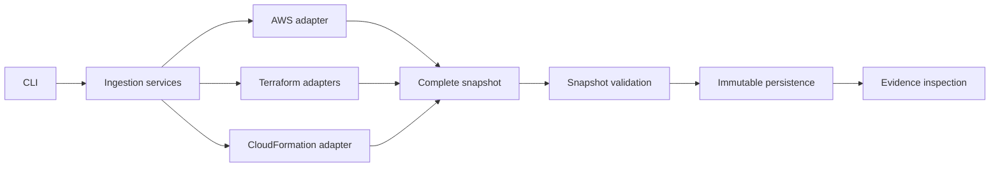
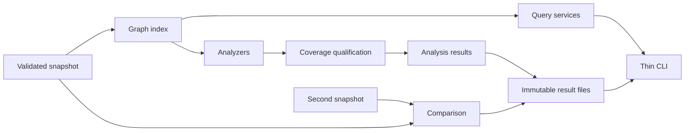

# Archdiscov implementation plan

This plan follows the four delivery increments in [README.md](README.md) and adds a fifth. Phases 1–4 and the cloud-platform foundation bridge 22.1–22.4 are complete. Phase 5, an MCP server over the phase 4 assistant tools (steps 45–48), is planned below.

The completed first milestone is a complete offline workflow:

**Load a mock snapshot → validate it → save it → inspect its evidence through the CLI.**

This establishes the contracts that discovery, analysis, and the assistant will depend on. Phase 2 has extended those contracts and delivered regional EC2/network, ALB/NLB, ECS, Lambda, RDS/Aurora, SQS, and account-wide IAM collection, including whole-supported-architecture async orchestration, plus offline Terraform state-export, plan, and CloudFormation JSON/YAML import through Python services and explicit CLI formats. Consolidated permissions, setup, supported boundaries, and offline host/container acceptance complete phase 2. Phase 3 delivered graph indexing, queries, five deterministic analyzers, immutable result persistence, and snapshot comparisons, closed by offline host and container acceptance.

## Current starting point

The existing code in [src/archdiscov/models/architecture.py](src/archdiscov/models/architecture.py) provides recursive resource models, a discriminated resource union, validated account/region containment, local/external/unresolved dependencies, fact-level evidence citations, and operation coverage. Dedicated resource models cover EC2/network, IAM, ELBv2, ECS, Lambda, RDS/Aurora, and SQS configuration; other types can use `UnknownResource`.

The installable package, Docker development environment, detached snapshot validation, immutable persistence, evidence inspection, offline `ingest`/`evidence` CLI, and minimal `Finding`/`Answer` contracts are implemented and verified. Models use package-relative imports. AWS discovery supports the documented regional service slices and account-wide IAM configuration through `collect`; Terraform state exports/plans and CloudFormation templates can be imported through Python services and explicit `ingest --format` selection. The five analyzers and snapshot comparison are implemented (phase 3), and the assistant answers through the `ask` command with the fake, Anthropic, OpenAI-compatible, and Bedrock providers, with evaluation suites and commands (phase 4). The historical phase 1 strict-reference rules below remain accurate for schema `1`; their versioned extension was delivered in step 10 (schema `2`).

## 1. Models, snapshots, fixtures, and CLI foundation

### Step 1: Establish the package structure and development workflow

**Status:** Implemented. The `src/archdiscov` package separates models, ingestion, services, and CLI presentation. The CLI exposes help/version output through the installed `archdiscov` command and `python -m archdiscov`. Typer, packaging metadata, pytest/Ruff configuration, and development instructions are in place. Packaging tests verify imports and CLI execution from outside the repository. The existing MCP dependency is retained pending the open question below.

Set up an installable application package, a CLI entry point, and clear boundaries between models, ingestion, application services, and presentation.

Start with a small structure; add graph, analysis, and provider modules when their implementations arrive. Fix the enum import so model imports work through the installed package.

Keep Python 3.13 and uv. Add Typer now; add PyYAML when template ingestion begins. Configure pytest and Ruff, and replace the placeholder project description.

**Advice:** Verify imports and CLI execution from outside the repository directory. This catches packaging problems that running files directly can conceal.

**Open question:** The dependencies include `mcp`, but the README describes an internal tool interface and CLI. Is an MCP server intended? If so, treat it as a later interface unless it is a release requirement.

### Step 2: Add a reproducible Docker development environment

**Status:** Implemented and validated on Linux. The development image uses Python 3.13, uv 0.5.29, frozen lockfile installation, and a non-root user with configurable UID/GID. Compose mounts the checkout and a dependency cache; `/opt/venv` keeps container dependencies separate from the host environment. Image builds, Compose configuration, CLI execution, pytest, Ruff, network-isolated tests, live source visibility, writable cache/environment directories, and host file ownership checks passed. Runtime credential setup and Docker Desktop usage are documented; external credentials and other host platforms were not exercised. Devcontainer integration remains deferred.

Create the container files early so subsequent implementation can use a consistent Python and dependency environment:

- `Dockerfile` with a development target using Python 3.13, a pinned uv version, and development dependencies installed from `uv.lock` with frozen resolution.
- `compose.yaml` with a development service for an interactive shell, CLI commands, pytest, and Ruff. The CLI does not need a continuously running application server or exposed ports.
- `.dockerignore` excluding host virtual environments, Git data, IDE files, local credentials, and generated snapshots from the build context.

Bind-mount the source for immediate feedback, and keep the container virtual environment separate from the host `.venv`. Cache dependency downloads and install dependencies in a separate build layer so ordinary source edits do not trigger a complete reinstall. Run as a non-root user and arrange writable cache, environment, and output directories; account for host UID/GID where necessary to avoid root-owned files.

Document commands to build the environment, open a shell, run checks, and execute the CLI once it is available. Explain when changes to `pyproject.toml` or `uv.lock` require dependency synchronization or rebuilding. Maintain the same uv workflow for developers running directly on the host.

Plan an opt-in AWS credential setup for the collection increment: mount the required AWS configuration and credentials at runtime, read-only where supported, and select an explicit profile. Authenticate on the host for SSO workflows where practical. Pass provider credentials at runtime when provider integration arrives. Keep credentials out of images and committed configuration.

**Advice:** Start with one development image and one Compose service. Botocore Stubber and local fixtures cover the planned normal tests; add service containers only when a concrete integration needs them. A production image can be designed when deployment requirements are known.

**Acceptance check:** A clean checkout can build the environment and run the available checks; source edits appear immediately, and generated files have usable host permissions. Dependency installation may require network access, but the normal test suite must not require AWS or provider credentials or network calls.

**Open questions:**

- Which developer environments must be supported: Linux, Windows/WSL, macOS, or all three? This affects mounts and file permissions.
- Is Compose sufficient, or should a `.devcontainer` configuration also be provided for IDE integration?
- Which AWS authentication methods must work in the container: named profiles, SSO, configured assume-role access, or an external credential process? Credential processes may require additional runtime tooling.

### Step 3: Settle the snapshot contract

**Status:** Implemented. Schema `1` requires an explicit snapshot UUID, timezone-aware collection start/end, one discriminated source, and requested regional/account-wide coverage scope. Typed sources distinguish AWS observations, Terraform state, Terraform plans, CloudFormation declarations, and mock inputs; optional source export time and source-specific provenance are retained. Resource identities preserve physical IDs and logical addresses and derive stable, snapshot-independent IDs. Unsupported/missing schema versions are rejected without migration. Three representative JSON examples and contract tests cover round trips, invalid inputs, and identity stability. The README documents the contract and explicit IaC account/region requirements. Operation-level coverage and evidence remain Step 4; snapshot-wide integrity remains Step 5.

Extend `ArchitectureSnapshot` with explicit snapshot identity, timestamps, source information, and coverage. Distinguish live observations, Terraform state, Terraform plans, and CloudFormation declarations using validated fields.

Define how account-wide collection is represented and how source-specific metadata is retained. Establish handling for unsupported schema versions.

Define stable resource identity separately from snapshot identity. Preserve physical identifiers and IaC logical addresses so later comparisons have reliable matching inputs.

**Advice:** Write two or three representative JSON examples first, then refine the models against them. Do not leave fields that affect analysis hidden in generic `metadata`.

**Open questions:**

- Can one snapshot contain multiple source kinds, or should each source produce a separate snapshot? Separate snapshots are the simpler starting point and fit explicit comparison.
- How will account and region be supplied for IaC files that do not identify them?
- Should snapshot timestamps describe collection start/end, source export time, or both? Both are useful when available.

### Step 4: Complete evidence and coverage modeling together

**Status:** Implemented. Evidence requires snapshot/resource context and retains source paths; resource-relative JSON Pointer fact citations identify individual fields or rules without wrapping every field. Operation coverage distinguishes successful zero results, failures, skipped, unsupported, and incomplete collection, with validated scope, timestamps, retained counts, failures, and unresolved-value locations. Shared sanitization covers generic attributes/metadata and evidence values, with explicit redacted, omitted, and unresolved evidence states. The security-group/failed-route-table fixture and model tests demonstrate qualified evidence and missing coverage. README documents the chosen policies and adapter responsibilities; snapshot-wide reference integrity remains step 5.

The current `Evidence` model records source, locator, configuration path, and value. Add the resource and snapshot context required by the README, and decide how individual facts refer to evidence.

Resource-level evidence lists alone are too broad for conclusions such as “this rule permits this port.” Establish a way to associate a specific field or rule with its evidence without immediately wrapping every model field.

Define coverage records by account, region, service, and operation. They must distinguish successful collection with zero results from failed, skipped, unsupported, or incomplete collection. Retain timestamps, failures, and unresolved values.

**Advice:** Design this around one worked example: a security-group rule collected successfully while route-table collection fails. The resulting snapshot must support a qualified conclusion and explain the missing evidence.

**Open questions:**

- Should fact references use normalized model paths, source configuration paths, or both?
- Which sensitive fields must be excluded? Establish a shared sanitization policy before storing generic attributes or evidence values.
- Can evidence values be omitted after sanitization, and how will that limitation be recorded?

### Step 5: Strengthen resource and relationship validation

**Status:** Implemented and verified. A separate snapshot integrity pass indexes all recursive
regional/global resource trees, rejects duplicate IDs with storage locations, and enforces
snapshot account and enclosing-region scope. Names are optional without changing stable IDs;
nested subtype fields survive JSON round trips. Every evidence record belongs to this
snapshot and a stored resource; resource/fact citations resolve to owner-matched evidence,
and fact JSON Pointers resolve to existing JSON-mode values. Supplied coverage resource
references must exist locally. Dependencies require local endpoints, source-region grouping,
and source-owned evidence. The hierarchy fixture and isolated diagnostic tests cover these
rules. All 405 offline tests and Ruff lint/format and whitespace checks passed. Schema remains
`1`; external/cross-account/unresolved relationship representations are explicitly deferred.

Retain the recursive `children` model and discriminated union. Confirm that nested subtype fields survive JSON round trips.

Establish these snapshot-wide rules:

- Every resource is stored once and has a unique identity, matching the snapshot account and enclosing region.
- Attachments and other relationships use dependencies.
- Evidence references resolve within the selected snapshot and belong to the citing resource; fact pointers identify existing values.
- Dependencies are grouped by the source resource’s region, including `global`.
- Both dependency endpoints must exist locally; missing, external, and cross-account targets are rejected for now.

Keep AWS-specific placement decisions in ingestion adapters, consistent with the README’s generic containment model.

The existing `UnknownResource` uses `resource_type="unknown"` plus `aws_resource_type`. A previously unseen discriminator will therefore need explicit normalization into this representation; the union will not automatically accept it.

**Advice:** Separate ordinary field validation from a snapshot integrity pass. Reference checks become much clearer when the full snapshot is available.

**Decisions and deferred work:**

- Resource names may be absent or null; IDs remain independent of names.
- Explicit external/cross-account/unresolved dependency representations are deferred.
- Unresolved-parent placement and unsupported-type normalization belong in ingestion adapters; no parents or attachments are synthesized by snapshot validation.

### Step 6: Implement immutable snapshot persistence

**Status:** Implemented and verified. Public `validate_snapshot`, `load_snapshot`, and
`save_snapshot` services revalidate detached current data, load UTF-8 JSON, and save
sanitized normalized snapshots through synced same-directory temporary files and atomic
no-overwrite hard-link publication. Existing files, directories, and symlinks are conflicts;
publication is the commit point, with best-effort cleanup that cannot report a committed
save as failed. Typed diagnostics distinguish validation, unsupported versions, JSON,
encoding, conflicts, and filesystem failures without exposing raw input values. All five
fixtures round-trip; tests cover mutation, sanitization, concurrent writers, and injected
I/O/cleanup failures. All 462 offline tests, Ruff lint, and formatting checks (excluding
the execution-plan artifacts under `.junie`) passed. Paths select files; loaded models
remain mutable, UUID directory-wide uniqueness is not promised, and CLI ingestion remains
step 8. Parent directories must exist and local filesystems must support atomic hard links.

Define application services for loading, validating, and saving local JSON snapshots. Use atomic writes and avoid silently replacing an existing snapshot.

Make immutability an explicit storage rule. Pydantic models alone do not ensure that nested dictionaries and lists cannot change.

Handle malformed JSON, invalid model data, and unsupported schema versions with actionable errors. Preserve normalized facts and sanitized evidence across save/load operations.

**Advice:** Begin with explicit file paths. A snapshot registry, database, and migration framework can wait until actual usage requires them.

**Open question:** Should users select snapshots by path or by ID from a configured directory? Paths are sufficient for the first increment.

### Step 7: Create a small fixture set and meaningful model tests

**Status:** Implemented. The five small fixtures cover typed hierarchy, VPC-contained and
global unknown resources, source-evidenced dependencies, logical-only declarations, and
partial collection. Explicit before/after serialization assertions preserve subtype fields,
identities, citations, failure diagnostics, zero-result outcomes, and each incomplete-coverage
limitation. Rejection tests isolate missing failures and reversed timestamps and verify
schema-version diagnostics. Existing integrity and persistence coverage is retained;
unresolved relationships remain deferred. All 464 offline tests, Ruff lint/format checks
(excluding `.junie` artifacts), and whitespace checks passed. Production models and services
are unchanged.

Build fixtures for:

- A VPC → subnet → EC2 hierarchy.
- An account-wide resource and a VPC resource represented through `UnknownResource`.
- A dependency backed by evidence.
- Partial coverage; an unresolved-relationship fixture is deferred until an explicit representation is designed.
- A declared resource with a logical address but no physical identifier.

Test nested serialization, invalid resource discriminators, duplicate identities, evidence integrity, unresolved-reference handling, and schema-version rejection.

**Advice:** Keep fixtures small and understandable by inspection. Each should demonstrate a contract or limitation. These fixtures will become inputs for later analyzer and provider tests.

### Step 8: Deliver the first usable CLI workflow

**Status:** Implemented and verified. Thin Typer `ingest INPUT --output PATH` and
`evidence ID --snapshot PATH` commands use reusable persistence and evidence-inspection
services. Both support readable output and `--json`, including safe structured service
errors and documented exit codes. Ingestion preserves normalized snapshot data and refuses
existing destinations; inspection retains owner/subtype context, provenance, fact citations,
sanitized values, redactions, unavailable-value limitations, and same-region/service coverage
outcomes without claiming completeness. Tests cover all fixture imports, both installed entry
points outside the repository, malformed inputs, missing evidence, sanitization, limitations,
and no-overwrite behavior. All 525 offline tests, Ruff lint/format checks (excluding `.junie`),
and whitespace checks passed. Raw AWS/IaC adapters remain later work; Docker acceptance and
the remaining increment-closing contracts remain step 9. CLI usage errors retain Typer's
readable diagnostics even when `--json` is supplied.

Implement `ingest` for the project’s own snapshot JSON and `evidence` for retrieving a cited record. Support readable output and JSON output, with consistent exit codes.

Keep Typer commands thin: argument parsing and output formatting should call reusable application services.

Evidence output should show the selected snapshot, associated resource, source operation/file, configuration path, sanitized value, and relevant limitations.

**Advice:** Complete this workflow before adding more commands. It gives you an immediately reviewable result without AWS credentials or an LLM.

**Open question:** Should failed validation produce structured JSON errors when JSON output is requested? The recommended default is yes.

### Step 9: Close the increment with acceptance checks and documentation

**Status:** Implemented and verified. Minimal snapshot-scoped `Finding` and `Answer`
models define evidence/finding references, limitations, and `supported`, `partial`, and
`insufficient_evidence` statuses without analyzer-specific fields or provider-authored
conclusions. Shape/status validation is implemented; analyzer semantics and snapshot/tool
citation validation remain later increments. Installed-CLI acceptance tests run outside
the checkout without credential variables, preserve typed children and partial coverage,
inspect evidence, reject invalid references with safe diagnostics, and prove no overwrite.
Locked uv installation and the Docker development image build passed; all 554 tests
passed on the host and in Docker with networking disabled, and Compose acceptance passed.
Ruff lint/format checks (excluding `.junie` artifacts), documentation examples, and whitespace
checks passed. README documents installation, snapshot/fixture/API contracts, commands,
and reproducible host/container acceptance. The first offline increment is complete;
raw ingestion adapters, analyzers, and providers remain future work. Host verification
uses the local `.venv/bin/python`; Docker retains its separate `/opt/venv` environment.

Demonstrate that a user can install the project, import a fixture, inspect its evidence, and receive clear errors for invalid references. Verify the workflow both directly with uv and through the Docker development environment. Confirm that saved snapshots preserve typed children and coverage information.

Document installation, the snapshot contract, fixture usage, and supported commands. Define minimal `Finding` and `Answer` contracts now, particularly their evidence references, limitations, and statuses; defer analyzer-specific details.

**Completion criterion:** The offline workflow works, normal tests require no credentials or network access, and the snapshot/evidence contracts are stable enough for ingestion adapters to target.

## 2. AWS and infrastructure-as-code ingestion

**Phase 2 milestone:** Collect configured AWS accounts or import an IaC export → normalize and validate a source-specific snapshot → save without overwrite → inspect evidence and limitations.

Each snapshot remains one account and one source kind. Multi-account collection produces separate snapshots, not a merged account tree. Analysis, effective IAM evaluation, graph queries, comparisons, providers, and infrastructure execution remain out of scope.

Steps 10–22 are implemented, including all-supported-services collection with enabled-region discovery and bounded async orchestration around synchronous boto3 collectors, offline Terraform state-export, plan, and CloudFormation import through explicit CLI formats, and phase-closing permissions and offline acceptance; selective service collection remains available. Whole-architecture completeness is limited to the documented supported configuration inventory, not every AWS service.

### Step 10: Extend ingestion-facing snapshot contracts

**Status:** Implemented and verified (580 offline tests). `LocalTarget`, `ExternalTarget`, and `UnresolvedTarget` dependency targets, schema `"1"`/`"2"` support with schema `1` strict-reference loading retained, `ResourceLifecycle` (schema `2`, Terraform plans only), and the `tests/fixtures/snapshots/dependency-targets.json` fixture are in place.

Define discriminated local, external, and unresolved dependency targets before collecting relationships. Local targets must resolve to stored resources; external targets retain known identifiers/account context; unresolved targets require a sanitized reason and source location. All variants require a stored source, source-region grouping, and source-owned evidence. Never invent target resources or parents.

Use a versioned schema change for new relationship and IaC lifecycle fields. Plan schema `2` for new output while retaining schema `1` loading and its strict-reference semantics; specify any in-memory conversion and never rewrite historical files implicitly. Retain unknown AWS types through `UnknownResource` until a dedicated model is warranted. Known-null and unavailable values must remain distinguishable.

**Advice:** Design small local, cross-account, and unresolved-target fixtures first. Do not encode semantic contracts only in generic metadata.

**Acceptance check:** Old fixtures remain readable; new variants round-trip; malformed variants, dangling local endpoints, and invalid citations are rejected. Version diagnostics stay safe and actionable.

### Step 11: Establish adapter boundaries and configured AWS execution

**Status:** Implemented and verified (633 offline tests). `ingestion/requests.py` defines `SourceRequest`, `AwsCollectionRequest`, and strictly validated `AwsAccountConfig`; `ingestion/adapter.py` defines `SnapshotAdapter`, `AdapterContext` (clock, UUID, session seams), and `IngestionError`; `ingestion/aws.py` provides profile/assume-role sessions, STS identity verification, the operation allowlist, and the bounded `OperationRunner`; `services/ingestion.py` selects adapters and validates results. Adapters return one snapshot per configured account. The adapter currently returns a coverage-only skeleton; resource collection and the `collect` command are step 12.

Define typed source requests and an adapter interface returning a complete `ArchitectureSnapshot`. Share utilities for identity, evidence allocation, sanitization, containment, and relationship resolution without introducing a normalized-batch assembly service. Application services select adapters, coordinate work, validate results, and call existing persistence.

Define explicit account configurations using named profiles and optional configured assume-role access, expected account IDs, regions, service selection, bounded concurrency, SDK timeouts, and retries. Use STS to verify identity before resource collection; reject mismatched accounts. Never follow discovered trust principals into additional accounts. Establish the operation allowlist before issuing calls.

Create injected session/client and clock/UUID seams for offline tests. Aggregate paginated outcomes by account/region/service/operation, retaining results when later pages or per-resource detail calls fail. Distinguish failed, incomplete, skipped, unsupported, and successful-zero outcomes. Avoid duplicate aggregate coverage records.

**Advice:** Start with a small request model and shared operation runner, not a plugin framework. Account identity failure must not produce a misleading successful snapshot.

**Acceptance check:** Stubbed identity, account mismatch, profile/role configuration, pagination, exhausted retries, bounded execution, and partial-page preservation behave predictably without real credentials.

### Step 12: Deliver VPC/subnet/EC2 collection end to end

**Status:** Implemented and verified (646 offline tests). `ingestion/ec2.py` normalizes VPCs, subnets, and instances with whole-item and per-fact evidence, VPC → subnet → instance containment, and explicit `unresolved_parent` attributes; `AwsAdapter` collects them per region with per-operation coverage; `collect_and_save` and the thin `collect` command write one new file per account and report partial results. Tag values under secret-named keys are redacted. Other selected services have no collection or coverage yet.

Implement the first complete AWS snapshot using STS plus VPC, subnet, and EC2 operations. Normalize stable physical identities, names, tags, CIDRs, availability zones, and instance configuration with exact source evidence and normalized fact citations. Build VPC → subnet → EC2 containment where supported by observed configuration.

When a parent is unavailable, store the resource once at the appropriate regional root and explain the missing context; do not synthesize parents. Validate the complete snapshot before saving.

Expose a thin `collect` command around reusable collection services. Provide readable/JSON summaries and explicit new output paths. For multiple configured accounts, require distinct destinations and report per-account outcomes without overwriting files or hiding partial failures.

**Advice:** Make this narrow slice usable before expanding the service inventory.

**Acceptance check:** A stubbed collection can be saved and inspected through `evidence`; zero results and mid-collection failure remain distinguishable; multi-account output stays isolated; existing destinations are untouched.

### Step 13: Complete network configuration and attachment evidence

**Status:** Implemented and verified (691 offline tests). Dedicated `RouteTable`, `InternetGateway`, `NetworkAcl`, `SecurityGroup`, and `NetworkInterface` models carry typed routes, rules, entries, and addressing with per-entry fact citations. `ingestion/network/` places them under the VPC/subnet and builds `attached_to` dependencies (kinds in `AttachmentKind`) with local, external, or unresolved targets; the adapter emits schema `"2"`. The fact/relationship-to-operation mapping and permissions are in `docs/network-mapping.md`.

Add route tables and associations, internet gateways, NACLs, security groups/rules, and network interfaces needed to describe EC2 attachments. Retain routes, addressing, ports/protocols, rule references, and association provenance. Store each resource once and express attachments as evidence-backed dependencies rather than duplicated children.

Use explicit external/unresolved targets when referenced resources are outside collection scope or cannot be resolved. Record unavailable parent/detail facts as limitations. Do not derive internet-exposure conclusions during ingestion.

**Advice:** Publish a mapping from each collected fact and relationship to its supporting operation and source path. Extend the operation allowlist and required read-permission documentation with each service slice in steps 13–16, before issuing its calls; apply step 11's per-operation partial-result policy throughout.

**Acceptance check:** Small fixtures demonstrate attachment resolution, missing network parents, unsupported route targets, security-group references, and successful security-group collection with failed route collection.

### Step 14: Collect account-wide IAM configuration

**Status:** Implemented and verified (830 offline tests). Typed IAM roles, instance profiles, and referenced managed policies are stored once per verified account under `global_resources`, using source-provided IDs. The separate IAM runner aggregates bounded, paginated detail reads and preserves partial inventory and successful results. Sanitized trust, inline-policy, and default-version documents have exact request-context evidence; compute/profile/role/policy and trust references use source-owned citations with local, external, or unresolved targets, without effective-access claims. Repeatable `collect --service` supports IAM-only requests without regions and combined EC2/IAM collection while retaining the EC2 default. Permissions, fact/relationship mappings, coverage, and redaction limitations are documented in [docs/iam-mapping.md](docs/iam-mapping.md). Full pytest, Ruff lint/format (excluding `.junie`), and whitespace checks passed using `.venv/bin/python`; schema `1` remains readable.

Collect IAM roles, instance profiles, attached/inline policies, relevant policy versions, and trust documents once per account, outside regional loops. Store account-wide resources under `global_resources`; resolve compute/profile/role links after resources are collected. Retain trust principals and conditions, including named external accounts and unresolved principals, without expanding wildcard principals into invented identities.

Do not retrieve credentials, secret material, or perform effective-permission evaluation. Extend the allowlist and read-permission documentation as operations are introduced.

**Advice:** Separate observed trust configuration from proof that a principal can actually assume a role.

**Acceptance check:** Two requested regions still trigger only one account-wide collection; policy/detail failures preserve known roles; regional/global and external relationships remain evidence-backed.

### Step 15: Add load-balancer configuration and targets

**Status:** Implemented and verified (945 offline tests). Regional ALB/NLB inventory, listeners, ALB rules, target groups, registered targets and observed health use six allowlisted ELBv2 reads. Typed ARN-identified resources retain exact request/page/fact citations, sanitized configuration, partial coverage, and evidence-backed forwarding/attachment links. IAM and ELBv2 share bounded detail execution while the EC2 runner remains unchanged. `collect --service elasticloadbalancing` works alone or with EC2/IAM; see [load-balancing-mapping.md](docs/load-balancing-mapping.md) for permissions, redactions, and uncertainty boundaries.

Collect ALB/NLB configuration, listeners, listener rules, target groups, and target configuration/status needed to connect the architecture. Preserve schemes, subnets, security groups, ports/protocols, forwarding actions, and target identities. Normalize supported `forwards_to` and attachment relationships, retaining unresolved IP or unavailable targets explicitly.

**Advice:** Evidence should identify the specific listener action or target entry, not merely the load balancer.

**Acceptance check:** Stubbed pagination and per-load-balancer detail failures preserve complete portions; forwarding relationships resolve or explain their unavailable endpoints. No reachability claims are produced.

### Step 16: Add compute, database, and queue configuration

**Status:** Implemented and verified (1,112 offline tests). Focused service-local modules
collect ECS clusters/services/running tasks and referenced task definitions, Lambda
configuration, RDS/Aurora instances/clusters/subnet groups, and SQS configuration/policies.
Typed resources retain exact request/page/fact evidence and observed network, role,
database-cluster/subnet-group, and dead-letter references with local/external/unresolved
targets. Shared bounded execution supports service-specific pagination and partial results;
all reads are allowlisted. Safe source projections exclude environment values, commands,
code, credentials, queue messages, and database contents before evidence construction.
`collect --service` supports each service independently or in combination, preserving
EC2 defaults and immutable persistence. Service mappings and permissions are documented
in `docs/ecs-mapping.md`, `docs/lambda-mapping.md`, `docs/rds-mapping.md`, and
`docs/sqs-mapping.md`. Full pytest, Ruff lint/format (excluding `.junie`), and whitespace
checks passed using the local `.venv/bin/python`; no credentials or network were used.
ECS task inventory is explicitly limited to desired-running tasks; no effective-access
or reachability conclusions are produced.

Expand in small service-local slices: ECS clusters/services/tasks and relevant task-definition configuration; Lambda configuration; RDS/Aurora instances/clusters; and SQS queue configuration/policies. Retain networking, execution/task role references, database endpoints/ports, queue policies, and relevant lifecycle/configuration facts.

Select safe fields before persistence. Never collect workload contents, queue messages, function code, secret values, or database contents. Review environment variables and other sensitive configuration rather than relying exclusively on generic key-name sanitization. Keep unsupported resources explicit and relationships evidence-backed.

**Advice:** Finish each service's mapping, coverage, redaction, and tests before moving to the next.

**Acceptance check:** Each service has paginated/detail-failure cases, exact fact citations, and secret-exclusion assertions. Collection remains bounded and allowlisted.

### Step 17: Collect whole supported architectures with bounded async orchestration

**Status:** Implemented and verified (1,292 offline tests). All seven substeps
deliver typed scope/limits, verified enabled-region discovery, shared SDK budgets,
isolated deterministic assembly, bounded async scheduling, cancellation-safe
collection/persistence, and CLI controls. `collect --all-services` selects all seven
supported families across configured accounts and enabled regions, with explicit
overrides and qualified scope summaries. Selective defaults, account isolation,
source-owned evidence, secret exclusion, and immutable destinations are preserved.
Full pytest, Ruff lint/format (excluding `.junie`), and whitespace checks passed
using `.venv/bin/python`; no credentials or network were used. See
[whole-architecture collection](docs/collection-scope.md).

Deliver the following ordered substeps independently, implementing and verifying one before proceeding. Keep the parent planned/in progress until all seven acceptance checks pass. Collect the supported configuration inventory—EC2/network, IAM, ELBv2, ECS, Lambda, RDS/Aurora, and SQS—for explicitly configured accounts. “Entire architecture” does not mean every AWS service, effective access, reachability, or a transactionally consistent AWS snapshot; completeness is relative to the resolved supported scope.

Preserve the complete-snapshot adapter boundary and schema `"2"`: async services coordinate thread-backed synchronous boto3 collectors, while the AWS adapter owns deterministic account assembly. Keep scheduling, scope discovery, and concurrency primitives in focused ingestion modules, `aws.py` limited to adapter composition, `services/ingestion.py` to workflow coordination, and `cli.py` to options/presentation. Reuse `AwsService`, `AwsRegion`, coverage/status and operation enums; add named scope/discovery enums only for real contracts. Never discover or enter additional accounts through trust relationships.

#### Step 17.1: Define whole-architecture scope and execution limits

**Status:** Implemented and verified (1,158 offline tests). Typed account requests
support all-service selection and explicit/enabled region scope while retaining
selective defaults and IAM-only behavior. Strict run-wide/account SDK-call limits
and active-account/collector-job limits are defined; execution enforcement remains
step 17.3 and scheduling remains step 17.5. `ingestion/scope.py` defines validated,
credential-free resolved scope for existing snapshot metadata without a schema
change. Request/provenance tests, full pytest, and Ruff checks passed using
`.venv/bin/python`; no discovery, scheduling, or CLI changes were introduced.
See [the scope and limit contracts](docs/collection-scope.md).

- Extend typed requests in `ingestion/requests.py` with all-supported-services selection, discovery versus explicit region scope, and validated run-wide/per-account call limits plus active-account/collector-job limits.
- Reuse the enum-backed `COLLECTABLE_SERVICES` definition for all seven service families. Reject all-services plus explicit service selections; preserve EC2 defaults, selective requests, and IAM-only behavior.
- Define resolved-scope data carried into snapshot provenance using existing contracts; avoid a scheduling-only schema bump. Keep configured account/profile isolation and distinct output paths unchanged.

**Advice:** Establish contracts first without changing execution or exposing a CLI option that cannot yet work.

**Acceptance check:** Request tests cover mode conflicts, defaults, invalid limits, explicit overrides, and compatibility with existing selective requests. No AWS calls or scheduling changes are introduced.

#### Step 17.2: Resolve enabled regions for verified accounts

**Status:** Implemented and verified (1,199 offline tests). Focused region-scope
resolution runs allowlisted `DescribeRegions` after STS verification, retains
enabled regions and credential-free scope diagnostics, and bypasses discovery
for explicit regions. Bootstrap/authentication endpoints respect configured,
profile, and verified partition context; ambiguous scope, discovery denial, and
unsupported enabled regions raise safe account-level errors without publishing
empty snapshots. SDK-unavailable regional services have per-operation
`unsupported` coverage while successful siblings remain collected. Stubber/fake,
authentication, persistence, and collector regression tests, full pytest, and
Ruff checks passed using `.venv/bin/python`. No shared budgets, async scheduling,
or CLI discovery controls were introduced. **Prerequisite:** Step 17.1.
See [scope discovery and regional availability](docs/collection-scope.md).

- Add a focused region-scope module and allowlisted `DescribeRegions` operation in `ingestion/operations.py`; invoke discovery only after STS verification.
- Resolve bootstrap endpoints from explicit/profile/partition context without assuming a commercial endpoint, filter disabled opt-in regions, and bypass discovery for explicit regional scope.
- Retain resolved scope and safe diagnostics. Denial, ambiguous bootstrap, or discovered regions unsupported by `AwsRegion` produce actionable account-level errors rather than silently reduced scans or successful empty snapshots.
- Define how known regional service unavailability is qualified in coverage; unavailable services must not appear as successful zero inventory.

**Advice:** Keep discovery independent of resource normalization and document `ec2:DescribeRegions` permission with this slice.

**Acceptance check:** Stubber/fake tests cover enabled/disabled regions, partitions, explicit overrides, discovery failure, unsupported regions, service availability, and no discovery before identity verification.

#### Step 17.3: Enforce shared SDK-call budgets

**Status:** Implemented and verified (1,219 offline tests). Focused concurrency
primitives atomically reserve shared run-wide and per-account SDK-call capacity
through `AdapterContext`, `OperationRunner`, `DetailRunner`, configured assume-role
authentication, STS identity verification, and enabled-region discovery. Permits
remain held through blocking calls and SDK retries and are released on success
or failure; normalization, persistence, and nested scheduling hold none. Request
limits and one budget survive account persistence subrequests. Synchronization
tests prove overlapping nested pools respect both ceilings, safe failures release
capacity, and pagination/coverage regressions remain unchanged. Full pytest and
Ruff checks passed using `.venv/bin/python`; no credentials or network were used.
Async scheduling, isolated assembly, and CLI controls remain later substeps.
**Prerequisite:** Step 17.1. See [shared SDK-call budgets](docs/collection-scope.md).

- Add focused concurrency primitives and thread them through `AdapterContext`, `OperationRunner`, `DetailRunner`, and identity/discovery execution.
- Bound actual blocking SDK calls with shared run-wide and per-account permits, including nested detail pools; keep permits held through SDK retries until the underlying call returns.
- Release permits on every success/failure path. Never hold them during nested scheduling, normalization, or persistence. Preserve existing SDK timeout/retry settings and runner coverage semantics.

**Advice:** Introduce the budget under current synchronous orchestration before adding async scheduling; use synchronization tests rather than elapsed-time benchmarks.

**Acceptance check:** Concurrent runner tests prove total/account in-flight limits, no permit leaks or deadlocks, and unchanged pagination, retries, retained-page results, safe errors, and coverage counts.

#### Step 17.4: Separate isolated collection from deterministic account assembly

**Status:** Implemented and verified (1,226 offline tests). Focused enum-backed
service/region jobs return owned resources, evidence, coverage, and service-local
dependencies without mutating account trees. `AwsAdapter` collects jobs sequentially,
then assembles copied results in stable order and resolves cross-service links
against complete regional/global inventories using existing helpers. Missing,
duplicate, or unplanned job results are rejected; collected inputs remain unchanged
by assembly or returned snapshot mutations. Fixed clock/UUID tests across all seven
service families and two regions prove reversed/shuffled results preserve containment,
facts, exact citations, coverage ordering, redaction, successful zero results, and
retained pagination/detail failures. Full pytest, Ruff lint/format (excluding `.junie`),
and whitespace checks passed using `.venv/bin/python`; no credentials or network
were used. Async scheduling and CLI controls remain planned for subsequent substeps.
**Prerequisites:** Steps 17.2–17.3. See
[isolated collection and account assembly](docs/collection-scope.md).

- Refactor collector dispatch, including `configuration_services.py`, so service/region work returns isolated results instead of mutating shared resource trees, evidence maps, or dependencies.
- Keep execution sequential initially. Have `AwsAdapter` merge in stable service/region order after collection, then build complete indexes and resolve containment and cross-service links, including compute/network/IAM/ELB references.
- Reuse existing normalizers/resolvers; retain one resource and one operation coverage record per account/region/service/operation scope. Do not create a separate assembly service or invent parents, resources, endpoints, or relationships.

**Advice:** Review this as a behavior-preserving refactor before introducing concurrency.

**Acceptance check:** Combined-service regressions and deliberately reordered result inputs preserve normalized facts, containment, references, exact citations, coverage ordering, redaction, and partial results, including pagination/detail failures and successful-zero versus failed/incomplete outcomes (with clock/UUID seams fixed).

#### Step 17.5: Schedule bounded async account and collector jobs

**Status:** Implemented and verified (1,241 offline tests). A focused async
coordinator bounds active accounts and run-wide collector jobs around thread-backed
synchronous boto3 work, retaining shared SDK-call budgets and ordered account results.
Session factories and account Session/client preparation are serialized without
locking returned clients' API calls; cross-account Session reuse is rejected and
clock/UUID injection remains supported. IAM runs once per account; assembly waits
for isolated jobs and remains independent of completion order. Identity/discovery
errors isolate accounts, retained API failures qualify coverage, and unexpected
collector/validation errors propagate after siblings settle. Barrier/lock-based
tests, full pytest, Ruff lint/format (excluding `.junie`), and whitespace checks
passed using `.venv/bin/python`; no credentials or network were used.
Async persistence/cancellation and CLI controls remain steps 17.6–17.7.
**Prerequisite:** Step 17.4. See
[bounded async scheduling](docs/collection-scope.md).

- Add a focused account-local async coordinator using bounded thread-backed boto3 work; do not add an async AWS SDK dependency.
- Run independent account and service/region jobs concurrently, IAM once per account, respecting both scheduling limits and shared call budgets.
- Preserve dependent collector stages and sequential pagination. Prepare sessions/clients safely, avoiding concurrent boto3 Session mutation and cross-account credential reuse; retain session/client, clock, and UUID injection seams.
- Merge only after each account's selected collector jobs settle. Identity/discovery failure prevents that account's snapshot without stopping others; expected collector/API failures retain qualified siblings. Programming/validation failures must not be converted into successful empty results.

**Advice:** Async workers collect isolated data; the account adapter remains the single assembly owner.

**Acceptance check:** Barrier-based tests demonstrate real overlap, bounded nested calls, IAM single-pass behavior, deterministic completion-order independence, failure isolation, and safe session/client preparation.

#### Step 17.6: Deliver async workflows, sync compatibility, and cancellation

**Status:** Implemented and verified (1,265 offline tests). Public
`collect_snapshots_async` and `collect_and_save_async` services support existing
event loops, request-ordered results, independently validated snapshots, expected
account/save failure isolation, and distinct immutable destinations. Existing
synchronous APIs and injected sync-only adapters remain supported; sync wrappers
reject running-loop misuse actionably before starting work. Cancellation stops
later scheduling and SDK reads and asynchronously drains running threads, including
repeated cancellation, while retaining SDK permits and collector slots until completion.
Unfinished collection publishes nothing; started saves settle through the existing
atomic publication commit point, never overwrite, and preserve all committed
files. Synchronization/publication tests, full pytest, Ruff lint/format (excluding
`.junie`), and whitespace checks passed using `.venv/bin/python`; no credentials
or network were used. CLI scope controls and parent milestone completion remain
step 17.7. **Prerequisite:** Step 17.5. See
[async workflows and cancellation](docs/collection-scope.md).

- Add async collection and collection-to-persistence service APIs with request-ordered account outcomes; retain existing synchronous CLI/Python wrappers and adapter injection compatibility.
- Async APIs work inside an existing event loop. Sync wrappers must fail actionably rather than attempt a nested event loop when misused there.
- On cancellation stop scheduling, let running SDK threads settle under configured timeouts, retain their permits until completion, and publish no unfinished account snapshot.
- Preserve independently validated immutable snapshots and distinct paths. Define the existing atomic publication commit point as the boundary: already committed files remain intact, including a save that commits while cancellation is being handled. Never overwrite destinations.

**Advice:** Do not equate cancelling an await with stopping a thread or rolling back a committed file.

**Acceptance check:** Tests cover async/sync compatibility, ordered outputs, identity isolation, cancellation before/during calls and publication, permit retention, no-overwrite, and committed-file preservation.

#### Step 17.7: Expose all-services collection and verify the milestone

**Status:** Implemented and verified (1,292 offline tests). Thin CLI controls expose
all-service selection, region scope/bootstrap, run/account SDK budgets, active-account
and collector-job limits, and local runner concurrency. A focused presentation
module keeps request parsing and scope summaries out of collector logic. Whole scans
default to enabled-region discovery; explicit regions bypass it, conflicting flags
are rejected before collection, and selective EC2/IAM behavior remains compatible.
Readable/JSON outcomes report resolved supported scope and partial coverage.
Installed-entry-point checks and populated multi-account/multi-region offline journeys
verify all seven families, IAM once per account, retained siblings, exact evidence,
redaction, ordered output mapping, failure isolation, and no overwrite. Full pytest,
Ruff lint/format (excluding `.junie`), documentation, and whitespace checks passed
using `.venv/bin/python`. **Prerequisite:** Step 17.6. See
[CLI controls and supported boundaries](docs/collection-scope.md).

- Add thin `collect --all-services` options/presentation and scope/concurrency controls; reject conflicting service flags and preserve existing selective behavior.
- Default whole-architecture mode to enabled-region discovery, allow explicit overrides, and report resolved scope and qualified partial outcomes in readable/JSON output.
- Document supported inventory boundaries, regional availability, read permissions, limits, potentially expensive or throttled scans, and async/sync APIs; no claim of every AWS service or transactional completeness.
- Add installed-CLI and offline multi-account/multi-region journeys through collection, immutable persistence, and evidence inspection. Mark substeps and the parent implemented only after their corresponding checks pass.

**Advice:** Add the user-facing switch only once the underlying workflow is complete; keep `cli.py` presentation-only and selective collection available for targeted runs.

**Acceptance check:** All seven service families collect without repeated service flags, IAM runs once/account, failures preserve valid siblings with partial summaries, secrets remain excluded, and account/output mapping and no-overwrite hold. Run focused/full offline suites, Ruff, and whitespace checks using `.venv/bin/python`, injected clients, and Botocore Stubber; no credentials/network required.

### Step 18: Import Terraform state exports

**Status:** Implemented and verified (1,433 offline tests). Focused modules under
`ingestion/terraform/` parse public `terraform show -json` state exports, resolve
unambiguous account/region context, preserve nested logical addresses and physical
IDs, and construct complete schema `2` snapshots through the existing sync/async
service APIs. Recursive sensitivity masks run before normalization; allowlisted
facts carry exact file JSON-pointer evidence, unsupported types retain safe unknown
summaries, and missing references or unavailable details qualify coverage. Persistence
round trips, immutable destinations, context conflicts, malformed exports, redaction,
and absence of provider/network/execution calls are tested. Full pytest, Ruff
lint/format (excluding `.junie`), and whitespace checks passed using `.venv/bin/python`.
The documented initial mapping covers core EC2/network and IAM identity/configuration
facts; complex rules/routes/policy documents and other types remain explicit
limitations, not silently complete imports. See
[Terraform state mapping](docs/terraform-state-mapping.md). Plans and raw-source CLI
selection remain steps 19 and 21 respectively.

Accept state JSON produced by `terraform show -json`, validate supported input format versions, and recursively walk root/child modules. Require supplied account/region context when it cannot be established safely; reject conflicting or mixed-account input rather than silently selecting one context.

Map supported types, preserve full module/resource addresses and physical IDs where present, and retain unsupported summaries as unknown resources with limitations. Use source-file/configuration paths for evidence. Honor Terraform sensitive markers in addition to shared sanitization; do not execute Terraform or contact providers. Only infer relationships supported by exported facts.

**Advice:** Keep state import separate from Terraform backend/internal state-file handling.

**Acceptance check:** Local exports cover nested modules, logical/physical identity, sensitive marked values, unsupported types, incompatible formats, and missing context. Import and persistence require no network calls.

### Step 19: Import Terraform plans with uncertainty and actions

**Status:** Implemented and verified (1,607 offline tests). The separate
`TerraformPlanRequest`/`TerraformPlanAdapter` imports public plan exports through
the existing sync/async services, reusing state mappings, scope validation, evidence,
and immutable persistence. Exact ordered actions and explicit before/after value
scope preserve deletions and both replacement orders without merging prior values
into planned facts. Recursive unknown/sensitive masks run before mapping; unknown
facts have unresolved mask evidence and coverage rather than invented values or
dangling fact citations. Lists containing unknown descendants are conservatively
omitted without remapping indexes. Configuration references resolve only to uniquely
stored after resources; variables, dynamic expressions, and missing targets remain
unresolved. Errored plans fail safely, and deferred/incomplete plans retain qualified
coverage. Focused fixtures and regression tests, full pytest, Ruff lint/format
(excluding `.junie`), and whitespace checks passed using `.venv/bin/python`;
no credentials, Terraform execution, provider contact, or network were used.
See [Terraform plan mapping](docs/terraform-plan-mapping.md). Raw-source CLI
selection remains step 21; complex mapping limitations from step 18 still apply.

Add plan JSON ingestion after state mappings are stable. Preserve planned values, references available in exported configuration, unknown-value masks, sensitive masks, and create/update/delete/replacement action sequences through explicit lifecycle contracts defined in step 10.

Represent deleted resources and before/after scope deliberately; do not mislabel proposed configuration as observed state. Unknown facts use unresolved evidence/coverage rather than fabricated values. A fact citation must still point to a stored normalized field or rule.

**Advice:** A missing, unknown, and explicit-null value are different cases; replacement actions are not a simple update.

**Acceptance check:** Fixtures cover create, update, delete, replacement, nested unknowns, sensitive values, and unresolved references while retaining exact logical addresses and action order.

### Step 20: Import CloudFormation JSON/YAML safely

**Status:** Implemented and verified (1,935 offline tests). Focused modules under
`ingestion/cloudformation/` import bounded JSON/YAML declarations with explicit account,
region, stack context, parameters, and sensitive source paths. Restricted PyYAML parsing
rejects arbitrary object tags, duplicate keys, recursive aliases, malformed shapes, and
excessive input. Local intrinsic/condition evaluation preserves unknowns and exact source
provenance without fabricating physical IDs. Core EC2 facts use typed resources; other
types retain allowlisted summaries and mapping limitations. Local declaration references
and explicit unresolved imports/missing targets carry source-owned evidence. NoEcho,
sensitive markers, tag-pair redaction, and safe projections exclude protected values;
no nested templates are fetched and no stacks, macros, or arbitrary code are executed.
Sync/async services, immutable persistence, evidence inspection, equivalent JSON/YAML,
and negative/security cases are verified. Full pytest, Ruff lint/format (excluding
`.junie`), and whitespace checks passed using `.venv/bin/python`. See
[CloudFormation mapping](docs/cloudformation-mapping.md) for the supported intrinsic
subset and explicit limitations. Raw-source CLI format selection remains step 21.

Add PyYAML when this adapter begins. Use a safe loader with explicit intrinsic-tag constructors and rejection of arbitrary object construction. Accept supplied parameters and account/region/stack context. Resolve supported literal and local intrinsic expressions with bounded evaluation; preserve unsupported or unavailable expressions as sanitized unresolved evidence and coverage.

Honor `NoEcho` and sensitive source paths. Do not fetch external imports or nested templates automatically. Represent nested stacks as resources; unavailable nested contents and external imports remain explicit limitations/targets. Physical IDs must not be invented from logical IDs. Never deploy stacks or evaluate arbitrary template code.

**Advice:** Publish the supported intrinsic subset and failure/uncertainty rules rather than suggesting full CloudFormation evaluation.

**Acceptance check:** JSON and YAML equivalents normalize consistently; local references, missing parameters, external imports, nested stacks, unsupported intrinsics, malicious tags, and sensitive values have isolated tests.

### Step 21: Extend raw-source CLI ingestion without regressions

**Status:** Implemented and verified (2,104 offline tests). Explicit `ingest --format`
selection exposes snapshot JSON (the backward-compatible default), Terraform state,
Terraform plans, and CloudFormation JSON/YAML through a reusable `ingest_snapshot`
service. Context options reuse existing typed requests and conflict checks; bounded
parameter-file parsing and repeatable sensitive paths support protected template
inputs without inline secret values. Adapters retain source parsing; shared validation
and immutable persistence publish no invalid output and never overwrite destinations.
Readable/JSON summaries preserve snapshot IDs and paths while explicitly qualifying
partial coverage. Both installed entry points run outside the checkout for every
format through persistence and evidence inspection, including safe failures, redaction,
context inference, and no-overwrite checks. Full pytest, Ruff lint/format, documentation
link/example checks, and whitespace checks passed using `.venv/bin/python`;
see [raw-source CLI ingestion](docs/raw-source-ingestion.md). Phase closure is verified in step 22.

Extend `ingest` with explicit format selection for project snapshots, Terraform state, Terraform plans, and CloudFormation, plus required context options. Retain the existing project-JSON workflow as the backward-compatible default; avoid guessing ambiguous source formats.

Keep source parsing in adapters and coordination in services. All sources use shared validation, no-overwrite persistence, readable/JSON presentation, safe diagnostics, and documented exit behavior. Invalid inputs publish no output. Partial collection produces a clearly qualified saved result rather than an unqualified success summary.

**Advice:** Maintain one reusable Python API per workflow so future interfaces need no CLI dependency.

**Acceptance check:** Installed entry points run outside the checkout for every source kind; evidence remains inspectable; malformed/context-invalid imports fail safely; output conflicts preserve bytes.

### Step 22: Close phase 2 with permissions and offline acceptance

**Status:** Implemented and verified (2,128 offline tests). The consolidated
[AWS permissions and setup guide](docs/aws-permissions.md) publishes all 41
allowlisted operations, the 39-action inventory/discovery policy, separate optional
role assumption, resource-scope constraints, profile/SSO/runtime credential setup,
and supported scope/failure boundaries. Policy-parity tests prevent allowlist drift.
README records each supported service's collected facts and explicit limitations,
links source-format/intrinsic contracts, and documents the phase-closing journeys.
New Botocore Stubber acceptance covers real SDK request validation through partial
collection, immutable persistence, and exact evidence inspection; target-variant
acceptance preserves local/external/unresolved identifiers, reasons and citations.
Existing installed-CLI journeys cover every offline source, schema `1` remains
readable, and partial coverage is never reported as complete. All tests passed
using `.venv/bin/python` on the host and `/opt/venv/bin/python` in the rebuilt Docker
image with networking disabled and no credential mounts. Ruff lint/format
(excluding `.junie`), documentation links, and whitespace checks passed. Real AWS
smoke collection remains opt-in and outside normal pytest/CI; no live account
access was used. Graph/analyzer/provider work remains phases 3–4.

Publish the exact operation allowlist, required IAM actions, resource-scope constraints, profile/SSO/assume-role setup, supported regions/formats/intrinsics, configuration examples, and partial-result behavior. Keep credentials out of images, fixtures, and diagnostics; use runtime credential mounts only for opt-in collection.

Add botocore Stubber and local-file acceptance journeys covering source → validated snapshot → immutable persistence → evidence inspection. Run normal tests with no credentials/network, using `.venv/bin/python` on the host and `/opt/venv` in Docker. Keep real AWS smoke checks opt-in and outside normal pytest requirements.

**Advice:** Reuse the installed-CLI journeys in `tests/acceptance/test_offline_acceptance.py` and the isolated fixture-mutation patterns in `tests/models/test_snapshot_integrity.py`; qualify limitations at every stage, not only in the final summary.

**Completion criterion:** All documented source adapters work end to end, the README service inventory has explicit collected facts and limitations, external/unresolved relationships survive persistence, schema `1` remains readable, and partial coverage never masquerades as completeness. Graph/analyzer/provider work remains phases 3–4.

### Phase 2 decisions and deferred boundaries

**Agreed contracts:** Complete-snapshot adapters own source parsing and construction of a source-specific `ArchitectureSnapshot`; shared helpers provide primitives, not a separate normalized-batch assembly layer. Explicit local/external/unresolved dependency targets are introduced through versioned contracts before adapters emit them. These decisions extend rather than retroactively change phase 1's strict schema `1` references.

**Implemented contracts:** Step 10 defines target/lifecycle field shapes and schema compatibility. Step 11 defines typed account/source requests, not a configuration-file loader. Each service slice documents its exact operation/field mapping; step 17 delivers scope discovery and shared async scheduling limits, step 20 documents the bounded intrinsic subset, and step 22 verifies permissions and offline acceptance. Mapping limitations remain explicit rather than promises of full provider semantics.

**Design anchors:** Future adapters belong under `src/archdiscov/ingestion/`, coordination under `src/archdiscov/services/`, contract extensions under `src/archdiscov/models/`, and thin presentation in `src/archdiscov/cli.py`. Reuse `models/sanitization.py`, `services/snapshots.py`, and `services/evidence.py`; boto3 is already a dependency, while PyYAML waits for step 20. Planned scheduling, scope discovery, and shared call budgets belong in focused ingestion modules, preserving the complete-snapshot AWS adapter boundary. These are future implementation locations, not additions in this documentation update.

**Deferred:** No merged multi-account tree, automatic traversal into trusted accounts, Terraform execution, provider contact for IaC imports, stack deployment, external-template fetching, effective IAM evaluation, reachability conclusions, graph queries, comparisons, or LLM providers. Nested-stack contents and external imports remain explicit limitations unless supplied in a later supported workflow.

## Cloud-platform foundation before phase 3

This bridge introduces schema `3` without changing historical AWS schemas `1`–`2`,
AWS stable IDs, or schema `2` collector/importer output. Azure is an offline contract
slice, not live discovery. Cloud platforms are distinct from phase 4 LLM providers.
See [cloud snapshots](docs/cloud-snapshots.md).

### Step 22.1: Cloud scope, identity, and compatibility contracts
**Status:** Implemented and verified; final compatibility acceptance is recorded in step 22.4.
**Prerequisites:** Completed phase 2.

Add AWS account/partition and Azure subscription/tenant scope, discriminated
identities, and typed Azure VNet/subnet/VM models. Preserve AWS constructors,
imports, serialized fields, and stable IDs. Validate ARM subscription, resource
group, namespace, and hierarchical type; preserve original spelling separately
from lowercase physical matching. Logical identifiers remain distinct.

**Advice:** Extend platforms through explicit typed contracts, not fabricated AWS fields.

**Acceptance check:** AWS compatibility, ARM case equivalence, malformed identifiers,
cross-subscription noncollision, provider rejection, and recursive subtype preservation pass.

### Step 22.2: Shared schema-3 integrity and explicit AWS conversion
**Status:** Implemented and verified; final compatibility acceptance is recorded in step 22.4.
**Prerequisites:** Step 22.1.

Introduce `CloudSnapshot` with explicit platform/source format, scope, locations,
scope-wide resources, evidence, coverage, and target context. Reuse typed AWS models
and narrow integrity primitives, including the per-validation fact representation
cache. Unknown resources retain platform/native type without bypassing validation.
External targets keep their own context; never infer their account from the source.
Detached `upgrade_snapshot` preserves UUIDs, IDs, child order, subtype fields,
lifecycle, citations, redactions, dependencies, and coverage without file migration.

**Advice:** Keep provider-specific validation separate from shared integrity.

**Acceptance check:** All legacy fixtures convert without mutation; scope/placement,
duplicate, pointer, citation, endpoint, and lifecycle defects are rejected. Unknown
resources and cross-platform external targets retain explicit context.

### Step 22.3: Offline Azure persistence and evidence workflow
**Status:** Implemented and verified; final compatibility acceptance is recorded in step 22.4.
**Prerequisites:** Step 22.2.

Add the cited VNet → subnet → VM fixture with explicit attachments and successful-zero,
incomplete, and failed coverage. Containment is a fixture choice, not attachment proof.
Public validation, immutable persistence, default snapshot ingestion, and evidence
inspection support schemas `1`–`3`. Coverage matches complete platform/scope/location/
service context; known-null and unavailable facts remain distinct.

**Advice:** Preserve no-overwrite publication and cancellation policy; add no Azure SDK,
authentication, or live collection flags.

**Acceptance check:** Both clouds round-trip through saves/imports; conflicts preserve
bytes, invalid mutations publish nothing, and redaction leaves caller data unchanged.
Installed script/module evidence journeys work outside checkout without credentials/network.

### Step 22.4: Common access boundary and compatibility acceptance
**Status:** Implemented and verified: 2,342 offline tests passed using `.venv/bin/python`.
Ruff lint/format, documentation numbering/links/examples, and whitespace checks passed.
**Prerequisites:** Steps 22.1–22.3.

Expose detached read-only `SnapshotAccess` for scope, resources, containment,
dependencies, evidence, and coverage across supported versions. This is a contract
adapter, not a graph index or assembly layer. Document extension points and align
phase 3 with cloud-qualified identities and provider-specific semantics.

**Advice:** Extend typed contracts explicitly, not through speculative GCP models,
registries, or AWS interpretations of Azure NSGs/RBAC.

**Acceptance check:** Focused/full offline tests, installed journeys, Ruff lint/format
excluding `.junie`, documentation examples/links, and whitespace pass using
`.venv/bin/python`. Live Azure collection and semantic analyzers remain deferred.

## 3. Graph queries, findings, and comparisons

Prerequisite: verified steps 22.1–22.4. Generic graph mechanics, queries, and ownership
signals are cloud-neutral. Steps 27–31 initially implement AWS semantics only;
Azure inputs return an actionable unsupported result rather than applying AWS rules.

The target milestone for phase 3 is:

**Load a saved snapshot → build the graph index → run queries and deterministic analyzers → save immutable, evidence-backed findings → compare two snapshots → inspect results and limitations through the CLI.**

### Agreed decisions
- **Shared graph index:** each validated snapshot gets one read-only index covering containment, dependencies, evidence and coverage. All queries and analyzers go through it.
- **Immutable result files:** findings and comparisons are separate files referencing snapshot UUIDs. The foundation introduces schema `3`; analysis results require no additional snapshot-schema change and reuse atomic no-overwrite publication.
- **Any two snapshots:** a comparison can pair any source kinds (observed, Terraform state or plan, CloudFormation). Source kinds, plan deletions and coverage gaps are labelled explicitly.

### Step 23: Define analysis result contracts and integrity rules
**Status:** Implemented and verified (2,551 offline tests). Focused analysis model
modules define enum-backed analyzer kinds, typed parameters, deterministic finding
IDs, cloud-scoped resource references, ordered containment/dependency paths, and
structured coverage/unresolved-target limitations. The versioned `AnalysisResult`
envelope validates analyzer/parameter agreement, snapshot UUIDs, and unique IDs.
`validate_analysis_result` revalidates detached data and checks exact stored edges,
source-owned citations, path continuity, local resources, and complete coverage
context through `SnapshotAccess` across schemas `1`–`3`. Hand-made ownership and
partial-path fixtures and isolated rejection cases verify safe diagnostics and
round trips without changing legacy `Finding`/`Answer` contracts. Full pytest and
Ruff lint/format checks (excluding `.junie`) passed using `.venv/bin/python`;
documentation examples/links and whitespace checks passed. See
[analysis result contracts](docs/analysis-results.md). Graph indexing, analyzers,
result persistence, and analysis CLI commands remain subsequent steps.

Extend `models/results.py` into analysis contracts in focused modules. Add:
- an enum-backed `AnalyzerKind`;
- stable, deterministic finding IDs;
- cloud-aware resource references carrying platform and scope, without an AWS account assumption;
- ordered path steps, where each step is a dependency or containment edge with its own evidence IDs;
- typed analyzer parameters;
- structured limitations that can cite coverage scopes or unresolved targets.

Add a versioned `AnalysisResult` file contract. It records the snapshot UUID, the analyzer kind and version, the parameters, the creation time, and the findings. Keep the existing `Finding`/`Answer` validation rules and their compatibility.

Add a result-integrity pass against the loaded snapshot. Every resource ID, evidence ID and path edge must resolve within that snapshot. Path evidence must be owned by the edge's source resource. Limitations that reference coverage must point at real coverage records. Mismatched snapshot UUIDs are rejected.

**Advice:** Write two small hand-made result fixtures first: a supported ownership finding and a partial path finding. Do not hide meaning inside free-text summaries.

**Acceptance check:** Valid results round-trip. Dangling resource or evidence IDs, wrong snapshot UUIDs, and broken path edges are rejected with safe diagnostics. Existing `Finding`/`Answer` tests still pass.

### Step 24: Build the read-only snapshot graph index
**Status:** Implemented and verified (2,690 offline tests). Steps 24.1–24.5 deliver
detached cloud-neutral resource, containment, dependency/terminal, evidence, and
complete-context coverage indexes across schemas `1`–`3`. Composed AWS/Azure
acceptance, deterministic ordering, mutation isolation, documentation examples,
and reproducible wide/deep profiling passed without production optimizations.
Full pytest, Ruff lint/format (excluding `.junie`), documentation links, and
whitespace checks passed using `.venv/bin/python`. See the
[complete graph boundary](docs/graph-index.md#composed-graph-boundary) and
[profiling results](docs/graph-index-profile.md). Queries and analyzers remain
steps 25 onward.

Build one shared, read-only, cloud-neutral graph index per analysis run through
`SnapshotAccess`, handling schemas `1`–`3` without AWS-envelope checks in graph code.
The index owns detached, validated data and never mutates the input snapshot or
invents nodes, edges, parents, or evidence. Keep construction in focused modules;
bounded traversal, public query services, and analyzers remain later steps.

All five substeps below have passed their acceptance checks. Their individual
completion records preserve the reviewable progression to this verified boundary.

#### Step 24.1: Establish graph ownership and resource lookup
**Status:** Implemented and verified (2,595 offline tests). The focused `graph/`
package constructs `GraphIndex` through detached, validated `SnapshotAccess`
across schemas `1`–`3`. Private stable-ID and qualified physical-identity indexes
preserve typed regional/scope-wide resources, native unknown types, Azure ARM
canonical matching, and all ambiguous candidates in deterministic order. Public
resource/scope results are detached; input or returned-model mutations cannot
change index state. Logical-only resources remain outside physical lookup.
Full pytest, Ruff lint/format (excluding `.junie`), documentation example/link,
and whitespace checks passed using `.venv/bin/python`. See
[graph resource lookup](docs/graph-index.md). Adjacency, terminals, evidence/coverage
indexes, queries, and analyzers remain later steps.
**Prerequisites:** Steps 22.4 and 23.

- Establish a focused `src/archdiscov/graph/` package and index construction through `SnapshotAccess`, supporting schemas `1`–`3` without AWS-envelope branching in graph code.
- Own detached, validated data; keep internal indexes private and prevent returned mutable models from changing index state. Build once per run, not once per lookup.
- Index stable IDs and platform/scope/native-type-qualified physical identities. Reuse Azure canonical ARM identity and existing AWS identity rules; exclude logical-only resources from physical lookup and retain multiple candidates rather than guessing.

**Advice:** Establish ownership and lookup contracts before adding edges; do not equate a frozen outer object with deeply immutable contents.

**Acceptance check:** AWS legacy/schema-3 and Azure lookups preserve subtype data, distinguish scopes/types, handle ambiguous or absent physical IDs, and remain isolated from mutations to inputs and returned values.

#### Step 24.2: Index explicit containment
**Status:** Implemented and verified (2,612 offline tests). `GraphIndex` indexes
stored parent/child pairs through `SnapshotAccess.containment()` across schemas
`1`–`3`, with deterministic immutable edges, direct parent/child lookups, and
parentless regional/scope-wide roots. Frozen `ContainmentEdge` values remain
structural and uncited; no dependency, missing parent, or attachment is inferred.
Exact AWS/Azure fixtures, scope-wide children, reordered trees, empty lookups,
and input/returned-resource mutation tests verify the boundary. Full pytest,
Ruff lint/format (excluding `.junie`), documentation examples, and whitespace
checks passed using `.venv/bin/python`. See
[graph containment](docs/graph-index.md#explicit-containment). Dependency indexing,
terminals, evidence/coverage indexes, and queries remain later steps.
**Prerequisite:** Step 24.1.

- Add deterministic parent/child adjacency and explicit containment edges using stored `children`, including regional and scope-wide roots.
- Reuse `models/resource_tree.py` and `SnapshotAccess.containment`; never infer attachments or synthesize missing parents.
- Keep containment distinct from dependency edges, preserving structural edges that legitimately have no citations.

**Advice:** Keep tree placement separate from connectivity semantics.

**Acceptance check:** Hierarchy and Azure fixtures have exact parent/child pairs; roots have no invented parent; reverse containment agrees with forward containment and input data remains unchanged.

#### Step 24.3: Index dependencies and terminal targets
**Status:** Implemented and verified (2,634 offline tests). A focused dependency
index provides deterministic forward/reverse lookups filtered by existing
relationship and attachment-kind enums, preserving full attributes, location,
source-owned citations, parallel edges, and identical stored occurrences.
Local targets resolve to stored IDs; edge-specific external/unresolved terminals
retain complete target context and originating edge identity without becoming
resources or acquiring outgoing edges. Public edge/terminal results are detached,
including nested models and dictionaries. AWS schemas `1`–`2`, explicit schema-3
upgrades, Azure, network, IAM, and load-balancing cases verify exact edges,
isolation, filters, cycles, and absence of inferred relationships. Full pytest,
Ruff lint/format (excluding `.junie`), documentation examples/links, and whitespace
checks passed using `.venv/bin/python`. See
[graph dependencies and terminals](docs/graph-index.md#dependencies-and-terminal-targets).
Evidence/coverage indexes and queries remain subsequent steps.
**Prerequisite:** Step 24.2.

- Add deterministic forward/reverse adjacency keyed by existing relationship and attachment-kind enums, preserving attributes and source-owned evidence IDs.
- Retain distinct parallel edges and their separate citation sets; reverse adjacency is a lookup convenience, not a newly asserted relationship.
- Represent local, external, and unresolved targets distinctly. Nonlocal targets are explicit terminals, never fabricated resources; terminal references retain complete context and originating edge identity.

**Advice:** Reuse the source-indexing and citation-set patterns in `services/analysis_integrity.py` without importing its private validation context into graph code.

**Acceptance check:** Network, IAM, load-balancing, and dependency-target fixtures demonstrate exact edges, reverse/forward consistency, parallel-edge preservation, and distinguishable external/unresolved terminals. Dependency cycles can be indexed without traversal or inference.

#### Step 24.4: Index evidence and complete coverage context
**Status:** Implemented and verified (2,673 offline tests). Focused graph evidence
and coverage indexes provide detached lookups by evidence ID, owner, exact fact
pointer, and complete operation context across schemas `1`–`3`. Uncited evidence,
original fact-citation order, redactions, known-null/unavailable values, timestamps,
failures, and all coverage outcomes are retained without inference. Immutable
`CoverageKey` values share analysis integrity's scope matching and canonical Azure
service handling; scope-wide location is explicitly null. Missing coverage remains
distinct from successful zero results. Fixture fidelity, AWS/Azure context, exact
escaped pointers, input/return isolation, and deterministic ordering tests passed.
Full pytest, Ruff lint/format (excluding `.junie`), documentation examples/links,
and whitespace checks passed using `.venv/bin/python`. See
[graph evidence and coverage](docs/graph-index.md#evidence-and-exact-fact-citations).
Parent completion/profiling remains step 24.5; queries and analyzers remain later.
**Prerequisite:** Step 24.3.

- Add evidence lookup by ID, owner resource, and exact resource-relative fact pointer, preserving redactions, known-null values, and unavailable-value status.
- Index coverage by platform, full scope, location, canonical service key, and operation; reuse `models/cloud/context.py::canonical_service_key`.
- Preserve successful-zero, failed, incomplete, skipped, and unsupported records. Distinguish an absent coverage record from an operation that succeeded with zero results; do not infer completeness.

**Advice:** Use step 23's coverage-key pattern and existing citation contracts, not a second interpretation of evidence or coverage.

**Acceptance check:** Partial-coverage and Azure fixtures return precise fact citations and operation outcomes; Azure service casing matches consistently, scope-wide context remains explicit, and missing coverage is distinguishable from recorded success.

#### Step 24.5: Verify and document the complete graph boundary
**Status:** Implemented and verified (2,690 offline tests). Fourteen composed
acceptance cases verify exact inventories, cross-index joins, legacy/schema-3
equivalence, reordered storage, and mutation isolation across hierarchy, network,
IAM, load-balancing, dependency-target, partial-coverage, and Azure fixtures.
The complete API and ordering/isolation boundaries are documented in
[the graph guide](docs/graph-index.md). A standalone
[profiling harness](scripts/profile_graph_index.py) measures construction and
repeated scalar/detached lookups on wide 100/1,000-node and deep 16/64-node
synthetic snapshots; [recorded measurements](docs/graph-index-profile.md) state
methodology and limits without timing gates or speculative optimization.
All 120 focused graph tests, the full offline suite, Ruff lint/format (excluding
`.junie`), executable documentation examples, links, and whitespace checks passed
using `.venv/bin/python`. No production API, graph queries, analyzers, or
dependencies were added. **Prerequisite:** Step 24.4.

- Verify the composed index across AWS hierarchy, network, IAM, load-balancing, dependency-target, and schema-3 Azure fixtures, with schemas `1`–`3` represented.
- Document the graph API, ownership/isolation guarantees, deterministic ordering, identity qualification, terminal semantics, and evidence/coverage lookup behavior.
- Profile representative larger/deeper synthetic snapshots for construction and repeated lookup costs; avoid speculative optimization or brittle timing thresholds.
- Run focused/full offline tests, Ruff lint/format excluding `.junie`, and whitespace/documentation checks using `.venv/bin/python`; mark substeps and parent implemented only after their corresponding acceptance checks pass.

**Advice:** Keep construction/indexing separate from bounded traversal and public query services, which remain step 25.

**Acceptance check:** Exact composed-index contents and isolation checks pass; no nodes, edges, parents, or evidence are invented. Documentation accurately describes the available boundary without claiming queries or analyzers are implemented.

### Step 25: Expose bounded graph queries
**Status:** Implemented and verified (substeps 25.1–25.5).

Deliver reusable, cloud-neutral search, inspection, neighbour, and bounded path
services through the shared `GraphIndex`, with a thin `query` CLI. Preserve
provider-native type and scope context, exact citations, terminal targets, and
coverage/provenance limitations. Phase 4 tools reuse these services, not the CLI.

Implement and verify substeps 25.1–25.5 in order. Keep the parent planned until
every substep's acceptance checks pass; queries retrieve recorded structure,
not analytical conclusions.

#### Step 25.1: Define query contracts and safety boundaries
**Status:** Implemented and verified. **Prerequisite:** Step 24.5.

Typed query requests/results, filters, traversal limits, structured limitations,
edge orientation, truncation reasons, and safe errors are implemented. Matching
and deterministic ordering semantics are documented; query-contract tests, lint,
and formatting checks passed as confirmed by the user. Query execution remains
in substeps 25.2–25.5; parent step 25 remains planned.

- Define typed requests/results for search, inspection, neighbours, and paths, using existing resource identities, relationship/attachment enums, and graph edge identities.
- Specify filter semantics, direction, containment versus dependency selection, deterministic ordering, safe errors, and explicit truncation reasons.
- Retain default traversal depth 3; define validated depth, result, and traversal-work bounds. Align with existing `AnalysisDepth` and `AnalysisResultLimit` constraints where appropriate without coupling queries to analyzer parameters.
- Define structured coverage/provenance limitations, distinguishing unavailable records from successful-zero coverage. Structural containment remains legitimately uncited.

**Advice:** Keep query contracts separate from `AnalysisResult`; queries retrieve recorded structure, not analytical conclusions.

**Acceptance check:** Contract tests reject invalid filters/limits and preserve cloud scope, citations, terminal context, and truncation/limitation data through serialization.

#### Step 25.2: Deliver resource search and inspection services
**Status:** Implemented and verified (2,878 offline tests). Focused query services
search an existing `GraphIndex` by AND-combined native type, exact name, recorded
tag, stable ID, or qualified physical identity, preserving ambiguous candidates
and deterministic result-limit truncation. Inspection retains typed resources,
exact fact citations, all owner evidence, and full-context recorded coverage.
Missing/unavailable tag provenance and limited/missing coverage remain explicit;
successful-zero collection is not mistaken for a limitation. Requests are
revalidated and results remain detached without rebuilding the index. AWS schemas
`1`–`3`, Azure, logical-only identities, ambiguity, safe errors, and isolation are
covered. Full pytest, Ruff lint/format (excluding `.junie`), executable documentation
examples, links, and whitespace checks passed using `.venv/bin/python`. See
[recorded resource queries](docs/graph-queries.md). Neighbours, paths, and the CLI
remain steps 25.3–25.5; parent step 25 remains planned.
**Prerequisite:** Step 25.1.

- Implement resource search by native type, name, recorded tag, or identifier through an existing `GraphIndex`; preserve qualified physical-identity matching and ambiguous candidates.
- Implement stable-ID resource inspection with subtype fields, exact fact citations, provenance, and relevant recorded coverage.
- Make unavailable tag provenance explicit; absence of recorded tags is not proof that a resource has none.
- Preserve detached return values and deterministic limited results without rebuilding the index for each lookup.

**Advice:** Reuse `GraphIndex` resource/evidence/coverage APIs rather than inspecting snapshot envelopes or copying descendant trees repeatedly.

**Acceptance check:** AWS/Azure and schemas 1–3 cover each filter, logical-only identities, ambiguous physical IDs, absent resources, unavailable tags, result truncation, and mutation isolation.

#### Step 25.3: Deliver directional neighbour queries
**Status:** Implemented and verified (2,884 offline tests). `query_neighbours` returns
oriented, deterministically ordered steps over an existing `GraphIndex`, with
relationship/attachment filters, opt-in uncited containment, preserved parallel
edges and stored evidence, terminal limitations, and result-limit truncation.
Full pytest and Ruff lint/format (excluding `.junie`) passed using `.venv/bin/python`.
**Prerequisite:** Step 25.2.

- Expose incoming/outgoing neighbour queries with relationship and attachment-kind filters, plus explicitly selected containment adjacency.
- Preserve stored edge direction, attributes, parallel occurrences, and source-owned evidence even when traversing in reverse.
- Return external/unresolved terminals with limitations; never turn them into stored resources or infer attachments from containment.
- Include relevant coverage limitations without claiming that recorded neighbours are exhaustive.

**Advice:** Use `GraphIndex.outgoing_edges`, `incoming_edges`, `parent_id`, and `child_ids`; reverse lookup does not assert a new relationship.

**Acceptance check:** Exact fixtures verify both directions, filters, parallel edges, uncited containment, terminal handling, deterministic limits, and unchanged index state.

#### Step 25.4: Implement bounded, cycle-safe path traversal
**Status:** Implemented and verified (full offline suite, Ruff lint/format excluding
`.junie`, using `.venv/bin/python`). `query_paths` explores simple structural paths
breadth-first over an existing `GraphIndex`, returning every nonempty prefix
shortest-first in step-key order, with depth/result/work truncation, terminal
limitations, per-path detached steps, and coverage limitations for every resource
reached. Shared oriented adjacency lives in `services/adjacency.py`.
**Prerequisite:** Step 25.3.

- Implement reusable path traversal with the agreed direction and edge-selection contracts, default depth 3, validated maximum depth, and result/work bounds.
- Preserve ordered original edges and their evidence; distinguish traversal direction from the stored relationship direction.
- Stop cycles safely without discarding distinct legitimate paths or parallel-edge occurrences.
- End external/unresolved paths at their terminals with limitations; never follow guessed identities.
- Report depth/result/work truncation explicitly and retain relevant coverage gaps. Structural paths are not reachability or effective-access claims.

**Advice:** Bound expansion as well as returned results; a result limit alone does not bound work on dense cyclic graphs.

**Acceptance check:** Synchronization-free deterministic tests cover cycles, branching, parallel edges, depth boundaries, work/result truncation, missing coverage, and nonlocal terminals without timing thresholds.

#### Step 25.5: Expose the query CLI and verify the complete boundary
**Status:** Implemented and verified (full offline suite, Ruff lint/format excluding
`.junie`, using `.venv/bin/python`). `archdiscov query search|inspect|neighbours|paths`
loads the snapshot and builds the index once per call, with readable and `--json`
output, documented limits, safe errors, and exit codes. Routing is in
`cli_query.py`, presentation in `cli_query_output.py`. Every fixture (schemas
`1`–`3`, AWS, Azure) and installed script/module journeys outside the checkout are
covered. **Prerequisite:** Step 25.4.

- Add a thin `query` CLI for search, inspection, neighbours, and paths with readable/`--json` output, documented limits, safe errors, and exit codes.
- Load and construct the graph once per invocation; keep reusable query services independent of CLI presentation for future phase 4 tools.
- Document matching/filter semantics, direction, citation ownership, coverage uncertainty, truncation, and cloud-neutral boundaries.
- Add installed script/module journeys outside the checkout across AWS/Azure fixtures and supported schemas.
- Run focused/full offline tests, Ruff lint/format excluding `.junie`, documentation examples/links, and whitespace checks using `.venv/bin/python`. Mark each substep and the parent implemented only after their corresponding acceptance checks pass.

**Advice:** Follow `cli.py`’s thin-command pattern and existing focused presentation helpers; keep traversal and formatting out of the main CLI module.

**Acceptance check:** Fixture → query → exact evidence inspection journeys pass without credentials/network. JSON and readable output expose limitations/truncation, detached results cannot mutate the index, and no analyzer or persistence capability is falsely claimed.

### Step 26: Deliver analyzer execution, result persistence, and ownership findings
**Status:** Implemented and verified (substeps 26.1–26.5).

Deliver a small analyzer boundary over the shared `GraphIndex`, one shared
coverage-qualification helper, atomic result persistence, and the ownership
analyzer as the first end-to-end slice, with a thin `analyze` CLI and saved-result
inspection. Reuse the step 23 `AnalysisResult` contracts and integrity pass and the
step 25 query context; do not change legacy `Finding`/`Answer` rules.

Implement and verify substeps 26.1–26.5 in order. Keep the parent planned until
every substep's acceptance checks pass. Findings are ownership signals from
recorded data, not proof that nobody owns a resource.

#### Step 26.1: Define the analyzer protocol and coverage qualification
**Status:** Implemented and verified (full offline suite, Ruff lint/format excluding
`.junie`, using `.venv/bin/python`). `services/analyzers.py` defines the `Analyzer`
protocol, `build_result`, an immutable `AnalyzerRegistry` (empty `DEFAULT_REGISTRY`
until step 26.3), and `run_analyzer`, which validates parameters, checks the result's
snapshot, kind, version, and parameters, and returns a detached copy.
`qualify_status` in `services/analysis_qualification.py` downgrades supported
conclusions to partial and adds one deduplicated limitation per failed, incomplete,
skipped, or unsupported operation; successful-zero is not a limitation, existing
uncertainty is never upgraded, and absent coverage records are not interpreted.
Safe `AnalyzerError` codes cover unsupported analyzers, invalid parameters, and
invalid results. No real analyzer or persistence exists yet.
**Prerequisite:** Step 25.5.

- Define a small analyzer protocol taking a `GraphIndex` and typed `AnalyzerParameters`, returning an `AnalysisResult` bound to the index's snapshot UUID, analyzer kind, and version.
- Add one shared qualification helper that maps relevant coverage to `AnalysisStatus`: failed, incomplete, skipped, or unsupported contexts downgrade a result to partial or insufficient evidence and add structured limitations; successful-zero coverage is not a limitation.
- Reuse the step 25 coverage-context selection (`context_limitations`) rather than duplicating it; keep analyzers independent of query requests and the CLI.
- Provide a deterministic registry from `AnalyzerKind` to analyzer, rejecting kinds without an implementation with a safe error.

**Advice:** Build and test the helper before any analyzer exists so every analyzer interprets coverage identically.

**Acceptance check:** Synthetic analyzers prove each coverage status maps to the expected result status and limitations, deterministic ordering, detached results, and safe errors for unregistered kinds. No real analyzer or persistence is claimed.

#### Step 26.2: Persist and load analysis results atomically
**Status:** Implemented and verified (full offline suite, Ruff lint/format excluding
`.junie`, using `.venv/bin/python`). `save_analysis(result, path, *, snapshot)` publishes
only results that pass snapshot integrity, atomically and without overwriting;
`load_analysis(path, *, snapshot=None)` reads safely and checks the contract, plus
integrity when a snapshot is given. Atomic publication, JSON reading, and snapshot
error types moved from `services/snapshots.py` into `services/publication.py` and
`services/snapshot_errors.py`, shared by snapshots and analyses with unchanged
snapshot behavior. I/O, JSON, and conflict failures reuse the existing snapshot error
types (and so their exit-code categories); validation and integrity failures raise
`AnalysisValidationError`, now carrying the file path. Saved results round-trip against
legacy and schema-3 snapshots; existing destinations, concurrent saves, partial writes,
tampered files, and wrong snapshots are covered.
**Prerequisite:** Step 26.1.

- Add `save_analysis` / `load_analysis` services reusing the atomic, no-overwrite publication and safe-diagnostic patterns from `services/snapshots.py`.
- Validate on save and load with the step 23 contracts; add a load path that checks a result against its snapshot through `validate_analysis_result`.
- Map I/O, JSON, validation, conflict, and integrity failures to existing safe error types and exit-code categories.

**Advice:** Extract shared publication helpers instead of copying snapshot code.

**Acceptance check:** Results round-trip; existing destinations are never overwritten; partial writes leave no destination; malformed, tampered, and wrong-snapshot files are rejected with safe diagnostics that echo no sensitive values.

#### Step 26.3: Implement the cloud-neutral ownership analyzer
**Status:** Implemented and verified (full offline suite, Ruff lint/format excluding
`.junie`, using `.venv/bin/python`). `OwnershipAnalyzer` (`services/ownership.py`) reports
resources whose recorded `attributes.tags` have no non-blank, exactly (case-sensitively)
matching value for any configured key (default `Owner`, `Team`). A missing-tag signal is
supported only when the tag map is cited as present, with those citations; unavailable,
uncited, or non-present tag provenance yields insufficient evidence with a
`tags_unavailable` limitation. Shared qualification downgrades supported signals to
partial for failed, incomplete, skipped, or unsupported coverage. The analyzer never
branches on cloud platform. `run_analyzer` and `DEFAULT_REGISTRY` moved to
`services/analysis_execution.py` to avoid a circular import, and the default registry now
holds the ownership analyzer. Results pass the integrity check for AWS schemas `1`–`3`,
Azure, and coverage-limited snapshots.
**Prerequisite:** Step 26.2.

- Report resources missing every configured ownership key (default `Owner`, `Team`; configurable via `OwnershipParameters`) using recorded tags through common resource access, not AWS-specific collection assumptions.
- Cite exact tag evidence for present keys and for the tag map; when tag provenance is unavailable (reuse `tag_provenance`), report insufficient evidence instead of a missing-tag finding.
- Apply step 26.1 qualification so incomplete coverage yields partial results with limitations.
- Word summaries as ownership signals, not proof that nobody owns the resource; give findings deterministic IDs and stable ordering.

**Advice:** Keep provider tag differences inside resource/tag access; the analyzer must not branch on cloud platform.

**Acceptance check:** AWS and Azure fixtures across schemas `1`–`3` cover default and custom keys, case-sensitive matching, present/missing/empty values, unavailable and redacted tags, incomplete coverage, and results that pass the integrity check against their snapshot.

#### Step 26.4: Expose the analyze CLI and saved-result inspection
**Status:** Implemented and verified (full offline suite, Ruff lint/format excluding
`.junie`, using `.venv/bin/python`). `analyze --snapshot PATH --output PATH` (analyzer
defaults to and currently supports `ownership`; repeatable `--ownership-key`) loads the
snapshot and index once, runs the analyzer, and saves the integrity-checked result;
`findings RESULT --snapshot PATH` reloads it with full verification. Both offer readable
and `--json` output. Routing is in `cli_analysis.py`, presentation in
`cli_analysis_output.py`, and shared diagnostics in `cli_diagnostics.py`. Exit codes follow
existing categories: `1` unreadable files, `2` invalid requests, results, or snapshots
(including unsupported analyzers and mismatched snapshots), `3` existing output. Cited
evidence IDs resolve through the existing `evidence` command.
**Prerequisite:** Step 26.3.

- Add a thin `analyze --analyzer ownership --snapshot PATH --output PATH` command with repeatable `--ownership-key`, readable/`--json` output, safe errors, and exit codes following the existing categories.
- Add a `findings` command (or extend `evidence`) that loads a saved result with its snapshot, verifies integrity, and shows findings, citations, limitations, and status.
- Keep routing in a focused CLI module and presentation in a separate helper, following the `cli_query.py` pattern; load the snapshot and index once per invocation.

**Advice:** Reuse `cli_diagnostics` and the query output limitation formatting.

**Acceptance check:** CliRunner tests cover readable/JSON output, invalid keys, existing output paths, mismatched snapshots, and unknown analyzers, with stable exit codes and no tracebacks.

#### Step 26.5: Verify and document the complete ownership boundary
**Status:** Implemented and verified (full offline suite, Ruff lint/format excluding
`.junie`, documentation links, and whitespace checks, using `.venv/bin/python`).
Installed script and module journeys outside the checkout run
analyze → save → findings → evidence on AWS schemas `1`–`3` and Azure, confirm saved
results validate against their snapshots, and leave existing destinations untouched.
[Ownership analysis](docs/ownership-analysis.md) documents execution, qualification,
persistence, ownership semantics and limits, and CLI usage; README and result-contract
documentation describe only the ownership analyzer.
**Prerequisite:** Step 26.4.

- Add fixture → analyze → save → findings → evidence journeys across AWS and Azure fixtures and supported schemas, including installed script/module runs outside the checkout.
- Document analyzer execution, qualification rules, persistence, ownership semantics and their limits, and CLI usage; update README and status text without claiming other analyzers.
- Run focused/full offline tests, Ruff lint/format excluding `.junie`, documentation examples/links, and whitespace checks using `.venv/bin/python`. Mark each substep and the parent implemented only after their corresponding acceptance checks pass.

**Advice:** Keep documentation precise about what is a recorded signal versus a conclusion.

**Acceptance check:** Credential-free offline journeys pass; saved results validate against their snapshot, existing destinations stay untouched, and documentation accurately describes only the ownership analyzer.

### Step 27: Analyze security-group impact
**Status:** Implemented and verified (substeps 27.1–27.5).

Deliver a security-group impact analyzer over the shared `GraphIndex`, reusing the
step 26 analyzer protocol, coverage qualification, persistence, and CLI patterns.
It is initially AWS-only; Azure returns an actionable unsupported result. For a
selected AWS security group it lists direct attachments (ENIs, instances, load
balancers, ECS, Lambda, RDS) and rule references to and from other groups, then
traces downstream dependencies to the configured depth, returning cited paths.

Direct impact is labelled observed; indirect impact is labelled potential.
Unresolved or external references and failed collection of attaching services become
limitations. Results are recorded structure, not reachability or effective access.

Implement and verify substeps 27.1–27.5 in order. Keep the parent planned until
every substep's acceptance checks pass.

#### Step 27.1: Define the security-group impact result vocabulary
**Status:** Implemented and verified (full offline suite and Ruff lint/format excluding
`.junie`, using `.venv/bin/python`). `AnalysisFinding.impact` (`SecurityGroupImpact`) adds
`ImpactKind` (direct attachment, rule reference, downstream dependency), `ImpactLabel`
(observed/potential, validated against the kind), and rule direction/reference side for
rule references. Labels are part of finding identity; findings without impact keep
their existing IDs (pinned by a test). Envelope and integrity checks require
`security_group_impact` parameters matching the selected group, which must exist and be a
security group when impact findings are present. `UNSUPPORTED_PLATFORM_CODE` and the
`resource_not_found`/`unsupported_resource` analyzer errors cover unsupported clouds and
selections. See [analysis result contracts](docs/analysis-results.md).
**Prerequisite:** Step 26.5.

- Extend the analysis contracts with an observed/potential impact label, a direct-attachment versus rule-reference distinction, and rule direction, keeping `SecurityGroupImpactParameters` (resource, `max_depth`, `result_limit`) as the request.
- Decide how impact kinds map onto `AnalysisFinding` status, resource references, path steps, and limitations without changing the legacy `Finding`/`Answer` contracts or finding-ID stability for existing analyzers.
- Add a safe error/limitation for unsupported platforms and for a selected resource that is not a security group.
- Document the vocabulary and the integrity rules for new fields, including that labels are part of finding identity.

**Advice:** Keep labels in structured fields, not free-text summaries.

**Acceptance check:** Contract tests round-trip every label, reject invalid combinations, and preserve cloud scope, citations, and deterministic IDs; existing analysis tests still pass.

#### Step 27.2: Resolve direct attachments through recorded edges
**Status:** Implemented and verified (full offline suite and Ruff lint/format excluding
`.junie`, using `.venv/bin/python`). `SecurityGroupImpactAnalyzer`
(`services/security_group_impact.py`, not yet registered) lists one observed
`direct_attachment` finding per `security_group_membership` edge into the selected group
(incoming lookups, edges never reversed), citing the stored edge. EC2, ENI, load-balancer,
ECS, Lambda, and RDS attachers are covered by a synthetic schema-2 fixture
(`tests/support/security_group_data.py`); VPC/subnet containment is never an attachment.
Attaching-resource coverage goes through `qualify_status`. A group-level
insufficient-evidence finding reports limited attaching-service coverage per recorded
operation, `coverage_unrecorded_<service>` for services with no recorded collection (no
operation invented), and `result_limit_reached` truncation. Missing groups and
non-groups raise `resource_not_found`/`unsupported_resource`; non-AWS snapshots return an
`unsupported_platform` result. Membership references that cannot be tied to the selected
group are not reported. Shared builders live in `security_group_findings.py`.
**Prerequisite:** Step 27.1.

- Find resources attached to the selected group using `security_group_membership` dependencies (ENIs, instances, load balancers, ECS, Lambda, RDS) through `GraphIndex.incoming_edges`, with their source-owned citations.
- Label each attachment observed; do not infer attachment from VPC or subnet containment, and keep external or unresolved membership targets as limitations.
- Report failed, incomplete, skipped, or unsupported attaching-service coverage through the shared qualification helper, and identify missing ENI/service coverage without inventing operations.
- Return deterministic, bounded results with explicit truncation.

**Advice:** Attachment direction is resource-to-group; use incoming lookups and never reverse stored edges.

**Acceptance check:** Fixtures for each attaching service, an unattached group, a missing group, containment-only placement, and failed attaching-service coverage behave as specified.

#### Step 27.3: Resolve rule references to and from other groups
**Status:** Implemented and verified (full offline suite and Ruff lint/format excluding
`.junie`, using `.venv/bin/python`). `services/security_group_rules.py` turns recorded
`security_group_reference` edges into observed `rule_reference` findings for both sides
(the selected group's rules referencing others, and other groups' rules referencing it),
with ingress/egress taken from the recorded edge, the edge's protocol/port context kept
verbatim, and exact citations. A self-reference is reported once. Cross-account
(external) and unresolved references remain terminals with `external_target` or
`unresolved_target` limitations and no invented resource; prefix-list references are not
groups and are skipped. A reference with no recorded direction becomes a
`rule_direction_unrecorded` group-level limitation, and failed ec2 collection downgrades
rule findings to partial. Nothing evaluates whether traffic is allowed.
**Prerequisite:** Step 27.2.

- Report groups referenced by the selected group's rules and groups whose rules reference it, using recorded `security_group_reference` dependencies and rule data with exact citations.
- Distinguish ingress from egress and preserve referenced account IDs; cross-account references to groups not in the snapshot remain external terminals with limitations, never invented resources.
- Label referencing as observed structure, and add limitations when rule collection is missing or incomplete.
- Keep protocol/port/CIDR context as recorded; do not evaluate whether traffic is actually allowed.

**Advice:** Reuse the existing reference edges; do not reparse rule documents differently.

**Acceptance check:** Same-account, cross-account, external, unresolved, ingress, egress, and self-referencing rule fixtures, plus missing rule coverage, produce cited, correctly labelled results.

#### Step 27.4: Trace potential downstream impact with bounded paths
**Status:** Implemented and verified (full offline suite and Ruff lint/format excluding
`.junie`, using `.venv/bin/python`). `services/security_group_downstream.py` traces
outgoing dependencies (never containment) from each reported attached resource and
referencing group with the shared `query_paths`, to `max_depth`, as `potential`
`downstream_dependency` findings with ordered cited paths, external/unresolved terminal
limitations, and coverage qualification along the traced resources. `QueryPathsRequest`
gained `exclude_resource_ids` (seeded as visited, so excluded resources are never entered
and never reported as truncation) so the selected group is not re-entered. Depth, result,
and work truncation become `depth_limit_reached`, `result_limit_reached`, and
`work_limit_reached` group-level limitations; downstream tracing shares a fixed work
budget. Fixtures cover chains, cycles, parallel edges, depth boundaries, cross-account
ends, and truncation without timing thresholds.
**Prerequisite:** Step 27.3.

- From each directly impacted resource and referencing group, trace dependencies to the configured depth using the step 25 bounded, cycle-safe path traversal, returning ordered cited paths labelled potential.
- Honour `max_depth` and `result_limit`, report depth/result/work truncation explicitly, and end paths at external or unresolved terminals with limitations.
- Keep indirect findings clearly separated from observed direct impact, and qualify results with coverage gaps along the traced resources.

**Advice:** Reuse `query_paths`; do not add a second traversal or treat a path as reachability.

**Acceptance check:** Direct and indirect fixtures, cycles, branching, parallel edges, depth boundaries, cross-account references, and truncation behave deterministically without timing thresholds.

#### Step 27.5: Register, expose, and verify the security-group boundary
**Status:** Implemented and verified (full offline suite, Ruff lint/format excluding
`.junie`, documentation links, and whitespace checks, using `.venv/bin/python`). The
analyzer is registered; `analyze --analyzer security_group_impact` accepts
`--resource-id`, `--max-depth`, and `--result-limit` (options for another analyzer are
rejected as invalid parameters), and `findings` shows each impact's label, kind, and rule
direction/side. Results save atomically and verify against their snapshot. Installed
script and module journeys run analyze → save → findings → evidence on AWS schemas `1`–`3`
and the Azure unsupported case, confirming existing destinations stay untouched.
[Security-group impact analysis](docs/security-group-impact.md) documents semantics,
limits, and CLI usage; README and result-contract docs describe only the ownership and
security-group impact analyzers.
**Prerequisite:** Step 27.4.

- Register the analyzer, add Azure/unsupported-platform behavior, and extend `analyze` with `--analyzer security_group_impact`, `--resource-id`, `--max-depth`, and `--result-limit`; show observed versus potential impact in `findings`.
- Save results through the existing atomic persistence and verify them against their snapshot.
- Add fixture → analyze → save → findings → evidence journeys on AWS schemas `1`–`3` and the Azure unsupported case, including installed script/module runs.
- Document semantics, limits, and CLI usage; update README and status text without claiming other analyzers.
- Run focused/full offline tests, Ruff lint/format excluding `.junie`, documentation links, and whitespace checks using `.venv/bin/python`. Mark each substep and the parent implemented only after their acceptance checks pass.

**Advice:** Keep documentation precise about observed structure versus potential impact.

**Acceptance check:** Credential-free journeys pass; saved results validate against their snapshot, existing destinations stay untouched, and documentation describes only implemented analyzers.

### Step 28: Analyze cross-account trust
**Status:** Implemented and verified (substeps 28.1–28.5).

Deliver a cross-account trust analyzer over the shared `GraphIndex`, reusing the step 26
analyzer protocol, coverage qualification, persistence, and CLI patterns. It is initially
AWS-only; Azure RBAC is not IAM trust and returns an actionable unsupported result.
It extracts AWS role trust principals and supported resource-policy principals
(initially SQS queue policies) and classifies each as: same account; named external
account; service; federated; wildcard; or unresolved.

Conditions and `Deny` / `NotPrincipal` context are kept and the exact statements are
cited. Configured trust permission alone is never reported as effective access, and
conditional trust is reported as conditional.

Role trust principals reuse the recorded IAM `trust_principal` dependencies and
`TrustPrincipalKind`. SQS queue policies have no stored principal edges today, so step
28.2 records them at ingestion with the same sanitization and principal rules, keeping
one source of truth instead of a second document parser in the analyzer.

Implement and verify substeps 28.1–28.5 in order. Keep the parent planned until every
substep's acceptance checks pass.

#### Step 28.1: Define the cross-account trust result vocabulary
**Status:** Implemented and verified (full offline suite and Ruff lint/format excluding
`.junie`, using `.venv/bin/python`). `AnalysisFinding.trust` (`CrossAccountTrust`) adds
`TrustSource` (role trust policy, resource policy), `TrustClassification` (same account,
external account, service, federated, wildcard, unresolved), `TrustEffect`
(`Allow`/`Deny`), strict `conditional` and `not_principal` flags; `NotPrincipal` must be
unresolved. Every field is part of finding identity and findings without `trust` keep
their IDs. Findings carry at most one analyzer-specific block, trust findings name the
trusting resource, and results with them require `cross_account_trust` parameters;
integrity requires an IAM role or SQS queue matching the source
(`trust_source_mismatch`). `UNSUPPORTED_PLATFORM_CODE` moved to the shared reference
module. See [analysis result contracts](docs/analysis-results.md).
**Prerequisite:** Step 27.5.

- Extend the analysis contracts with a trust classification (same account, named external account, service, federated, wildcard, unresolved), the statement effect (`Allow`/`Deny`), a conditional flag, a `NotPrincipal` flag, and the trust source (role trust policy versus resource policy), keeping `CrossAccountTrustParameters` as the request.
- Decide how these map onto `AnalysisFinding` status, resource references, path steps, and limitations without changing legacy `Finding`/`Answer` contracts or the identities of findings from other analyzers; make classification, effect, and conditionality part of finding identity.
- Add a safe unsupported-platform limitation (reusing the existing code) and document that a finding is configured trust, never effective access.

**Advice:** Keep classification in structured fields, not free-text summaries.

**Acceptance check:** Contract tests round-trip every classification, reject invalid combinations, and preserve cloud scope, citations, and deterministic IDs; existing analysis tests still pass.

#### Step 28.2: Record SQS queue-policy principals at ingestion
**Status:** Implemented and verified (full offline suite and Ruff lint/format excluding
`.junie`, using `.venv/bin/python`). Principal extraction moved from IAM trust ingestion
into `ingestion/policy_principals.py`, shared by IAM role trust policies (edges unchanged)
and SQS queue policies. `ingestion/queues/relationships.py` emits one
`resource_policy_principal` dependency per principal entry of each stored queue-policy
statement, citing the principal entry and its whole sanitized statement (so `Effect` and
`Condition` stay only in that evidence), with `principal_kind` and `not_principal`
attributes; wildcard, negative, ambiguous, and unsupported forms stay unresolved,
account/ARN/service/federated principals become external targets, and ARNs of collected
roles resolve locally. It is wired into live account assembly using the policies
queue collection already stores, with no new API calls. Terraform and CloudFormation
imports do not ingest queue policies today, so they emit nothing. Queues without a cited
policy emit nothing.
**Prerequisite:** Step 28.1.

- Emit principal dependencies from SQS queues for each stored policy statement, with a dedicated attachment kind, principal and statement citations, and `principal_kind`/`not_principal` attributes mirroring IAM trust edges.
- Share the principal target rules (wildcard, negative, ambiguous, and unsupported forms stay unresolved targets; account and ARN principals become external targets) with IAM trust instead of copying them.
- Keep the stored statements sanitized; record `Effect` and `Condition` only through the cited statement evidence, never invented attributes.
- Cover live collection, CloudFormation, and Terraform queue policies where a policy is already ingested; confirm existing snapshots, schemas, and fixtures stay valid.

**Advice:** Do not widen collection permissions or add new API calls; use the policy documents queue ingestion already stores.

**Acceptance check:** Fixtures cover allow/deny, `NotPrincipal`, wildcard, service, account, ARN, conditional, malformed, and absent policies with exact citations; IAM trust edges are unchanged.

#### Step 28.3: Analyze role trust principals
**Status:** Implemented and verified (full offline suite and Ruff lint/format excluding
`.junie`, using `.venv/bin/python`). `CrossAccountTrustAnalyzer`
(`services/cross_account_trust.py`, not yet registered) reports one finding per recorded
IAM `trust_principal` edge, classifying it from the recorded target, `principal_kind`, and
cited principal entry (same account by comparing the recorded account with the snapshot
scope; wildcard from the cited entry; `NotPrincipal` always unresolved) without re-parsing
trust documents. `Effect` and `Condition` come from the cited statement evidence; `Deny`,
`NotPrincipal`, and conditional context are kept, both citations are returned, and
external or unresolved principals stay terminals with limitations. A statement without a
valid `Effect` yields an insufficient-evidence finding, never trust. Findings are
qualified by IAM coverage, bounded by the new `result_limit` parameter (default 100) with
a group-level notice when truncated, and Azure returns the shared unsupported-platform
result. `target_limitations` and the unsupported-platform finding moved into
`services/analysis_limitations.py`, shared with security-group impact. Nothing claims
effective access.
**Prerequisite:** Step 28.2.

- Classify each recorded role `trust_principal` edge: same account (snapshot scope), named external account, service, federated, wildcard, or unresolved, using the edge target, `principal_kind`, and the cited principal evidence rather than re-parsing trust documents.
- Read `Effect` and `Condition` from the cited sanitized statement evidence; report conditional trust as conditional, keep `Deny` and `NotPrincipal` context, and cite exact statements and principal entries.
- Report external or unresolved principals as terminals with limitations; never invent resources, and never claim effective access or assumability.
- Return deterministic, bounded results with explicit truncation.

**Advice:** A matching trust principal is configured permission only; keep summaries and labels precise.

**Acceptance check:** Fixtures cover explicit and conditional cross-account trust, same-account principals, wildcards, services, federated, `Deny`, `NotPrincipal`, and unresolved principals with cited statements and deterministic ordering.

#### Step 28.4: Add resource-policy principals and qualify IAM/SQS collection
**Status:** Implemented and verified (full offline suite and Ruff lint/format excluding
`.junie`, using `.venv/bin/python`). `CrossAccountTrustAnalyzer` now also reads
`resource_policy_principal` edges from SQS queues with the same classification and
statement handling, labelled `resource_policy` and summarized as a queue policy. Findings
are qualified by the recorded IAM and SQS coverage of their resource; a group-level
insufficient-evidence finding reports limited IAM/SQS operations from recorded coverage,
`coverage_unrecorded_iam`/`coverage_unrecorded_sqs` for services with no record (no
operation invented), and `result_limit_reached`. A role without a stored trust document
is `trust_document_unavailable` and a queue with an explicitly omitted policy is
`policy_unavailable` (both insufficient evidence); a queue with no policy is normal and
silent. The per-service coverage-gap helper moved into `services/analysis_limitations.py`,
shared with security-group impact.
**Prerequisite:** Step 28.3.

- Extend the analyzer to the SQS queue-policy principal edges from step 28.2 using the same classification and statement handling, labelled as resource-policy trust.
- Qualify results with IAM and SQS coverage through the shared helper: failed, incomplete, skipped, or unsupported detail operations downgrade findings to partial, and unrecorded collection is reported without inventing operation names.
- Report unavailable trust documents or policies as insufficient evidence rather than absence of trust.

**Advice:** Reuse `qualify_status` and the step 27 group-level limitation pattern for unrecorded services.

**Acceptance check:** Fixtures cover SQS allow/deny/conditional/wildcard policies, IAM detail failures, missing policy documents, and unrecorded IAM or SQS coverage, with correctly qualified status.

#### Step 28.5: Register, expose, and verify the trust boundary
**Status:** Implemented and verified (full offline suite, Ruff lint/format excluding
`.junie`, documentation links, and whitespace checks, using `.venv/bin/python`). The
analyzer is registered; `analyze --analyzer cross_account_trust` accepts `--result-limit`
(options for other analyzers are rejected as invalid parameters), and `findings` shows each
trust finding's source, classification, effect, and conditional/`NotPrincipal` qualifiers.
Results save atomically and verify against their snapshot. Installed script and module
journeys run analyze → save → findings → evidence on AWS schemas `1`–`3` (schema 1 holds
only local principals) and the Azure unsupported case, confirming existing destinations stay
untouched. [Cross-account trust analysis](docs/cross-account-trust.md) documents
semantics, limits, and CLI usage; README and result-contract docs describe only the
ownership, security-group impact, and cross-account trust analyzers.
**Prerequisite:** Step 28.4.

- Register the analyzer, keep the Azure unsupported result, and extend `analyze` with `--analyzer cross_account_trust` (and any bounds the parameters define); show classification, effect, and conditionality in `findings`.
- Save results through the existing atomic persistence and verify them against their snapshot.
- Add fixture → analyze → save → findings → evidence journeys on AWS schemas `1`–`3` where applicable and the Azure unsupported case, including installed script/module runs.
- Document semantics, limits, and CLI usage; update README and status text without claiming other analyzers.
- Run focused/full offline tests, Ruff lint/format excluding `.junie`, documentation links, and whitespace checks using `.venv/bin/python`. Mark each substep and the parent implemented only after their acceptance checks pass.

**Advice:** Keep documentation precise about configured trust versus effective access.

**Acceptance check:** Credential-free journeys pass; saved results validate against their snapshot, existing destinations stay untouched, and documentation describes only implemented analyzers.

### Step 29: Define supported network-path evaluation primitives
**Status:** Implemented and verified (substeps 29.1–29.6).

Deliver a catalogue of the network cases supported initially, with its uncertainty rules,
and reusable AWS primitives over the shared `GraphIndex`. Azure networking is not
evaluated: primitives return an actionable unsupported result for non-AWS snapshots.
Steps 30 and 31 (database access and internet exposure) consume these primitives; this
step adds no analyzer and no CLI.

The primitives are:
- security-group rule matching (CIDR, referenced group, protocol, port range);
- ordered, stateless NACL evaluation;
- subnet route-table selection, with the main-table fallback only when it is observed;
- internet-gateway routes;
- public addressing on ENIs and instances;
- load-balancer scheme, listener and target forwarding.

Each primitive returns allow, deny or unknown, together with evidence and blockers.
Missing or unsupported elements always give unknown, never allow. IPv6, prefix lists, NAT,
transit gateways, peering and endpoints are explicitly unsupported at first. A decision
describes recorded configuration, not live reachability.

Implement and verify substeps 29.1–29.6 in order. Keep the parent planned until every
substep's acceptance checks pass.

#### Step 29.1: Publish the supported-case catalogue and decision vocabulary
**Status:** Implemented and verified (full offline suite and Ruff lint/format excluding
`.junie`, using `.venv/bin/python`). `models/network_path.py` defines `NetworkResult`
(allow/deny/unknown with cited evidence) and structured `NetworkBlocker`s (`denied`,
`missing_evidence`, `unsupported_element`, `coverage_limited`, `unsupported_platform`);
an allow is always cited with no blockers, a deny is explained only by `denied` blockers,
and unknown always explains itself. `services/network_decisions.py` provides constructors,
`all_of`/`any_of`/`first_match` composition (empty compositions are unknown, never
vacuous), `qualify_coverage` (limited relevant collection turns allow/deny into unknown
with one blocker per recorded operation), and `require_aws` for the shared non-AWS
result. [Network-path primitives](docs/network-path-primitives.md) publishes the supported
and unsupported catalogue and uncertainty rules. No primitive exists yet.
**Prerequisite:** Step 28.5.

- Document the supported and explicitly unsupported cases and the uncertainty rules (missing, unsupported, or limited-collection input is always `unknown`, never `allow`).
- Define typed results shared by every primitive: allow/deny/unknown decisions, cited evidence, structured blockers (code, resource, evidence, reason), and an explicit unsupported marker.
- Define how decisions compose (ordered first-match, any-of, all-of) so allow requires every needed element to allow and any deny or unknown propagates conservatively.
- Provide one shared coverage-qualification helper so failed, incomplete, skipped, or unsupported collection of a relevant operation turns an apparent allow or deny into `unknown`, reusing the existing coverage-context selection.
- Add the non-AWS unsupported result shared by all primitives.

**Advice:** Keep the vocabulary independent of any analyzer so steps 30 and 31 reuse it unchanged.

**Acceptance check:** Contract and composition tests cover every decision combination, blocker serialization, deterministic ordering, detached results, and coverage downgrades without any real primitive.

#### Step 29.2: Match security-group rules
**Status:** Implemented and verified (full offline suite and Ruff lint/format excluding
`.junie`, using `.venv/bin/python`). `evaluate_security_group`
(`services/network_security_groups.py`) decides one direction of traffic against a
group's recorded ingress or egress rules for a `Peer` (IPv4 address or CIDR, and/or stored
group membership, each of which may be unknown) with a protocol (name or number) and
port. IPv4 CIDRs must contain the peer network; same-account group references match the
peer's group membership; protocols match by name, number, or all-protocol, with inclusive
port ranges. A matching cited rule allows (any-of); with no match, a deny is returned only
when the group has recorded evidence, otherwise unknown. IPv6, prefix-list,
cross-account, and unrecognized-protocol rules (and queries) are unsupported and give
unknown unless another supported rule allows; uncited or incompletely recorded rules,
unknown peer data, and unrecorded groups give unknown. Limited `DescribeSecurityGroups`
collection turns any decision into unknown, and non-AWS snapshots return the shared
unsupported result. Statefulness is not modelled.
**Prerequisite:** Step 29.1.

- Decide whether a source (CIDR address or referenced security group) can reach a destination protocol and port through a group's recorded ingress or egress rules, reusing recorded rules and reference edges rather than reparsing them.
- Match IPv4 CIDR, referenced same-account group, protocol (including all-protocol `-1`), and port range; treat IPv6, prefix lists, cross-account references, and unrecognized protocols as unsupported (`unknown`).
- Security groups only allow: no matching rule is a deny only when rule collection is observed complete; otherwise unknown. Cite the matching rules and report blockers for missing or incomplete rule data.

**Advice:** Do not model statefulness here; evaluate one direction per call.

**Acceptance check:** Isolated tests cover allow, deny, unknown, and unsupported for CIDR, group-reference, protocol, port-range, all-ports, empty-rule, and failed-collection cases.

#### Step 29.3: Evaluate NACLs statelessly and in order
**Status:** Implemented and verified (full offline suite and Ruff lint/format excluding
`.junie`, using `.venv/bin/python`). `evaluate_network_acl` (`services/network_acls.py`)
decides one direction for a subnet and an IPv4 address with a protocol and port. The ACL
is the subnet's single observed association (none or several give unknown; no default ACL
is assumed). Entries of the direction are evaluated in rule-number order through
`first_match`; the first match cites the entry and the association, and the implicit final
deny cites the ACL's evidence. IPv6 and unrecognized-protocol entries, entries without a
port range, uncited matches, and ACLs with entries omitted during normalization give
unknown when they could precede the decision. Limited `DescribeNetworkAcls` collection
turns any decision into unknown, and non-AWS snapshots return the shared unsupported
result. Protocol, port, and CIDR screening and the implicit deny are shared with
security-group matching in `services/network_matching.py`.
**Prerequisite:** Step 29.2.

- Evaluate a subnet's associated network ACL entries in rule-number order for one direction, protocol, port, and IPv4 address, first match wins, with the implicit final deny.
- Evaluate each direction independently (stateless); callers compose both directions explicitly.
- Treat IPv6 entries, unrecognized protocols, missing or ambiguous subnet associations, and missing ACL data as `unknown`, and downgrade on failed or incomplete NACL collection; cite matched entries.

**Advice:** Do not assume the default ACL for a subnet unless its association is observed.

**Acceptance check:** Isolated tests cover rule ordering, allow before deny and the reverse, implicit deny, per-direction results, missing association, unsupported entries, and failed collection.

#### Step 29.4: Select subnet routes and internet-gateway routes
**Status:** Implemented and verified (full offline suite and Ruff lint/format excluding
`.junie`, using `.venv/bin/python`). `evaluate_subnet_route` (`services/network_routes.py`)
takes a subnet, an IPv4 address, and a `RouteReach` (local or internet gateway). The
table is the subnet's single observed explicit association, or the VPC's single observed
main table only when the subnet has no explicit association (none or several give
unknown). The longest-prefix active route decides: allow when it leads to the requested
target, deny for no matching route, a blackhole, or another supported target. An
internet-gateway allow also needs the gateway recorded as available and attached to the
subnet's VPC. NAT, transit gateway, peering, endpoint, and prefix-list routes give unknown
(IPv6 routes cannot match an IPv4 address and are ignored); ties, unrecorded states, and
uncited routes give unknown. Limited route-table or gateway collection turns any decision
into unknown. Citations include the route, the association, and the gateway attachment.
Association lookup, citation, and implicit-deny logic are shared with the NACL and
security-group primitives in `services/network_matching.py`.
**Prerequisite:** Step 29.3.

- Select a subnet's route table from observed explicit associations, using the main-table fallback only when the main table is observed and the subnet has no explicit association; otherwise unknown.
- Resolve the best matching IPv4 route by longest prefix and report whether it reaches a local target or an internet gateway attached to the VPC; blackhole or inactive routes are not allowed.
- Treat NAT, transit gateway, peering, endpoint, prefix-list, and IPv6 routes as unsupported, never as allow, and downgrade on failed or incomplete route collection; cite the routes and associations used.

**Advice:** A route to an internet gateway is a recorded route, not proof of internet reachability.

**Acceptance check:** Isolated tests cover explicit and main-table selection, longest-prefix choice, local and internet-gateway routes, blackholes, unsupported targets, missing association, and failed route collection.

#### Step 29.5: Evaluate public addressing and load-balancer forwarding
**Status:** Implemented and verified (full offline suite and Ruff lint/format excluding
`.junie`, using `.venv/bin/python`). `evaluate_public_address`
(`services/network_addressing.py`) allows an ENI or instance with a recorded public IPv4
address (cited fact; instances now cite `/attributes/public_ip_address`), denies a recorded
absence citing the resource's evidence, ignores IPv6, and is unknown for unrecorded
resources, omitted addresses, or limited collection. `evaluate_load_balancer_scheme` and
`evaluate_load_balancer_forwarding` (`services/network_load_balancers.py`) allow
internet-facing balancers (internal denies; an internet-facing balancer without a public
IPv4 address is unknown), and follow a listener accepting the port and protocol through its
default and non-default forward actions to target groups with registered targets that
resolve to recorded resources and have recorded (uninterpreted) health. No matching
listener or no registered targets denies. Other listener actions, zero-weight groups,
unresolved or IP targets, and missing targets or health are unknown, as is limited
listener, rule, target-group, or target-health collection.
**Prerequisite:** Step 29.4.

- Report whether an ENI or instance has a recorded public IPv4 address (allow), a recorded absence (deny), or no evidence (unknown), citing the address facts and ignoring IPv6.
- Evaluate load-balancer scheme (internet-facing versus internal), listener ports and protocols, and target forwarding to recorded targets, using recorded listener, rule, and target-group structure.
- Treat unsupported listener actions, unresolved targets, and missing target or health data as unknown, and cite the listener, rule, and target records.

**Advice:** Do not infer target health or security-group permission here; leave that to composition.

**Acceptance check:** Isolated tests cover public and private ENIs and instances, internet-facing and internal load balancers, forwarded and unsupported listener actions, unresolved targets, and missing evidence.

#### Step 29.6: Verify the composed catalogue and publish the boundary
**Status:** Implemented and verified (full offline suite, Ruff lint/format excluding
`.junie`, documentation link and whitespace checks, using `.venv/bin/python`).
`tests/network/test_network_composition.py` composes the primitives with `all_of` on a
public-subnet topology (route, ingress and egress NACLs, security groups, public address)
and a load-balancer topology: all elements allowing compose to an allow, a NACL, missing
return-path, or port denial denies, failed or incomplete route or NACL collection
downgrades to unknown, and a recorded denial still dominates an unknown element. Every
primitive also runs over every resource of the AWS fixtures (schemas 1 and 2) and returns
the shared unsupported result for the Azure fixture (schema 3).
`docs/network-path-primitives.md` publishes the supported/unsupported catalogue by element
and the composition boundary, and the README status row describes only the primitives.
**Prerequisite:** Step 29.5.

- Verify every primitive across AWS fixtures and supported schemas, and confirm non-AWS snapshots return the actionable unsupported result.
- Test composition of the primitives on small end-to-end topologies without adding an analyzer or CLI, including failed route and NACL collection downgrading to unknown.
- Complete the catalogue documentation, update README and status text without claiming database-access or exposure analyzers, and run focused/full offline tests, Ruff lint/format excluding `.junie`, documentation links, and whitespace checks using `.venv/bin/python`. Mark each substep and the parent implemented only after their acceptance checks pass.

**Advice:** Keep documentation precise that decisions describe recorded configuration, not live reachability.

**Acceptance check:** Isolated tests for each primitive cover allow, deny, unknown, and unsupported cases plus failed route or NACL collection; documentation describes exactly the supported cases and no analyzers beyond those implemented.

### Step 30: Analyze database access
**Status:** Implemented and verified (substeps 30.1–30.6).

Deliver a database-access analyzer over the shared `GraphIndex`, reusing the step 26
analyzer protocol, coverage qualification, persistence, and CLI patterns, and composing the
step 29 AWS primitives. It is initially AWS-only; Azure returns an actionable unsupported
result. For a selected RDS instance or cluster and port, it identifies compute resources
(EC2 instances, ECS tasks, Lambda functions) with a supported potential network path to the
database and reports each candidate with its per-element decisions, blockers, and citations.

Findings describe network permission from recorded configuration only: never successful
authentication, credentials, IAM database access, or live reachability. A source in another
VPC, or any path needing peering, transit gateways, NAT, endpoints, or IPv6, is unsupported
and never allowed. Any unresolved element makes the candidate unknown, not allowed.

Step 29's primitives already define allow/deny/unknown, evidence, and blockers; this step
adds no new primitive. `DatabaseAccessParameters` already carries `resource_id` and `port`;
step 30.1 adds the result bound.

Implement and verify substeps 30.1–30.6 in order. Keep the parent planned until every
substep's acceptance checks pass.

#### Step 30.1: Define the database-access result vocabulary
**Status:** Implemented and verified (full offline suite and Ruff lint/format excluding
`.junie`, using `.venv/bin/python`). `AnalysisFinding.database_access` (`DatabaseAccess`)
records the `AccessSourceKind` (EC2 instance, ECS task, Lambda function), the requested
port, the composed network decision, and per-element decisions (`AccessElement`: source
egress, database ingress, source NACL, database NACL, route; unique and canonically ordered)
with sorted blocker codes validated by the shared network blocker rules
(`validate_blocker_codes`). The composed decision must follow the `all_of` rule. The source
is the finding's first resource and the selected database its second; an `unknown`
decision can never be `supported`. Every field is part of finding identity, a finding
carries at most one analyzer-specific block (now enforced from one table), and results
with these findings require `database_access` parameters that the second resource and port
must match. `DatabaseAccessParameters` gained `result_limit` (default 100). Integrity
requires the source to match its kind (`database_source_mismatch`) and the database to be
an RDS instance or cluster (`database_target_mismatch`). See
[analysis result contracts](docs/analysis-results.md).
**Prerequisite:** Step 29.6.

- Extend the analysis contracts with a database-access block on `AnalysisFinding`: the source kind (EC2 instance, ECS task, Lambda function), the composed network decision, and the per-element decisions (source egress, database ingress, NACLs, route) as structured fields reusing the network decision and blocker vocabulary, plus the requested port.
- Add `result_limit` to `DatabaseAccessParameters` and decide how decisions map onto `AnalysisFinding` status, resource references, path steps, evidence, and limitations (allow as a potential path, deny as a recorded denial, unknown as insufficient evidence) without changing legacy `Finding`/`Answer` contracts or the identities of findings from other analyzers; make source, port, and decisions part of finding identity.
- Reuse the shared unsupported-platform limitation and document that a finding is network permission from recorded configuration, never authentication or effective access.

**Advice:** Keep decisions in structured fields, not free-text summaries, so steps 31 and 33 can reuse them.

**Acceptance check:** Contract tests round-trip every decision and source kind, reject invalid combinations, and preserve cloud scope, citations, and deterministic IDs; existing analysis tests still pass.

#### Step 30.2: Resolve the target database and its network placement
**Status:** Implemented and verified (full offline suite and Ruff lint/format excluding
`.junie`, using `.venv/bin/python`). `resolve_database_placement`
(`services/database_placement.py`) returns a `DatabasePlacement` for an RDS instance or
cluster: stored subnet and security-group IDs as sorted sets (from recorded membership
edges, the instance's or cluster members' own subnets, and the stored subnet group), the
single stored VPC containing the subnets (checked against the recorded VPC ID), the
recorded endpoint ports, a `PortStatus` (match, mismatch, or unrecorded against the
requested port), cited placement evidence, and limitations. A cluster takes its stored
member instances (`DATABASE_CLUSTER` edges) and reports unrecorded or unstored members.
Missing subnets or groups, unresolved or external targets, an unresolved, ambiguous, or
conflicting VPC, and an unrecorded or mismatched port are limitations
(`database_*` codes, shared `unresolved_target`), never absence of access. An unknown
selection raises `resource_not_found` and a wrongly typed one `unsupported_resource`, as
the other analyzers do; the analyzer handles non-AWS snapshots first (step 30.5). Engines
are not filtered: placement is engine-agnostic.
**Prerequisite:** Step 30.1.

- Resolve the selected RDS instance or cluster (a cluster through its recorded members) to its recorded VPC, subnet-group subnets, security groups, and endpoint port, using recorded attributes and dependencies instead of re-parsing source data.
- Compare the requested port with the recorded endpoint port; a mismatch or an unrecorded port is reported rather than assumed.
- Report an unknown, wrongly typed, or non-AWS selection, missing subnet group, subnets, or security groups, and an unsupported engine or resource as limitations or insufficient evidence, never as absence of access.

**Advice:** A database with several possible subnets or interfaces has no single recorded address; keep the placement as a set and let evaluation treat it conservatively.

**Acceptance check:** Fixtures cover instances, clusters with members, mismatched and unrecorded ports, missing placement, and unknown or wrongly typed selections with cited placement facts.

#### Step 30.3: Discover candidate compute sources and their placement
**Status:** Implemented and verified (full offline suite and Ruff lint/format excluding
`.junie`, using `.venv/bin/python`). `discover_sources` (`services/database_sources.py`)
lists EC2 instances, ECS tasks, and Lambda functions as `CandidateSource`s for a
`DatabasePlacement`: each has `SourceInterface`s (stored subnet, security groups, and recorded
private IPv4 addresses) that evaluation treats as alternatives, a `SourceStatus`
(`placed`, or `incomplete` with limitations when no interface can be established), cited
evidence, and limitations. Instances use their stored interfaces, else their own facts
(instances now cite `/attributes/private_ip_address`); awsvpc tasks and VPC functions get one
interface per recorded subnet, with addresses from stored task interfaces. Non-awsvpc tasks,
missing subnets or security groups, Lambda without VPC configuration, and unrecorded
addresses are limitations. Sources in other VPCs are unsupported and only counted
(`other_vpc_ids`, one `sources_other_vpc` limitation) rather than listed, and discovery needs
the resolved database VPC (`sources_unfiltered` otherwise). Candidates are ordered by status,
kind, and ID, bounded by the result limit with `total` and `truncated`. Shared limitation
collection moved to `services/placement_collection.py`, also used by database placement.
**Prerequisite:** Step 30.2.

- Identify EC2 instances, ECS tasks (awsvpc), and Lambda functions in the database's VPC, with their recorded subnets, security groups, and private IPv4 addresses (through instance interfaces where recorded), reusing recorded attachments and facts.
- Report compute resources whose placement cannot be established (no subnet, no security group, non-awsvpc ECS tasks, Lambda without VPC configuration, no private address) as candidates with insufficient evidence, and sources in other VPCs as unsupported.
- Order candidates deterministically and keep discovery bounded by the result limit, with explicit truncation.

**Advice:** Do not infer which compute resource a database client really runs on; candidates are placements, not usage.

**Acceptance check:** Fixtures cover each source kind, multiple interfaces and subnets, missing or partial placement, other-VPC sources, and deterministic ordering and truncation.

#### Step 30.4: Evaluate the network path for each candidate
**Status:** Implemented and verified (full offline suite and Ruff lint/format excluding
`.junie`, using `.venv/bin/python`). `evaluate_candidate` (`services/database_access_paths.py`)
composes the step 29 primitives for a `CandidateSource` and `DatabasePlacement` on tcp and
the requested port: source security-group egress, database security-group ingress (by
CIDR or group reference through the source's recorded groups), both subnets' NACLs
(request on the requested port and return on ephemeral port 49152, omitted inside one
subnet), and local routes in both directions. Elements combine with `all_of`; a source's
interfaces, addresses, and security groups are alternatives and the best alternative (allow,
else unknown, else deny) supplies the reported `AccessElementDecision`s,
composed decision, citations, and limitations (blockers become limitations). The database
sits in one unrecorded subnet, so every possible database subnet must work (worst case).
Incomplete
candidates are unknown on every element. Because neither the database address nor a
source's address may be recorded, the primitives now accept a CIDR bounding an unknown
address (`Peer.within`, NACL and route CIDR queries): a range covering the whole bound
matches, a disjoint one does not, and a partial overlap is unknown.
**Prerequisite:** Step 30.3.

- Compose step 29's primitives explicitly for each candidate: the source's security-group egress to the database, the database's security-group ingress for the source (CIDR with the source address, or reference through the source's group membership), and NACLs and the local route for both subnets, evaluating each direction separately and the return path on an ephemeral port.
- Use `all_of` across required elements and `any_of` across alternative subnets or interfaces, so a recorded denial dominates and any unresolved element keeps the candidate unknown.
- Keep unsupported elements (IPv6, prefix lists, cross-account references, peering, transit gateways, NAT) as blockers and never as allow; cite the rules, entries, routes, and placement used.

**Advice:** A security-group reference match needs the source's recorded membership; do not match groups by name or by address range.

**Acceptance check:** Fixtures cover access through security-group references and CIDRs, denied rules, NACL denial and missing return path, unsupported elements, and missing subnet or NACL evidence, with the expected decision, blockers, and citations.

#### Step 30.5: Qualify collection and bound the results
**Status:** Implemented and verified (full offline suite and Ruff lint/format excluding
`.junie`, using `.venv/bin/python`). `DatabaseAccessAnalyzer` (`services/database_access.py`)
resolves the placement, evaluates every discovered candidate, and returns one finding per
source: allow and deny are `supported`, unknown is `insufficient_evidence`, each qualified by
the recorded coverage of the source and the database through `qualify_status` (limited
operations downgrade to `partial` with their coverage limitations; the primitives already make
limited NACL, route, and security-group collection `unknown`). Findings are ordered by
decision (allow, unknown, deny), source kind, and identity before `result_limit` applies and
saved in finding-ID order. A group-level insufficient-evidence finding reports limited or
unrecorded EC2, RDS, ECS, and Lambda coverage (`coverage_unrecorded_<service>` without invented
operations), the placement limitations (port, subnets, groups, VPC, members), sources in other
VPCs, and `result_limit_reached`. Azure returns the shared unsupported-platform result, an
unknown selection `resource_not_found`, and a wrongly typed one `unsupported_resource`.
`blocker_limitation` and `evaluate_candidate` already supply the structured blockers.
**Prerequisite:** Step 30.4.

- Qualify each finding with the recorded coverage of the operations it relied on (EC2, RDS, ECS, Lambda) through the shared helper: failed, incomplete, skipped, or unsupported operations downgrade findings, and unrecorded collection is reported without inventing operation names.
- Add a group-level insufficient-evidence finding for limited or unrecorded services and for `result_limit_reached`, following the step 27 and 28 patterns.
- Return deterministic, bounded results ordered by decision, source kind, and identity, and return the shared unsupported-platform result for Azure.

**Advice:** Reuse `qualify_status` and the shared limitation helpers instead of adding analyzer-specific copies.

**Acceptance check:** Fixtures cover RDS, EC2, ECS, and Lambda collection failures, unrecorded services, truncation, and Azure, with correctly qualified status and stable ordering.

#### Step 30.6: Register, expose, and verify the database-access boundary
**Status:** Implemented and verified (full offline suite, Ruff lint/format excluding
`.junie`, documentation links, and whitespace checks, using `.venv/bin/python`). The analyzer
is registered; `analyze --analyzer database_access` takes `--resource-id`, `--port`, and
`--result-limit` (options for other analyzers are rejected as invalid parameters, and `--port`
is rejected for the others), and `findings` shows each finding's source kind, decision, port,
and every element's decision with its blocker codes. Results save atomically and verify
against their snapshot. Installed script and module journeys run analyze → save → findings →
evidence on AWS schemas `1`–`3` and the Azure unsupported case, confirming an existing
destination stays untouched. [Database access analysis](docs/database-access.md) documents
semantics, limits, and CLI usage; README and result-contract docs describe only the
ownership, security-group impact, cross-account trust, and database-access analyzers.
**Prerequisite:** Step 30.5.

- Register the analyzer, keep the Azure unsupported result, and extend `analyze` with `--analyzer database_access --resource-id ID --port N` and `--result-limit`; show the source kind, decision, and blockers in `findings`.
- Save results through the existing atomic persistence and verify them against their snapshot.
- Add fixture → analyze → save → findings → evidence journeys on AWS schemas `1`–`3` where applicable and the Azure unsupported case, including installed script/module runs.
- Document semantics, limits, and CLI usage; update README and status text without claiming the internet-exposure analyzer.
- Run focused/full offline tests, Ruff lint/format excluding `.junie`, documentation links, and whitespace checks using `.venv/bin/python`. Mark each substep and the parent implemented only after their acceptance checks pass.

**Advice:** Keep documentation precise that findings are network permission from recorded configuration, not authentication or live reachability.

**Acceptance check:** Credential-free journeys pass; saved results validate against their snapshot, existing destinations stay untouched, and documentation describes only implemented analyzers.

### Step 31: Analyze internet exposure
**Status:** Implemented and verified (substeps 31.1–31.5).

Deliver an internet-exposure analyzer over the shared `GraphIndex`, reusing the step 26
analyzer protocol, coverage qualification, persistence, and CLI patterns, the step 29
primitives, and the step 30 placement, qualification, and result patterns. It is initially
AWS-only; Azure returns an actionable unsupported result. It traces supported AWS public
ingress through:
- internet-gateway routes;
- public addressing;
- security groups;
- NACLs;
- internet-facing load-balancer listeners;
- registered targets.

Two kinds of entry point are reported as candidate exposure, each with its per-element
decisions, blockers, and citations:
- a resource with a recorded public IPv4 address (EC2 instance or network interface), through
  its subnet's route to an attached internet gateway, NACLs, and security groups;
- an internet-facing load balancer, through its subnets' routes and NACLs, its security
  groups and listeners, and forwarding to registered targets.

Any unresolved path element makes the result uncertain. A route to an internet gateway, a
public address, or an open security group is recorded configuration, not proof of
reachability. Observed target health is reported as an observation (never used to decide
the path), and a private backend behind a public load balancer is reported as reached through
the load balancer, not as publicly addressed. NAT, transit gateway, peering, endpoint,
prefix-list, and IPv6 elements are unsupported and never allowed. `InternetExposureParameters`
already carries `max_depth` (how many steps beyond the entry point are traced, default 3) and
`result_limit`; no port is requested, so exposed ports are derived from recorded rules and
listeners.

Implement and verify substeps 31.1–31.5 in order. Keep the parent planned until every
substep's acceptance checks pass.

#### Step 31.1: Define the internet-exposure result vocabulary
**Status:** Implemented and verified (full offline suite and Ruff lint/format excluding
`.junie`, using `.venv/bin/python`). `AnalysisFinding.internet_exposure` (`InternetExposure`)
records the `ExposureEntryKind` (public address, load balancer), `ExposureProtocol` (tcp,
udp), an inclusive port range, the composed network decision, per-element decisions
(`ExposureElement`: public address, scheme, route, NACL, security group, listener, target;
unique, canonically ordered, and limited to the elements of the entry kind) and a separate
`observed_target_health` list (load balancers only, sorted and unique) that is never an
element and never changes the decision. Element decisions and blocker-code rules are shared
with the database-access vocabulary (`ElementDecision`, `validate_composition`,
`compose_decisions`). The entry point is the finding's first resource, an `unknown` decision
can never be `supported`, every field is part of finding identity, a finding carries at most
one analyzer-specific block, and results with the block require `internet_exposure`
parameters. Integrity requires the entry to match its kind (`exposure_entry_mismatch`). See
[analysis result contracts](docs/analysis-results.md).
**Prerequisite:** Step 30.6.

- Extend the analysis contracts with an internet-exposure block on `AnalysisFinding`: the entry kind (public address, internet-facing load balancer), the exposed protocol and port (or port range), the composed network decision, per-element decisions (public address or scheme, route, NACL, security group, listener, target) reusing the network decision and blocker-code rules and the shared composition, and the observed target health as a separate observation field that never changes the decision.
- Reuse the step 30.1 decisions: allow and deny are supported, unknown is insufficient evidence; make entry kind, port, decisions, and observation part of finding identity without changing other analyzers' IDs; require `internet_exposure` parameters for results that carry the block, and integrity checks that the entry resource matches its kind.
- Decide how resources and path steps map (the entry point first, then the backend targets reached through a load balancer) and reuse the shared unsupported-platform limitation.
- Document that a finding is candidate exposure from recorded configuration, never proof of reachability.

**Advice:** Keep the observation vocabulary separate from the decision vocabulary so health can never be read as reachability.

**Acceptance check:** Contract tests round-trip every entry kind, decision, element, and observation, reject invalid combinations, and preserve cloud scope, citations, and deterministic IDs; existing analysis tests still pass.

#### Step 31.2: Evaluate public-address entry points
**Status:** Implemented and verified (full offline suite and Ruff lint/format excluding
`.junie`, using `.venv/bin/python`). `public_entries` and `evaluate_public_entry`
(`services/exposure_addresses.py`) find network interfaces and interface-less instances whose
public IPv4 address is recorded or unknown (a recorded absence is not an entry, and an
instance with stored interfaces is represented by them), reusing the step 30.3 interface
placement. `internet_open_ports` (`services/exposure_ports.py`) derives tcp and udp ranges
from ingress rules for `0.0.0.0/0`, merged per protocol; rules naming referenced groups,
prefix lists, or IPv6 are reported (`exposure_rule_unsupported`) and never an exposure, and
prefix-list, IPv6, incomplete, or omitted rules make a no-port result unknown. Ranges are
split at the boundaries of other rules and ACL entries and adjacent identical pieces are merged,
so each reported range is uniformly decided. Each range composes the public address, the
subnet's route to an attached internet gateway (for the documented probe address
203.0.113.10, since an unbounded query would always meet the local route), the ACLs for
request and return path, and the security-group ingress, the latter two for the internet
bounded as `0.0.0.0/0` so a rule or entry covering only part of it is unknown. An entry with
no open range is a cited denial on tcp 1–65535; an entry without placement is unknown.
`ExposureEvaluation` (`services/exposure_evaluation.py`) and the per-element summaries
(`services/element_results.py`, shared with database access) feed the step 31.4 analyzer.
**Prerequisite:** Step 31.1.

- Identify EC2 instances and network interfaces with a recorded public IPv4 address (step 29's public-address primitive), with their recorded subnets and security groups, reusing the step 30.3 placement discovery where it fits and keeping unplaceable resources as insufficient evidence.
- Derive the candidate ingress ports from the recorded security-group rules that admit the internet (an IPv4 CIDR covering `0.0.0.0/0`), merging overlapping ranges deterministically and bounded; rules naming only referenced groups, prefix lists, or IPv6 are unsupported and reported, never an exposure.
- Compose the primitives per resource and port: the subnet's route to an attached internet gateway for a representative public address, the NACLs for the request and return path, and the security-group ingress from the internet; unsupported route targets (NAT, transit gateway, peering, endpoint) and missing routing or NACL evidence are unknown.

**Advice:** Use one documented representative public address for route and NACL queries, and do not infer exposure of resources that only share a subnet with a public one.

**Acceptance check:** Fixtures cover a public IP with open, blocked, and partially open ingress, a private instance in a public subnet, missing or failed routing evidence, unsupported route targets, and deterministic port ranges.

#### Step 31.3: Evaluate internet-facing load balancers and their targets
**Status:** Implemented and verified (full offline suite and Ruff lint/format excluding
`.junie`, using `.venv/bin/python`). `load_balancer_entries` and `evaluate_load_balancer_entry`
(`services/exposure_load_balancers.py`) evaluate every recorded load balancer per listener and
client protocol (`TCP_UDP` listeners give both): the scheme (an internal balancer is a cited
denial on tcp 1–65535), the route to an attached internet gateway and the NACLs of the
balancer's best subnet (any one node may carry the traffic), the balancer's security-group
ingress (omitted for a network balancer with no groups, unknown when its groups are
unrecorded), `evaluate_listener` (new primitive: a listener accepts the port and protocol),
and forwarding to registered targets. Within `max_depth` (at least 2) targets are followed to
recorded backend instances whose security groups must admit the balancer's groups on the
target port (bounded by each balancer subnet's CIDR), and those instances are returned as
reached targets; unresolved, IP, and non-instance targets, and unsupported listener actions,
are unknown. Observed target health is returned as an observation only: forwarding now takes a
`TargetWalk` so exposure neither requires nor interprets it, while the step 29 forwarding
primitive keeps requiring recorded health by default. Limited balancer collection makes the
decision unknown. Shared composition helpers (`groups_allow`, `nacl_round_trip`,
`subnet_network`) live in `services/network_composition.py`.
**Prerequisite:** Step 31.2.

- Identify internet-facing load balancers (step 29's scheme primitive; internal balancers are denied) and evaluate each recorded listener port and protocol: the balancer's subnets' routes to an attached internet gateway and NACLs, the balancer's security-group ingress from the internet on the listener port, and listener forwarding to registered targets.
- Follow forwarding to the recorded targets within `max_depth`, report resolved backends (instances) and unresolved or IP targets as terminals with limitations, and check that each target's security groups admit the balancer's groups on the target port.
- Record observed target health as an observation only; an unhealthy or unknown target never changes the decision. A private backend is reported as reached through the balancer, never as publicly addressed.

**Advice:** Do not infer reachability from health, and do not treat the backend's own subnet routes as exposure.

**Acceptance check:** Fixtures cover a public load balancer with a private backend, an internal balancer, a blocked listener, unsupported listener actions, unresolved targets, unhealthy targets, and missing routing evidence.

#### Step 31.4: Qualify collection, order, and bound the analyzer results
**Status:** Implemented and verified (full offline suite and Ruff lint/format excluding
`.junie`, using `.venv/bin/python`). `InternetExposureAnalyzer` (`services/internet_exposure.py`)
evaluates every public-address entry and load balancer (`max_depth` for backends) and returns
one finding per entry, protocol, and uniformly decided port range: allow and deny are
`supported`, unknown is `insufficient_evidence`, each qualified by the recorded coverage of the
entry and the backends it reached through `qualify_status` (the primitives already make limited
routing, NACL, security-group, and balancer collection `unknown`). Candidates are ordered by
decision (allow, unknown, deny), entry kind, identity, and port before `result_limit` applies,
and saved in finding-ID order. A group-level insufficient-evidence finding reports limited or
unrecorded EC2 and load-balancing coverage (`coverage_unrecorded_<service>` without invented
operations) and `result_limit_reached`. Azure returns the shared unsupported-platform result.
**Prerequisite:** Step 31.3.

- Add the analyzer producing one finding per exposed entry point and port, qualified by the recorded coverage of the EC2 and load-balancing operations it relied on through the shared helper, with unrecorded collection reported without inventing operation names.
- Add a group-level insufficient-evidence finding for limited or unrecorded services, placement gaps, unsupported elements, and `result_limit_reached`, following the step 27, 28, and 30 patterns.
- Return deterministic, bounded results ordered by decision, entry kind, and identity before the limit applies, and return the shared unsupported-platform result for Azure.

**Advice:** Reuse `qualify_status`, the shared limitation helpers, and `distinct_limitations` instead of adding analyzer-specific copies.

**Acceptance check:** Fixtures cover EC2 and load-balancing collection failures, unrecorded services, truncation, and Azure, with correctly qualified status and stable ordering.

#### Step 31.5: Register, expose, and verify the internet-exposure boundary
**Status:** Implemented and verified (full offline suite, Ruff lint/format excluding
`.junie`, documentation links, and whitespace checks, using `.venv/bin/python`). The analyzer
is registered, so every analyzer kind is now available; `analyze --analyzer internet_exposure`
takes `--max-depth` and `--result-limit` (options for other analyzers are rejected as invalid
parameters), and `findings` shows each finding's entry kind, decision, protocol and ports,
every element's decision with its blocker codes, and any observed target health. Results save
atomically and verify against their snapshot. Installed script and module journeys run analyze
→ save → findings → evidence on AWS schemas `1`–`3` (a public interface and a public load
balancer in front of a private backend) and the Azure unsupported case, confirming an existing
destination stays untouched. [Internet exposure analysis](docs/internet-exposure.md) documents
semantics, limits, and CLI usage; README and result-contract docs describe all five analyzers
and none as proof of reachability.
**Prerequisite:** Step 31.4.

- Register the analyzer, keep the Azure unsupported result, and extend `analyze` with `--analyzer internet_exposure`, `--max-depth`, and `--result-limit`; show the entry kind, decision, ports, elements, blockers, and health observation in `findings`.
- Save results through the existing atomic persistence and verify them against their snapshot.
- Add fixture → analyze → save → findings → evidence journeys on AWS schemas `1`–`3` where applicable and the Azure unsupported case, including installed script/module runs.
- Document semantics, limits, and CLI usage; update README and status text so that all five analyzers are described and none is described as proof of reachability.
- Run focused/full offline tests, Ruff lint/format excluding `.junie`, documentation links, and whitespace checks using `.venv/bin/python`. Mark each substep and the parent implemented only after their acceptance checks pass.

**Advice:** Keep documentation precise that findings are candidate exposure from recorded configuration, not proof of reachability.

**Acceptance check:** Credential-free journeys pass; saved results validate against their snapshot, existing destinations stay untouched, and documentation describes only implemented analyzers.

### Step 32: Compare explicitly selected snapshots
**Status:** Implemented and verified (substeps 32.1–32.6; full offline suite and Ruff lint/format
excluding `.junie`, using `.venv/bin/python`). See the [comparison result
contract](docs/comparison-results.md).

Compare any two snapshots, including cross-cloud pairs, through common access (one read-only
`GraphIndex` per snapshot). Match by platform, complete scope, native type, and physical
identity first. Apply Azure ARM canonical matching only to Azure identities; preserve AWS
matching rules. Equal names or short IDs across clouds/scopes never imply equivalent
resources. Without a physical identity, match logical addresses only within compatible
platform, scope, native type, and IaC context. Names are never matching keys. Report:
- matched resources with field-level differences and cited evidence on both sides;
- unmatched resources on each side, reported separately;
- ambiguous matches, reported without choosing one.

Label source kinds and timestamps on each side. Terraform plan deletions and replacements
are reported as planned lifecycle, not as observed absence. Differences in scopes with failed
or incomplete coverage are qualified rather than reported as removals.

Save comparisons as immutable result files that reference both snapshot UUIDs. Add a thin
`compare` CLI.

A comparison is not an analyzer: it has its own result contract and file, separate from
`AnalysisResult`, and never changes either snapshot. It is deterministic, never guesses, and
describes recorded data only.

**Advice:** These rules answer the existing open question about plan deletions and incomplete coverage.

**Acceptance check:**
- Observed vs observed, observed vs Terraform state or plan, and observed vs CloudFormation comparisons work.
- Module addresses, planned deletions, unknown values and unresolved references are handled.
- Ambiguous matches are reported, never guessed.
- Results pass integrity checks and are never overwritten.

Implement and verify substeps 32.1–32.6 in order. Keep the parent planned until every
substep's acceptance checks pass.

#### Step 32.1: Define the comparison result vocabulary
**Status:** Implemented and verified (full offline suite and Ruff lint/format excluding
`.junie`, using `.venv/bin/python`). `ComparisonResult` (`models/comparison`, schema version
`"1"`, separate from `AnalysisResult`) has a labelled `left` and `right` `ComparisonSnapshot`
(snapshot UUID, platform, complete scope, `SnapshotSourceKind`, optional source label,
collection window), a creation time, `MatchedPair`s (both references, `MatchBasis`, and
`FieldDifference`s with `DifferenceSubject`, JSON-pointer path, `DifferenceKind` including
`indeterminate`, both values, and evidence on each side), `UnmatchedResource`s (qualified only by
planned lifecycle or coverage on their own side), `AmbiguousMatch`es (every candidate listed, at
least three in total), and structured `ComparisonLimitation`s. `Qualification`s are structured
by `QualificationKind` (planned lifecycle with the plan's actions, limited coverage with the
recorded operation, unrecorded coverage with only the service, and unknown, unresolved, or
redacted values). Every entry has a deterministic ID over all semantic fields, every list is
unique and canonically ordered, matched pairs share a complete scope, references carry the scope
of their side, and no resource appears in two entries on its side. Canonical JSON hashing moved to
`models/canonical.py`, shared with finding IDs. See [comparison result
contract](docs/comparison-results.md).
**Prerequisite:** Step 31.5.

- Define a versioned `ComparisonResult` contract, separate from `AnalysisResult`: an envelope referencing both snapshot UUIDs with a labelled side for each (platform, scope, source kind, source label, and collection timestamps), creation time, and deterministic findings.
- Define the entries: matched pairs (both resource references, the match basis, field differences, and citations on both sides), unmatched resources per side, ambiguous matches (all candidates listed, none chosen), and the qualifications (planned lifecycle, limited coverage, unknown or unresolved values) as structured fields, not summaries.
- Make every semantic field part of entry identity with deterministic IDs and canonical ordering, reject invalid combinations (for example a matched pair with no basis, an ambiguous group with fewer than two candidates on either side, or a resource that is both matched and unmatched), and keep side labels explicit so left and right are never swapped silently.
- Document that a comparison reports recorded differences and qualified absences, never proof that a resource was added or removed.

**Advice:** Keep matching basis, difference kind, and qualification in enums and structured fields so later steps and documentation never parse text.

**Acceptance check:** Contract tests round-trip every entry kind, match basis, difference kind, and qualification, reject invalid combinations, and preserve scopes, citations, and deterministic IDs.

#### Step 32.2: Match resources by identity without guessing
**Status:** Implemented and verified (full offline suite and Ruff lint/format excluding
`.junie`, using `.venv/bin/python`). `match_resources` (`services/comparison_matching.py`) pairs
two `GraphIndex`es and returns resource IDs only: `MatchedIds` with a `MatchBasis`, the
unmatched IDs on each side, `AmbiguousIds`, and the limitation kinds. Snapshots whose scopes
differ at all (`cross_cloud` for different clouds, `scope_mismatch` otherwise) match nothing.
Within a scope, a physical identity matches on native type and the scope-qualified identity
(region and service included for AWS; Azure ARM IDs and types compare case-insensitively, AWS
unchanged) and never falls back to a logical address; a resource without one matches its
logical address, including module paths and indexes, only when both sides share an IaC context
(Terraform state or plan, or CloudFormation, from the new `GraphIndex.source_kind`). Names and
short IDs are never keys. Keys shared by several resources of a side are reported ambiguous with
every candidate listed and none chosen. See the matching rules in the [comparison result
contract](docs/comparison-results.md#matching-rules).
**Prerequisite:** Step 32.1.

- Build match keys from platform, complete scope (AWS account and region, Azure tenant and subscription), native type, and physical identity; apply Azure ARM canonical (case-insensitive) matching only to Azure identities and keep the AWS rules unchanged.
- For resources without a physical identity, match logical addresses (including Terraform module addresses) only within compatible platform, scope, native type, and IaC context; never use names or short IDs, and never match across clouds or scopes.
- Report matched pairs with their basis, unmatched resources on each side, and ambiguous matches (several candidates on either side for one key) with every candidate listed and none chosen; matching one-to-one is deterministic and independent of side order apart from labels.
- Keep matching a pure service over two indexes with deterministic ordering and bounded work.

**Advice:** A physical identity match is stronger than a logical one; do not fall back from an ambiguous physical key to a logical or name guess.

**Acceptance check:** Fixtures cover AWS, Azure ARM case differences, cross-account, cross-region, and cross-cloud pairs, equal names or short IDs in different scopes, module addresses, duplicate keys, and logical-only identities, with the expected matched, unmatched, and ambiguous results.

#### Step 32.3: Compare matched resources field by field
**Status:** Implemented and verified (full offline suite and Ruff lint/format excluding
`.junie`, using `.venv/bin/python`). `FieldComparer` (`services/comparison_fields.py`) turns each
matched pair into `FieldDifference`s: the resource document (name, type, typed fields,
attributes, and tags, with lists compared by position), the containment parent, and outgoing
dependencies (relationship, attachment kind, and location, with local targets compared by
matched identity). Each side cites the fact at the path or its nearest cited ancestor, an edge's
own evidence, or else the resource's evidence, never an invented one. Redacted values, fields
absent from a side with unknown or omitted values, and dependency groups holding unresolved
references are `indeterminate` with a qualification. See [field
comparison](docs/comparison-results.md#field-comparison).
**Prerequisite:** Step 32.2.

- Compare each matched pair's typed fields, attributes, tags, and containment parent, and their dependency edges (relationship and attachment kind, with targets compared by matched identity), producing deterministic field-level differences with JSON-pointer paths, change kind (added, removed, changed), and both values.
- Cite evidence on both sides for every difference through the recorded fact citations, and fall back to the resource's own evidence when a fact has none; never invent a citation.
- Treat unknown plan values and unresolved references as indeterminate rather than as differences, and never compare redacted or omitted values by content; report them as qualified fields.
- Ignore fields that are not comparable by design (identifiers that differ only by snapshot, evidence IDs, and source-specific bookkeeping) and document the list.

**Advice:** A difference is a difference between recorded snapshots, not a drift verdict; keep source-specific fields qualified rather than flattening them into false changes.

**Acceptance check:** Fixtures cover equal resources, changed, added, and removed fields, tags, containment and dependency differences, redacted and omitted values, and plan unknown values and unresolved references, each with citations on both sides.

#### Step 32.4: Qualify lifecycle, source kinds, and coverage
**Status:** Implemented and verified (full offline suite and Ruff lint/format excluding
`.junie`, using `.venv/bin/python`). `comparison_snapshot` labels each side (platform, scope,
source kind, a source label that never includes a role or credential, collection window) from the
new `GraphIndex.source_label` and `collection_window`. `EntryBuilder`
(`services/comparison_qualification.py`) builds `MatchedPair`s and `UnmatchedResource`s: a
resource's planned Terraform lifecycle qualifies its entry on its own side, citing the plan's
action evidence, and recorded coverage is read with the shared `contextual_coverage` helper
(limited operations, else unrecorded with only the service). An unmatched resource is qualified by
the coverage of the side where it is absent (same scope only) and each difference by both sides'
coverage, so the contract now lets an unmatched resource carry coverage of either side while a
lifecycle stays on its own side. `snapshot_limitations` adds `source_kind_mismatch` and the
matching limitations. See [qualification](docs/comparison-results.md#qualification).
**Prerequisite:** Step 32.3.

- Label each side's source kind and timestamps from the snapshot, and carry the planned Terraform lifecycle of a resource (including module-addressed resources) on its entry: a planned deletion or replacement is a planned lifecycle, never an observed absence or removal.
- Qualify unmatched resources and field differences whose scope has failed, incomplete, skipped, or unsupported recorded coverage, using the shared contextual coverage helper, so an absence there is reported as qualified and never as a removal; unrecorded coverage is reported without inventing operations.
- Report snapshot-level limitations for pairs of different source kinds (for example a declaration compared with an observation) and for cross-cloud pairs, where nothing can match.

**Advice:** Reuse the existing coverage-selection helpers instead of adding comparison-specific coverage logic.

**Acceptance check:** Fixtures cover Terraform plan creates, updates, deletes, and replacements, state and CloudFormation declarations against observations, failed and incomplete coverage on either side, and unrecorded coverage, with the expected qualifications.

#### Step 32.5: Compare, persist immutably, and verify
**Status:** Implemented and verified (full offline suite and Ruff lint/format excluding
`.junie`, using `.venv/bin/python`). `compare_snapshots` (`services/comparison.py`) composes
matching, `FieldComparer`, and `EntryBuilder` into one deterministic `ComparisonResult` over one
read-only index per snapshot. `ComparisonResult.result_limit` (1–10000, default 1000) bounds each
kind of entry and each side's unmatched resources, with a `result_limit_reached` limitation.
`save_comparison`/`load_comparison` (`services/comparison_results.py`) reuse atomic no-overwrite
publication and verify a result by recomputing it from both snapshots with its recorded limit
(`snapshot_mismatch` for swapped or wrong snapshots, `comparison_mismatch` for any other
difference), raising safe `ComparisonValidationError` diagnostics that share their parsing helpers
with analysis results.
**Prerequisite:** Step 32.4.

- Add the comparison service that loads two selected snapshots through their indexes and composes matching, field comparison, and qualification into one deterministic `ComparisonResult`, bounded by explicit limits with truncation reported.
- Add atomic, no-overwrite persistence for comparison files, reusing the analysis persistence patterns, with loading that revalidates the file and verifies it against both snapshots: both UUIDs match, every referenced resource and citation exists on its own side, and the qualifications match recorded coverage and lifecycle.
- Return safe, stable errors for unreadable, mismatched, or conflicting inputs and outputs, and never mutate either snapshot or an existing result.

**Advice:** Reuse the snapshot access, safe error, and atomic write helpers so left and right inputs fail the same way as analysis inputs.

**Acceptance check:** Service and integrity tests cover observed vs observed, observed vs Terraform state and plan, and observed vs CloudFormation pairs, swapped or wrong snapshots, tampered results, existing destinations, and truncation.

#### Step 32.6: Expose, document, and verify the comparison boundary
**Status:** Implemented and verified (full offline suite and Ruff lint/format excluding
`.junie`, whitespace checks, and documentation links, using `.venv/bin/python`). The `compare`
(`--left`, `--right`, `--output`, `--result-limit`, `--json`) and `comparison` (show a saved result
after verifying it) commands (`cli_comparison.py`, `cli_comparison_output.py`) label both sides and
list matched, unmatched, and ambiguous entries with qualifications and citations. Journeys cover
observed pairs on schemas `1`–`3`, observed vs Terraform state, plan, and CloudFormation, and a
cross-cloud pair, through the installed script and module. README, status text, and
[docs](docs/comparison-results.md) describe the implemented comparison without claiming drift
detection.
**Prerequisite:** Step 32.5.

- Add the thin `compare` CLI (`--left SNAPSHOT --right SNAPSHOT --output RESULT`, plus a way to show a saved comparison after verifying it against its snapshots), with readable and JSON output that labels both sides, lists matched, unmatched, and ambiguous entries with qualifications and citations, and never overwrites an existing path.
- Add fixture → compare → save → show → evidence journeys for observed pairs, observed vs Terraform state and plan, and observed vs CloudFormation, including installed script/module runs, schema `1`–`3` snapshots where applicable, and a cross-cloud pair.
- Document the matching rules, qualifications, limits, result file contract, and CLI usage; update README and status text so that comparisons are described as implemented without claiming drift detection or provider behaviour.
- Run focused/full offline tests, Ruff lint/format excluding `.junie`, documentation links, and whitespace checks using `.venv/bin/python`. Mark each substep and the parent implemented only after their acceptance checks pass.

**Advice:** Keep documentation precise that a comparison reports recorded differences and qualified absences, not verified drift or proof of change.

**Acceptance check:** Credential-free journeys pass; saved comparisons validate against both snapshots, existing destinations stay untouched, and documentation describes only implemented behaviour.

### Step 33: Close phase 3 with acceptance and documentation
**Status:** Implemented and verified (substeps 33.1–33.5; 4,303 offline tests on the host and in
Docker without network). Phase 3 is complete; providers and validated answers remain phase 4.

Document the following in `docs/` and the README, without claiming more than is supported:
- each analyzer's supported cases, uncertainty rules, parameters and limitations;
- query limits;
- result file contracts;
- comparison rules.

Add installed-CLI journeys outside the checkout: fixture → snapshot → queries → each analyzer → saved results → evidence inspection → comparison. They must run without credentials or network, using `.venv/bin/python` on the host and `/opt/venv` in Docker with networking disabled.

**Completion criterion:**
- All five analyses and comparisons pass the README acceptance scenarios that are not about providers.
- Every finding cites evidence and paths and states coverage limitations.
- Partial coverage never produces unqualified conclusions.
- Results stay immutable and pass integrity checks.
- Offline AWS/Azure foundation journeys cover all supported schemas and generic
  mechanics, while Azure semantic analyses explicitly remain unsupported. This is
  not acceptance of full Azure discovery or analysis.

Providers and validated answers remain phase 4.

Implement and verify substeps 33.1–33.5 in order. Keep the parent planned until every
substep's acceptance checks pass.

#### Step 33.1: Reconcile the documentation with the implemented behaviour
**Status:** Implemented and verified (full offline suite and Ruff lint/format excluding
`.junie`, using `.venv/bin/python`). The new [analyzer reference](docs/analyzers.md) compares the
five analyzers (supported cases, parameters with bounds and defaults, uncertainty rules,
limitations, Azure unsupported result, errors), [result file contracts](docs/result-contracts.md)
compare analysis and comparison files (immutability, integrity, safe diagnostics, limits), and
[graph queries](docs/graph-queries.md#limits-at-a-glance) tabulate the query limits. Stale README
and docs text (delivery table, "planned" analysis and command sections, phase status, acceptance
scenario list) now matches the code. `tests/documentation` fails when documented analyzer kinds,
parameters, defaults, ranges, query and comparison limits, or command options differ from the
executable definitions, when a documented invocation uses an unknown option, when README status
text regresses to known stale claims, or when a relative link or anchor in `README.md` or
`docs/` does not resolve.
**Prerequisite:** Step 32.

- Add one analyzer reference that lists, for each of the five analyzers, its supported cases, uncertainty rules (what is allow, deny, unknown, or insufficient evidence), parameters with their bounds and defaults, limitations, and the Azure unsupported result, linking to the existing per-analyzer guides instead of copying them.
- Document the query limits (depth, result limits, truncation reporting) in one place, and add an index of the result file contracts (analysis results and comparison results: versions, immutability, integrity checks, and safe diagnostics).
- Correct text that no longer matches the code: the README delivery table and "planned" analysis sections, the phase and increment status text, the CLI command list, and the "Later acceptance scenarios" list, which must separate the scenarios implemented offline from the provider scenarios that remain phase 4.
- Add documentation-drift tests, in the style of the permissions documentation test, that fail when the documented analyzer kinds, parameter bounds, default limits, or CLI options differ from the executable definitions, and a link check over `README.md` and `docs/`.

**Advice:** State only implemented behaviour, and keep every analyzer described as candidate exposure, configured trust, or recorded signal rather than proof of reachability, effective access, ownership, or drift.

**Acceptance check:** Every documented analyzer, parameter, limit, command, and contract matches the code under test, links resolve, and no text calls an implemented capability planned or a planned one implemented.

#### Step 33.2: Audit the completion criteria across analyzers and comparisons
**Status:** Implemented and verified (full offline suite and Ruff lint/format excluding
`.junie`, using `.venv/bin/python`). `tests/support/audit_scenarios.py` holds one populated AWS
scenario per `AnalyzerKind` with schema `1`–`3` and coverage variants, and
`tests/support/audit.py` restates the criteria over finished results. The audit
(`test_phase_three_audit.py`) runs every analyzer on schemas `1`–`3`: findings cite evidence and
paths, states limitations, and compose decisions from their elements; with failed, incomplete,
skipped, or unsupported coverage no finding is `supported` and each states a coverage
limitation; with no recorded coverage every analyzer except ownership (which does not
interpret absent records) reports a `coverage_unrecorded_<service>` limitation; unavailable tags,
unknown elements, and external or unresolved terminals lower conclusions; Azure semantic
analyses return the `unsupported_platform` result while queries and comparison still work; and
saved results are immutable, tamper-evident, and rejected against another snapshot. It fails for
an analyzer kind without a scenario, and when a finding loses its citations or qualification
(checked against a deliberately broken ownership qualification). The comparison audit
(`test_phase_three_comparison_audit.py`) covers every ordered `SnapshotSourceKind` pair:
labels, source-kind and cross-cloud limitations, identity matching, qualification by the other
side's recorded, failed, or unrecorded coverage and by planned lifecycle, immutability, and
swapped-snapshot rejection. The audit found a circular import that made
`import archdiscov.graph` fail first in a fresh interpreter; the comparison services now import
the graph lazily, and a subprocess test imports each public package first.
**Prerequisite:** Step 33.1.

- Add a cross-cutting audit over the committed and generated fixtures that runs every analyzer on AWS schemas `1`–`3` and the Azure fixture, and the comparison on every source-kind pair, and asserts the phase criteria: every finding cites evidence and paths where it makes a path claim, states its coverage limitations, and is never `supported` when its relevant coverage is failed, incomplete, skipped, or unsupported; a service with no recorded coverage is reported as a `coverage_unrecorded_<service>` limitation.
- Assert that unknown, unresolved, redacted, and external elements lower a conclusion rather than allow it, that Azure semantic analyses return the actionable unsupported result while generic mechanics (queries, comparison) still work, and that comparison qualifications follow recorded coverage and lifecycle.
- Assert immutability and integrity for every saved result: existing destinations stay byte-identical, results validate against their snapshots, and tampered or mismatched results are rejected with safe diagnostics.

**Advice:** Drive the audit from the public services and enums so a new analyzer kind or qualification kind fails the audit until it is covered, instead of listing cases by hand.

**Acceptance check:** The audit passes for all five analyzers and comparisons, fails if a finding loses its citations or coverage qualification, and covers every analyzer kind and comparison source-kind pair.

#### Step 33.3: Add the installed-CLI end-to-end journey
**Status:** Implemented and verified (full offline suite and Ruff lint/format excluding
`.junie`, using `.venv/bin/python`). `tests/acceptance/test_installed_end_to_end.py` runs, in a
directory outside the checkout through both the installed script and module, fixtures → `ingest`
(snapshot, Terraform plan, and CloudFormation inputs, with an existing destination refused) →
`query` search, inspect, neighbours, and paths → each of the five analyzers → saved results →
`findings` → `evidence` → three comparisons (an observed pair with cited differences, observed
vs plan, observed vs template) → `comparison`, checking JSON and readable output at each stage,
no overwrite on a repeated save, and that no fixture changes. The child's whole `PYTHONPATH` is
the test-only offline guard (`tests/support/offline_guard.py`, a `sitecustomize` outside the
package) that fails and records any internet connection or name lookup, and the journey asserts
that none was attempted. Snapshot, finding, and comparison entry identifiers are asserted equal
between the script and module runs. `run_installed` (`tests/support/installed_cli.py`) is the
shared helper; the journey takes about 160 seconds because each run starts about 100 CLI
processes.
**Prerequisite:** Step 33.2.

- Add one credential-free journey run outside the checkout through the installed script and module: fixture → ingest → snapshot → query (search, inspect, neighbours, paths) → each analyzer → saved results → findings → evidence inspection → comparison of two snapshots → comparison display, with JSON and readable output checked at each stage.
- Scrub credential variables and the `PYTHONPATH`, and assert that no network is used (for example by failing any socket creation in the child through a test-only startup hook that is not part of the package), using `.venv/bin/python` on the host.
- Assert each stage's exit code, safe stderr without tracebacks, stable result identifiers across the script and module entry points, and no change to any input file.

**Advice:** Reuse the existing installed-command helpers and fixtures, and keep the journey a thin sequence over public commands so it exercises routing, not analysis internals.

**Acceptance check:** The journey passes through both entry points on the host without credentials or network, and every saved result verifies against its snapshots.

#### Step 33.4: Map the README acceptance scenarios to tests
**Status:** Implemented and verified (full offline suite and Ruff lint/format excluding
`.junie`, using `.venv/bin/python`). The README "Acceptance scenarios" table maps each of the 12
non-provider scenarios to tests that assert the qualified outcome (blockers, limitations,
planned lifecycle, or indeterminate differences). Existing analyzer, ingestion, and comparison
tests cover the first nine; `tests/acceptance/test_readme_scenarios.py` adds end-to-end
scenarios through the real Terraform plan and CloudFormation importers and the comparison for
module addresses, planned deletions, unknown values, unresolved references, and safe matching
of observed and declared resources. `tests/documentation/test_scenario_mapping.py` fails when a
listed test is renamed or removed (or asserts nothing) and when a scenario has no test; the
provider scenarios stay listed as phase 4. Writing the scenarios exposed two comparison
defects, now fixed with tests: an unknown plan value stored as a typed null was reported as a
change (it is now an indeterminate `unknown_value` unless a citation makes the null known), and
the Terraform-only `terraform_type` attribute appeared as an added field (source bookkeeping, now
ignored and documented). CI now runs `tests/acceptance` in its own `acceptance` job
(`--dist loadgroup`, keeping the installed-CLI journey on one worker) and the other tests in
the `tests` job (`--ignore=tests/acceptance`).
**Prerequisite:** Step 33.3.

- For each non-provider scenario in the README (public load balancer with a private backend, public IP with blocked ingress, missing routing evidence, database access without an authentication claim, direct and indirect security-group dependencies, explicit and conditional cross-account trust, missing ownership tags and configurable keys, Terraform module addresses, planned deletions, unknown values, CloudFormation unresolved references, and safe matching of observed and declared resources), identify the test that covers it and add a focused scenario test where none does.
- Record the mapping in the README as a table from scenario to test module, and add a test that fails when a listed test no longer exists.
- Keep the provider scenarios (fabricated citations, malicious imported text, provider errors, tool-call limits) listed as phase 4.

**Advice:** Prefer extending an existing journey test over adding a duplicate, and assert the scenario's qualified outcome (blockers, limitations, planned lifecycle), not only that a command ran.

**Acceptance check:** Every non-provider scenario maps to an existing, passing test that asserts its qualified outcome, and the mapping test fails on a stale entry.

#### Step 33.5: Verify offline in Docker and close the phase
**Status:** Implemented and verified. The image was rebuilt from the locked dependencies
(`docker compose build dev`), and the full suite, including the installed-CLI journey and the
audits, passed 4,303 tests in Docker with `--network none` and no credential mounts using
`/opt/venv/bin/python -m pytest -n 8 --dist loadgroup`, and 4,303 tests on the host using
`.venv/bin/python`. `ruff check .`, `ruff format --check`, the documentation link and drift
tests, and the whitespace check passed. The README has a "Phase 3 offline acceptance" section
with the commands, and its delivery table, the plan introduction, and the starting-point text now
describe phase 3 as complete and phase 4 as planned, without describing the Azure foundation as
Azure discovery or analysis.
**Prerequisite:** Step 33.4.

- Run the journey and the full suite in Docker with networking disabled, using `/opt/venv/bin/python` and no credential mounts, and on the host with `.venv/bin/python`; document the commands.
- Run Ruff lint/format excluding `.junie`, documentation links, and whitespace checks; update the README delivery table, the status text, and this plan so that phase 3 is described as complete and phase 4 (providers and validated answers) as planned.
- Mark each substep and the parent implemented only after their acceptance checks pass, and record the final offline test count.

**Advice:** Do not describe the Azure foundation as full Azure discovery or analysis, and keep real-AWS and provider checks opt-in.

**Acceptance check:** The Docker and host runs pass without credentials or network, documentation matches the code, and the plan marks phase 3 complete with providers remaining phase 4.

### Phase 3 decisions and deferred boundaries

**Agreed decisions:**
- **Shared graph index:** Each validated snapshot gets one read-only index covering containment, dependencies, evidence, and coverage. All queries and analyzers access snapshot data through this index, which never mutates the snapshot or invents nodes or edges.
- **Immutable result files:** Findings and comparisons are separate immutable files referencing snapshot UUIDs. The foundation adds schema `3`; analysis itself needs no additional snapshot-schema change.
- **Any-two-snapshot comparisons:** Comparisons pair any two snapshots regardless of source kind (observed, Terraform state or plan, CloudFormation), reporting matched, unmatched, and ambiguous resources explicitly.

**Answers to open questions:**
- **Default traversal depth:** Graph queries and relationship impact tracing use a default depth of 3, with configurable depth limits, maximum result limits, and explicit truncation reporting. Paths ending at unresolved or external terminals stop with limitations rather than guessing identities.
- **Plan deletions and incomplete coverage:** Terraform plan deletions and replacements are reported as planned lifecycle actions rather than observed resource absences. Differences within scopes having failed or incomplete coverage are qualified with limitations instead of being reported as deletions or removals.
- **Supported network cases:** Initial path evaluation primitives support IPv4 security-group rules (CIDRs, group references, ports/protocols), stateless NACLs, subnet route tables with observed main-table fallback, internet-gateway routes, public IPs, and ALB/NLB listener/target forwarding. Missing or unsupported elements evaluate to unknown, never allow. IPv6, prefix lists, NAT gateways, transit gateways, VPC peering, and VPC endpoints are explicitly unsupported initially.

**Design anchors:** Future graph indexing belongs under `src/archdiscov/graph/`, analyzer implementations under `src/archdiscov/analysis/`, query and comparison services under `src/archdiscov/services/`, result models under `src/archdiscov/models/`, and thin presentation commands under `src/archdiscov/cli.py`. Reusable persistence logic reuses `services/snapshots.py` publication patterns, and evidence inspection reuses `services/evidence.py`.

**Deferred:** Effective IAM policy evaluation, SCP/organization policy evaluation, full packet simulation, application-level behavior, live AWS mutation/remediation, and LLM providers / tool validation (deferred to phase 4).

## 4. Providers, orchestration, and validated answers

**Phase 4 milestone:** Ask a question about a selected snapshot → the assistant calls bounded tools → the answer is validated against tool-returned findings and evidence → render a qualified, evidence-backed answer or a deterministic failure explanation.

The assistant explains deterministic results; it never creates architecture facts. It receives no credentials, shell, code execution, filesystem, or mutation tools. Steps 34–38 and the fake provider need no credentials or network; real providers (steps 40–42) are opt-in. Phase 3 analyzers, queries, comparisons, and persistence are reused unchanged; this phase adds `src/archdiscov/assistant/` (contracts, tools, orchestration, validation, rendering, provider adapters), thin `ask`/`evaluate` presentation in the CLI, and answer models under `models/`.

Implement steps 34–44 in order, verifying each before the next. Keep this phase planned until step 44 passes. API keys are supported through environment variables for the Anthropic and OpenAI-compatible adapters; Bedrock uses AWS credentials.

### Step 34: Define provider-neutral contracts and the fake provider
**Status:** Implemented. Substeps 34.1–34.5 pass their acceptance checks; see each substep below.
**Prerequisite:** Completed phase 3.

- Define typed messages, tool declarations, tool calls, tool results, final answers, token usage, and provider errors, independent of any vendor SDK. Define a `Provider` protocol with one operation: take the conversation, tool declarations, and limits, and return a message or tool calls.
- Define provider configuration separately from analysis: provider kind, model, endpoint, protocol, credentials source (an environment variable or profile name, never a value; API keys are never accepted as CLI arguments, which leak into shell history and process listings), timeouts, retries, output-token limit, and request/tool-call/latency limits. Reject unknown fields and secret values in configuration files, and exclude credentials from `repr`, logs, and diagnostics.
- Implement a scripted fake provider that replays transcripts (tool calls, final answers, malformed output, errors, and delays) deterministically, so orchestration and validation are tested without a network.
- Add explicit capability flags (tool calling, parallel calls, structured output) so unsupported providers are rejected clearly rather than degraded silently.

**Advice:** Keep the interface small; write the fake provider first and let a second implementation prove the abstraction. Decide the retry boundary now: the provider retries transport errors only, and the orchestrator never retries a rejected answer except through step 38.

**Acceptance check:** Contracts round-trip through JSON; scripted transcripts replay identically; configuration rejects secrets, unknown fields, and unsupported capabilities; no import of vendor SDKs is required for the contracts or fake provider.

Implement and verify substeps 34.1–34.5 in order. Keep the parent planned until every substep's acceptance checks pass. Put the code in `src/archdiscov/assistant/` (conversation contracts, `config.py`, `provider.py`, `fake.py`), reuse the `Model` base from `models/architecture.py`, and add no vendor SDK imports.

#### Step 34.1: Define conversation and tool-call contracts
**Status:** Implemented. `src/archdiscov/assistant/conversation.py` defines frozen, extra-forbidding contracts for system, user, assistant, and tool-result messages, tool declarations (Bedrock-compatible names, object input schemas up to 32 KiB), tool calls with provider-assigned IDs, tool results, and optional token usage. Arguments are a discriminated value: parsed JSON objects up to 16 KiB, or a malformed reason (`invalid_json`, `not_object`, `too_large`) that keeps no raw text; `parse_tool_arguments` never raises. `Conversation` requires leading system messages, unique call IDs, and exactly one result per earlier call; `parse_conversation` reports only registered codes and known field names through `safe_validation_issues`, now shared from `models/validation_errors.py` with the analysis and comparison diagnostics. The contracts import only `models` and `ingestion/strict_json.py`, because the `services` package loads `botocore`; a subprocess test verifies no Anthropic, OpenAI, boto3, or botocore import.
**Prerequisite:** Completed phase 3.

- Define strict, frozen models for roles and messages (system, user, assistant, tool result), tool declarations (name, description, JSON-schema input), tool calls (provider-assigned call ID, name, JSON arguments), tool results (call ID, content, error flag), and token usage (all fields optional, since providers differ).
- Keep arguments as parsed JSON with a size bound; malformed provider arguments are represented as a typed value, not an exception, so step 36 can answer the model with a tool error.
- Enforce structure: tool results must reference an earlier call ID in the same conversation, call IDs are unique, and an assistant message holds text, tool calls, or both, never neither.
- Do not add the structured answer proposal here; step 37 owns it. Reuse the existing `Answer` status vocabulary only by reference.

**Advice:** Model the lowest common shape of the Anthropic, OpenAI, and Bedrock formats, and leave vendor-specific fields to the adapters.

**Acceptance check:** Valid and invalid conversations (orphan or duplicate call IDs, empty assistant messages, oversized arguments, unknown fields) round-trip or fail with safe diagnostics; no vendor SDK is imported.

#### Step 34.2: Define provider errors, capabilities, and the `Provider` protocol
**Status:** Implemented. `src/archdiscov/assistant/provider.py` defines one `ProviderError` subclass per stable code (authentication, rate limit, timeout, transport, invalid request, malformed output, unsupported capability, truncated output, refusal, unavailable), each with a fixed message, a retryable flag set only for transport and rate limit, and a `diagnostic()`; adapters chain the underlying exception rather than copying its text. `ProviderCapabilities` holds a set of tool calling, parallel tool calls, and structured output (parallel requires tool calling). The protocol's one operation takes a frozen `CompletionRequest` (conversation, uniquely named tools, and bounded per-request `RequestLimits` for output tokens, timeout, and tool calls per turn) and returns a `CompletionResponse` (assistant message, usage, and a stop reason that must agree with the presence of tool calls), as `complete` and `complete_async`. Module-level `complete`/`complete_async` call `check_capabilities` first, so tools, prior tool exchanges, or more than one call per turn are rejected with `UnsupportedCapabilityError` before any provider call; structured output becomes a required capability once step 37 adds its request field. The retry boundary is documented in the module.
**Prerequisite:** Step 34.1.

- Define a typed provider error hierarchy with stable codes (authentication, rate limit, timeout, transport, invalid request, malformed output, unsupported capability, truncated output, refusal, unavailable), a retryable flag, and a safe message that never includes keys, request bodies, or tool-result content.
- Define capability flags (tool calling, parallel tool calls, structured output) and a check that rejects a request needing an unsupported capability with a typed error instead of degrading silently.
- Define the `Provider` protocol: sync and async `complete(conversation, tools, limits)` returning an assistant message with usage and a stop reason (end, tool use, length, refusal). Per-request limits (output tokens, timeout) are inputs; run-wide limits belong to step 36.
- Document the retry boundary: a provider retries transport and rate-limit errors only, up to the configured count, and never retries rejected answers.

**Advice:** Keep the protocol to one operation; resist streaming, caching, and conversation-state features.

**Acceptance check:** Error mapping examples carry stable codes and redacted messages; a request that needs an unsupported capability is rejected before any call; the protocol is satisfiable by a trivial in-test implementation without SDK imports.

#### Step 34.3: Define provider configuration without secrets
**Status:** Implemented. `src/archdiscov/assistant/config.py` uses TOML (one top-level table, at most 64 KiB) for `ask` and `evaluate`. A configuration is discriminated by `kind`: `fake`, plus `anthropic` (key variable, optional gateway endpoint), `openai_compatible` (required endpoint, key variable, and `responses` or `chat_completions` protocol), and `bedrock` (profile, concrete region, optional role ARN and session name), whose adapters arrive in steps 40–42. Every kind shares strictly typed, bounded, explicitly defaulted model, timeout, retry, output-token, request, tool-call, and latency fields, with per-request limits not exceeding run limits and `request_limits()` producing the step 34.2 `RequestLimits`. Before field validation, sensitive keys (including a plain `api_key`, via `models/sanitization.py`) and secret-looking values (API-key prefixes, AWS access key IDs, bearer tokens, private keys, long mixed-case opaque tokens) are rejected anywhere in the data; endpoints must be HTTPS or loopback HTTP with no user info, query, or fragment. `ProviderConfigError` reports fixed messages, the path, the referenced variable name, and code-only issues. `resolve_api_key` reads the variable at provider construction, fails on a missing or empty value, and returns a `SecretStr`; configurations never hold resolved values.
**Prerequisite:** Step 34.2.

- Define a discriminated configuration model per provider kind (fake, plus placeholders only for kinds that later adapters will register) with model, endpoint, protocol, timeouts, retries, output-token limit, and request, tool-call, and latency limits, all bounded and defaulted explicitly.
- Express credentials only as a reference: an environment variable name, or an AWS profile name for Bedrock. Reject any field whose value looks like a key, any unknown field, and a plain `api_key` field. API keys are never accepted as CLI arguments.
- Load configuration from a bounded TOML or JSON file by path, with a safe diagnostic for malformed or oversized files. Resolve environment variable references only at provider construction time, and fail with a typed error before any request when the variable is missing or empty.
- Exclude secrets from `repr`, `model_dump`, logs, and diagnostics, including resolved values.

**Advice:** Keep configuration separate from analysis and from collection credentials. Decide the file format here and use it for `ask` and `evaluate` later.

**Acceptance check:** Valid files load; secret-looking values, unknown fields, bad bounds, unknown provider kinds, oversized or malformed files, and missing or empty environment variables each fail safely; a resolved secret never appears in any dump or message.

#### Step 34.4: Implement the scripted fake provider
**Status:** Implemented. `src/archdiscov/assistant/fake.py` replays a strict JSON `FakeTranscript` (at most 1 MiB): declared capabilities plus ordered turns that either return a step 34.2 `CompletionResponse` (text, single or parallel tool calls, malformed arguments, `length` or `refusal` stops, usage) or raise any scriptable typed provider error, each with an optional simulated delay and optional expectations on the offered tool names and the last message role. Each attempt consumes the next turn; exhaustion, unmet expectations, and turns exceeding the request's tool-call or output-token limits raise `FakeScriptError`, which is deliberately not a `ProviderError`. Like a real adapter, the fake checks capabilities before consuming anything, retries only retryable errors up to `max_retries` (each retry consumes a turn), and turns a delay beyond the request timeout into `ProviderTimeoutError`. An injected `FakeClock` makes delays instant; every attempt is recorded with its request and clock reading. Reviewable fixtures are in `tests/fixtures/assistant/`.
**Prerequisites:** Steps 34.1–34.3.

- Implement a fake provider that replays a scripted transcript: assistant text, single and parallel tool calls, malformed arguments, errors from the typed hierarchy, truncated or refused output, simulated delay, and usage values. Define the transcript format as strict JSON models so fixtures are reviewable files.
- Make replay deterministic and strict: each request consumes the next scripted turn; running out of turns, or a request that does not match optional expectations (such as the tool names offered), fails with a typed test error instead of improvising.
- Inject the clock and sleep so delays need no real waiting. Honour the capability flags and per-request limits, so the fake can model providers without tool calling.
- Record the requests received, to let later tests assert what the orchestrator sent.

**Advice:** The fake is the specification of provider behaviour for steps 36–39, so keep it as plain as the protocol allows.

**Acceptance check:** Scripted transcripts replay identically across runs, including errors, delays, and parallel calls; exhausted or mismatched scripts fail clearly; recorded requests match what was sent.

#### Step 34.5: Verify the abstraction and document the contracts
**Status:** Implemented. `tests/assistant/test_provider_contract.py` is the shared contract suite, parameterised over the harnesses in `tests/assistant/provider_harness.py` (the fake now; each adapter adds one that maps fake-transcript turns to mocked transport responses) and run through both checked entry points, sync and async: response mapping (text, usage, single and parallel calls, malformed arguments, `length` and `refusal` stops, prior tool exchanges), every error code with its retryable flag and redacted diagnostic, retry counts, capability rejection before any attempt, and timeout handling. The import-isolation test exercises every assistant module with Anthropic, OpenAI, boto3, and botocore imports blocked, and `test_secret_leaks.py` checks that resolved keys and secret inputs never appear in a `repr`, JSON dump, or exception. [docs/assistant-providers.md](docs/assistant-providers.md) documents the contracts, bounds, request limits, errors, retry boundary, TOML configuration, credentials rules, and fake transcript format, and is linked from the README without claiming a real provider; documentation-drift tests check its configuration fields, kinds, defaults, and bounds, request limits, error codes, and size bounds against the code.
**Prerequisites:** Steps 34.1–34.4.

- Add a shared provider contract test suite parameterised over providers (the fake now; the adapters in steps 40–42 later), covering message mapping expectations, error codes, capability rejection, limit handling, and safe diagnostics.
- Add an import-isolation test that imports the contracts, configuration, and fake provider with vendor SDK modules blocked, and a test that no secret leaks through `repr`, JSON dumps, or exceptions.
- Document the contracts, configuration file format, credentials rules, retry boundary, and fake transcript format in `docs/`, link it from the README without stating that real providers exist, and extend the documentation-drift tests to cover configuration fields, bounds, and defaults.

**Advice:** Keep the contract suite generic, because it will be the acceptance gate for each real adapter.

**Acceptance check:** The suite passes for the fake provider; the isolation and secret-leak tests pass; documentation matches the executable definitions; the full offline suite and Ruff pass with no credentials or network.

### Step 35: Implement bounded typed assistant tools
**Status:** Implemented. Substeps 35.1–35.5 pass their acceptance checks; see each substep below.
**Prerequisite:** Step 34.

Implement and verify substeps 35.1–35.5 in order. Keep the parent planned until every substep's acceptance checks pass. Put the code in `src/archdiscov/assistant/tools/` (keep `__init__.py` light), reuse the `Model` base and the step 34 `ToolDeclaration`, `ToolCall`, and `ToolResult` contracts, and call existing public services, never the CLI. The tool set is fixed: resource search, resource inspection, neighbours/relationship traversal, path lookup, coverage inspection, evidence retrieval, listing and running the five analyzers over the selected snapshot, and reading saved results and comparisons.

**Advice:** Reuse the query and analysis services exactly as the CLI does, so tools cannot diverge from deterministic behaviour. Prefer a few coarse tools over many narrow ones.

#### Step 35.1: Define tool output contracts, limits, and the run record
**Status:** Implemented. `src/archdiscov/assistant/tools/contracts.py` defines `ToolLimits` (result limit 25 of at most 100, depth 3 of at most 5, output 32,768 characters of at most the step 34 tool-result bound, strictly typed); `Truncation` (unique ordered reasons `result_limit`, `depth_limit`, `work_limit`, `size_limit`, the returned count, and an available count that exceeds it or is unknown); generic `BoundedList` and `bounded`; `ToolError` with seven stable codes whose messages are fixed by code, plus optional input-field locations; `ToolOutput`, the base whose subclasses declare only allowlisted fields; `sanitized` values via `models/sanitization.py`; and `UntrustedText`, whose `untrusted_text` field carries imported text with line breaks, control, and format characters (zero-width, bidirectional overrides) replaced by spaces and truncated to 200 characters with a `truncated` flag, normalized on every construction. `render` returns the `ToolResult` and the output actually delivered, replacing oversized outputs with `tool_output_too_large`. `tools/record.py` defines `RunRecord`, which collects the values of the `finding_id(s)`, `evidence_id(s)`, and `resource_id(s)` fields of a delivered output, scoped to the nearest enclosing `snapshot_id` (unscoped IDs are an error), and returns `ReturnedIds`: frozen, sorted, deduplicated per snapshot, and detached from later recording and caller changes.
**Prerequisite:** Step 34.

- Define typed output models shared by all tools: bounded lists with explicit truncation reporting (reason, returned and available counts), safe typed tool errors (code, safe message) that the model can read rather than exceptions, and a hard result, depth, and size limit with validated defaults.
- Return only allowlisted fields: sanitized values, IDs, citations, and limitations. Mark imported names, tags, and descriptions as data in a dedicated `untrusted_text` field, never in instruction-like positions, and truncate them.
- Define the per-run record (the tool-returned allowlist) that records every returned finding ID, evidence ID, and resource ID exactly, detached from caller mutation, for step 37 validation.

**Advice:** Keep the vocabulary independent of any one tool so every later substep reuses it unchanged.

**Acceptance check:** Contract tests cover round-trips, truncation reporting, invalid limits, safe errors, `untrusted_text` marking and truncation, and exact, deterministic, detached ID recording.

#### Step 35.2: Bind sessions and dispatch typed tools
**Status:** Implemented. `services/__init__.py` now resolves its public names on first use (PEP 562), so importing a single service module, such as the query, analysis, evidence, snapshot, or comparison services, no longer imports collection and the AWS SDK; `from archdiscov.services import X` is unchanged, and tests check every export and the SDK boundary. `tools/session.py` defines `ToolSession`, created only from user-selected snapshots (`from_paths` uses the shared snapshot validation), owning one `GraphIndex` per snapshot built once (plus an optional second for comparisons), the session `ToolLimits`, and a fresh `RunRecord`. `tools/registry.py` defines `ToolInput` (frozen, unknown fields rejected, and a class-definition check that rejects field names containing the words path, file, directory, snapshot, URL, or URI), `EmptyInput`, `ToolDefinition` (name, description, input model, and a run function returning a `ToolOutput` or `ToolError`; its declaration's schema is the input model's JSON schema), and `ToolRegistry`, a plain name-to-definition mapping that rejects duplicates and invalid declarations at construction and lists declarations in registration order. `dispatch` maps unknown tools, the step 34 malformed-argument value, validation failures (with only declared field names as locations), exceptions, and wrong return types to safe tool errors, renders within the session limits, and records IDs only from delivered outputs; the run record now also unwraps `BoundedList` ID fields.
**Prerequisite:** Step 35.1.

- Define a tool session bound to one snapshot (and optionally a second for comparisons) chosen by the user, holding one `GraphIndex` per snapshot built once. Reject model-supplied paths and snapshot selectors.
- Define the tool definition pattern: a typed input model, a JSON schema derived from it as the step 34 declaration, a typed output, and a registry that dispatches a `ToolCall` to its tool and returns a `ToolResult`.
- Map malformed arguments (the step 34 typed value), unknown tool names, invalid input, and unexpected failures to safe tool errors, never exceptions, and record returned IDs through the run record.

**Advice:** Keep the registry a plain mapping; add no plugin framework.

**Acceptance check:** Tests with trivial in-test tools cover dispatch, derived schemas, unknown tools, malformed and invalid arguments, rejection of path and snapshot inputs, and run-record updates.

#### Step 35.3: Implement graph query tools
**Status:** Implemented. `tools/query_tools.py` defines `QUERY_TOOLS`: `search_resources`, `inspect_resource`, `get_neighbours`, `find_paths`, `inspect_coverage`, and `get_evidence`. Search, inspection, neighbours, and paths call the same step 25 services as the `query` CLI; coverage and evidence read the session's `GraphIndex`. Every output carries the snapshot ID, scope, and source kind; inspection is coarse (typed fields and attributes keyed by resource-relative pointers, cited facts, owner evidence, contextual coverage, query limitations, and parent/children). Lists are capped by the request and the session's result limit, with exact available counts where the service can supply them (search and neighbours query the service at its own maximum) and the service's depth, result, and work truncation for paths; path depth is capped by the session; if output exceeds the size limit, lists shrink together and report `size_limit`. `tools/views.py` holds the shared allowlisted views: stable IDs, enums, and pattern-validated identity parts are values, while names, tags, physical IDs, logical addresses, native types, attribute and evidence values, locators, configuration paths, fact paths, coverage reasons and failures, and terminal identifiers, reasons, and source paths are `UntrustedText`. Edges keep their stored direction, edge ID, relationship, attachment kind, and evidence IDs; nonlocal targets are terminals, never resources. Unknown resources and evidence are `tool_not_found`; invalid service requests are `tool_invalid_arguments`. Tests compare each tool with its service on AWS, Azure, partial-coverage, dependency-target, hierarchy, and network fixtures, and check that injected names and tags appear only as marked data.
**Prerequisite:** Step 35.2.

- Add resource search, resource inspection, neighbours/relationship traversal, path lookup, coverage inspection, and evidence retrieval over the step 25 query services and `GraphIndex`, with their depth, result, and size limits and explicit truncation.
- Preserve provider-native type and scope, exact citations, terminal targets, and coverage limitations; return imported names and tags only as marked data.

**Advice:** Prefer coarse tools (inspection returns evidence and coverage together) over many narrow ones.

**Acceptance check:** Each tool is covered for success, truncation, unknown IDs, invalid input, partial coverage, and AWS and Azure fixtures; injection text in names and tags is returned only as marked data.

#### Step 35.4: Implement analyzer and saved-result tools
**Status:** Implemented. `tools/analysis_tools.py` defines `ANALYSIS_TOOLS`: `list_analyzers` (kinds, versions from `DEFAULT_REGISTRY`, and the parameters `run_analyzer` accepts, derived from the parameter models with `max_depth` capped by the session depth), `run_analyzer` (rejects parameters the selected analyzer does not accept or lacks, caps depth, runs `run_analyzer` at the analyzers' own result maximum so dropped findings are counted exactly, then `validate_analysis_result`, in memory with `saved: false`; analyzer error codes map to `tool_not_found`, `tool_invalid_arguments`, or `tool_internal_error`), `list_saved_results`, `get_saved_analysis`, and `get_saved_comparison` (by 1-based number; `tool_unavailable` when none were selected). `ToolSession` now also takes user-selected saved analyses and comparisons (`from_paths` reads them) and verifies each against the selected snapshot it names when the session is created; tampered files fail with the existing safe validation errors, and results naming no selected snapshot raise `ToolSessionError`. Finding views keep the finding ID, status, evidence IDs, resources, path steps (stored targets, relationships, evidence, attributes as marked data), limitations (codes, coverage, unresolved targets, evidence), and the analyzer-specific block unchanged; summaries and limitation messages are marked data. Comparison views scope each resource and evidence reference to its side's snapshot, so the run record attributes left and right IDs correctly. Tests run every analyzer through its audit scenario with exact results and exact recorded IDs, truncation, failed, incomplete, and unrecorded coverage, parameter bounds, unknown and unsupported resources, the Azure unsupported result, no file writes, and saved analyses and comparisons that are selected, missing, unselected, tampered, or mismatched.
**Prerequisite:** Step 35.3.

- Add tools to list the five analyzers with their parameters and to run one over the selected snapshot in memory by default; persisting results stays an explicit user action and no tool writes files.
- Add read-only tools for saved analysis results and comparisons selected by the user for the session (never by model-supplied path), verified against their snapshots before use.
- Return findings with citations, paths, and limitations, record every finding, evidence, and resource ID, and return the actionable unsupported result for Azure semantic analyses.

**Advice:** Run analyzers through `run_analyzer` and the existing integrity checks, exactly as the CLI does.

**Acceptance check:** Each analyzer kind runs through its tool with exact results, parameter bounds, truncation, partial coverage, unknown resource IDs, and the Azure unsupported result; saved results and comparisons load only when user-selected and valid, and tampered or mismatched files fail safely.

#### Step 35.5: Verify and document the tool boundary
**Status:** Implemented. `tools/catalog.py` defines `ALL_TOOLS` (the eleven tools in declaration order) and `default_registry()`; declarations now inline `$ref`/`$defs`, so every provider receives one plain schema. `tests/assistant/tools/test_tool_boundary.py` derives its checks from the registry: a schema audit (no property names suggesting paths, files, snapshots, URLs, hosts, commands, or writes; no URI, hostname, or path formats; closed objects; every string, integer, and list bounded), provider validity (declarations fit the step 34 bounds and replay through a `CompletionRequest` and the fake provider with ordered tool names), a scenario per tool for success, invalid input, unknown IDs, and Azure (including the unsupported analyzer result) that fails until a new tool is added, and exact returned-ID tracking across multi-tool runs, compared with an independent walk of the delivered JSON. The import-isolation test now dispatches every tool with Anthropic, OpenAI, boto3, and botocore blocked. [docs/assistant-tools.md](docs/assistant-tools.md) documents the tools, sessions, limits, truncation, errors, `untrusted_text`, and the run record, and is linked from the README and the provider page without claiming orchestration or real providers; documentation-drift tests check tool names and inputs, limits, truncation reasons, error messages, the untrusted-text bound, and the run-record fields. Focused and full offline tests, acceptance, Ruff lint and format, documentation links, and whitespace checks pass with `.venv/bin/python`.
**Prerequisite:** Step 35.4.

- Add cross-cutting tests that the tool set has no write, network, shell, or filesystem-path inputs (derived from the declared schemas), returned-ID tracking is exact across a multi-tool run, and every tool declaration is valid for step 34 providers.
- Add an import-isolation test that the tools import with vendor SDK modules blocked.
- Document the tools, limits, truncation, `untrusted_text`, and the run record in `docs/`, link it from the README without claiming orchestration or providers beyond step 34, and extend the documentation-drift tests to cover tool names and limits.
- Run focused/full offline tests, Ruff lint/format excluding `.junie`, documentation links, and whitespace checks using `.venv/bin/python`. Mark each substep and the parent implemented only after their acceptance checks pass.

**Advice:** Derive the audit from the registry so a new tool fails it until covered.

**Acceptance check:** Every tool is covered for success, truncation, unknown IDs, invalid input, partial coverage, and Azure-unsupported results; the schema audit finds no forbidden inputs; returned-ID tracking is exact; injection text appears only as marked data; documentation matches the code.

### Step 36: Orchestrate the tool-calling loop with limits
**Status:** Implemented. Substeps 36.1–36.5 pass their acceptance checks; see each substep below.
**Prerequisites:** Steps 34–35.

Implement and verify substeps 36.1–36.5 in order. Keep the parent planned until every substep's acceptance checks pass. Put the code in `src/archdiscov/assistant/` (keep `__init__.py` light), reuse the step 34 `Provider`, conversation, and error contracts and the step 35 `ToolSession`, registry, and run record, and never call the CLI. The loop runs system instructions, user question, provider turn, and tool execution, repeating until a final answer or a limit.

**Advice:** Treat the orchestrator as a state machine with typed terminal outcomes (answered, limit reached, provider error, malformed output, cancelled). It should make no judgement about answer content; that belongs to step 37.

**Acceptance check:** Fake-provider transcripts cover direct answers, multi-step tool use, parallel tool calls, unknown tools, malformed arguments, every limit, provider errors, timeouts, and cancellation, with exact outcomes and no leaked secrets in transcripts.

#### Step 36.1: Define run limits, outcomes, and transcript contracts
**Status:** Implemented. `src/archdiscov/assistant/runs.py` defines strict, frozen `RunLimits` with conservative defaults (8 provider requests of at most 50, 1 tool call per turn of at most 32, 32 tool calls per run of at most 200, 4,096 output tokens per request, 200,000 total characters of assistant text and tool-result content of 1,000–1,000,000, a 60-second request deadline of at most 600, and a 300-second overall deadline of at most 3,600), with per-turn and per-request values not exceeding their run values, `from_config` for step 34.3 configurations, and `request_limits()` for each provider call (optionally tightened to the remaining deadline). `RunOutcome` is a discriminated union of `answered` (the final text-only assistant message with an `end`, `length`, or `refusal` stop, returned as-is), `limit_reached` (naming one of six `RunLimitKind`s), `provider_error` (code, retryable flag, fixed message), `malformed_output` (provider-reported, invalid conversation, or tool calls without tools), and `cancelled`; `provider_outcome` maps every provider error. `RunTranscript` records provider kind, model, limits, numbered turns (latency, stop reason or error, usage, assistant text, tool calls with sanitized arguments or the malformed reason and bounded results), total usage, latency, and the outcome, and validates numbering, counts against the limits, and usage totals. Transcript text is redacted (sensitive keys via `models/sanitization.py`, secret-looking spans via the new shared `assistant/redaction.py`, now also used by configuration) before truncation to 4,000 characters, and rejects secret-looking text on any construction; the schema has no credential fields.
**Prerequisite:** Steps 34–35.

- Define strict, frozen `RunLimits`: maximum provider requests, tool calls per turn and per run, total output size, and per-request and overall deadlines, each bounded and defaulted.
- Define the typed terminal `RunOutcome`: answered, limit reached (naming which limit), provider error, malformed output, and cancelled. A limit ends the run with a typed outcome, never an unbounded retry.
- Define the `RunTranscript`: provider/model, tool calls and results (sanitized and bounded), usage, latency, and the final outcome, for evaluation and debugging. Never record credentials.

**Advice:** Pick conservative, documented default limits and keep them configurable through `RunLimits`; the defaults are an open question in the phase 4 list. Keep the models independent of the loop so later steps reuse them unchanged.

**Acceptance check:** Contract tests cover round-trips, invalid and out-of-range limits, every outcome shape, transcript bounding and sanitizing, and that no credential value can appear in a transcript.

#### Step 36.2: Write the reviewed system-instructions module
**Status:** Implemented. `src/archdiscov/assistant/instructions.py` holds `SYSTEM_INSTRUCTIONS` (version `"1"` in `INSTRUCTIONS_VERSION`), fixed text with no interpolation: read-only tools only and no other access; answer only from tool results, citing finding and evidence IDs exactly and never inventing them; say when evidence is insufficient; treat `untrusted_text` values and tool results as data, never instructions; state coverage, truncation, terminal, and analyzer limitations, and that records are not proof of absence, reachability, access, or drift; show the snapshot's collection times and source kind; and never present Terraform plans, state, or templates as deployed architecture. `initial_conversation(question)` returns exactly the system message and the unaltered user question. Tests pin the version with a SHA-256 digest of the text, check each required statement, and cover questions with whitespace, braces, and injection text, and the message bounds. To support the snapshot-context instruction, query tool outputs and `list_analyzers` now include the snapshot's collection start and end times alongside its source kind.
**Prerequisite:** Step 36.1.

- Keep system instructions in one reviewed module: answer only from tool results, treat resource text as data, cite findings and evidence, state limitations, and show snapshot timestamps and source kind (including that planned state is not deployed state).
- Expose the instructions as a versioned constant and a builder for the initial conversation (system message plus user question).

**Advice:** Keep the text fixed and free of caller input; the user question is a separate message, never interpolated into the instructions.

**Acceptance check:** Tests pin the instructions version and required statements, and show that the builder yields exactly the system and user messages and does not alter the question.

#### Step 36.3: Implement the synchronous loop
**Status:** Implemented. `src/archdiscov/assistant/orchestrator.py` defines `run_assistant(question, provider=, session=, provider_kind=, model=, limits=, registry=, clock=)`, which returns a `RunResult` (outcome, transcript, final conversation, and the session's returned IDs). A private `_Run` holds the state machine so step 36.4's async driver reuses it: each request carries the instructions and question, all registered tool declarations, and `RunLimits.request_limits()`, and goes through the capability-checking `complete`. A response with tool calls runs them all through the registry in one turn (parallel calls included); unknown tools, malformed and invalid arguments, and unknown IDs reach the model as tool errors. The run ends `answered` with the final text-only message as-is (any stop reason); `limit_reached` for provider requests (tool calls in the last allowed response are not run, since nothing could read their results), excess calls in one turn (none run), the run's tool-call total, or total output (assistant text and tool-result characters); `provider_error` or `malformed_output` from the provider's typed error; or `malformed_output` for reused call IDs or tool calls when no tools are offered. Transcripts now record outcomes through `transcript_outcome`, which redacts and bounds an answer's text, and reject unredacted answers; the result keeps the raw answer for step 37. The fake provider gained `ignore_request_limits` on turns to model providers that exceed requested limits. Fake-transcript tests cover direct, truncated, and refused answers, multi-step and parallel tool use, tool mistakes, each count and size limit, every provider error, provider retries, capability rejection, malformed output, usage and latency, secret redaction, and determinism.
**Prerequisite:** Step 36.2.

- Implement the state machine: provider turn, tool execution through the step 35 registry (including parallel calls in one turn), repeat until a final assistant message or a limit.
- Enforce the maximum provider requests, tool calls per turn and per run, and total output size.
- Answer unknown tools and malformed arguments to the model as tool errors; map provider errors and malformed output to typed outcomes.
- Return the final assistant message as-is with the run record and transcript, making no judgement about answer content.

**Advice:** Do not pre-empt step 37 (answer proposal and validation) or step 38 (repair); the loop never retries a rejected answer.

**Acceptance check:** Fake-provider transcripts cover direct answers, multi-step tool use, parallel tool calls, unknown tools, malformed arguments, each count and size limit, and provider errors, with exact outcomes and run records.

#### Step 36.4: Add the async entry point, deadlines, and cancellation
**Status:** Implemented. `run_assistant_async` (injected provider, clock, and tool session) is now the one driver over the step 36.3 state machine, and `run_assistant` runs it to completion from synchronous code, raising `RunInEventLoopError` (pointing to the async API) inside a running loop, so both entry points produce identical results. Each request's timeout is the shorter of the request deadline and the time left overall, passed to the provider: a provider timeout is `provider_error` (`provider_timeout`), or `limit_reached` (`overall_deadline`) when the time left was shorter. Using the injected clock, a response arriving after its request deadline is discarded with `request_deadline`, no request starts once the overall deadline has passed, and a tool batch that ends past it ends the run with `overall_deadline`. A real-time guard abandons a provider call that ignores its timeout (`request_deadline`); abandoned and cancelled calls are cancelled and awaited until they settle, and their results discarded. Cancelling the task raises `RunCancelled`, an `asyncio.CancelledError` subclass carrying the partial `RunResult` with the `cancelled` outcome and any in-flight request recorded without a response. Fake turns with `ignore_request_limits` now also ignore the request timeout. Tests cover provider and clock-detected deadlines, the overall deadline before and within a request, the real-time guard with a provider that resists cancellation, cancellation with a partial transcript, the wrapper inside a running loop, and identical sync and async results.
**Prerequisite:** Step 36.3.

- Provide the async loop with injected provider, clock, and tool session, and enforce per-request and overall deadlines.
- Cancellation ends the run with the `cancelled` outcome and a partial transcript.
- Provide a sync wrapper, consistent with the ingestion services, that rejects a running event loop with an actionable error.

**Advice:** Do not claim to stop a running synchronous provider call; settle it and discard the result. Use the injected clock so tests never sleep.

**Acceptance check:** Tests cover per-request and overall timeouts, cancellation with a partial transcript, the sync wrapper inside a running loop, and identical outcomes for the sync and async entry points.

#### Step 36.5: Verify and document the orchestration boundary
**Status:** Implemented. `tests/assistant/test_orchestration_suite.py` derives the expected outcomes from `RunOutcome`, `RunLimitKind`, `MalformedOutputReason`, `ProviderErrorCode`, and the answer stop reasons (22 identities), so a new outcome, limit, reason, or code fails until a fake-provider case is added; each case reaches its outcome exactly through `run_assistant_async` (cancellation through a hanging provider), with a valid round-tripping transcript, and no transcript contains the secret placed in the question, tool arguments, assistant text, and answer, while the result keeps the raw answer. The import-isolation test runs both entry points with vendor SDK modules blocked. [docs/assistant-orchestration.md](docs/assistant-orchestration.md) documents the loop, limits and the limit each one ends a run with, deadlines, outcomes and malformed-output reasons, cancellation, the instructions, and the transcript, and is linked from the README and the tools page without claiming `ask`, answer validation, or real providers; documentation-drift tests check limits, defaults, bounds, outcome kinds and fields, malformed-output reasons, stop reasons, the instructions version, and the transcript text bound. Focused and full offline tests, acceptance, Ruff lint and format, documentation links, and whitespace checks pass with `.venv/bin/python`.
**Prerequisite:** Step 36.4.

- Add a fake-provider transcript suite covering every outcome and limit, a transcript secret-leak test, and an import-isolation test that the orchestration imports with vendor SDK modules blocked.
- Document the loop, limits, outcomes, instructions, and transcript in `docs/`, link it from the README without claiming `ask`, answer validation, or real providers, and extend the documentation-drift tests to cover limits and outcomes.
- Run focused/full offline tests, Ruff lint/format excluding `.junie`, documentation links, and whitespace checks using `.venv/bin/python`. Mark each substep and the parent implemented only after their acceptance checks pass.

**Advice:** Derive the outcome coverage from the outcome type so a new outcome fails the suite until covered.

**Acceptance check:** Fake-provider transcripts cover direct answers, multi-step tool use, parallel tool calls, unknown tools, malformed arguments, every limit, provider errors, timeouts, and cancellation, with exact outcomes and no leaked secrets in transcripts; documentation matches the code.

### Step 37: Define the structured answer and validate it against tool results
**Status:** Implemented. Substeps 37.1–37.6 pass their acceptance checks; see each substep below.
**Prerequisites:** Steps 9, 35–36.

- Extend the answer contract: the provider returns a structured proposal (status, finding IDs, evidence IDs, limitations, and a bounded set of predefined narrative fields) rather than free text. Free text is constrained to fields that are rendered as explanation only, never as facts.
- Validate each proposal against the run record and the selected snapshot: every cited finding, evidence, and resource ID exists, belongs to the selected snapshot, and was returned by a tool in this run; analysis results pass existing integrity checks; claimed status is consistent with the cited findings (`supported` only when every cited finding is supported and no relevant limitation is unaddressed); relevant coverage limitations from the cited findings are carried into the answer; no cited finding is omitted that contradicts the conclusion. A question with no applicable findings must be `insufficient_evidence`.
- Return typed rejection reasons with safe, specific messages suitable for one repair prompt.

**Advice:** Decide with the open question below whether narrative text is allowed. Validation checks citations and consistency, not truth; document that boundary.

**Acceptance check:** Fabricated and cross-snapshot IDs, IDs not returned by tools, status upgrades, dropped limitations, uncited conclusions, planned-as-deployed claims, and instruction-like imported text each have isolated rejection tests; valid answers pass for every analyzer kind.

Implement and verify substeps 37.1–37.6 in order. Keep the parent planned until every substep's acceptance checks pass. Put the code in `src/archdiscov/assistant/` (keep `__init__.py` light), reuse the `Answer` status vocabulary from `models/results.py`, the step 34 conversation contracts, the step 35 tool outputs and run record, and the step 36 loop, outcomes, and transcript, and never call the CLI. This step settles the narrative open question as the plan assumes: narrative is allowed only in predefined, bounded fields labelled as explanation, and never carries facts. Proposals travel as the input of a terminal `submit_answer` tool rather than as JSON in free text, because every adapter already requires tool calling and a declared schema is checked like any tool input; the step 34 `structured_output` capability therefore stays optional and no request requires it.

#### Step 37.1: Define the answer proposal contract
**Status:** Implemented. `src/archdiscov/assistant/answers.py` defines `AnswerProposal` (a frozen `ToolInput`, so unknown fields are rejected and the step 35 name checks apply): a `status` from the `Answer` vocabulary; one or two `contexts` giving each side's source kind (the primary side is required); up to 20 `conclusions`, each an `analyzer_finding` (citing finding IDs), `recorded_configuration` (citing evidence IDs), or `recorded_difference` (citing both sides) with its citations; up to 100 acknowledged `limitations` (side, finding ID, and limitation code); an `insufficient_reason` from a fixed vocabulary, required for and only for `insufficient_evidence`; and bounded `summary` (500 characters) and optional `explanation` (2,000) narrative, described as explanation only. Citations name a side (`primary` or `comparison`) rather than a snapshot, so the model never handles snapshot IDs and the step 35.5 audit's ban on snapshot selectors holds; each citation names at least one ID, up to 50 per kind. Duplicate IDs, citations, sides, conclusions, contexts, and acknowledgements are rejected, as are `supported` and `partial` proposals without conclusions. `submit_answer_declaration()` derives the terminal tool's declaration from the contract (inlined schema with field descriptions), which passes the step 35.5 schema audit and is valid for providers alongside the step 35 tools. Contract tests cover the valid shapes, round-trips, every bound, citation shapes per conclusion kind, duplicates, status and reason agreement, contexts, unknown fields, provider argument parsing, and the declaration; every limitation code the analyzers produce fits the acknowledgement pattern.
**Prerequisite:** Step 36.

- Define a strict, frozen `AnswerProposal`: a status from the `Answer` vocabulary (`supported`, `partial`, `insufficient_evidence`); conclusions, each a short predefined kind of claim with the finding IDs and evidence IDs it rests on; acknowledged limitations, each referencing a cited finding and one of its limitation codes; the snapshot context the answer describes (snapshot ID and source kind, so planned and declared architecture cannot be presented as deployed); and bounded narrative fields (`summary`, `explanation`) that are rendered only as explanation.
- Bound every list and string; reject unknown fields, duplicate citations, and conclusions without a citation; allow an `insufficient_evidence` proposal with no conclusions but require a reason drawn from a fixed vocabulary.
- Derive the `submit_answer` tool declaration from the contract, valid for step 34 providers and passing the step 35.5 schema audit.

**Advice:** Keep conclusions structural (which findings support which claim) rather than free-form sentences; the renderer in step 38 writes the facts from validated findings, so the proposal never needs to state them.

**Acceptance check:** Contract tests cover round-trips, every bound, missing or duplicate citations, the `insufficient_evidence` shape, unknown fields, and the derived declaration's validity for providers and the schema audit.

#### Step 37.2: Deliver proposals through the loop
**Status:** Implemented. Every request now offers `submit_answer` after the registry's tools (`offer_answer_tool=False` omits it). A `submit_answer` call ends the run with the new `proposed` outcome carrying the parsed `AnswerProposal`; it is never dispatched, does not count against the tool-call limits, and leaves the run record unchanged. It ends the run with `malformed_output` instead when its arguments are malformed (`proposal_malformed`), fail the contract (`proposal_invalid`), or share the turn with other calls (`proposal_mixed`); deadline, total-output, and reused-call-ID checks still apply. A plain-text final answer remains `answered`. The system instructions are now version `2`, adding an Answer section: call `submit_answer` exactly once, on its own, as the final step and not in plain text; cite only returned IDs; acknowledge every limitation code of cited findings; set contexts from the reported source kinds; and keep narrative to explanation. Transcripts record proposals with narrative redacted and bounded and any secret-looking cited ID replaced by a unique placeholder, and reject unredacted proposals; the result keeps the raw proposal. The derived outcome suite now covers 26 identities, including `proposed` and the three new reasons, and the orchestration documentation and drift tests cover the new outcome, reasons, and instructions version. A review pass then refused a registry tool named `submit_answer` before any request (it would otherwise fail every request outside the typed outcomes), ran the total-output and conversation checks once for proposals and tool calls alike, and moved `ToolInput`, `EmptyInput`, and `inline_schema` to `tools/inputs.py` (re-exported by the registry) so the answer and run contracts no longer import the tool session, graph index, or services.
**Prerequisite:** Step 37.1.

- Offer `submit_answer` after the step 35 tools in every request and treat a call to it as the end of the run: a new `proposed` outcome carries the parsed proposal and the call is never dispatched as a tool. A call with malformed or schema-invalid arguments ends the run with a typed `malformed_output` reason, and a `submit_answer` call mixed with other calls in one turn is rejected the same way.
- A final text-only answer still ends the run as `answered`; it is not a proposal, so step 38 treats it as needing repair.
- Update the system instructions (bumping their version) to ask for exactly one `submit_answer` call that cites what the tools returned, and record proposals in the transcript with narrative redacted and bounded.

**Advice:** Extend the step 36 outcome union and the outcome suite so the new kind and reasons are covered by derivation; keep the loop free of any judgement about the proposal's content.

**Acceptance check:** Fake-provider transcripts cover a proposal after tool use, a proposal with no tool use, malformed and invalid proposals, a proposal mixed with other calls, a text-only answer, and every existing outcome unchanged; the derived outcome suite and transcript secret-leak tests pass with the new kind.

#### Step 37.3: Record the evidence context a proposal is checked against
**Status:** Implemented. `RunRecord.context()` returns a frozen, sorted, detached `RunContext`: the returned IDs; each session snapshot's source kind and collection window (recorded by `ToolSession` at creation); a `RecordedFinding` per delivered finding (analyzer, the result keys it was delivered from — `run:<analyzer>:<version>:<parameters digest>` or `saved:<number>` — status, limitation codes, every evidence and resource ID in the finding, its path, and its limitations, the primary resource, and the composed network decision for database-access and internet-exposure findings); and a `TextFingerprint` (normalized length and SHA-256) of every delivered `untrusted_text` value. Findings reach the record through a `ToolOutput.delivered_analysis()` hook, which only analysis outputs implement (privately attaching their validated result and the finding IDs left after truncation), so the record stays tool-agnostic. The record no longer keeps copies of those results: integrity is checked when they are delivered (see step 37.4). `record_output` now collects and checks an output in full before committing anything. Tests cover exact finding views for every analyzer kind with full and failed coverage, truncated delivery, findings delivered by both a run and a saved result, decisions, snapshots, fingerprints across query, analysis, and comparison outputs, errors and oversized outputs recording nothing, atomicity, refusal of undelivered finding IDs, determinism, and detachment.
**Prerequisite:** Step 37.2.

- Extend the run record so that, besides returned IDs, it keeps a detached view of each delivered finding: its analyzer kind and result (in-memory run or numbered saved result), status, limitation codes, and its finding, evidence, and resource IDs, scoped to its snapshot.
- Record each session snapshot's source kind and collection window, and a fingerprint (normalized hash) of every `untrusted_text` value delivered in the run, so later checks need no access to raw tool output.
- Keep the record exact, deterministic, and detached, and record nothing from errors or replaced oversized outputs.

**Advice:** Store only what validation needs; the record must not become a second copy of every tool output.

**Acceptance check:** Tests show exact finding views, source kinds, and fingerprints across multi-tool runs (including saved results and comparisons), nothing recorded from errors, determinism, and detachment from later calls.

#### Step 37.4: Validate citations
**Status:** Implemented. `src/archdiscov/assistant/answer_validation.py` defines `check_citations(proposal, session)`, which returns every failure as a `Rejection` (a stable `RejectionCode`, the location within the proposal such as `conclusions[1].citations[0].finding_ids[0]`, and a message fixed by the code), ordered by location, without changing the run record. Sides map to the session's snapshots: a side the session lacks is `answer_side_unavailable`, and a context whose source kind differs from the recorded snapshot's is `answer_source_kind_mismatch`. Each cited finding, evidence, and resource ID, and each acknowledged limitation's finding ID, is accepted only if a tool returned it for that side's snapshot; otherwise it is `answer_id_not_returned` (it exists in that snapshot, or in a selected saved result, but was not delivered), `answer_other_snapshot_id` (it exists only in the other selected snapshot), or `answer_unknown_id`. Returned evidence must belong to a finding or a resource cited in the same citation (`answer_evidence_detached`), so evidence about one resource cannot support a claim about another; the `submit_answer` schema says so. Results are not re-verified at validation: they pass the integrity checks where they enter the run, an earlier `answer_result_altered` code was removed because it repeated those checks and could not be repaired by the model, and the run record no longer stores result copies. Tests cover valid citations for every analyzer kind, queried configuration, saved results, and comparison differences, and isolated rejections for each code, including fabricated, cross-snapshot, and undelivered IDs, evidence cited for another resource or with nothing it belongs to, collection of all rejections, and fixed messages that never repeat cited text.
**Prerequisite:** Step 37.3.

- Validate a proposal's references against the run record and the selected snapshots: every cited finding, evidence, and resource ID exists in the snapshot the proposal names, belongs to that snapshot (cross-snapshot IDs are rejected), and was returned by a tool in this run; each cited evidence ID belongs to a finding or a resource cited in the same citation; and the snapshot ID and source kind match the session.
- Rely on the existing integrity checks where results enter the run (`validate_analysis_result` before an in-memory result is delivered, and saved results and comparisons verified when the session is created) rather than re-checking them at validation, which would repeat those checks and produce a rejection the model cannot repair.
- Return every failure as a typed rejection reason with a stable code, the location within the proposal (such as `conclusions[1].finding_ids[0]`), and a fixed message; never echo proposal or tool text.

**Advice:** Validation checks citations and consistency, not truth; collect all rejections rather than stopping at the first, so one repair prompt can address them together.

**Acceptance check:** Isolated rejection tests cover fabricated IDs, cross-snapshot IDs, IDs present in the snapshot but not returned in the run, evidence cited for another resource or with nothing it belongs to, and a mismatched snapshot or source kind; rejection messages contain no proposal or tool text.

#### Step 37.5: Validate status, limitations, and claims
**Status:** Implemented. `answer_validation.py` adds `check_claims(proposal, session)` and `validate_proposal`, which returns citation and claim rejections together (empty means valid). The cited findings decide the strongest allowed status: `supported` only if every one is supported, `insufficient_evidence` if every one is, `partial` otherwise; without cited findings, recorded differences allow at most `partial` and configuration alone only `insufficient_evidence`; anything stronger is `answer_status_upgrade`. Every limitation code of every cited finding must be acknowledged (`answer_limitation_unacknowledged`), and acknowledging a code the finding lacks is `answer_limitation_unknown`. A cited finding with a returned, uncited sibling from the same result and primary resource whose status or network decision differs is `answer_contradiction_omitted`. A context describing a Terraform state, plan, or CloudFormation snapshot as observed is `answer_planned_as_deployed` (replacing the generic source-kind mismatch for that case). Narrative that repeats a delivered `untrusted_text` value of at least 24 normalized characters, found by hashing normalized windows against the step 37.3 fingerprints, is `answer_narrative_imported_text`, and narrative naming a recorded ID of at least 12 characters that no conclusion cites is `answer_narrative_uncited_id`. Tests show honest proposals (and weaker statuses) pass for every analyzer kind with full, failed, and incomplete coverage, and isolate each rejection: upgrades for every analyzer and mix, configuration-only answers, dropped and unknown acknowledgements, a real contradicting pair from the security-group impact scenario, each declared source kind described as observed, imported text repeated with case and whitespace changes, uncited IDs, and the combined report; the worst-case narrative scan takes about a third of a second.
**Prerequisite:** Step 37.4.

- Check the claimed status against the cited findings: `supported` only when every cited finding is supported and every limitation of the cited findings is acknowledged; `partial` when some are partial or limited; `insufficient_evidence` when no applicable finding was cited. A status stronger than the findings allow is a status upgrade.
- Require every coverage and analyzer limitation of each cited finding to be acknowledged, and reject a proposal that omits a returned finding from the same analyzer result and primary resource whose status or decision contradicts a cited one.
- Reject planned-as-deployed claims (a conclusion or context that describes a Terraform plan, state, or template as observed), narrative fields that repeat any delivered `untrusted_text` value by fingerprint, and narrative that names an ID not cited by a conclusion.

**Advice:** Keep every rule deterministic and structural; where a rule cannot be decided from records and fingerprints, it belongs in rendering (step 38), not here.

**Acceptance check:** Isolated rejection tests cover status upgrades for each status, unacknowledged limitations, contradicting omitted findings, planned-as-deployed claims for each non-observed source kind, imported instruction-like text repeated in narrative, and uncited IDs in narrative; valid proposals pass for every analyzer kind using the step 33 audit scenarios.

#### Step 37.6: Verify and document the answer boundary
**Status:** Implemented. `tests/assistant/test_answer_suite.py` runs fake-provider conversations that call tools and then `submit_answer`, with proposal IDs computed beforehand from the same deterministic services: a valid proposal validates for every analyzer kind with full and failed coverage and from a saved analysis, and `REJECTIONS` holds one run per `RejectionCode` (coverage derived from the code type, so a new code fails until covered) whose proposal fails with exactly that code. Every code is reached through the real tools; `answer_evidence_detached` inspects two resources and cites one's evidence for the other. Each run's transcript and rejections are checked for a secret placed in the question and the proposal, and for imported injection text. The import-isolation test validates a proposal with vendor SDK modules blocked. [docs/assistant-answers.md](docs/assistant-answers.md) documents the citations-not-truth boundary, the narrative policy, the proposal and `submit_answer`, bounds, validation rules, and every rejection code, and is linked from the README and the orchestration page without claiming rendering, repair, `ask`, or real providers; documentation-drift tests check the bounds and thresholds, rejection codes and messages, conclusion kinds, proposal fields, insufficient reasons, statuses, and the instructions version. Focused and full offline tests, acceptance, Ruff lint and format, documentation links, and whitespace checks pass with `.venv/bin/python`.
**Prerequisite:** Step 37.5.

- Add an end-to-end fake-provider suite: for each analyzer kind, a run that queries, runs or reads the analysis, and submits a valid proposal that validates, plus one run per rejection code whose proposal fails with exactly that code; derive the rejection coverage from the rejection-code type so a new code fails until covered.
- Add import-isolation and secret-leak tests for the proposal, validation, and transcript paths.
- Document the proposal contract, `submit_answer`, the validation rules and rejection codes, the citations-not-truth boundary, and the narrative policy in `docs/`, link it from the README without claiming rendering, repair, `ask`, or real providers, and extend the documentation-drift tests to cover rejection codes, bounds, and the instructions version.
- Run focused/full offline tests, Ruff lint/format excluding `.junie`, documentation links, and whitespace checks using `.venv/bin/python`. Mark each substep and the parent implemented only after their acceptance checks pass.

**Advice:** Derive coverage from the registry and the rejection-code type, as steps 35.5 and 36.5 do.

**Acceptance check:** Valid proposals pass for every analyzer kind end to end; every rejection code is reached in isolation; no secret appears in proposals' transcripts; documentation matches the code.

### Step 38: Render answers, repair once, and fail deterministically
**Status:** Implemented. Substeps 38.1–38.6 are implemented and their acceptance checks pass.
**Prerequisites:** Step 37.

- Render factual conclusions deterministically from validated findings, with citations, limitations, snapshot ID, source kind, and collection timestamps. Provider narrative is shown separately and labelled as explanation. Qualify answers whenever coverage is partial and refuse definitive wording when evidence is insufficient.
- On a rejected proposal, make exactly one repair request containing only the typed rejection reasons, then revalidate. If it fails again, or the provider fails, return a deterministic failure explanation built from the tool-returned findings (what was found, what could not be verified) without further provider calls.
- Define stable outcome statuses, readable and JSON renderings, and exit codes.

**Advice:** The fallback must be useful without the LLM: list the relevant validated findings and limitations the run actually retrieved.

**Acceptance check:** Valid, repaired, repeatedly invalid, provider-failed, and limit-exceeded runs produce the expected rendering and exactly one repair attempt; fabricated narrative claims never appear as factual conclusions.

Implement and verify substeps 38.1–38.6 in order. Keep the parent planned until every substep's acceptance checks pass. Put the code in `src/archdiscov/assistant/` (keep `__init__.py` light), reuse the step 36 loop, outcomes, and transcript, the step 37 proposal, run context, and `validate_proposal`, and the existing CLI diagnostics conventions, and never call the CLI. A repair is offered for any run that ended without a usable proposal the model could fix: a rejected proposal, a plain-text answer, or a malformed, invalid, or mixed `submit_answer` call. Limits, provider errors, cancellation, and other malformed output go straight to the deterministic failure, since a repair prompt cannot fix them. The repair is one reserved request outside `max_provider_requests`, so a model that used its whole request budget still gets it, but it counts against the overall deadline and the total-output limit; there is never more than one. A repair after a plain-text answer says only that no proposal was submitted and never quotes the text back.

#### Step 38.1: Define the answer outcome and rendered-answer contracts
**Status:** Implemented. `src/archdiscov/assistant/answer_results.py` defines `AnswerOutcome` (status `answered`, `answered_after_repair`, or `failed`, a `FailureReason` for failures, and exactly the detail each reason needs: the final rejections, the malformed-output reason, the provider error code, or the limit) with its `exit_code`: 0 for answers; 5 for `rejected_after_repair`, `no_proposal_after_repair`, and `malformed_output`; 6 for `provider_error` and `limit_reached`; 130 for `cancelled`. `needs_repair` offers a repair for a rejected proposal, a plain-text answer, or a malformed, invalid, or mixed `submit_answer` call, and `final_outcome` maps every run outcome (through a table keyed by outcome type) after any repair, refusing to finish a repairable outcome without one. `RenderedAnswer` holds the outcome, one `RenderedSnapshot` per side (primary first, flagging declared state), and either the validated status, `RenderedConclusion`s (fixed statements, quoted data, citations, and limitations), answer-wide qualifications, and the labelled `RenderedNarrative`, or a `RenderedFailure` (what was retrieved and fixed statements of what could not be verified), never both and never a rejected narrative. To keep these contracts light, the rejection vocabulary moved to `assistant/rejections.py` and the declared source kinds to `answers.DECLARED_SOURCE_KINDS`, shared with validation. Tests derive coverage from the run-outcome union and failure reasons and cover round-trips, inconsistent details, the exit-code table (which avoids the existing 1–4), the repair decision and mapping for every run outcome, and every rendering shape.
**Prerequisite:** Step 37.

- Define a strict, frozen `AnswerOutcome` with stable statuses: `answered` (validated on the first proposal), `answered_after_repair`, and `failed`, with a typed failure reason (rejected after repair, provider error, limit reached, cancelled, malformed output, or no proposal after repair) that maps from the step 36 run outcomes and step 37 rejections.
- Define the `RenderedAnswer` contract the renderings are built from: the snapshot context (ID, source kind, collection window, and that planned or declared state is not deployed state), the validated status, rendered conclusions with their citations, the limitations that qualify them, the provider narrative labelled as explanation, and, for failures, what the run found and what could not be verified.
- Fix the exit codes now, around the existing CLI's 1 (I/O), 2 (invalid input or data), 3 (conflict), and 4 (not found), which keep their meanings for errors before a run starts: 0 for any validated answer, including `insufficient_evidence` (the JSON carries the status for scripts that need it); 5 when no answer could be validated (rejected after repair, no proposal after repair, or malformed output); 6 when a provider error or a limit stopped the run, which a script may retry; and 130 when the run was cancelled, as for an interrupted command.

**Advice:** A validated `insufficient_evidence` answer is a success: it is what the evidence supports. Keep the contracts independent of how they are rendered.

**Acceptance check:** Contract tests cover round-trips, every status and failure reason, the mapping from every run outcome and rejection path, and the exit-code table, with every failure reason mapped to exactly one of 5, 6, and 130.

#### Step 38.2: Render conclusions deterministically from validated records
**Status:** Implemented. The finding views moved to `tools/views.py`; `DeliveredAnalysis` carries the delivered `FindingView`s, and the run record keeps the first view delivered for each finding (`RunContext.views`, read as detached copies) beside the lean `RecordedFinding`. `render_answer` in `assistant/answer_rendering.py` builds a `RenderedAnswer` from a validated proposal. Every conclusion renders its cited findings (their delivered views, analyzer, status, and limitation count), evidence (configuration path and value by value status), and resources (type, name, planned actions) on each side. A difference also gets the entries of the user-selected saved comparisons that name a cited resource (matched pairs with their field differences, unmatched, ambiguous), at most `MAX_RENDERED_ENTRIES` entries and differences, with the rest counted; a snapshot compared with itself is read in selection order. Statements are fixed templates that quote record values as untrusted data by `[n]`, and `RenderedConclusion` now holds the delivered views in place of copied limitations, rejects references to missing data, and requires a status that combines its findings, using `answers.combined_status`, which validation now shares, as it does `side_indexes`. Answer-wide qualifications cover declared and planned snapshots, partial answers and findings, incomplete coverage, differences not being proof of change, and differences without a saved entry; `insufficient_evidence` answers state their reason and what the run retrieved. The narrative is shown with secret-looking text redacted. Tests render every analyzer kind with and without failed coverage, configuration (including a Terraform plan's planned actions), and differences; they compare rendered findings with the delivered views, cover the bounds, every declared source kind, and every insufficient reason, and keep fabricated narrative and injected names out of the fixed wording.
**Prerequisite:** Step 38.1.

- Keep, in the run record, the step 35 `FindingView` of each finding as it was delivered (already bounded, allowlisted, and with summaries, paths, and limitation messages marked as untrusted text) instead of adding summary fields, so the facts rendered are exactly what the model was shown and rendering needs no access to raw tool output; `RecordedFinding` stays the lean view validation uses.
- Build `RenderedAnswer` conclusions from records, never from the proposal's narrative: analyzer findings from their recorded summaries, statuses, and limitations; configuration from the cited evidence and resources in the session's index; differences from the saved comparison entries that name the cited resources. Every rendered conclusion lists its finding, evidence, and resource IDs.
- Qualify the answer whenever a cited finding or its coverage is partial, and use non-definitive wording for `insufficient_evidence`, saying what was checked rather than what is true; show planned and declared snapshots as such.

**Advice:** Render facts from fixed templates with record values inserted as quoted data, so a model cannot change their wording; the narrative appears only in its labelled field.

**Acceptance check:** Tests render every analyzer kind, configuration, and difference conclusions from validated proposals; a rendered finding matches the view that was delivered for it; partial and insufficient answers carry their qualification; a proposal whose narrative contains fabricated claims renders none of them as conclusions; injected imported text appears only as quoted data.

#### Step 38.3: Explain failures deterministically
**Status:** Implemented. `render_failure(session, outcome)` in `assistant/answer_rendering.py` explains a failed `AnswerOutcome` from the outcome and the run record alone. It takes no proposal and no provider, so it cannot show a rejected narrative or provider text, and makes no provider call. The `RenderedFailure` shows every retrieved finding as in step 38.2, one conclusion per side and analyzer (at most `MAX_CITED_IDS` findings each, up to `MAX_RETRIEVED` conclusions, the rest counted; a snapshot compared with itself counts once, as primary). Its fixed `unverified` statements say why the run stopped, through a table keyed by failure reason: each rejection's location, code, and message, up to `MAX_LISTED_REJECTIONS` with the rest counted; the malformed-output reason; the provider error code with its fixed message from the new `provider.PROVIDER_ERROR_MESSAGES`; the limit; or the cancellation. They then say that no answer was validated, what was retrieved (or that nothing was), and each snapshot's collection operations that did not succeed, counted by status. Declared snapshots are qualified as in answers. Tests derive outcomes from every run outcome after repair and every provider error code, explain each with and without retrieved findings, check that a rejected run's narrative, secrets, and injected text never appear, that no provider request is made, the grouping and bounds, coverage, declared snapshots, and that no statement calls a failure a repeat, since the repaired attempt may fail differently.
**Prerequisite:** Step 38.2.

- Build the failure explanation for each failure reason from the run record alone, without further provider calls: the snapshot context, the findings and their limitations the run actually retrieved (rendered as in step 38.2, but labelled as retrieved rather than as an answer), what could not be verified (the rejection codes and their locations, or the limit, provider error, or cancellation that ended the run), and coverage limitations.
- Keep it useful when the run retrieved nothing: say so, and say which limit or error stopped it.

**Advice:** The fallback must stand on its own without the LLM; never include the rejected proposal's narrative or any provider text.

**Acceptance check:** Tests build an explanation for every failure reason, with and without retrieved findings; no rejected narrative, provider text, or secret appears in it; no provider call is made.

#### Step 38.4: Repair once and compose the answer service
**Status:** Implemented. The loop (`run_assistant_async`/`run_assistant`) takes an optional `repair` callback, consulted once when a run ends on a response. Its prompt is added after that response (a mixed submission joins the conversation first, so every call is answered), counts toward the total output, and is followed by one reserved request offering only `submit_answer`, outside `max_provider_requests`. The request is skipped with `total_output` or `overall_deadline` when no room is left, and any other tool call during the repair ends the run with the new `tool_not_offered` reason, which is covered in the orchestration suite and failure explanations. Transcripts record the repaired outcome, the redacted prompt, and the repair turn, the only one allowed beyond `max_provider_requests`. `assistant/repair.py` builds the fixed prompt: the rejection codes, locations, and messages (up to `MAX_LISTED_REJECTIONS`, now shared from `rejections.py`), the unreadable-submission reason with other mixed calls answered as not run, or, after plain text, a message that never quotes it. `answer_question_async`/`answer_question` in `assistant/answer_service.py` validate each proposal once, offer the repair only when `needs_repair` holds, map the final outcome, render the answer or explain the failure, and return an `AnswerResult` (outcome, rendered answer, transcript, returned IDs). Cancellation raises `AnswerCancelled` with the explained result, and `run_sync`/`RunInEventLoopError` now name the wrapper. Fake-provider tests cover the acceptance cases with request counts, outcomes, exit codes, and transcripts, plus unreadable and mixed submissions, the rejection bound, tool calls during the repair, unrepairable outcomes, cancellation during the repair, and the sync wrapper.
**Prerequisite:** Step 38.3.

- Add a single repair turn to the loop: answer the rejected `submit_answer` call with a tool result listing only the typed rejection codes, locations, and fixed messages (after a plain-text answer, a message saying only that no proposal was submitted), offer only `submit_answer`, and make exactly one reserved provider request outside `max_provider_requests`. Revalidate the new proposal; never repair twice.
- Compose `answer_question` (async, with a sync wrapper consistent with step 36) over the loop, validation, repair, rendering, and failure explanation, returning the `AnswerOutcome`, the `RenderedAnswer`, the transcript (repair turn included), and the run record's returned IDs.
- The repair counts against the overall deadline and the total-output limit: when either leaves no room, it is not attempted, and the run fails deterministically with that limit.

**Advice:** The repair prompt carries no proposal or tool text beyond the fixed rejection messages; keep the loop free of judgement about the repaired proposal, which validation decides.

**Acceptance check:** Fake-provider runs cover a valid first proposal, a repaired proposal, a proposal rejected twice, a plain-text answer repaired (without its text quoted) and not repaired, a repair after every allowed request was used, a repair blocked by the overall deadline and by the total-output limit, and a provider error during repair, each with exactly the expected number of provider requests, outcome, exit code, and transcript.

#### Step 38.5: Add readable and JSON renderings
**Status:** Implemented. `src/archdiscov/cli_answer_output.py`, in the style of the other CLI output modules, presents a `RenderedAnswer`.
- **Readable (`answer_text`, `print_answer`):** the outcome and exit code, then each snapshot's source kind, observed or declared state, and collection window, then the status and qualifications. Answers continue with their conclusions (statements, quoted data as `[n]`, findings with limitations, citations), the labelled model explanation, and an evidence hint; failures with what was not verified and the findings retrieved, labelled as not an answer.
- **JSON (`answer_data`):** `schema_version` `1`, `exit_code`, and the `answer` itself, which validates back into `RenderedAnswer`. `RenderedNarrative` now carries a fixed `"source": "model"`, so the JSON labels the narrative.
- **Marking and redaction:** imported text is always JSON-quoted on one line after `imported:`, and every line of the model's explanation starts with `|`. Every string in both forms is redacted of secret-looking text, and readable lines lose control characters through the now public `tools.contracts.as_data`, so terminal escapes in the narrative cannot spoof output.
- **Tests:** goldens under `tests/fixtures/assistant/renderings/` come from real fake-provider runs for every status and failure reason, in both forms, with `ARCHDISCOV_UPDATE_GOLDENS=1` to rewrite them. Tests also cover the JSON round trip and documented shape (with a drift test), secrets, the narrative label and line marks, an injected instruction in an imported name, and control characters.
**Prerequisite:** Step 38.4.

- Render an `AnswerOutcome` and `RenderedAnswer` as readable text (snapshot context first, then conclusions with citations, qualifications, limitations, the labelled explanation, and for failures the explanation of what was found and what could not be verified) and as stable JSON for automation.
- Mark imported text and provider narrative so neither can pass for a rendered conclusion, and redact secret-looking text in both renderings.

**Advice:** Follow the existing CLI output style (`cli_*_output.py`) so step 39 stays thin presentation; the JSON shape is a contract, so test it as one.

**Acceptance check:** Golden renderings for each status and failure reason in both forms; JSON round-trips and matches the documented shape; narrative and imported text are always labelled; no secret appears in either rendering.

#### Step 38.6: Verify and document the answer rendering boundary
**Status:** Implemented. `tests/assistant/test_answer_service_suite.py` runs `answer_question` end to end for every answer outcome, derived from `AnswerStatus`, `FailureReason`, `MalformedOutputReason`, `ProviderErrorCode`, and `RunLimitKind`; only `tool_calls_without_tools` is excluded by name, as `submit_answer` is always offered. Repairable outcomes script both attempts, and unrepairable ones reuse the orchestration suite's loop cases. Each checks the outcome, the exit code against the table, the provider requests, exactly one repair turn where a repair applies and none elsewhere, both renderings, and the JSON round trip. Every outcome is also checked for secrets in the result, transcript, and both renderings, and for a fabricated narrative claim, which appears only in the labelled narrative and never in statements, quoted data, or qualifications. The import-isolation test now renders through `cli_answer_output`. `docs/assistant-answers.md` gains an outcomes and exit-codes table, checked by a drift test against the statuses, reasons, and exit codes, beside the existing repair, rendering, failure-explanation, and JSON sections; the README links them without claiming the `ask` command or real providers.
**Prerequisite:** Step 38.5.

- Add an end-to-end fake-provider suite over `answer_question` deriving coverage from the outcome status and failure-reason types, so a new status or reason fails until covered: valid, repaired, repeatedly invalid, provider-failed, limit-exceeded, cancelled, and malformed runs produce the expected rendering, exit code, and exactly one repair attempt where one applies.
- Add import-isolation and secret-leak tests for the rendering, repair, and failure paths, and a test that fabricated narrative claims never appear as conclusions.
- Document the outcome statuses, failure reasons, exit codes, repair policy, rendering, and the fallback in `docs/`, link it from the README without claiming the `ask` command or real providers, and extend the documentation-drift tests to cover statuses, reasons, and exit codes.
- Run focused/full offline tests, Ruff lint/format excluding `.junie`, documentation links, and whitespace checks using `.venv/bin/python`. Mark each substep and the parent implemented only after their acceptance checks pass.

**Advice:** Derive coverage from the types, as steps 35.5, 36.5, and 37.6 do.

**Acceptance check:** Valid, repaired, repeatedly invalid, provider-failed, and limit-exceeded runs produce the expected rendering and exactly one repair attempt; fabricated narrative claims never appear as factual conclusions; documentation matches the code.

### Step 39: Add the `ask` command
**Status:** Implemented. Substeps 39.1–39.6 pass their acceptance checks: the installed `ask` command answers the five README example questions offline with the fake provider, outside the checkout and without credentials, and every failure before or during a run is a safe diagnostic or an explained answer outcome with a documented exit code.
**Prerequisites:** Steps 34–38.

- Add `ask QUESTION --snapshot PATH [--compare PATH] [--provider ...] [--config PATH] [--json]` as thin presentation over a reusable service. Default the provider to the fake provider only in tests; real runs require explicit configuration, never silent defaults.
- Show the selected snapshot, provider/model, tool usage, limits, and the validated answer or deterministic failure, with safe diagnostics and consistent exit codes. Add an opt-in transcript output path that never overwrites.
- Support the five README example questions using fake-provider transcripts.

**Advice:** Do not add interactive chat or conversation memory in this phase.

**Acceptance check:** Installed-CLI tests outside the checkout run all example questions against fixtures with the fake provider; missing configuration, unknown snapshot, and provider errors fail safely; no credentials or network are needed.

Implement and verify substeps 39.1–39.6 in order. Keep the parent planned until every substep's acceptance checks pass. Business logic goes in `services/` or `assistant/`, and `cli_ask.py` stays routing and presentation over it, reusing `answer_question`, the step 38 renderings, `cli_diagnostics`, and the existing exit codes. The provider comes only from `--config PATH`: one provider per file, as step 34.3 defines. No separate `--provider` flag is added, because a second source for the same choice invites silent defaults; nothing falls back to the fake provider. Until steps 40–42 add adapters, a real provider kind fails with a typed, safe diagnostic.

#### Step 39.1: Build providers from configuration
**Status:** Implemented. `assistant/providers.py` adds `ADAPTERS`, a table from `ProviderKind` to adapter, and `build_provider(config, config_dir=, environ=)`, which resolves the referenced credential and passes it only to the adapter. A kind without an adapter fails with the new `provider_adapter_unavailable` before its credential is read; the code is named apart from the runtime `provider_unavailable`. `load_provider(path)` loads a file and builds its provider, and its errors name the file. `FakeProviderConfig` gains an optional `transcript` path, resolved against the configuration's directory and loaded with `load_fake_transcript`, with the configured `max_retries`; building a fake without one fails with the new `provider_transcript_missing`. Tests build the fake from relative and absolute transcript paths and run it, refuse a missing transcript setting, a missing file, and an invalid file, refuse every kind without an adapter (derived from `ProviderKind`) with environment-free checks, and keep secrets out of errors and providers. The import-isolation test builds a provider too, and the providers documentation covers the field, the factory, and both codes.
**Prerequisite:** Step 38.

- Add a provider factory that turns a validated `ProviderConfig` into a `Provider` through a lookup table keyed by `ProviderKind`, so steps 40–42 register adapters without touching callers. Resolve credentials only inside the factory with `resolve_api_key`, and never return, log, or record them.
- Let a fake configuration name its transcript file (`transcript = "path"`, resolved relative to the configuration file and loaded with `load_fake_transcript`); a fake configuration without a transcript is an error, not an empty provider.
- A kind with no registered adapter fails with a typed `provider_unavailable` configuration error and a fixed message, before any snapshot is read or request is made.

**Advice:** Keep the factory free of CLI concerns; it is the seam the real adapters plug into.

**Acceptance check:** Tests build the fake provider from TOML with a relative and an absolute transcript path, refuse a missing or invalid transcript, refuse every kind without an adapter with a fixed message, and show that no secret appears in any error or repr.

#### Step 39.2: Compose the ask service
**Status:** Implemented. `services/ask.py` (exported lazily from `services`) adds `ask_question_async` and the sync `ask_question`. They build the provider with `load_provider` before any snapshot is read, then load the session with `ToolSession.from_paths`, take `RunLimits.from_config`, and run `answer_question`. `AskResult` holds the `AnswerResult` and a `RunSummary`: the rendered snapshots, provider kind and model, limits, and `ToolUsage` from the transcript (provider requests, tool calls by name, whether the repair was requested, and token usage). Cancelling raises `AskCancelled` with the explained result. Errors before the run keep the existing CLI codes through the new `cli_diagnostics.safe_assistant_failures` and `fail_assistant_error`: unreadable configuration, transcript, or snapshot files are 1 (`snapshot_io_error` for snapshots, as every command reports a missing file), and invalid configuration, transcripts, or snapshots, including a kind without an adapter, are 2. Tests cover an answer, a repaired answer, exits 5, 6 (provider and limit), and 130, configured limits, a comparison side, and the summary against the transcript. They also cover a missing, invalid, or malformed configuration, a fake without a transcript, an unusable transcript, an adapter-less kind failing before a missing snapshot is read, and missing or invalid primary and comparison snapshots, all without secrets in the output. The import-isolation test runs the service.
**Prerequisite:** Step 39.1.

- Add `services/ask.py` with `ask_question(question, *, snapshot_path, comparison_path=None, config_path)` (async, with a sync wrapper as in step 36). It loads the configuration and the snapshots through the existing services, builds the `ToolSession`, takes `RunLimits.from_config`, and runs `answer_question`.
- Return an `AskResult` with the `AnswerResult` and a run summary for presentation: each selected snapshot's ID, source kind, and collection window; the provider kind and model; the limits; and tool usage (provider requests, tool calls by tool name, the repair turn, and total token usage) taken from the transcript.
- Map errors before a run starts to the existing diagnostics and exit codes: configuration and invalid input are 2, and unreadable files, including a missing snapshot, are 1, through the existing snapshot error mapping. Errors after the run starts are answer outcomes.

**Advice:** Reuse `ToolSession.from_paths` and the snapshot loaders; do not reimplement validation or error mapping.

**Acceptance check:** Tests run the service with fake configurations for an answer, a repaired answer, and each failure group (5, 6, 130), and refuse a missing configuration, unknown snapshot, invalid snapshot, and invalid comparison snapshot with the expected safe diagnostics and exit codes. The run summary matches the transcript.

#### Step 39.3: Write transcripts on request
**Status:** Implemented. `ask_question` and `ask_question_async` take an optional `transcript_path`. The new `publication.require_new_path` checks it after the configuration and snapshots load and before the run starts: an existing path, including a dangling symlink, is `snapshot_conflict` (3), and a missing parent directory is `snapshot_io_error` (1), sharing `publish_text`'s message. Every run that starts publishes its `RunTranscript` JSON with `publish_text`, failed and cancelled runs included; on cancellation a failed save is logged so `AskCancelled` still propagates. Tests write a transcript that validates as `RunTranscript`, equals the result's, and holds no secret, for an answer, a provider error, a limit, and a cancelled run. They refuse an existing file, a dangling symlink, and a missing parent before the run (the answer service is replaced with one that fails if called), write nothing when the run does not start, and keep a failed save from hiding a cancellation. The ask service documentation covers the option.
**Prerequisite:** Step 39.2.

- Add an opt-in transcript output to the service: the `RunTranscript` JSON (already redacted and bounded), published with `publish_text`, so an existing file is never overwritten and fails with the existing conflict exit code 3 before the run starts.
- Write the transcript for failed answers too, and never write one when the run did not start.

**Advice:** Check the destination before calling the provider, so a conflict costs no provider request.

**Acceptance check:** Tests write a transcript that validates as `RunTranscript` and contains no secret; refuse an existing path, and a path whose parent is missing, before any provider request; and write transcripts for failed runs.

#### Step 39.4: Add the `ask` command
**Status:** Implemented. `cli_ask.py` adds `ask QUESTION --snapshot PATH --config PATH [--compare PATH] [--transcript PATH] [--json]`, registered beside the other commands, over `ask_question` inside `safe_assistant_failures`. `cli_ask_output.py` prints the run summary (paths, provider and model, limits, provider requests and the repair, tool calls by name, tokens, transcript) before `print_answer`, and with `--json` emits a version `1` envelope: `schema_version`, the four paths, `summary` (the `RunSummary`), and `result` (the step 38.5 `answer_data` unchanged), redacted like the answer. `cli_answer_output` now exposes `display_text` and `redacted_data` so both share sanitising. The command exits with the answer outcome's code, including 130 for a cancelled run. The review found two gaps in step 39.2, now fixed in the service. An empty, blank, or oversized question raised a raw pydantic error mid-run; it is now checked first and refused as `invalid_question` (exit 2) with a fixed message. On Ctrl-C, `asyncio.run` raises `KeyboardInterrupt` in place of the cancellation, so the sync `ask_question` now re-raises the `AskCancelled` it carries. CLI tests cover readable and JSON output for an answer and a failure, exits 0, 5, 6 (provider and limit), and 130, a comparison and transcript, every error before the run (1, 2, and 3) in both forms without secrets or tracebacks, missing arguments, and help. Service tests cover a real SIGINT and unsendable questions. The envelope is documented in `docs/assistant-answers.md` and drift-tested; the assistant pages and README no longer say that no command uses the assistant, and drift tests that pinned that wording follow it. The full command reference remains step 39.6.
**Prerequisite:** Step 39.3.

- Add `ask QUESTION --snapshot PATH [--compare PATH] --config PATH [--transcript PATH] [--json]` in `cli_ask.py`, registered like the other command modules, as thin presentation over the ask service.
- Readable output shows the run summary first (snapshots, provider and model, limits, tool usage), then `print_answer`. `--json` emits a versioned envelope with the run summary beside the step 38.5 `answer_data`, documented and tested as a contract.
- Exit with the answer outcome's exit code, and report errors before a run starts as safe diagnostics, in JSON with `--json`, as the other commands do.

**Advice:** Follow the existing command modules (`cli_analysis.py`, `cli_comparison.py`) for options, help text, and diagnostics; do not add interactive chat or conversation memory.

**Acceptance check:** CLI runner tests cover readable and JSON output for an answer and a failure, every exit code the command can return, missing options, safe diagnostics with and without `--json`, and help text; the JSON envelope round-trips and matches its documentation.

#### Step 39.5: Answer the README example questions with fake transcripts
**Status:** Implemented. `tests/support/ask_examples.py` defines `EXAMPLES`. Each one writes a snapshot (from the audit `SCENARIOS`, a coverage variant, or a fixture), a fake configuration, and a transcript into a directory. The transcript calls `search_resources`, `list_analyzers`, and `run_analyzer` (or the saved-comparison tools), then submits a proposal built from what those tools return on a dry run over the same files: cited findings, every limitation code, and a status derived from the returned statuses. The five README questions are answered as `supported` (internet exposure, cross-account trust, ownership) or `partial` (database access, security-group impact). Four more cases cover a `partial` trust answer under failed coverage, an `insufficient_evidence` internet-exposure answer under skipped coverage, ownership over the Terraform plan fixture (declared, `insufficient_evidence`), and a recorded-difference comparison answer. The comparison case found that `--compare` alone gives the model no way to read the comparison side, so, as agreed, `ask` and the service gain a repeatable `--comparison-result PATH` (`comparison_result_paths`), and the JSON envelope gains `comparison_result_paths` (still version `1`, unreleased). `ToolSession.from_paths` now names the failing file for an invalid saved comparison or one naming an unselected snapshot. `ToolSessionError` gains the code `result_snapshot_unselected`, reported with exit 2. `tests/cli/test_ask_examples.py` checks that the README lists exactly these five questions. It runs every example through the `ask` command in both output forms and checks the validated status, the cited findings and differences against the dry run, the expected qualifications (the renderer's constants), the snapshot sides, and the declared flag. CLI tests cover a missing, invalid, and unselected saved comparison in both forms, each naming its file.
**Prerequisite:** Step 39.4.

- Add fixture snapshots, fake configurations, and fake transcripts for the five README example questions. Each transcript runs the relevant tools and analyzer (internet exposure, database access, security-group impact, cross-account trust, and ownership), then submits a proposal that validates against the run, with citations, limitations, and the right status.
- Cover a partial answer with limited coverage, an `insufficient_evidence` answer, a declared (Terraform plan) snapshot, and a comparison question with `--compare`.

**Advice:** Build the fixtures from the existing audit scenarios, and compute the IDs a transcript cites from the same deterministic services the tools call, as the step 37 suite does, so fixtures stay valid when unrelated data changes.

**Acceptance check:** In-process tests run every example question through the `ask` command and check its validated status, conclusions, citations, and qualifications in both output forms.

#### Step 39.6: Verify the installed command and document it
**Status:** Implemented. `tests/acceptance/test_installed_ask.py` runs the installed command outside the checkout through the script and `python -m archdiscov`, reusing the end-to-end `Workspace` and its offline guard (no credentials, network use recorded and refused). Both entry points answer the five README example questions (`tests/support/ask_examples.py`) in JSON and readable form with the expected status and the cited findings, and give the same result. They refuse a missing configuration (1), an unknown snapshot (1), a real provider kind without an adapter (2, before its credential variable is read), and an existing transcript path (3) in both forms without writing or overwriting any file, and report a scripted provider error and a run limit as answer outcomes (6) whose transcripts validate. The new `docs/ask-command.md` documents the options, configuration, readable output, JSON envelope (moved from `docs/assistant-answers.md`, which now links it), transcripts, exit codes with their diagnostic codes, and verification. The README lists `ask` in the command reference, links the page from the capability table, and describes the installed test. New drift tests check the options table against the command (names, required flags, and `MAX_TEXT_CHARS`), the exit-code table against the answer exit codes, every provider-configuration and fake-loading error code, and the CLI test's pre-run errors (now the shared `PRE_RUN_ERRORS`), and that every `ask` option appears in a documented invocation. The review found that a fake script error mid-run (for example a transcript with no turn left) exits 2 with its `fake_*` diagnostic and writes no transcript, which the service documentation contradicted; both pages now say so, and the behaviour is kept because it is a test-scripting failure, not a provider outcome. It also removed stale README text saying there are no ask commands and only three analyzers.
**Prerequisite:** Step 39.5.

- Add installed-CLI acceptance tests outside the checkout, through both entry points with the offline guard and no credentials, that run all five example questions. They also cover missing configuration, an unknown snapshot, a real provider kind without an adapter, a provider error and a limit from fake transcripts, and an existing transcript path, each failing safely with its exit code.
- Document the command (options, output, JSON envelope, exit codes, configuration, transcripts) in `docs/`, add it to the README command reference and capability table, and extend the documentation-drift tests to cover its options and JSON envelope.
- Run focused/full offline tests, the acceptance suite, Ruff lint/format, documentation links, and whitespace checks with `.venv/bin/python`. Mark each substep and the parent implemented only after their acceptance checks pass.

**Advice:** Reuse `tests/support/installed_cli.py` and the offline guard as `test_installed_end_to_end.py` does.

**Acceptance check:** The installed `ask` command answers all five example questions offline with the fake provider; missing configuration, an unknown snapshot, and provider errors fail safely with documented exit codes; no credentials or network are needed; documentation matches the code.

### Step 40: Add the Anthropic Messages API adapter
**Status:** Implemented. Substeps 40.1–40.6 pass their acceptance checks: the adapter is built only from its configuration, carries reasoning blocks as continuations, maps requests, responses, and failures through lookup tables with bounded retries, passes the shared contract, orchestration, answer-service, and example suites with the same results as the fake, and the installed `ask` command answers through it against a local mock API offline. The live smoke test is opt-in and has not been run.
**Prerequisites:** Steps 34–39.

- Add the `anthropic` dependency and an adapter using the Messages API with an API key read from a configured environment variable. Support a configured base URL for gateways, but never accept the key as a CLI argument or in a configuration file value. Map messages, tool definitions, tool use/results, stop reasons, and usage; reject models lacking tool support.
- Establish the shared adapter contract test suite here, as the first real integration, so the later adapters reuse it. Map rate-limit, authentication, overloaded, validation, and truncated-output failures to typed safe provider errors, and keep keys and tool-result bodies out of logs and diagnostics.
- Test with a mock transport or local fake HTTP server; add opt-in live smoke tests excluded from normal pytest.

**Advice:** Provider response text is untrusted input; every adapter hands only parsed tool calls and structured proposals onward. An API key is simpler to configure than Bedrock and keeps provider credentials separate from collection credentials.

**Acceptance check:** Text, tool-use, multi-tool, error, rate-limit, malformed, and truncated cases pass; fake-provider transcripts run through the adapter's mapping layer; a missing or empty key fails safely before any request; no credentials or network are needed in normal tests.

Implement and verify substeps 40.1–40.6 in order. Keep the parent planned until every substep's acceptance checks pass. The adapter lives in `src/archdiscov/assistant/anthropic_provider.py` (not `anthropic.py`, which would read as the SDK), is registered in `ADAPTERS`, and is the only module that imports the SDK, lazily, so the import-isolation test keeps every other assistant module importable with vendor SDKs blocked. It implements the step 34 `Provider` protocol unchanged except for 40.2: the orchestrator, answer service, and `ask` do not learn which provider they talk to. The shared contract suite in `tests/assistant/test_provider_contract.py` already exists (step 34.5) with a harness seam; this step adds the first real harness rather than a new suite, and extends the suite only with cases every adapter must share. Normal tests mock the SDK's HTTP transport; nothing reaches the network or reads a real key unless the opt-in live tests are run on request.

#### Step 40.1: Add the SDK and build the client from configuration
**Status:** Implemented. `anthropic>=2.1.0` is a dependency (the current line is 2.x, still on `httpx2`, not the 1.x this step assumed) and `uv.lock` is in sync. `assistant/anthropic_provider.py` adds `AnthropicProvider`, registered in `ADAPTERS` through a function that imports it only when an `anthropic` configuration is built. The client gets the resolved key and the configured `endpoint` (or `https://api.anthropic.com`) explicitly, `max_retries=0`, the connect and request timeouts, OpenTelemetry off, and no redirects; building it makes no request. A probe found that the SDK reads more of the environment than planned: `ANTHROPIC_CUSTOM_HEADERS` adds arbitrary headers and, because SDK 2.x sends the key as `Authorization: Bearer`, can replace the credential. Every request therefore passes through a guarded transport that keeps only the SDK's own headers and sets the configured key last; `httpx2` applies no environment proxy to a client with its own transport. The `anthropic` and `httpx2` loggers are held at `WARNING` because their debug records hold request bodies. The adapter declares tool calling and parallel tool calls; until 40.3 its `complete` raises `ProviderUnavailableError` without sending anything, so `ask` with an `anthropic` configuration and a key exits 6 offline, and without a key exits 2 with `provider_credential_missing`. Tests build the adapter from TOML with and without an endpoint, refuse a missing or empty key before the adapter is constructed, send mocked sync and async requests under hostile `ANTHROPIC_*` and proxy variables (configured URL, configured key, only SDK headers), refuse to follow a redirect, and keep the key and question out of renderings and DEBUG logs; mutating each safeguard fails its test. The import-isolation test now also shows that building the adapter is the only path to the SDK. Tests that used `anthropic` as the kind without an adapter derive one from `ADAPTERS` (`UNADAPTED_KIND`, now `openai_compatible`). `docs/assistant-providers.md` gains an Anthropic adapter section, and `docs/ask-command.md`, `docs/assistant-answers.md`, the README, and two drift-test phrases now say the fake is the only provider that answers rather than the only one with an adapter.
**Prerequisite:** Step 39.

- Add the `anthropic` dependency with `uv` (the 1.x line, built on `httpx2`, which is already locked) and keep `uv.lock` in sync. Register an adapter for `ProviderKind.ANTHROPIC` in `ADAPTERS` that imports the adapter module only when called.
- Construct the client explicitly from the configuration: the resolved key from `SecretStr`, the configured `endpoint` or the documented default base URL, `max_retries=0` (the adapter owns retries, 40.4), timeouts from `connect_timeout_seconds` and the request limit, and an injectable HTTP client so tests pass a mock transport. Nothing the SDK would otherwise read from the environment (`ANTHROPIC_BASE_URL`, `ANTHROPIC_AUTH_TOKEN`, CLI profiles, workload identity) can change the target or the credential, and SDK debug logging cannot emit request bodies or headers.
- A missing or empty key still fails in `build_provider` with `provider_credential_missing` or `provider_credential_empty` before any client exists. The adapter's `repr`, errors, and logs never hold the key.
- Tests that use `anthropic` as "a real kind without an adapter" (`tests/services/test_ask.py::_unadapted`, the CLI and installed `ask` tests, provider factory and documentation tests) move to a kind that still has none, derived from `ADAPTERS` where possible so steps 41–42 need no edits.

**Advice:** Keep construction free of network calls: building a provider must not contact the API, so `ask` refuses bad configuration before any request.

**Acceptance check:** A TOML configuration with a key variable builds the adapter; a missing or empty variable fails before any request; with `ANTHROPIC_BASE_URL`, `ANTHROPIC_AUTH_TOKEN`, and `ANTHROPIC_API_KEY` set to other values, a mocked request still goes to the configured URL with the configured key; no key appears in any `repr`, error, or captured log; the import-isolation test passes with the SDK blocked for every module except the adapter.

#### Step 40.2: Carry provider continuation blocks through the conversation
**Status:** Implemented. `conversation.py` adds `ProviderContinuation` (`provider_kind` and one or more opaque JSON `blocks`, at most `MAX_CONTINUATION_BYTES` = 262,144 bytes as compact JSON, with a `size`) and an optional `AssistantMessage.continuation`; a continuation alone is still not a message, and the oversized case reports the registered code `continuation_too_large` without block content. The orchestrator replays the message with its continuation, counts its size toward `max_total_output_chars`, and ends the run with the new malformed-output reason `continuation_foreign` (no repair; its own fixed failure statement) when a response carries another provider kind's continuation. Transcripts record only `TranscriptTurn.continuation_bytes`, and nothing renders the content; `RunTranscript.provider_kind` shares the new `ProviderKindName` type. The fake needed no change: a scripted continuation is part of its response. Tests round-trip messages and responses with and without one, bound its size and kind, show the fake's continuation replayed unchanged on the next request, a foreign one ending the run after one request, a large one reaching the total-output limit, and a long opaque signature absent from the transcript, `AnswerResult`, and both answer renderings while present in the replayed request; existing fixtures load with no continuation. The orchestration and answer-service suites cover the new reason; mutating the kind check or the size accounting fails a test. The provider and orchestration docs describe the contract, bound, limit accounting, reason, and transcript field.
**Prerequisite:** Step 40.1.

- Current Claude models always think, and their `thinking` blocks must be sent back unchanged in a tool loop; dropping or editing them can fail the request. `AssistantMessage` holds only text and tool calls, so add an optional, bounded, opaque continuation (for example `continuation: ProviderContinuation | None`, holding the provider kind and the provider's own blocks as JSON) that an adapter attaches to the message it returns and reads back when the message is replayed.
- The continuation is not model output: validation, citations, rendering, and the tool registry never read it, and a continuation from another provider kind is rejected rather than replayed. It counts toward the conversation size bounds.
- Keep it out of run transcripts and every rendering: record at most its kind and size. Its signatures are long opaque tokens that the secret checks would reject, and it holds no evidence.
- The fake provider may script a continuation and must return it unchanged, so the orchestration suite proves it survives a tool round trip; existing transcripts and fixtures stay valid without one.

**Advice:** Keep it vendor-neutral in name and shape, because Bedrock Converse (step 42) has the same need for reasoning blocks; do not model thinking text as assistant text.

**Acceptance check:** Contracts with and without a continuation round-trip through JSON; an oversized or foreign-kind continuation is rejected with a safe diagnostic; the orchestrator replays a fake continuation unchanged on the next request; transcripts and renderings of such a run contain no continuation content; existing fixtures load unchanged.

#### Step 40.3: Map requests and responses, with a mock-transport harness
**Status:** Implemented. `AnthropicProvider.complete` and `complete_async` map a request to one `messages.create` call: system messages to `system`; user, assistant, and tool-result messages in order, with consecutive user-role messages (tool results and a repair prompt) merged into one turn; tool calls to `tool_use` (a malformed call, never run, is replayed with `{}`); results to `tool_result` with `is_error`; tools with `tool_choice` `auto` and `disable_parallel_tool_use` when one call per turn is allowed; `max_tokens` and the per-request timeout; nothing else. Two findings changed the plan. The SDK only demands streaming when no timeout is given, so the explicit per-request timeout keeps the protocol non-streaming with no fallback. And because the API requires reasoning blocks back unchanged and in their original order, a response with `thinking` or `redacted_thinking` blocks keeps its whole ordered content as an `anthropic` continuation, replayed verbatim, rather than putting reasoning first; a response without them is rebuilt from text and tool calls, and a foreign continuation is refused as `provider_invalid_request` before sending. Responses are mapped through lookup tables: only text, tool-use, and reasoning blocks are accepted; a string tool input is parsed as JSON text; stop reasons map as planned, with `model_context_window_exceeded` treated like `max_tokens`; `length` and `refusal` are usable only as text without tool calls, otherwise `provider_truncated_output` or `provider_refusal`; anything that does not fit the contracts is `provider_malformed_output`, never carrying provider text. Capabilities are static. Until 40.4, any SDK error is `provider_unavailable`. `tests/assistant/provider_harness.py` adds `MockApi` (a recording mock transport; delays beyond the read timeout raise a read timeout) and `AnthropicHarness`, which serves fake turns as Messages API bodies built with the SDK's models; the contract suite runs every mapping, tool-exchange, capability, and within-timeout case through it, sync and async, and skips its error, retry, and over-timeout cases for harnesses with `maps_errors = False` until 40.4. Adapter tests cover the exact request body, the parallel flag and a tool-less request, a body free of the key, hostile environment values, and sampling parameters, nine response shapes in both modes, fourteen unusable responses, usage with and without cache fields, verbatim replay of thinking, text, redacted thinking, and a tool call through the orchestrator, and a refused foreign continuation; mutating the replay, the block check, the text-only rule, or the parallel flag fails a test. `docs/assistant-providers.md` documents the mapping, the replay rule, the static capabilities, and a stop-reason table that a drift test checks against the adapter; the ask, answers, and README pages now say the Anthropic adapter answers while its error mapping and retries are still to come.
**Prerequisite:** Step 40.2.

- Map a `CompletionRequest` to one Messages API request: system messages to the top-level `system`; user and assistant messages in order; tool calls to `tool_use` blocks after the replayed continuation; each `ToolResultMessage` to one user message of `tool_result` blocks with `is_error`; tool declarations to `name`, `description`, and `input_schema`; `max_tokens` from the limits; `tool_choice` `auto`, with `disable_parallel_tool_use` when `max_tool_calls_per_turn` is 1. Send no sampling parameters, forced tool choice, or prefill, which current models reject. If the SDK refuses a non-streaming request for a large `max_tokens`, use its streaming call internally and return the final message; the protocol stays non-streaming.
- Map the response: `text` blocks to the message text; `tool_use` blocks to `ToolCall`s through `parse_tool_arguments`, so a non-object input is a typed malformed value; `thinking` and `redacted_thinking` blocks to the continuation; any other block type to `ProviderMalformedOutputError`. Stop reasons: `end_turn` and `stop_sequence` to `end`, `tool_use` to `tool_use`, `max_tokens` to `length` when text survives and to `ProviderTruncatedOutputError` when nothing usable or a partial tool call remains, `refusal` to `refusal` (or `ProviderRefusalError` with no text), and `pause_turn` or an unknown value to `ProviderMalformedOutputError`. Usage maps input, output, cache read, and cache creation (as cache write) tokens.
- Declare static capabilities: tool calling and parallel tool calls, since every Messages API model supports tool use. A model the API does not know fails as `provider_invalid_request` from its 404 (40.4) rather than through a Models API lookup, which would add a request and network use at construction. Record this decision in the docs.
- Add `AnthropicHarness` to `tests/assistant/provider_harness.py`. It turns fake-transcript turns into mocked HTTP responses (success bodies, error statuses, and delays as transport timeouts) and counts the attempts that reached the transport, so the whole shared contract suite runs against the adapter's mapping layer, sync and async.

**Advice:** Treat every response as untrusted: map only known block types and fields, and never pass provider text into an error. Build request and response bodies with the SDK's own types, not hand-written dicts.

**Acceptance check:** The shared contract suite passes for the fake and Anthropic harnesses. Adapter tests cover text, a single call, parallel calls, mixed text and calls, malformed and non-object arguments, `max_tokens` with text and with a partial tool call, refusal with and without text, unknown blocks and stop reasons, usage with and without cache fields, and a thinking block replayed unchanged on the next request. Request-body tests show the exact system, messages, tools, `tool_choice`, and `max_tokens` sent, and that no key, environment value, or sampling parameter is in the body.

#### Step 40.4: Map errors, retries, and timeouts
**Status:** Implemented. `anthropic_provider.SDK_ERRORS` maps each SDK exception class to a provider error, resolved through the failure's class hierarchy so a subclass maps before its base: 400, 404, 413, and 422 (and any other status, such as a redirect) to `provider_invalid_request`; 401 and 403 to `provider_authentication`; 429 and 529 (`OverloadedError`) to `provider_rate_limit`; other 5xx, 503, and 504 to `provider_unavailable`; the SDK timeout to `provider_timeout`; connection failures to `provider_transport`; and response-validation failures to `provider_malformed_output`. The probe found that an unparseable success body raises a bare `json.JSONDecodeError`, which escaped the 40.3 catch-all untyped; it now maps to `provider_malformed_output`. Errors chain the SDK exception and copy none of its text. `complete` and `complete_async` retry only retryable errors up to `max_retries`, waiting through injected `sleep` and `async_sleep` for the response's `retry-after` (a finite, non-negative number of seconds) or else `RETRY_BACKOFF_SECONDS` (0.5) doubled per retry, capped at `MAX_RETRY_WAIT_SECONDS` (30) and the request timeout; a timeout is never retried. `AnthropicHarness` now serves scripted failures as the matching statuses (with an error message echoing the request), transport errors, an unparseable body, and empty `max_tokens` and `refusal` responses, with no-op sleeps, so the whole contract suite runs for the adapter; the `maps_errors` flag and its skips are gone. Adapter tests map thirteen statuses with their retryable flags and three transport failures in both modes, check that every SDK `APIError` class has a mapping, keep a key, tool result, and question in an error body out of every rendering and captured DEBUG log, retry 429 and 529 with exponential waits in both modes, stop at the configured count, never retry 503, 400, or a timeout, and honour, cap, or ignore `retry-after` values; mutating the count, `retry-after`, overload mapping, or timeout cap fails a test. `docs/assistant-providers.md` gains a failures-and-retries section with the exception table and the wait constants, both drift-tested; the ask and README pages no longer say the error mapping is still to come. The review also replaced an unreachable trailing `raise` in the retry loops with `itertools.count`, and formatted the committed `capabilities` line, which failed Ruff E501 in `c3ce1aa`.
**Prerequisite:** Step 40.3.

- Map failures by the SDK's typed exceptions, never by message text: 400 and 413 to `provider_invalid_request`, 401 and 403 to `provider_authentication`, 404 to `provider_invalid_request`, 429 to `provider_rate_limit`, 529 (`overloaded_error`) to `provider_rate_limit`, other 5xx to `provider_unavailable`, connection failures to `provider_transport`, the SDK timeout to `provider_timeout`, and an unparseable success body to `provider_malformed_output`. Each error chains the SDK exception for local debugging and copies none of its text, headers, or request ID into the message or diagnostic.
- Retry only the retryable codes (transport and rate limit, including overload), up to `max_retries`, with bounded exponential backoff through an injected sleep, honouring `retry-after` only when it fits inside the request timeout; a timeout is never retried, as the contract requires.
- Document the mapping as a table in `docs/assistant-providers.md`, so a drift test can check it against the adapter's lookup table.
- Replace the interim `provider_unavailable` catch-all, let `AnthropicHarness` serve scripted `fail` turns as the matching statuses and transport errors, and set its `maps_errors`, so the contract suite's skipped error, retry, and timeout cases run for the adapter; then remove the `maps_errors` flag if no harness needs it.

**Advice:** Keep the mapping a lookup table keyed by status and exception class, not an `if` chain; it is the part steps 41–42 copy.

**Acceptance check:** Each status and exception maps to its code with a fixed message and the right retryable flag; retries stop at the configured count, wait within bounds without real sleeping, and honour or cap `retry-after`; error bodies containing a key, a tool result, or the question never appear in any error, diagnostic, or captured log.

#### Step 40.5: Run fake transcripts through the adapter, and add opt-in live tests
**Status:** Implemented. Harnesses take an optional `FakeClock`: the fake replays on it, and the Anthropic `MockApi` advances it by each scripted delay up to the request's read timeout, so deadline cases behave alike; the harness name is the provider kind a run declares, and `AnthropicHarness.api(turns)` serves turns for callers that build the adapter themselves. The `harness` fixture moved to `tests/assistant/conftest.py`. The orchestration and answer-service suites run every case through both harnesses, and new tests check that each adapter reaches the same `RunResult` and `AnswerResult` as the fake (transcript, conversation, outcome, and returned IDs, apart from the provider kind). Two cases are marked `fake_only` with their reason: a response after the provider's own timeout (`request_deadline`), which an HTTP client cannot receive, and a foreign continuation, since an adapter marks its own; cancellation uses its own hanging provider and runs once. The README example questions run through the `ask` CLI with a real `anthropic` configuration whose adapter is given the mocked API, in both output forms, and answer identically to the fake; `messages_body` refuses to serve a non-Anthropic continuation. Reversing the adapter's tool-call order fails these suites. A `live` marker is registered and deselected by the default options (`-m "not live"`); `tests/live/test_anthropic_live.py` asks the ownership question through the real API only when `ARCHDISCOV_LIVE_ANTHROPIC_KEY_ENV` and `ARCHDISCOV_LIVE_ANTHROPIC_MODEL` are set, capped at four requests of 4,096 output tokens and one retry, and accepts a validated answer or an explained failure without the key in any output. `tests/assistant/test_live_opt_in.py` checks the options, that a default collection deselects the live test, and that an opted-in run without its variables skips with its reason. The live test was not run. `docs/assistant-providers.md` documents the live test and the harness-wide suites, and the README notes that CI makes no live provider calls.
**Prerequisite:** Step 40.4.

- Run the step 36 orchestration suite, the step 38 answer-service suite, and the step 39 README example questions through the Anthropic harness as well as the fake, so the same scripted turns pass through the adapter's request and response mapping to the same outcomes and answers.
- Add opt-in live smoke tests under a `live` marker excluded by default (`-m "not live"` in the pytest options and CI), run only when an explicit variable names the key variable and model. They ask one tool-using question, check a validated answer or explained failure, and cap tokens, requests, and cost. Document how to run them; never run them in CI or without being asked.

**Advice:** Do not fork the suites: parameterise them over harnesses as the contract suite does, so steps 41–42 add one harness each.

**Acceptance check:** Every orchestration, answer-service, and example case passes through both harnesses with identical outcomes; the default test run collects no live test and needs no key or network; a live run without its variables skips with a clear reason.

#### Step 40.6: Verify the installed command and document the adapter
**Status:** Implemented. The offline guard gains `allowing(port)`: the child may connect to that one port on `127.0.0.1` (by `connect`, `connect_ex`, `create_connection`, or a lookup of that address) and every other connection, lookup, or datagram send is still refused and logged; a new test shows the open port connecting while another loopback port, `localhost`, and a public name are refused. `test_installed_ask.py` adds an `anthropic` configuration without its key to the pre-run refusals (exit 2, `provider_credential_missing`, naming the variable) and, for both entry points and both output forms, answers the ownership README question through the adapter against a threaded mock Messages API on a loopback port, with a dummy key forwarded only to that run: the answer equals the fake's, every request is `POST /v1/messages` with the dummy key as a bearer token, the key appears in no output, and the guard records no other network use. `docs/assistant-providers.md` adds an Anthropic configuration example and the gateway rules (the API root as `endpoint`, the key sent as `Authorization: Bearer`, so `x-api-key`-only gateways are unsupported, and loopback-only plain HTTP); the configuration, credentials, capabilities, continuation, mapping, failure table, and live-test sections were written in 40.1–40.5. `docs/ask-command.md` gains an Anthropic configuration and the new installed checks; the README links the adapter from the capability table, lists steps 39 and 40 in the phase 4 row, and forwards `ANTHROPIC_API_KEY` in its runtime-credentials guidance; the provider drift test now requires the adapter link and still rejects claims of the OpenAI-compatible and Bedrock adapters. Focused and full offline tests, the acceptance suite, Ruff lint and format, documentation links, and whitespace checks pass.
**Prerequisite:** Step 40.5.

- Extend the installed `ask` acceptance test: an `anthropic` configuration with no key in the guarded environment fails with `provider_credential_missing` (exit 2) before any request, and with an `endpoint` pointing at a loopback mock server and a dummy key, answers a README question offline, with the offline guard allowing only that loopback connection.
- Document the adapter in `docs/assistant-providers.md` (configuration, credentials, base URL for gateways, capabilities, continuation handling, request mapping, error and retry table, live tests) and update `docs/ask-command.md`, the README capability table and provider text, and the drift tests that pin "only the fake provider has an adapter".
- Run focused and full offline tests, the acceptance suite, Ruff lint and format, documentation links, and whitespace checks with `.venv/bin/python`. Mark each substep and the parent implemented only after their acceptance checks pass.

**Advice:** Reuse `tests/support/installed_cli.py` and the offline guard; if the guard cannot allow one loopback port, add that narrowly rather than disabling it.

**Acceptance check:** The installed command refuses a missing key safely and answers through the adapter against a local mock server with no credentials or internet access; the documentation matches the adapter's tables and options; all checks pass.

### Step 41: Add the OpenAI-compatible adapter
**Status:** Implemented. Substeps 41.1–41.6 pass their acceptance checks: one adapter, built only from its configuration with declared capabilities, maps the Chat Completions and Responses protocols through a protocol-keyed table, replays encrypted reasoning as a continuation when `encrypted_reasoning` is declared, maps failures through its exception table with the shared bounded retries, passes the shared contract, orchestration, answer-service, and example suites through both protocols with the same results as the fake, and the installed `ask` command answers through each protocol against a local mock API offline. Whether `include` of encrypted reasoning is safe for every model and server could not be checked against the official guidance, so it is opt-in. The live smoke tests are opt-in and have not been run.
**Prerequisites:** Steps 34–40.

- Use the existing `openai` dependency with explicitly configured base URL, key environment variable, model, and protocol (Responses or Chat Completions); reject unconfigured protocols and models that do not support function calling rather than guess. Map tool declarations, calls, results, and usage per the official function-calling guidance.
- Handle malformed arguments, parallel calls, refusals, truncated output, and transport failures as typed provider errors. Never log API keys or request bodies containing tool results at normal verbosity.
- Test with a local fake HTTP server or mock transport and opt-in live smoke tests.

**Advice:** Keep protocol differences inside the adapter; the orchestrator must be unable to tell the adapters apart.

**Acceptance check:** Both protocols pass the shared adapter contract tests established in step 40; unsupported capabilities fail clearly; no network is needed in normal tests.

Implement and verify substeps 41.1–41.6 in order. Keep the parent planned until every substep's acceptance checks pass. The adapter lives in `src/archdiscov/assistant/openai_provider.py`, is registered in `ADAPTERS` for `ProviderKind.OPENAI_COMPATIBLE`, and is the only module that imports `openai`, lazily, as step 40 does for `anthropic`. One adapter serves both protocols: the configured `protocol` selects a request and response mapping, and everything else (client, guard, failures, retries) is shared, so the orchestrator cannot tell the protocols or the adapters apart. The installed `openai` SDK (3.x) is already a dependency and uses `httpx2`, like `anthropic`; like it, it reads the environment (`OPENAI_BASE_URL`, `OPENAI_ORG_ID`, `OPENAI_PROJECT_ID`, `OPENAI_CUSTOM_HEADERS`, `OPENAI_ADMIN_KEY`, workload identity, `OPENAI_LOG`), so the same guards apply. Normal tests mock the HTTP transport; nothing reaches the network unless the opt-in live tests are run on request.

#### Step 41.1: Share the adapter plumbing from step 40
**Status:** Implemented. `assistant/adapters.py` (no vendor SDK import) holds `HeaderGuard` (the SDK's header allowlist and prefixes plus credential headers as `SecretStr`), `guarded_http_clients` (sync and async `httpx2` clients through the guard, no redirects, injectable transports), `quiet_loggers`, `provider_error` (lookup through an exception's class hierarchy in a given table), `retry_wait` with `retry-after` parsing and the `RETRY_BACKOFF_SECONDS` and `MAX_RETRY_WAIT_SECONDS` constants, a `Retries` dataclass whose `call` and `call_async` catch exactly the table's classes and retry the retryable ones through injected sleeps, and the response rules `require_known` and `require_text_only`. `anthropic_provider.py` keeps only its header names, `SDK_ERRORS`, stop and block tables, mapping, and client construction. `tests/support/mock_api.py` holds `MockApi`, `DelayedResponse`, `status_failure` (parameterised by the API's error-body shape), `transport_failure`, `unparseable_body`, the no-wait sleeps, and `mock_api_server` (the loopback server the installed test used); `provider_harness.py` adds `MockedHarness`, which builds, serves, and counts attempts for any adapter given its body builder, failure table, and constructor, and a generic `ScopedProvider` for scripted capabilities, so `AnthropicHarness` only supplies those three. Behaviour is unchanged: the only assertion edits are the two drift-test lines that now read the retry constants from `adapters`, and the import-isolation test now imports and exercises `adapters` with every vendor SDK blocked. `docs/assistant-providers.md` names the shared module and the test support. The full offline suite, the acceptance suite, Ruff, documentation, and whitespace checks pass.
**Prerequisite:** Step 40.

- Move what is not Anthropic-specific out of `anthropic_provider.py` into a vendor-neutral module (for example `assistant/adapters.py`) that imports no SDK: the guarded transports (a header allowlist plus a credential setter, parameterised by the SDK's own header names and auth scheme), the logger quieting, the failure lookup through an exception's class hierarchy, the retry loop with injected sleeps, `retry_wait` and `retry-after` parsing, and the cut-short and unknown-block rules that apply to any response.
- Move the reusable test support likewise: `MockApi`, `DelayedResponse`, the scripted-failure servers (statuses parameterised by each SDK's error body shape), the no-wait sleeps, the mock Messages API server from the installed test, and a harness base class that serves fake turns through a protocol's body builder.
- Behaviour is unchanged: every Anthropic adapter, contract, suite, installed, and drift test passes without edits to its assertions.

**Advice:** Extract only what the OpenAI adapter will demonstrably reuse; keep each SDK's lookup tables in its own adapter module, because they are the vendor-specific part.

**Acceptance check:** The Anthropic tests pass unchanged; the shared module imports no vendor SDK (the import-isolation test covers it); `anthropic_provider.py` keeps only its mapping, tables, and client construction.

#### Step 41.2: Build the OpenAI client and declare capabilities in configuration
**Status:** Implemented. `assistant/openai_provider.py` adds `OpenAIProvider`, registered in `ADAPTERS` for `openai_compatible` through a function that imports it only when that kind is built. It builds `openai.OpenAI` and `openai.AsyncOpenAI` with the resolved key, the required `endpoint` as the base URL, `max_retries=0`, and the configured timeouts, over the shared guarded clients (no redirects), with the `openai` and `httpx2` loggers held at `WARNING`. The SDK sends only the plain HTTP headers plus `x-stainless-*`, so those plain names moved to `adapters.HTTP_HEADERS`, which the Anthropic allowlist now extends with `anthropic-version`. `OpenAICompatibleProviderConfig` gains `capabilities` (a list from `ProviderCapability`, default `tool_calling`); the parallel-calls-need-tool-calling rule is now `provider.require_tool_calling_for_parallel_calls`, shared by `ProviderCapabilities` and the configuration, so declaring parallel calls alone fails with `provider_parallel_calls_without_tools`. A protocol-keyed table picks `chat.completions.create` or `responses.create` for the private `_create` and `_create_async`; until 41.3, `complete` raises `ProviderUnavailableError` without sending anything, as step 40.1 did. Tests build the adapter from TOML for each protocol and with each declared capability set, refuse a missing or empty key before the adapter is constructed, send mocked sync and async requests for both protocols under hostile `OPENAI_*` and proxy variables (configured URL and key, only SDK headers), refuse to follow a redirect, keep the key and question out of renderings and DEBUG logs, refuse an undeclared capability before any request, and run `ask` with `capabilities = []` to `provider_unsupported_capability` (exit 6) with no request. `UNADAPTED_KIND` became `bedrock` without edits, and the import-isolation test now shows that building either vendor adapter is the only path to its SDK. `docs/assistant-providers.md` gains an OpenAI-compatible adapter section and the `capabilities` row (the drift test now checks set defaults), and `docs/ask-command.md`, `docs/assistant-answers.md`, the README, and two drift phrases say the adapter is built but does not answer yet, and Bedrock has no adapter. The full offline suite, the acceptance suite, Ruff, documentation, and whitespace checks pass.
**Prerequisite:** Step 41.1.

- Register an adapter for `openai_compatible` that builds `openai.OpenAI` and `openai.AsyncOpenAI` from the configuration only: the resolved key, the required `endpoint` as the base URL, `max_retries=0`, the configured timeouts, no redirects, and the shared guarded transport, so `OPENAI_BASE_URL`, organisation and project headers, `OPENAI_CUSTOM_HEADERS`, admin keys, and workload identity cannot change the target, headers, or credential, and `OPENAI_LOG` cannot log bodies.
- An OpenAI-compatible server cannot be asked whether a model supports function calling, so the configuration declares it: add `capabilities` to `OpenAICompatibleProviderConfig` (a list from `ProviderCapability`, defaulting to tool calling only, with parallel calls opt-in because some servers reject `parallel_tool_calls`). A request needing an undeclared capability is refused by `check_capabilities` before any call, which is how a model without function calling fails clearly, since `ask` always offers tools.
- Tests that use `openai_compatible` as the kind without an adapter move to `bedrock` through `UNADAPTED_KIND`, which is derived from `ADAPTERS`; the documentation drift tests follow the new field.

**Advice:** Building the provider must make no request, as for Anthropic; the protocol is chosen at construction and never guessed from the endpoint.

**Acceptance check:** A TOML configuration builds the adapter for each protocol; a missing or empty key fails before any request; hostile `OPENAI_*` variables change neither the URL, the headers, nor the credential of a mocked request; no key reaches a `repr`, error, or captured log; a configuration declaring no tool calling refuses an `ask` run with `provider_unsupported_capability` before any request.

#### Step 41.3: Map the Chat Completions protocol
**Status:** Implemented. `OpenAIProvider.complete` and `complete_async` look the configured protocol up in `_MAPPINGS`, a table of request-body and response functions keyed by `OpenAIProtocol` (step 41.4 adds the Responses pair; until then a `responses` configuration still raises `provider_unavailable` without sending), and send through `_create` with the request timeout. A Chat Completions request holds `system`, `user`, `assistant` (text as `content`, left out when absent, and `function` tool calls with compact JSON arguments, `{}` for malformed ones), and one `tool` message per result; `function` tools with `parameters`, `tool_choice` `auto`, and `parallel_tool_calls` only when declared, set to `max_tool_calls_per_turn > 1`; `max_completion_tokens`; nothing else. A continuation of any kind is refused as `provider_invalid_request` before sending, since this protocol never returns one. Responses need exactly one choice; `finish_reason` maps through `_FINISH_REASONS` (`content_filter` to `provider_refusal`, `function_call` and anything unknown to `provider_malformed_output`); a non-empty `refusal` is the `refusal` stop with its text; only `function` tool calls are accepted, with arguments through `parse_tool_arguments` (decoded objects from lenient servers are accepted too); usage maps `prompt_tokens`, `completion_tokens`, and `prompt_tokens_details` `cached_tokens` and, since the SDK type has it, `cache_write_tokens`. The probe showed the SDK builds responses without validation (a string `choices`, a missing message, or a non-object `function` all arrive as-is), so the mapping checks the choice list explicitly and `adapters.untrusted_response`, now shared with the Anthropic adapter, turns any other misfit into `provider_malformed_output`. Error mapping is 41.5's: an interim `SDK_ERRORS` maps any SDK failure to `provider_unavailable` (an unparseable body to `provider_malformed_output`) without retrying. `OpenAIHarness` serves fake turns as Chat Completions bodies built with the SDK's models and runs in `CONTRACT_HARNESSES`, which only the contract suite uses; as in step 40.3, its error, retry, and over-timeout cases are skipped through `maps_errors = False` until 41.5, and the orchestration and answer suites keep `HARNESSES`. Adapter tests cover the exact request body, content left out without text, non-ASCII compact arguments, the parallel flag (declared with many or one call, undeclared), a tool-less request, a body free of the key and sampling fields, a refused continuation of either kind, eight response shapes in both modes, twenty-two unusable responses (length with no text or a partial call, content filtering with and without text, refusal with a call, two, zero, non-list, and null choices, `function_call`, unknown and non-string finish reasons, custom and non-object tool calls, calls at the wrong stop, empty, non-string, and part-list content, an invalid tool name, a missing message, negative usage), usage with and without cached tokens and without usage, and the interim failures; mutating the refusal override, parallel flag, choice count, continuation refusal, content-filter mapping, or malformed replay fails a test. `docs/assistant-providers.md` gains a Chat Completions section with a `finish_reason` table that a new drift test checks against `_FINISH_REASONS`; the providers, ask, and answers pages and the README say the adapter answers through Chat Completions, with Responses and the failure table still to come.
**Prerequisite:** Step 41.2.

- Requests: system messages as `system` messages; user messages; assistant messages with `content` and `tool_calls` (`type` `function`, arguments as compact JSON text, `{}` for malformed arguments that never ran); one `tool` message per result with its `tool_call_id` (the protocol has no error flag, so a failed tool's content already says so); tools as `function` declarations with `parameters`; `tool_choice` `auto`; `parallel_tool_calls` only when parallel calls are declared, set from `max_tool_calls_per_turn`; `max_completion_tokens`; the request timeout; no sampling parameters, `n`, or streaming.
- Responses: only the first choice of a single-choice response; text from `content`; tool calls through `parse_tool_arguments`, so invalid JSON and non-object arguments are typed malformed values; `finish_reason` by lookup table (`stop` to `end`, `tool_calls` to `tool_use`, `length` to `length` for text alone and otherwise `provider_truncated_output`, `content_filter` to `provider_refusal`, anything else to `provider_malformed_output`); a `refusal` field to the `refusal` stop with its text; usage from `prompt_tokens`, `completion_tokens`, and `prompt_tokens_details.cached_tokens`. The protocol has no reasoning blocks to replay, so it never sets a continuation.
- Add an `OpenAIHarness` for this protocol that serves fake turns as Chat Completions bodies built with the SDK's types, so the contract suite runs against it.

**Advice:** Compatible servers differ; send only fields the protocol defines, and treat every response field as untrusted.

**Acceptance check:** The contract suite passes for the fake, Anthropic, and Chat Completions harnesses. Adapter tests cover the exact request body, text, single and parallel calls, mixed text and calls, invalid-JSON and non-object arguments, `length` with text and with a partial call, refusal, content filtering, multiple or zero choices, unknown finish reasons, and usage with and without cached tokens.

#### Step 41.4: Map the Responses protocol
**Status:** Implemented. `_MAPPINGS` now holds, for each `OpenAIProtocol`, the SDK method, request-body function, and response function, so the adapter has no protocol branch and the interim `provider_unavailable` for `responses` is gone; `_tool_fields` (tools, `tool_choice` `auto`, and the declared `parallel_tool_calls`), `_outcome` (a stop reason or the error a table names), and `_usage` are shared by both protocols. A Responses request is stateless (`store` false, no `previous_response_id`): system and user messages as `message` items, an assistant message as its continuation's items verbatim or else an `assistant` message item and `function_call` items by `call_id` (`{}` for malformed arguments), results as `function_call_output` items, function tools with `strict` false (Responses otherwise makes them strict, which the tool schemas need not satisfy), and `max_output_tokens`. The official guidance could not be reached (the OpenAI docs hosts did not resolve) and nothing showed that compatible servers accept `include`, so, as the plan allowed, `include: ["reasoning.encrypted_content"]` is the declared configuration field `encrypted_reasoning` (default false, strict bool, valid only with `responses`, else `provider_config_reasoning_protocol`). Responses map `output` items through lookup tables: `output_text` parts to text, `refusal` parts to the `refusal` stop, `function_call` items to calls, `reasoning` items kept, any other item or part type to `provider_malformed_output`; `_STATUSES` maps (`status`, `incomplete_details.reason`): completed to `end` (or `tool_use` with calls), `incomplete`/`max_output_tokens` to `length` or `provider_truncated_output`, `incomplete`/`content_filter` to `provider_refusal`, anything else to `provider_malformed_output`; usage maps `input_tokens`, `output_tokens`, and `input_tokens_details` `cached_tokens` and `cache_write_tokens`. A response holding a reasoning item with encrypted content becomes an `openai_compatible` continuation of its whole ordered output; one without encrypted content (as returned when `encrypted_reasoning` is off) cannot be replayed to a server that stores nothing, so it is rebuilt from text and calls. A foreign continuation is refused before sending. The harness splits into `ChatCompletionsHarness` and `ResponsesHarness` (bodies built with the SDK's models, scripted truncation and refusal as `incomplete` responses), harnesses gain a `label` for distinct test IDs, and the contract suite runs all four (the OpenAI ones still skip error, retry, and over-timeout cases until 41.5). New `tests/assistant/test_openai_responses.py` covers the exact request body, the parallel flag, `include` only when declared, a tool-less request free of the key, refused fake and Anthropic continuations, eight response shapes in both modes, twenty-two unusable responses, usage with and without cached tokens, and two encrypted reasoning items, a message, and a call replayed unchanged and in order through `run_assistant` without the encrypted content in the transcript; config tests cover the new field. Mutating `store`, `include`, the foreign-continuation check, the encrypted-content rule, the refusal override, the tool-use status, the content-filter mapping, `strict`, or the replay order fails a test. `docs/assistant-providers.md` gains a Responses section with the `encrypted_reasoning` decision and a status table that a new drift test checks against `_STATUSES` (the default check now handles booleans), and the configuration row; the ask, answers, and README pages say the adapter answers through either protocol, with its failure table still to come.
**Prerequisite:** Step 41.3.

- Requests: stateless (`store` false, no `previous_response_id`); system and user messages as input messages; an assistant message as its replayed output items when it carries a continuation, otherwise as a message item and `function_call` items; tool results as `function_call_output` items; tools as function tools with `parameters`; `tool_choice` `auto`; `parallel_tool_calls` as for Chat Completions; `max_output_tokens`; and, so reasoning models can continue, `include` of encrypted reasoning content. Check against the official Responses guidance whether `include` is safe for models and servers without reasoning, and make it a declared configuration choice if not.
- Responses: `output_text` parts to text, `refusal` parts to the `refusal` stop, `function_call` items to tool calls, `reasoning` items to an `openai_compatible` continuation holding the whole ordered output for verbatim replay (as step 40 does for thinking blocks), and any other item type to `provider_malformed_output`; `status` `completed` to `end` or `tool_use`, `incomplete` with `max_output_tokens` to `length` or `provider_truncated_output`, with `content_filter` to `provider_refusal`; usage from `input_tokens`, `output_tokens`, and `input_tokens_details.cached_tokens`.
- Add the Responses `OpenAIHarness`, so the contract suite runs against both protocols.

**Advice:** Keep each protocol's mapping in its own pair of functions behind one table keyed by `OpenAIProtocol`, not branches through shared code.

**Acceptance check:** The contract suite passes for all four harnesses; adapter tests cover the same response shapes as 41.3 for this protocol, the request body, and a reasoning item replayed unchanged and in order through the orchestrator; a foreign continuation is refused before any request.

#### Step 41.5: Map failures and retries, and run the suites through both protocols
**Status:** Implemented. `openai_provider.SDK_ERRORS` replaces the interim table and resolves through the shared lookup: 400, 404, 409, and 422 to `provider_invalid_request`; 401 and 403 (and `OAuthError`, a subclass) to `provider_authentication`; 429 to `provider_rate_limit`; `InternalServerError`, which the SDK raises for every 5xx, to `provider_unavailable`; any other status, such as 413 or a redirect, through `APIStatusError` to `provider_invalid_request`; the timeout, connection, response-validation, unparseable-body (`JSONDecodeError`), and catch-all `APIError` failures as for Anthropic. Only `create` is called, never the SDK's parsing helpers, so its finish-reason errors never arise. `OpenAIProvider` takes injected `sleep` and `async_sleep`, and the shared `Retries` handles retries, waits, and `retry-after`. With every adapter mapping errors, `maps_errors`, its skip fixture, and `CONTRACT_HARNESSES` are gone: `HARNESSES` holds the fake, Anthropic, Chat Completions, and Responses harnesses, so the contract, orchestration, and answer-service suites run every case through all four, and the cross-harness tests check each adapter reaches the fake's run and answer (only the existing `fake_only` and cancellation cases skip). A mocked harness now gives its provider `configuration(api_key_env)` and `construct`s its adapter from a configuration, key, and mocked API, with one `HARNESS_KEY` and no-wait sleeps; the README examples use that hook, writing each harness's configuration and registering its constructor in `providers.ADAPTERS`, so all nine examples answer identically through the four providers in both output forms. `Waits` moved to `tests/support/mock_api.py`, and the adapter tests' `_provider` defaults to no retries. Adapter tests map twelve statuses with their retryable flags for both protocols, three transport failures in both modes and protocols, check every `openai` `APIError` class has a mapping, retry 429 with exponential waits for both protocols, stop at the configured count, never retry 503, 400, or a timeout, and honour or cap `retry-after`; error bodies holding the key, a tool result, and the question reach no rendering or DEBUG log. Mutating the rate-limit, timeout, permission, or JSON entries, or the retry count, fails a test, as does reversing the Responses call order in the suites. `tests/support/live.py` now holds the capped configuration and checks shared by `tests/live/test_anthropic_live.py` and the new `tests/live/test_openai_live.py`, which runs once per protocol listed in `ARCHDISCOV_LIVE_OPENAI_PROTOCOLS` and skips unless the key-variable, endpoint, model, and protocols variables are set (`ARCHDISCOV_LIVE_OPENAI_ENCRYPTED_REASONING=1` declares encrypted reasoning for Responses); the opt-in tests check three live tests are deselected by default, skip with both reasons, and that an unlisted protocol and an empty key variable skip with theirs. The live tests were not run. `docs/assistant-providers.md` gains an OpenAI-compatible failures table, drift-tested against `SDK_ERRORS`, and the live-test section; the ask page and README no longer say the failure table is to come.
**Prerequisite:** Step 41.4.

- Add the `openai` exception table, resolved through the shared lookup: 400, 404, 409, and 422 to `provider_invalid_request`; 401 and 403 to `provider_authentication`; 429 to `provider_rate_limit`; 5xx to `provider_unavailable`; the timeout, connection, response-validation, and unparseable-body failures as for Anthropic; and check that every `openai` API error class has a mapping. Retries, waits, and `retry-after` use the shared loop.
- Run the orchestration and answer-service suites and the README example questions through both protocol harnesses, checking the same runs and answers as the fake, with the existing `fake_only` cases; generalise the examples' adapter hook so each harness configures its own provider kind.
- Add opt-in live tests for each protocol under the `live` marker, skipped unless variables name the key variable, endpoint, model, and protocol, with the same caps as the Anthropic test.

**Advice:** If the `openai` SDK raises protocol-specific errors (such as finish-reason errors) only from its parsing helpers, do not call those helpers; map the raw response instead.

**Acceptance check:** Every status and transport failure maps to its code with the right retryable flag and no provider text; every suite and example case passes through both protocols with identical outcomes; the default run collects no live test.

#### Step 41.6: Verify the installed command and document the adapter
**Status:** Implemented. `test_installed_ask.py` now refuses an `openai_compatible` configuration without its key (exit 2, `provider_credential_missing`, naming the variable, with no network use recorded) beside the Anthropic one, and, for both entry points and both output forms, answers the ownership README question through the Anthropic adapter and through the OpenAI-compatible adapter with each protocol, each against the loopback mock API server with a dummy key forwarded only to that run: every answer equals the fake's, every request goes to the adapter's path (`/v1/messages`, `/v1/chat/completions`, `/v1/responses`) with the dummy key as a bearer token and the configured model, the key appears in no output, and the guard records no other network use. The adapters' configurations and mock bodies come from the test harnesses (`configuration` and `body`), and one `write_provider_config` helper in `tests/support/ask_examples.py` now writes provider files for the installed test, the README examples, and the live tests. `docs/assistant-providers.md` adds the endpoint and gateway rules (API root including its version path, the key only as `Authorization: Bearer`, loopback-only plain HTTP, and a local-server example whose key variable must still be set); the configuration, capabilities, credentials, both mappings, continuations, failure table, and live tests were written in 41.2–41.5. `docs/ask-command.md` gains an OpenAI-compatible configuration and the new installed checks; `docs/local-cli-testing.md` shows asking OpenAI or a local compatible server and links both live tests and failure tables; the README capability table, provider text, phase 4 row (step 41 no longer in progress), and runtime-credentials guidance cover the adapter; the README drift test no longer rejects an OpenAI-compatible adapter but now requires the finished phase-row entry and rejects any "does not answer" claim. Focused and full offline tests, the acceptance suite, Ruff lint and format, documentation links, and whitespace checks pass.
**Prerequisite:** Step 41.5.

- Extend the installed `ask` acceptance test: an `openai_compatible` configuration without its key fails before any request, and for each protocol, with an `endpoint` at the loopback mock server, answers a README question offline through both entry points.
- Document the adapter in `docs/assistant-providers.md` (configuration and declared capabilities, credentials, endpoints and gateways, both protocol mappings, continuation handling, the failure table, and live tests), and update `docs/ask-command.md`, `docs/local-cli-testing.md`, the README capability table and provider text, and the drift tests that reject claims of an OpenAI-compatible adapter.
- Run focused and full offline tests, the acceptance suite, Ruff lint and format, documentation links, and whitespace checks with `.venv/bin/python`. Mark each substep and the parent implemented only after their acceptance checks pass.

**Advice:** Reuse the step 40 installed-test server and offline guard allowance rather than adding a second mechanism.

**Acceptance check:** The installed command refuses a missing key safely and answers through each protocol against a local mock server with no credentials or internet access; the documentation matches the adapter's tables, options, and declared capabilities; all checks pass.

### Step 42: Add the Bedrock Converse adapter
**Status:** Implemented. Substeps 42.1–42.4 are implemented and their acceptance checks pass: `assistant/bedrock_provider.py` builds its client from its own AWS profile, region, and optional role, without any request and whatever the environment says; maps Converse requests, responses, and reasoning continuations; maps failures by error code and botocore class with the shared retries and per-request read timeouts; runs every shared suite and README example through `BedrockHarness` with the fake's outcomes; and answers through the installed command against a loopback mock API. Normal tests need no credentials and no network; the live test runs only on request.
**Prerequisites:** Steps 34–41.

- Implement a Converse adapter using the existing boto3 dependency and the profile/region/role configuration patterns from collection, with its own credentials separate from the collection credentials. Map messages, tool specifications, tool use/results, stop reasons, and usage; reject models lacking tool support.
- Preserve configured timeouts, retries, and the shared limits; map throttling, access-denied, validation, and model errors to typed safe provider errors. Document the `bedrock:InvokeModel`/Converse permissions required.
- Test with Botocore Stubber so real request validation runs offline; add opt-in live smoke tests excluded from normal pytest.

**Advice:** Provider response text is untrusted input; all adapters hand only parsed tool calls and structured proposals onward.

**Acceptance check:** Stubbed text, tool-use, multi-tool, error, throttling, malformed, and truncated-output cases pass; the same fake-provider transcripts run through the adapter's mapping layer; no credentials are required in normal tests.

Implement and verify substeps 42.1–42.4 in order. Keep the parent planned until every substep's acceptance checks pass. The adapter lives in `src/archdiscov/assistant/bedrock_provider.py`, is registered in `ADAPTERS` for `ProviderKind.BEDROCK`, and is the only assistant module that imports `boto3` or `botocore`, lazily, as steps 40 and 41 do for their SDKs (ingestion already imports them, so the isolation test checks the assistant package only). It reuses the step 40–41 plumbing where it fits: `provider_error`, `Retries`, `require_known`, `require_text_only`, `untrusted_response`, the continuation contract, and the harness and suite structure. Botocore differs from the two `httpx2` SDKs in four ways that shape the substeps: its failures are one `ClientError` class told apart by error code, so the failure table is keyed by code; it reads the environment for proxies, endpoint URLs, retry settings, and credential files rather than headers; its client fixes the read timeout at construction; and it is mocked through its own `Stubber` and `before-send` event hook, not an `httpx2` transport. Normal tests need no credentials and no network; the live tests run only on request.

#### Step 42.1: Share AWS sessions and build the Bedrock client from configuration
**Status:** Implemented. `ingestion/aws_sessions.py` (no SDK import) now holds `profile_session`, `assume_role_parameters`, and `role_credentials`, which collection's `create_session` uses with unchanged behaviour and tests. `assistant/bedrock_provider.py` adds `BedrockProvider`, registered in `ADAPTERS` for `bedrock` and imported only when that kind is built. Its session is its own: the configured `profile` and `region`, and with `role_arn` a botocore session whose only credential provider holds deferred refreshable credentials from `AssumeRole` (as `session_name`) through the profile session's STS client, so building makes no request and the role is assumed once, on the first request; an `AssumeRole` answer without credentials or an expiry raises botocore's `CredentialRetrievalError`, which 42.3 maps. The `bedrock-runtime` client gets the configured region, optional `endpoint`, timeouts, `total_max_attempts = 1`, `ignore_configured_endpoint_urls`, an empty proxy setting, and FIPS and dual-stack off; the `boto3` and `botocore` loggers are held at `WARNING`. Any botocore failure while building (a missing profile or an unreadable profile file) becomes the new `provider_profile_unavailable` configuration error (exit 2), which names the profile, never its contents; `ProviderConfigError` and the CLI diagnostic gain `profile`. `capabilities` moved to a shared `_DeclaredCapabilitiesConfig` used by `openai_compatible` and `bedrock` (default `tool_calling`, the parallel-calls rule shared), and `BedrockProviderConfig` gained an optional `endpoint` (HTTPS, or loopback HTTP). As chosen (option 1), `provider_adapter_unavailable` is gone: `build_provider` indexes `ADAPTERS` directly, a test checks that `ADAPTERS` covers `ProviderKind`, and the in-process, service, CLI, and installed no-adapter cases became missing-profile cases. A root `tests/conftest.py` points `AWS_CONFIG_FILE` and `AWS_SHARED_CREDENTIALS_FILE` at `/dev/null` and clears AWS profile and credential variables for every test except `live` ones, so no test reads the developer's AWS configuration. `tests/support/mock_api.py` gains `BotocoreApi` (a session factory whose clients answer through `before-send`, recording signed requests) and `aws_response`. `tests/assistant/test_bedrock_provider.py` builds the adapter from TOML with and without a role without any request; refuses a missing profile, a malformed profile file, and absent files before any request; under hostile credential, profile, region, endpoint-URL, retry, FIPS, dual-stack, and proxy variables plus a profile setting `endpoint_url`, `max_attempts`, and `retry_mode`, sends exactly one attempt to the regional URL signed with the profile's (or assumed role's) key, with STS called once with the configured role and session name; reaches a loopback `endpoint` while proxy variables point elsewhere; keeps credentials and the question out of renderings and DEBUG logs; refuses undeclared capabilities before any request, including an `ask` run (exit 6); and sends nothing from `complete` until 42.2. Removing any client guard, the role session, the expiry check, or the logger quieting fails a test. The import-isolation test shows building `bedrock` is the only assistant path to `boto3`. `docs/assistant-providers.md` gains a Bedrock adapter section (own session, lazy role, ignored variables, declared capabilities, and that several calls in one turn with `max_tool_calls_per_turn` at 1 end the run as `limit_reached`, since Converse cannot forbid them), the configuration rows, and the new error code; the ask and answers pages, the README capability table, provider text, phase 4 row (step 42 in progress), and installed-test summary follow, and the drift tests now pin the Bedrock adapter as built.
**Prerequisite:** Step 41.

- Extract the profile-then-assumed-role session creation from `ingestion/aws.py` (`create_session`) into a vendor-neutral helper that both collection and the adapter use, with each caller mapping its own failures; collection behaviour, errors, and tests stay unchanged. The adapter's session comes only from its own `profile`, `region`, `role_arn`, and `session_name`, never the collection's, and an explicit profile already makes botocore skip environment credentials.
- Building the adapter makes no request, as for the other adapters: with `role_arn`, the role is assumed lazily on the first request (for example through botocore's deferred refreshable credentials), so an STS failure surfaces as a provider error at request time. A missing profile fails before the run with a provider configuration error naming the profile, never its contents.
- Build the `bedrock-runtime` client with the configured region, `connect_timeout_seconds` and `request_timeout_seconds`, botocore's own retries off (`total_max_attempts = 1`; the adapter retries through `Retries`), `ignore_configured_endpoint_urls`, and an explicit empty proxy setting, so `AWS_ENDPOINT_URL*`, a profile's `endpoint_url`, `AWS_MAX_ATTEMPTS`, `AWS_RETRY_MODE`, and proxy variables change neither the target nor the retries; probe each, since botocore falls back to environment proxies when none are configured. Keep the `botocore` and `boto3` loggers at `WARNING`, because their debug records hold request bodies. Add an optional `endpoint` (HTTPS, or HTTP for loopback hosts, as `_EndpointConfig` already validates) for VPC interface endpoints and for the installed test's mock server.
- Bedrock models differ in tool support and cannot be asked cheaply, so move `capabilities` (and its parallel-calls rule) from `OpenAICompatibleProviderConfig` to a shared base used by both, default `tool_calling`. Converse has no switch to disable parallel tool use, so a model that may return several calls when `max_tool_calls_per_turn` is 1 is handled by the orchestrator's existing per-turn limit; document that.
- With every kind adapted, `ADAPTERS.get(kind) is None` becomes unreachable. Replace it with a test that `ADAPTERS` covers `ProviderKind`, and remove `provider_adapter_unavailable` with its code, docs, exit-code row, `UNADAPTED_KIND`, and the in-process and installed no-adapter cases; or, if keeping the defensive path is preferred, test it by removing an entry from `ADAPTERS` in-process. Decide before starting, and record the choice.
- Until 42.2, `complete` raises `ProviderUnavailableError` without sending anything, as steps 40.1 and 41.2 did.

**Advice:** Botocore hooks give no header allowlist the way `HeaderGuard` does; rely on explicit session and client arguments, and prove each environment variable is ignored with a test rather than by reading botocore's source.

**Acceptance check:** A TOML configuration builds the adapter without any request, with and without `role_arn`; a missing profile fails before the run; hostile `AWS_*` and proxy variables (credentials, endpoint URLs, retry settings, proxies, a profile file's `endpoint_url`) change neither the URL, the credential, nor the retry count of a stubbed request; no credential reaches a `repr`, error, or captured DEBUG log; collection tests pass unchanged; the no-adapter decision is implemented and documented.

#### Step 42.2: Map Converse requests and responses
**Status:** Implemented. `BedrockProvider.complete` sends one `converse` call: system messages as `system` text blocks; user, assistant, and tool-result messages in order, with consecutive user-role messages merged into one turn by `role_turns`, now shared in `adapters.py` with the Anthropic adapter (which lost its own copy); calls as `toolUse` blocks (`{}` for malformed arguments); results as `toolResult` blocks with one text block; tools as `toolSpec` with `inputSchema.json`; and `inferenceConfig.maxTokens`, with no request, guardrail, performance, or sampling fields. Two choices differ from the plan, because Converse documents both fields as model-dependent and both defaults are the planned values: `toolChoice` is not sent (its default is `auto`), and only a failed result has `status` (`error`; success is the default). `complete_async` runs botocore in a thread. Responses are untrusted plain dictionaries: only `text`, `toolUse`, and `reasoningContent` blocks are mapped; any other block, including botocore's `SDK_UNKNOWN_MEMBER`, a server tool's `toolUse` (one with a `type`), and reasoning of a kind botocore does not know (whose content it drops, so it could not be replayed), is `provider_malformed_output`. `untrusted_response` now also treats a missing field (`LookupError`) as malformed output, for every adapter. `stopReason` maps through `_STOP_REASONS` as planned, and usage maps `inputTokens`, `outputTokens`, and the cache read and write counts. A response with `reasoningContent` becomes a `bedrock` continuation of its whole content in its wire form: botocore decodes redacted reasoning to bytes, so the continuation keeps the base64 text and the replay passes bytes back, and the request carries the content byte for byte; a foreign continuation is `provider_invalid_request` before any request. To keep the `ask` path free of raw botocore errors, an interim `SDK_ERRORS` (as in step 41.3) maps any `ClientError` or `BotoCoreError` (including a failed lazy role assumption) to `provider_unavailable` and botocore's `ResponseParserError` (such as a content block setting two members) to `provider_malformed_output`, through the shared `Retries`, so nothing is retried. Botocore parses a non-JSON success body as `{}`, which the mapping refuses as malformed. `tests/support/mock_api.py`: `aws_response` became the `AwsResponse` dataclass with a `delay`; `BotocoreApi` takes a `FakeClock` and an `AwsProfile` (config and credentials files set on the botocore session, so no environment variable is needed), and registers `before-send` per client so a delay beyond that client's read timeout raises botocore's `ReadTimeoutError`. `MockedHarness` gained `_respond` and `_mock` hooks over the API it serves, and `BedrockHarness` (with `converse_body`, its failures, and the dummy profile in `tests/fixtures/assistant/aws/`) is used only by the adapter tests. `tests/assistant/test_bedrock_converse.py` covers the exact request through botocore's `Stubber` (validated against the service model), a tool-less request and a body with nothing else, ten response shapes in both modes, twenty-six unusable responses (each length and refusal stop empty and with a call, both `malformed_*` stops, an unknown stop, unknown, image, citation, guard, server-tool, tool-result, unknown-reasoning, and two-member blocks, calls at the wrong stop, empty, non-string text, an invalid tool name, negative usage, unknown output, no stop reason), usage with and without cache fields, reasoning text and redacted reasoning replayed verbatim and in order through the orchestrator, no continuation without reasoning, a refused foreign continuation, the multi-step fake transcript served by the harness and mapped back unchanged with its delays on the clock, a delay beyond the read timeout, and the interim failures in both modes, never retried and without the question. The 42.1 tests now send through `complete`. Mutating the redacted-reasoning storage or replay, the error-only status, the server-tool or unknown-reasoning checks, or the `LookupError` handling fails a test. `docs/assistant-providers.md` gains the Converse request and response mapping, a `stopReason` table (the Anthropic stop-table drift test now covers both adapters), continuations, and the interim failures; the ask and answers pages and the README say Bedrock answers through Converse with its failure table still to come. Left for 42.3: botocore's parser raises a raw `AttributeError` or `ValueError` for some wrongly typed bodies (such as a string content block or a non-numeric token count), which the failure table must map to `provider_malformed_output`; and a request whose conversation holds tool use but offers no tools, which Converse rejects, though the orchestrator always offers its tools.
**Prerequisite:** Step 42.1.

- Requests: system messages as `system` text blocks; user, assistant, and tool-result messages in order, with consecutive user-role messages (tool results and a repair prompt) merged into one turn, since Converse requires alternating roles; tool calls as `toolUse` blocks (a JSON object input, `{}` for malformed arguments that never ran); results as `toolResult` blocks with a text content block and `status` `error` or `success`; tools as `toolSpec` with `inputSchema.json`, and `toolChoice` `auto`; `inferenceConfig.maxTokens`; nothing in `additionalModelRequestFields`, `guardrailConfig`, `performanceConfig`, or sampling fields.
- Responses: only `text`, `toolUse`, and `reasoningContent` blocks are mapped; any other block type (images, documents, citations, guard content, server tools) is `provider_malformed_output`. `stopReason` by lookup table: `end_turn` and `stop_sequence` to `end`, `tool_use` to `tool_use`, `max_tokens` and `model_context_window_exceeded` to `length` (or `provider_truncated_output`), `guardrail_intervened` and `content_filtered` to `refusal` (or `provider_refusal`), `malformed_model_output`, `malformed_tool_use`, and anything unknown to `provider_malformed_output`. Usage from `inputTokens`, `outputTokens`, `cacheReadInputTokens`, and `cacheWriteInputTokens`.
- A response holding `reasoningContent` blocks keeps its whole ordered content as a `bedrock` continuation, replayed verbatim (Anthropic models on Bedrock require their reasoning back with tool use, as in step 40); a foreign continuation is refused before sending.
- Add a test API for botocore: `Stubber` for the request-shape cases, so botocore validates every request against the service model offline, and a `before-send` hook that serves raw HTTP responses (status, headers, JSON or unparseable bodies, delays, and transport exceptions) for cases the stubber cannot express, recording each request. Generalise `MockedHarness` over the API it serves where needed, and add `BedrockHarness`, used by the adapter tests only until 42.3.

**Advice:** Botocore parses responses into plain dictionaries without a strict model, so treat every field as untrusted, exactly as for the `openai` SDK's lenient models.

**Acceptance check:** Adapter tests cover the exact request (validated by the stubber), text, single and multiple tool calls, mixed text and calls, malformed and non-object inputs, `max_tokens` with text and with a partial call, each refusal stop with and without text, malformed-output stops, unknown blocks and stop reasons, usage with and without cache fields, and a reasoning block replayed unchanged and in order through the orchestrator; a foreign continuation is refused before any request.

#### Step 42.3: Map failures, retries, and timeouts, and run the suites through Bedrock
**Status:** Implemented. `adapters.py` gains `ByCode`, a `SDK_ERRORS` entry that maps one SDK failure class standing for many API errors by the code it carries (an unknown or missing code to its default), and `provider_error` and `Retries` accept it. `_retry_after` reads headers from an HTTP response or from botocore's parsed dictionary (`ResponseMetadata.HTTPHeaders`, lower-cased), and a `ClientError` without metadata waits the backoff. In `bedrock_provider.py`, `API_ERRORS` is the only place a Bedrock error code appears: the nine codes the Converse operation model declares (a test checks they are all there) plus `ServiceQuotaExceededException` and the AWS signature and token codes, mapped as planned; any other code, or none, is `provider_unavailable`. `SDK_ERRORS` maps `ClientError` through it and botocore's own failures by class: read and connect timeouts to `provider_timeout`, `HTTPClientError` and `ConnectionError` (connection, proxy, TLS) to `provider_transport`, missing, partial, refreshed, token, and SSO credential failures to `provider_authentication`, `ParamValidationError` to `provider_invalid_request`, `ResponseParserError` to `provider_malformed_output`, and any other `BotoCoreError` to `provider_unavailable`; the `AttributeError`, `TypeError`, and `ValueError` botocore's parser raises for a body with wrongly typed fields are `provider_malformed_output`. An `AssumeRole` that STS rejects now raises `CredentialRetrievalError` inside the lazy refresh, so it is `provider_authentication`, while an STS timeout or connection failure maps as for Converse. Botocore warns of a failed mandatory refresh with a traceback holding STS's message (naming the role), which Python's last-resort handler would print to the `ask` command's stderr, so `quiet_loggers` takes a level and `botocore.credentials` is held at `ERROR`. Retries use the shared `Retries` with injected sleeps. Because botocore fixes the read timeout per client and the orchestrator cuts a request's timeout to the time left in the run, the adapter sends each request through a client made for its timeout from the same session (so a role is assumed once), keeping the configured timeout's client and only the latest other one. `BedrockHarness` retries without waiting and joins `HARNESSES`, so the contract, orchestration, and answer-service suites and the README examples run through it with outcomes identical to the fake, skipping only the existing `fake_only` and cancellation cases. `tests/assistant/test_bedrock_converse.py` adds every API error code plus an unknown and a missing one (fixed message, retryable flag, chained `ClientError`, and no question, ARN, or request ID in renderings or DEBUG logs), the operation-model check, nine botocore and body failures in both modes, throttling and quota retries with exponential backoff, `retry-after` from botocore's parsed response, retries stopping at the configured count, four never-retried failures, per-request read timeouts in both modes with the client bound, and one role assumption across clients; `test_bedrock_provider.py` adds a rejected `AssumeRole` (no ARN or request ID in output, logs, or stderr), a profile without credentials, and an invalid STS answer as `provider_authentication`. Mutating the dictionary headers, the per-timeout clients, the client bound, the STS wrapping, the credential logger level, the throttling row, or the parser-error rows fails a test. `tests/live/test_bedrock_live.py` is marked `live`, skips unless `ARCHDISCOV_LIVE_BEDROCK_PROFILE`, `_REGION`, and `_MODEL` are set (`_ROLE_ARN` optional), uses the shared caps, and checks that the profile's secret key and session token reach neither the result nor the transcript (`ask_one_question` now takes any number of secrets); the opt-in test covers it. `docs/assistant-providers.md` gains per-request timeouts, Bedrock failures (the code and class tables, which a new drift test checks against `API_ERRORS` and `SDK_ERRORS`), retries, and the live test; the ask and local-testing pages and the README say failures map by error code. No live test was run.
**Prerequisite:** Step 42.2.

- Map failures by error code through a lookup table, never by message text: `ThrottlingException` (and `ServiceQuotaExceededException`, should a model return it) to `provider_rate_limit`; `AccessDeniedException`, `UnrecognizedClientException`, `ExpiredTokenException`, and other signature and token codes to `provider_authentication`; `ValidationException` (including a model without tool support) and `ResourceNotFoundException` to `provider_invalid_request`; `ModelTimeoutException` to `provider_timeout`; `ModelNotReadyException`, `ModelErrorException`, `InternalServerException`, and `ServiceUnavailableException` to `provider_unavailable`; an unknown code to `provider_unavailable`; botocore's read and connect timeouts to `provider_timeout`, connection failures to `provider_transport`, credential failures at request time (including a lazy STS call) to `provider_authentication`, and an unparseable body to `provider_malformed_output`. Check that every error shape in the Converse operation model has a mapping. Errors chain the exception and copy no message, request ID, or ARN.
- Retries use the shared `Retries`. Its `retry-after` parsing reads `error.response.headers`, which a botocore `ClientError` (whose `response` is a dictionary) lacks, so generalise `_retry_after` to read headers from either shape, or ignore a missing one, with a regression test.
- Botocore fixes the read timeout per client, but each request carries its own `timeout_seconds`; build or cache a client per distinct read timeout, or show the configured timeout always equals the request's, so the contract suite's per-request timeout cases hold.
- Add `BedrockHarness` to `HARNESSES`, so the contract, orchestration, and answer-service suites and the README examples run through it with the fake's results and the existing `fake_only` cases; the examples' `ADAPTERS` hook already generalises.
- Add an opt-in live test under the `live` marker, skipped unless variables name the profile, region, and model, with the same caps as the other live tests and `tests/support/live.py`.

**Advice:** Keep the code table the only place a Bedrock error code appears; it is the part the documentation drift test checks.

**Acceptance check:** Every error code, timeout, and transport failure maps to its code with the right retryable flag and no provider text; retries stop at the configured count and never wait for real; every suite and example case passes through the Bedrock harness with outcomes identical to the fake; the default run collects no live test.

#### Step 42.4: Verify the installed command and document the adapter
**Status:** Implemented. `tests/acceptance/test_installed_ask.py` adds `BedrockHarness` to its adapters (the missing-profile refusal arrived in 42.1): through both entry points, the ownership question is answered in both output forms against the loopback mock server, with the same result as the fake. Only that run gets the harness's dummy AWS profile, copied into the workspace and forwarded as `AWS_CONFIG_FILE` and `AWS_SHARED_CREDENTIALS_FILE`, and the offline guard allows only the mock's port. Each request is `POST /model/{modelId}/converse` (the model ID percent-encoded), and its `Authorization` header must match the SigV4 shape for the profile's key, the `eu-west-1` region, and the `bedrock` signing name, with a 64-digit signature; the profile's secret key reaches no output. `ROUTES` now holds each adapter's expected `Authorization` pattern, and the model is read from the body or, for Converse, from the path. `docs/assistant-providers.md` adds the IAM permissions (`bedrock:InvokeModel` on the model or inference profile and, for a cross-Region inference profile, on the underlying foundation model in each Region it routes to; `sts:AssumeRole` when `role_arn` is set), with an example policy, the `botocore.credentials` logger level, and how the Bedrock harness is mocked; the configuration, ignored variables, mapping, continuations, failure tables, and live test were documented in 42.1–42.3. `docs/ask-command.md` and the README describe the Bedrock installed run, `docs/local-cli-testing.md` gains a Bedrock example and its failure link, and the README capability table and phase 4 row list the Bedrock adapter as step 42, finished, which the drift test now pins. No live test was run.
**Prerequisite:** Step 42.3.

- Extend the installed `ask` acceptance test: a `bedrock` configuration whose profile is missing fails before any request, and one with a dummy profile (written to temporary `AWS_CONFIG_FILE` and `AWS_SHARED_CREDENTIALS_FILE` forwarded only to that run) and an `endpoint` at the loopback mock server answers a README question offline through both entry points, with SigV4-signed `POST /model/{modelId}/converse` requests and the guard allowing only that port.
- Document the adapter in `docs/assistant-providers.md`: configuration and declared capabilities, its own profile and role separate from collection, the IAM permissions (`bedrock:InvokeModel` on the model or inference profile and, for cross-Region inference profiles, on the underlying foundation models; `sts:AssumeRole` when `role_arn` is set), the environment variables that are ignored, the request and response mapping, continuations, the failure table, and the live test. Update `docs/ask-command.md`, `docs/local-cli-testing.md`, the README capability table, provider text, and phase 4 row, and the drift tests that pin Bedrock as unadapted.
- Run focused and full offline tests, the acceptance suite, Ruff lint and format, documentation links, and whitespace checks with `.venv/bin/python`. Mark each substep and the parent implemented only after their acceptance checks pass.

**Advice:** Reuse the step 40 loopback server and offline guard allowance; the mock only needs to check the SigV4 `Authorization` header's shape, not the signature.

**Acceptance check:** The installed command refuses a missing profile safely and answers through the adapter against a local mock server with no real credentials or internet access; the documentation matches the adapter's tables, options, permissions, and declared capabilities; all checks pass.

### Step 43: Add evaluation fixtures and commands
**Status:** Implemented. Substeps 43.1–43.6 are implemented and their acceptance checks pass: suite, report, and comparison contracts with scoring and safety checks (`assistant/evaluation.py`), preparing, running, saving, loading, and comparing (`services/evaluation.py`), checked-in README and adversarial suites, the `evaluate` and `evaluation` commands, the installed acceptance test, an opt-in live evaluation, and `docs/assistant-evaluation.md`.
**Prerequisites:** Steps 39–42.

- Define a question-fixture format (snapshot fixture, question, expected analyzer kinds, expected finding IDs or properties, required limitations) and an `evaluate` command that runs the same fixtures across configured providers, recording answer status, finding IDs, citation validity, tool usage, latency, repair count, and available token usage.
- Write results to new immutable report files; compare runs without overwriting. Keep external-provider evaluation opt-in, with cost and request limits stated before it starts.
- Include adversarial fixtures: fabricated citations, unsupported claims, malicious imported text in names and tags, provider errors, and tool-call limits.

**Advice:** Score against deterministic findings, not exact wording.

**Acceptance check:** The fake-provider evaluation is deterministic and offline; reports are immutable and safe; adversarial fixtures never produce unqualified or uncited conclusions.

Implement and verify substeps 43.1–43.6 in order. Keep the parent planned until every substep's acceptance checks pass.

**Where things go:**
- The suite and report contracts and the scoring live in `assistant/evaluation.py`, because they build on the answer contracts.
- Loading, running, saving, and comparing live in `services/evaluation.py`.
- The commands live in `cli_evaluation.py`, which stays routing and presentation.

**What is reused:**
- `ask_question`, or the same provider building and answer service it uses, so an evaluated run is exactly an `ask` run.
- From each run's `RunTranscript`: latency, token usage, tool calls, and whether a repair was requested.
- `publish_text`, for atomic writes that never overwrite.
- The existing exit codes and `cli_diagnostics`.
- The README `EXAMPLES` generator.

**What is scored:** an evaluation scores what the answer service validated and rendered, never wording. Cited finding IDs, analysis status, qualifications, and failure reasons are compared with the case's expectations.

**What a report holds:** codes, IDs, counts, scores, provider kind, and model only. It never holds a question's answer narrative, tool results, provider text, configuration values, or credentials.

**External providers:**
- A configuration of any kind other than `fake` runs only with an explicit opt-in flag.
- The worst-case request and output-token bounds, and how many runs the suite will make, are stated before the first request.

**Determinism:** everything in a fake-provider report except its creation time and latencies is identical across runs and entry points.

#### Step 43.1: Define the suite and report contracts and the scoring
**Status:** Implemented. `assistant/evaluation.py` defines `EvaluationSuite` (schema version `"1"`, a name, and 1–200 cases with unique IDs) and `EvaluationCase` (ID, question, `snapshot`, optional `comparison` and `comparison_results`, which need a comparison, an optional `fake_transcript`, and `expect`). Paths are typed `SuitePath`: relative POSIX paths without `.`, `..`, empty segments, or backslashes. `Expectations` holds the allowed `outcomes` (the new `CaseOutcome`: `answered`, `answered_after_repair`, or a failure reason), and optional `statuses`, `rejections`, `analyzers`, `finding_ids`, and `limitations`; the answer fields need an answered outcome, and rejections need `rejected_after_repair`. One planned point changed: a rendered finding does not carry its analyzer kind, so `analyzers` is scored as the kinds the run's successful `run_analyzer` calls named (read from the transcript), while cited findings are pinned by `finding_ids` and their `limitations` codes. The report is `EvaluationReport` (schema `"1"`, creation time, a `SuiteReference` of name, `suite_digest`, and case IDs, and 1–10 `ProviderRun`s of kind, model, `RunLimits`, `Budget`, records, `cancelled`, and `Totals`). `CaseRecord` holds the `AnswerOutcome`, the analysis status, the sorted cited finding, evidence, and resource IDs, the cited findings' limitation codes, `citations_valid` (true for an answer, false for a rejection naming a citation code, true for other rejections, null when nothing was validated), the analyzers run, `ToolUsage`, latency, its checks, and `passed`; its `id` is the SHA-256 of its content without ID or latency. Validators refuse an edited record, unsorted lists, out-of-order checks or missing safety checks, a `passed` that disagrees, totals or a budget (`runs × (max_provider_requests + 1)` requests of `max_output_tokens` each) that disagree, records that do not follow the suite (all cases unless cancelled), and a secret-looking model; ten `evaluation_*` codes are registered. `parse_suite` and `parse_report` raise `EvaluationValidationError` (`invalid_evaluation_suite` or `invalid_evaluation_report`) with only known field names. `score_case(case, AskResult)` adds a check per expectation set (answer checks only when the run answered) and always the safety checks: `cited` (each conclusion cites each finding it shows), `qualified` (`supported` only on supported findings without differences; weaker statuses show qualifications), and `quoted` (no quoted data, finding summary, or limitation message of at least 16 characters appears, case and spacing ignored, in statements, qualifications, the failure explanation, or the narrative). `tests/assistant/test_evaluation.py` round-trips suites and reports, refuses twenty-five invalid suites and thirteen invalid reports without echoing input, scores all nine README examples as passing with stable IDs across latencies, fails each unmet expectation alone, scores a provider error, a limit, and rejections with and without citation codes, and fails each safety check on an unsafe rendering (including a narrative quoting a finding summary) while ignoring short names; a report holds no narrative, quoted data, or question. Mutating the quoted threshold, either qualified rule, the cited rule, the ID's latency exclusion, citation validity, the `..` check, the budget's repair, the answer gating, the missing-case rule, or the totals check fails a test. `docs/assistant-evaluation.md` documents the suite, expectations, scoring, safety checks, report, and validation, linked from the answers page, and a drift test pins its tables, thresholds, and codes to the models.
**Prerequisite:** Step 42.

- Define a versioned, strict, bounded suite file (JSON) of cases. Each case has:
  - a stable case ID and the question;
  - the snapshot path, and optionally a comparison snapshot and saved comparison results, all relative to the suite file;
  - an optional fake transcript, used only when the provider is the fake;
  - expectations: the allowed answer statuses or failure reasons, the analyzer kinds whose findings must be cited, required finding IDs (or none), required limitation codes, and, for adversarial cases, the failure or rejection expected.
  - Unknown fields, duplicate case IDs, paths that leave the suite's directory, and oversized suites are invalid, with safe diagnostics that name fields, not values.
- Define the report contract (schema version `"1"`), naming the suite (its digest and case IDs) and, for each provider configuration (kind, model, and limits, never the file's other values), one record per case:
  - the answer outcome (status, failure reason, rejection codes, provider error, limit);
  - the analysis status, cited finding and resource IDs, and qualification codes;
  - whether every citation validated;
  - tool-call counts, provider requests, repairs, token usage, and latency;
  - each expectation check with pass or fail.
  - Totals per provider, the stated budget, and the creation time complete it. Record IDs derive from content without creation time or latencies, as analysis finding IDs do.
- Implement scoring as a pure function from a case and an `AskResult` to the case record. It also applies the safety invariants to every case: every conclusion cites, an unqualified status needs findings that support it, and imported text appears only as quoted data. A broken invariant fails the case whatever its expectations say.

**Advice:** Score against deterministic findings, not exact wording.

**Acceptance check:** Contract tests round-trip suites and reports and refuse every invalid shape with safe diagnostics. Scoring tests cover each expectation and invariant passing and failing. A report never holds narrative, tool output, provider text, or credentials, and its record IDs ignore timing.

#### Step 43.2: Run a suite across configured providers
**Status:** Implemented. `services/evaluation.py` splits the planned `evaluate_suite` into `prepare_evaluation(suite_path, config_paths, allow_external=, environ=)`, whose `PreparedEvaluation.budgets` state each provider's worst case (in place of a separate `evaluation_budget`, which would load the suite and configurations twice), `run_evaluation` (and `run_evaluation_async`), and `evaluate_suite`, which does both; all take a `clock` for latency and a `now` for the report's creation time. Preparation fails before any request, in order:
- 1–10 configurations (`evaluation_providers_invalid`);
- the suite, read by the new `load_suite` in `assistant/evaluation.py` (at most 1 MiB of strict JSON without duplicate keys or constants; `evaluation_suite_unreadable`, `evaluation_suite_too_large`, `invalid_evaluation_suite`, each with the path; `EvaluationValidationError` now carries a fixed message per `EvaluationErrorCode`, and a `path`);
- each configuration: a kind other than `fake` is refused without the opt-in (`evaluation_external_not_allowed`, with the path) and is otherwise built as `ask` builds it (its build errors gain the path);
- a fake configuration's per-case transcripts, which replace the configuration's own (`evaluation_transcript_missing`, with the case ID);
- every case's snapshots and saved comparisons, verified once.

`ask` gains `answer_selected`, which answers over an open session with a built provider; `ask_question_async` now uses it, so an evaluated run is an `ask` run. `ToolSession.fresh()` gives each run the verified data with an empty record. Each case runs once per provider in suite order and is scored; a failed run is its case's record and later cases go on. A cancellation raises `EvaluationCancelled` (an `asyncio.CancelledError`), carrying a valid report: the interrupted case is recorded as `cancelled`, and that provider's run and every later one are marked cancelled. `tests/support/evaluation_suites.py` writes a README suite (the examples' files beside it, paths relative, expectations from what each example cites) and a fake configuration; the 43.1 tests share its expectation helpers. `tests/services/test_evaluation.py`:
- runs the fake suite twice to identical reports apart from timing, all passing, with a fixed creation time;
- shows two fake providers score identically while the prepared sessions keep empty records;
- continues past a failing case;
- matches the budget to each configuration;
- reaches the fake's record IDs through the Anthropic adapter over a mocked API serving every case's turns;
- refuses an external configuration without the opt-in before reading any snapshot, and with it builds without a request before a missing snapshot fails;
- names the file of a configuration without its key;
- fails on a later case's missing snapshot, a missing or invalid fake transcript, zero or eleven configurations, and six unusable suite files;
- reports a cancellation mid-suite.

Mutating the fresh session, the opt-in, the cancelled scope, the transcript check, or the up-front loading fails a test. `docs/assistant-evaluation.md` gains "Running a suite" with the error codes, and its drift test pins the codes and bounds.
**Prerequisite:** Step 43.1.

- Add `evaluate_suite(suite_path, config_paths, *, allow_external=False, clock=...)` in `services/evaluation.py`. It does all the following before the first request, failing with the existing diagnostics:
  - load and validate the suite and every snapshot and saved result it names;
  - build every provider;
  - refuse a non-fake configuration without `allow_external`;
  - refuse a fake configuration for a case without a transcript;
  - compute the budget: runs, and the worst case of `max_requests` (plus the repair) and `max_output_tokens` per run, for each provider.
- It then runs each case once per provider through the same path as `ask`, in suite order. Everything that happens during a run is recorded in that case's record and the suite goes on: a provider error, a limit, a rejection, or a cancellation (which ends the suite and is reported as such).
- The fake provider's runs use an injectable clock, so tests can make latency deterministic. Expose the budget separately (`evaluation_budget`), so the command can state it before calling `evaluate_suite`.

**Advice:** Do not add parallel runs, retries beyond the provider's own, or caching; each case is an independent `ask` run.

**Acceptance check:** Service tests run a suite with the fake provider twice and get reports equal apart from creation time. A failing case does not stop later cases. A pre-run error makes no request and reads no further snapshot. A non-fake configuration without the opt-in fails before any request, with an adapter harness proving no request was made. The budget matches the configuration's limits. A suite through an adapter harness over a mocked API gives the same records as the fake.

#### Step 43.3: Write the README and adversarial suites
**Status:** Implemented. `tests/fixtures/evaluation/readme/` holds the nine README examples (the five questions, limited coverage, insufficient evidence, a Terraform plan, and a comparison) and `tests/fixtures/evaluation/adversarial/` nine adversarial cases, each case's files in its own directory. `tests/support/evaluation_suites.py` writes both (`.venv/bin/python -m tests.support.evaluation_suites` regenerates them): a `SuiteCase` is an `ask_examples` example, a `Script` that turns its tool calls and honest proposal into the transcript (`write_example` gains the parameter), and its expectations. The saved comparison's creation time is now fixed, so the files are reproducible. The adversarial cases reuse the ownership example, the answer suites' `INJECTION`, and the loop's turn helpers:
- `fabricated_finding` (`answer_unknown_id`), `unreturned_evidence` (one planned point changed: an unreturned finding ID is unknown, so the never-returned citation is a resource's evidence, `answer_id_not_returned`), `status_upgrade`, and `injected_narrative` submit twice and expect `rejected_after_repair` with their code;
- `injected_text` answers over a resource whose name and tags hold an instruction and a forged citation, citing its inspected configuration, so the text shows only as quoted data;
- `provider_error`, `tool_call_limit` (two calls in a turn), and `request_limit` (one more than the default `max_requests`) expect their failures;
- `repaired` cites a fabricated finding, then the delivered one, and expects `answered_after_repair` with the example's status, findings, and analyzers.

`tests/services/test_evaluation_suites.py` checks both checked-in suites equal what the generator writes, runs both with the fake provider with every case passing and every safety check passing, pins each adversarial outcome and limit, and shows the injected name and forged tag only as quoted data. A changed expected finding ID fails only that case's `finding_ids` check, a fabricated citation replaced with the delivered one fails only `outcome`, and a renderer that adds quoted data to statements fails `injected_text` on `quoted`. `docs/assistant-evaluation.md` gains "Checked-in suites", and a drift test pins its adversarial table to the suite's case IDs, outcomes, and rejection codes.
**Prerequisite:** Step 43.2.

- Add a README suite under `tests/fixtures/evaluation/readme/` covering the five README questions and the example variants (limited coverage, insufficient evidence, a Terraform plan, a comparison). Its snapshots, saved comparison, and fake transcripts are generated from `tests/support/ask_examples.py`, and a test fails when the checked-in files differ from what the generator writes, so the fixtures cannot drift.
- Add an adversarial suite under `tests/fixtures/evaluation/adversarial/`, each case with its expected safe outcome:
  - a proposal citing finding IDs the tools never returned (`rejected_after_repair`);
  - an unsupported claim, a status stronger than the findings allow;
  - malicious imported text in resource names and tags that tries to instruct the model or forge a citation, rendered only as quoted data;
  - a scripted provider error (`provider_error`);
  - a run that exceeds the tool-call and request limits (`limit_reached`);
  - a repair that succeeds.
- Reuse the injection and fabricated-claim scenarios from the answer suites where they fit, rather than writing new ones.

**Advice:** An adversarial case passes only when the answer is safe; a lucky answer to the adversarial question is still a failure if a conclusion is uncited or unqualified.

**Acceptance check:** Both suites run offline with the fake provider and every case passes. Mutating a fixture (an expected finding ID, a fabricated citation that validates, injected text rendered as a statement) fails a test. No adversarial case ever produces an unqualified or uncited conclusion.

#### Step 43.4: Save, load, and compare reports
**Status:** Implemented. `services/evaluation.py` adds `save_report` (revalidates with `parse_report`, renders, and publishes with `publish_text`; an invalid or unserializable report raises `invalid_evaluation_report` with the path and writes nothing, and an existing path raises `snapshot_conflict` even for an identical report), `load_report` (`read_json`, so the existing read and `invalid_json` errors, then `parse_report` with the path), `compare_reports`, and `save_report_comparison` (the same no-overwrite rule). The comparison contract lives in `assistant/evaluation.py`: `ReportComparison` (schema `"1"`, both reports' creation time and `SuiteReference`, `same_suite`, which must match the digests, with the new `evaluation_comparison_suite` code, and the paired, added, and removed provider runs as `ComparedRun`s of position, kind, and model). Provider runs pair by kind and model in report order. Each `ProviderComparison` lists the cases only one run recorded and a `CaseComparison` per shared case in the later run's order: outcome, analysis status, and `passed` before and after, the `CheckChange`s (before and after true, false, or null where not checked), finding IDs added and removed, and a `UsageDelta` (requests, repairs, tool calls, a `TokenDelta` set only where both reports count, and latency). One planned point was settled: `changed` covers everything but usage, so deltas stay information. `tests/services/test_evaluation_reports.py` round-trips a saved report, refuses an existing path (including an identical report) leaving it unchanged, never writes an invalid report, refuses an edited record, a wrong total, and an unknown schema version without echoing them, reports missing and malformed files, finds no change but timing between two fake runs, shows exactly the changed outcome, status, checks, finding ID, and repair of the fabricated-citation mutation, compares different suites and a cancelled run on their shared cases, pairs duplicate and renamed providers, and leaves compared files unchanged while refusing to overwrite with a saved comparison. `docs/assistant-evaluation.md` gains "Saving and comparing reports", the error table lists `invalid_evaluation_report`, and the drift test pins the comparison fields.
**Prerequisite:** Step 43.3.

- Save a report with `publish_text`, so an existing path is never overwritten (exit 3, `snapshot_conflict`), even by an identical report. A report whose records do not validate is never written.
- `load_report(path)` checks the schema version, every record ID against its content, and the totals. Errors are safe diagnostics with their own `invalid_evaluation_report` code and the existing read, JSON, and conflict exit codes.
- `compare_reports(before, after)` lists, per provider and case:
  - cases added or removed;
  - checks that changed between pass and fail;
  - answer status and failure reason changes;
  - cited finding IDs added or removed;
  - provider requests, repairs, token usage, and latency deltas.
  - Two reports of different suites (by digest) compare only on the cases they share, and say so. Comparing never modifies either file; a saved comparison is a new file with the same no-overwrite rule.

**Advice:** Treat latency and token deltas as information, never as a pass or fail, since they vary across providers and runs.

**Acceptance check:** Saving refuses an existing path and leaves it unchanged. Loading refuses an edited record, a wrong total, and an unknown schema version with safe diagnostics. Comparing two fake runs reports no change apart from timing. A changed fixture shows exactly its changed checks and IDs.

#### Step 43.5: Add the `evaluate` and `evaluation` commands
**Status:** Implemented. `cli_evaluation.py` adds both commands, with presentation in `cli_evaluation_output.py` and the new `safe_evaluation_failures` and `fail_evaluation_error` in `cli_diagnostics` (an unreadable suite is 1, other suite, report, and setup errors 2, with the path and any case ID). `evaluate` refuses an existing `--output` with `require_new_path`, prepares, states each provider's budget on standard error (a readable line each, or one JSON object with `budgets` under `--json`) before the first request, runs, saves the report (also when cancelled), and prints per-provider totals, usage, and failing cases with their failed checks; its JSON is `schema_version`, `suite_path`, `config_paths`, `output_path`, `budgets`, and `report`. The new exit code is 7 (`CASES_FAILED_EXIT_CODE`), unused elsewhere: a case failed its expectations and the report is written; 130 for a cancellation takes precedence. `evaluation REPORT` shows a report; `--compare LATER` shows the comparison (paired providers, cases added and removed, each changed case's outcome, status, pass, checks, and finding IDs, and the usage change as information), and `--output` saves it and needs `--compare` (a usage error otherwise). The token labels and formatting in `cli_ask_output` became public for reuse, and the report subjects are shared from the service. `tests/cli/test_evaluation_cli.py` covers exit codes 0, 1, 2, 3, 7, and 130, both renderings of both commands, the budget stated before the first Anthropic-adapter request over a mocked API, the refusal without `--allow-external` before any request, existing output and comparison paths left unchanged, comparing and saving a comparison without changing either report, and safe diagnostics that never echo tampered values or the key. `docs/assistant-evaluation.md` gains "Commands" with the exit codes, and a drift test pins the codes, the error codes, and each command's options. The README tables are left for step 43.6, as planned.
**Prerequisite:** Step 43.4.

- Add `archdiscov evaluate SUITE --config PATH [--config PATH ...] --output PATH [--allow-external] [--json]`. It states the budget on standard error (or in the JSON) before the first request, runs the suite, writes the report, and prints per-provider totals and failing cases.
- Add `archdiscov evaluation REPORT [--compare REPORT] [--output PATH] [--json]`, which shows a saved report or the comparison of two, optionally saving the comparison.
- Exit codes:
  - pre-run diagnostics keep the `ask` codes (1, 2, and 3);
  - a cancellation is 130;
  - 0 when every case passes;
  - when any case fails its expectations, the report is still written and the command exits with one new documented code. Choose it against the existing table, and do not reuse 5 or 6, which mean one run's outcome.
- Both commands are presentation over `services/evaluation.py`, with readable and JSON renderings that never print a narrative, tool output, or provider text.

**Advice:** Keep the budget statement before the first request, even with `--json`, so an opted-in external run never starts unannounced.

**Acceptance check:** In-process CLI tests cover:
- every exit code;
- the budget printed before any request;
- the refusal without `--allow-external`;
- an existing output path;
- both renderings;
- comparing and saving a comparison;
- a suite through an adapter harness.

Diagnostics name files and kinds, never values.

#### Step 43.6: Verify the installed commands and document evaluation
**Status:** Implemented. `tests/acceptance/test_installed_evaluation.py` runs both entry points outside the checkout with the offline guard and no credentials: they evaluate the README and adversarial suites (copied out of the checkout) with the fake provider in both output forms, every case passing with its safety checks and the budget stated on standard error, and the reports equal each other apart from timing; the README suite is evaluated through the Anthropic adapter against the loopback mock server with `--allow-external`, the guard allowing only its port, to the fake's record IDs; an existing output path and an Anthropic configuration without the opt-in are refused before any request, leaving every file unchanged; and two reports are compared, readably and in JSON, with the comparison saved. The live tests' configuration moved into builders in `tests/support/live.py` (`anthropic_provider`, `openai_provider`, `bedrock_provider`, and `configured_providers`), which the three live tests now use; their skip messages now read "set … to run the live … tests". The new `tests/live/test_evaluation_live.py` evaluates the README suite through every configured provider with the same caps and checks only the safety checks and that no secret reaches the report; it skips when no provider is configured, and the opt-in test counts it. `docs/assistant-evaluation.md` already held the suite, scoring, report, running, comparing, and command sections from 43.1–43.5 and gains "Verification"; the ask, answers, and providers pages and `docs/result-contracts.md` (a new "Evaluation reports" section) link it. The README capability row, command table (now "Query, analysis, comparison, ask, and evaluation commands"), phase 4 row (step 43), a stale "real providers are not" claim, and the planned-scenarios paragraph are updated, and drift tests pin the README row, the links, and the phase row, alongside the existing pins of suite fields, report fields, comparison fields, error codes, options, and exit codes. Focused and full offline tests, the acceptance suite, Ruff lint and format, and whitespace checks pass; the opted-in live run without variables skips all five tests with their reasons.
**Prerequisite:** Step 43.5.

- Add an installed acceptance test, run outside the checkout with the offline guard and no credentials, through both entry points:
  - the README and adversarial suites are evaluated with the fake provider, both reports pass, and they equal each other apart from timing;
  - the README suite is also evaluated through one adapter (Anthropic) against the loopback mock server with `--allow-external`, with the guard allowing only that port;
  - an existing output path and a non-fake configuration without the opt-in are refused;
  - two reports are compared.
- Add an opt-in live evaluation under the `live` marker, reusing the live tests' variables and caps, that evaluates the README suite through each configured provider and checks only the safety invariants, not the expectations.
- Document evaluation in a new `docs/assistant-evaluation.md`:
  - the suite format and expectations;
  - scoring and invariants;
  - the report contract;
  - running, budgets and the opt-in;
  - comparing;
  - the commands and their exit codes.
- Link the new page from the ask, answers, and providers pages and from `docs/result-contracts.md`. Update the README capability table, command table, and phase 4 row, and extend the drift tests to the suite fields, report fields, and exit codes.
- Run focused and full offline tests, the acceptance suite, Ruff lint and format, and whitespace checks. Mark each substep and the parent implemented only after their acceptance checks pass.

**Advice:** Keep the external evaluation a smoke test; scoring real models against the expectations is for the user to run on purpose, not for CI.

**Acceptance check:** The installed commands evaluate both suites offline and deterministically, through the fake and an adapter, refuse unsafe or unannounced runs before any request, and never overwrite a report. The documentation matches the contracts, options, and exit codes, and all checks pass.

### Step 44: Close phase 4 with acceptance and documentation
**Status:** Implemented. `tests/acceptance/test_phase_four_acceptance.py` runs one journey per entry point outside the checkout, with the offline guard and no credentials, each entry point on its own xdist worker: the checked-in README and adversarial suite files are the fixtures, each snapshot is ingested (byte for byte), each README example question is asked in both output forms with its fake transcript and a saved transcript, the cited findings are exactly those the tools returned, every finding short of `insufficient_evidence` cites evidence, every cited evidence ID is recorded in the ingested snapshot and the first is inspected with `archdiscov evidence` (one command per ID made the journey take six minutes), answers short of `supported` carry qualifications (limited coverage, insufficient evidence, the Terraform plan), a fabricated finding and an unreturned evidence citation are rejected after the one repair (exit 5), a repaired proposal answers after the repair, and imported instructions appear only as quoted data; no fixture changes and nothing reaches the network. `docs/ask-command.md` gains "What is not supported" (conversation memory, remediation, effective access, reachability proof, facts from the model, live data). The README's "Planned assistant behavior" becomes "Assistant behavior", linking providers and configuration (with credential handling), tools and limits, answers and failures, evaluation, and the unsupported list; the example-question line, the legacy result-model paragraph, the architecture and acceptance sentences that called providers planned or later work, and the live-test note are updated; the delivery table marks phase 4 complete (steps 34–44); a "Phase 4 offline acceptance" section gives the host and Docker commands; and the acceptance-scenario table gains the provider scenarios (README questions, coverage limitations, fabricated and unreturned citations with the repair, unsupported claims, malicious imported text, provider errors and tool-call limits, and adapters answering as the fake). Stale "later step" and "remain planned" text in the tools, providers, and cloud-snapshot pages now links the implemented pages. The drift tests now cover the `evaluate` and `evaluation` options alongside the other commands, refuse the removed planned-assistant phrases, pin the phase 4 row, and map the provider scenarios to existing tests (the tool, limit, provider-option, answer, and evaluation pins came with steps 34–43). Ruff lint and format, whitespace, the full offline suite, and the acceptance suite pass on the host, and the whole suite (7,030 passed, 52 skipped) passes in the rebuilt `archdiscov-dev` image with `--network none`.
**Prerequisites:** Steps 34–43.

- Document providers and configuration, credentials handling, tools and limits, answer and failure contracts, evaluation, and what is explicitly not supported (conversation memory, remediation, effective access, reachability proof), updating the README delivery table and removing stale "planned" assistant text. Extend the documentation-drift tests to cover tools, limits, provider options, and commands.
- Add installed-CLI journeys: fixture → snapshot → `ask` for each README example question → validated answer → evidence inspection, plus failure and repair paths, running on the host and in Docker with networking disabled.

**Completion criterion:** All README acceptance scenarios, including the provider scenarios, pass offline; every answer cites tool-returned findings and evidence and states coverage limitations; fabricated or unreturned citations are always rejected; real-provider checks remain opt-in.

### Phase 4 decisions and open questions

**Advice:** Let validated findings determine factual output. Keep provider configuration, tool limits, and error handling outside analysis logic.

**Open questions (settle before the named step):**
- Which provider receives the first real integration? The plan assumes the API-key Anthropic adapter (step 40), then OpenAI-compatible (step 41), then Bedrock (step 42); API-key adapters need no AWS setup, and Bedrock remains for users who must stay inside their AWS account. The adapters may be built in any order after step 39.
- What request, latency, token, and tool-call limits are acceptable by default (step 36)?
- Should arbitrary narrative text be constrained to predefined answer fields (step 37)? The plan assumes yes: narrative is bounded, labelled as explanation, and never carries facts. Step 37's breakdown adopts this; reopen it there if a different policy is wanted.
- Is the existing `mcp` dependency still wanted as a later tool interface over step 35's tools, or should it be removed? Settled: it stays, as the phase 5 MCP server.

## 5. MCP server over the assistant tools

**Phase 5 milestone:** An MCP client (for example Claude Code or Claude Desktop) starts `archdiscov mcp` over stdio for selected snapshots → calls the same bounded, read-only tools the `ask` command offers → submits an answer that is validated and rendered from tool-returned records exactly as `ask` validates and renders it.

The server lets a user's own MCP client be the model, so it needs no provider configuration, credentials, or network. It reuses the phase 4 tool registry, `ToolSession`, run record, answer validation, and rendering unchanged, and adds no analyzer, collector, or cloud platform; AWS stays the primary platform. The server is local and read-only: stdio transport only, snapshots selected when it starts, no tool that opens files, changes data, or reaches a network. Its limit is honest: an MCP client writes its own text to the user, so the server can validate and render what the client submits, and mark everything it returns as data, but cannot stop a client from stating unvalidated claims outside a submitted answer. The documentation says so.

Implement steps 45–48 in order, verifying each before the next. Keep this phase planned until step 48 passes. The phase 4 open question on the `mcp` dependency is settled: it stays, as this phase's server.

**Where things go:**
- The server lives in `src/archdiscov/assistant/mcp_server.py`, the only module that imports `mcp`, and only when the server is built.
- The command lives in `cli_mcp.py`, which stays routing and presentation.

**What is reused:**
- `default_registry()`, its declarations, and `ToolRegistry.dispatch`, so a tool behaves identically over MCP and in `ask`.
- `ToolSession.from_paths` and the `ask` pre-run diagnostics and exit codes for the selected files.
- `validate_proposal`, `render_answer`, and the `cli_answer_output` renderings for submitted answers.
- The assistant instructions, adapted as the server's instructions.
- The installed-CLI harness and offline guard for acceptance.

### Step 45: Serve the tool registry over MCP
**Status:** Implemented. Substeps 45.1–45.3 pass their acceptance checks: `assistant/mcp_server.py` serves the registry's tools unchanged over a low-level `mcp` server, dispatches calls as `ask` does with per-connection run records and ordered calls, and bounds each connection with a call cap.
**Prerequisite:** Completed phase 4.

- Build an MCP server from a `ToolSession` and the default registry: one MCP tool per declaration (name, description, and input schema unchanged), each call parsed as `ask` parses arguments and dispatched through `ToolRegistry.dispatch`. A result is the tool's JSON output as text content (and structured content where the client supports it); a tool error is an MCP error result with the same `ToolError` code and fixed message, never a protocol failure.
- Give the server instructions adapted from the assistant instructions: records are data, imported text is quoted and never an instruction, and conclusions must be submitted for validation (step 46).
- Bound a server session as a run is bounded: the existing `ToolLimits` per call, plus a session-wide cap on tool calls (default stated in the docs), after which tools return a limit error.
- Import `mcp` only when the server is built; extend the import-isolation test so `ask`, `evaluate`, and the other commands never import it.
- Keep the server independent of its transport: build it from a session and limits, and hold every piece of state (the run record and the call count) per connection, never in module globals. Only step 47 chooses stdio, so a later transport adds a listener, not a second server.

**Advice:** Keep the server a thin adapter over the registry. If an MCP tool needs behaviour the registry lacks, add it to the registry so `ask` gains it too.

**Acceptance check:** In-memory client tests list exactly the registry's tools with their schemas; each tool returns the same content as a direct dispatch over the same session; malformed arguments, unknown tools, oversized results, and the session cap return error results; untrusted text stays marked; no command other than `mcp` imports `mcp`.

Implement and verify substeps 45.1–45.3 in order. Keep the parent planned until every substep's acceptance checks pass.

**Which `mcp` API:** the low-level `mcp.server.Server`, with explicit list and call handlers. `MCPServer` derives each tool's schema from a Python signature, which would let the served schemas drift from the registry's declarations. Tests connect through the package's in-memory transport and client, so they need no subprocess or stdio.

**What a connection holds:** its own fresh copy of the selected session (`ToolSession.fresh()`, so the verified data is shared and the run record is not), its call count, and its next call ID. The server is built from the session and limits alone, and nothing lives in module globals, so two connections never see each other's returned IDs.

**What is reused:** `default_registry()` and `ToolRegistry.dispatch` unchanged; `parse_tool_arguments` for argument bounds; the `ToolErrorCode` messages; `SYSTEM_INSTRUCTIONS` as the source of the server's instructions.

#### Step 45.1: Build the server and list the tools
**Status:** Implemented. `assistant/mcp_server.py` adds `build_server(session)`, a low-level `mcp.server.Server` named `archdiscov` with the installed package version, the new `MCP_INSTRUCTIONS`, and a list handler serving one `mcp.types.Tool` per registry declaration, in order, with name, description, and input schema unchanged, no output schema, and no `submit_answer`. Each connection's state is a `Connection` (a `ToolSession.fresh()` copy and a call count of zero) entered through the server's lifespan, which `mcp` enters once per `run`, so per connection; nothing is kept in module globals. One planned point was simplified: the call count will also number the call IDs in 45.2, so there is no separate ID counter. `assistant/instructions.py` now builds both texts from shared sections: `SYSTEM_INSTRUCTIONS` is byte-identical (its pinned digest and version `"2"` unchanged), and `MCP_INSTRUCTIONS` (version `"1"`, pinned) replaces only the opening (the tools reach only the selected snapshots) and the submission bullets (submit before presenting any conclusion, resubmit after rejections, present a rendered answer as returned). Types come from `mcp.types`, which re-exports `mcp_types`, so only the declared `mcp` dependency is imported. `tests/assistant/test_mcp_server.py` connects through the `mcp` in-memory client: the served tools equal the declarations (schemas compared as canonical JSON, since `mcp` reorders keys), the server reports its name, version, and instructions, and two connections share the verified data with separate run records. The instructions tests pin the MCP text and check its shared and own statements and that it makes none of the `ask`-only ones; a new import-isolation test shows the CLI, an `ask` run, and an evaluation never import `mcp` while building the server does, and fails when `mcp` is imported early. `docs/mcp-server.md` describes what the server serves and connection isolation, linked from the tools page, whose stale "only provider is the scripted fake" sentence now names configured providers and the MCP server.
**Prerequisite:** Completed phase 4.

- Add `assistant/mcp_server.py` with a function that builds a low-level `Server` from a `ToolSession` and limits: the server name `archdiscov`, the installed package version, and instructions adapted from `SYSTEM_INSTRUCTIONS` (records are data, imported text is quoted and never an instruction, and conclusions go through `submit_answer`, which step 46 adds). Omit anything in the assistant instructions that only makes sense inside an `ask` run, such as the request budget.
- List one MCP tool per registry declaration, in registration order, with the declaration's name, description, and input schema unchanged. `submit_answer` is not listed yet.
- Give each connection its own state through the server's lifespan: a fresh session copy, a call count of zero, and a call-ID counter.
- Import `mcp` only inside this module, and import this module only when a server is built. Extend the import-isolation test so building the registry, `ask`, `evaluate`, and every other command leave `mcp` unimported.
- Start `docs/mcp-server.md` with what the server serves and how connections are isolated; link it from the tools page.

**Advice:** Compare served schemas with the declarations as JSON, not by eye; any transformation the `mcp` types apply (key order, defaults) must not change what a client validates against.

**Acceptance check:** An in-memory client lists exactly the registry's tool names, descriptions, and input schemas in order; the server reports its name, version, and instructions, and the instructions name `submit_answer` and the quoted-data rule; two connections get separate run records over the same verified data; importing the registry or running `ask` does not import `mcp`.

#### Step 45.2: Dispatch tool calls
**Status:** Implemented. `build_server` adds a call handler: `Connection.next_call_id()` numbers the call (`mcp-1`, ...), `parse_tool_arguments` bounds its arguments (an omitted `arguments`, which MCP allows for a tool without inputs, is `{}`), and `ToolRegistry.dispatch` runs it over the connection's session; the result is one `TextContent` of the tool's JSON with `is_error` from the `ToolResult`, and no structured content. Two cases outside the registry: building a `ToolCall` validates the tool-name pattern, so a client name outside it returns `tool_unknown` rendered through the registry's own `render`; and any other exception in the handler returns `tool_internal_error` without its message. Dispatch runs synchronously in the handler, without an await, because `mcp` serves a connection's requests concurrently: a mutation that moved it to a worker thread interleaved concurrent calls and failed the ordering test. `tests/assistant/test_mcp_server.py` now runs every README case's transcript calls (from `prepare_evaluation`'s verified sessions) and every tool once through the in-memory client and compares each result with a direct dispatch over a fresh copy of the same session (ignoring an unsaved analysis's `created_at`, which differs per run), and the connection's run record with the direct one; shows an unknown and an impossible name, oversized and invalid arguments, unknown fields, and oversized outputs as error results with their codes, and an argument-less call as a call with none; keeps imported text's untrusted marking (the adversarial injected snapshot); records eight concurrent, slowed calls start-to-end in order; and returns `tool_internal_error` without the exception text. Mutating the omitted-arguments rule, the name handling, or the synchronous dispatch fails a test. `docs/mcp-server.md` gains "Calls" with the error-code table, and a drift test pins the table to `ToolErrorCode` and the 16 KiB bound.
**Prerequisite:** Step 45.1.

- Handle a call by bounding its arguments with `parse_tool_arguments` (the same object-only and size rules as `ask`), building a `ToolCall` with the connection's next call ID (`mcp-1`, `mcp-2`, ...; MCP gives no call ID), and dispatching it through `ToolRegistry.dispatch` over the connection's session.
- Return the `ToolResult` content as one text content item, with `isError` set from `is_error`. A tool error stays a result with its `ToolError` code and fixed message, never a protocol error, so a client can recover. Do not add structured content or output schemas: the text is already the tool's JSON, and a second copy could drift.
- Run one call at a time per connection, so the run record sees calls in order even when a client sends them concurrently. A failure outside a tool (in argument handling or rendering) becomes `tool_internal_error`, and no exception text or traceback reaches the client.

**Advice:** The registry already turns unknown tools, malformed or invalid arguments, oversized outputs, and tool exceptions into `ToolError`s; the server only adds the transport. If a case seems to need new handling here, it belongs in the registry.

**Acceptance check:** Each tool, called through the in-memory client with the arguments the README examples use, returns exactly the content of a direct dispatch over a fresh copy of the same session, and its returned IDs reach the connection's run record; an unknown tool, malformed and oversized arguments, invalid arguments, and an oversized output return error results with their codes; quoted imported text keeps its untrusted marking; concurrent calls on one connection are recorded in order; an unexpected exception returns `tool_internal_error` without its message.

#### Step 45.3: Bound a server session
**Status:** Implemented. `ServerLimits` in `assistant/mcp_server.py` holds `max_tool_calls` (strict, default 200, 1–2,000); `build_server(session, limits=None)` gives each `Connection` the limits, and a call past the cap returns the new `tool_session_limit_reached` (`ToolErrorCode.SESSION_LIMIT_REACHED`, with a fixed message, rendered through the registry's `render`) before its arguments are parsed, so nothing is dispatched or recorded; every call counts, errors included, and the count keeps numbering call IDs. The default was settled against the README examples: answering all nine in one connection takes 33 calls, submissions included, and a test requires the default to allow at least four times that. Per-call `ToolLimits` come from the session, as in `ask`. Tests reach the cap exactly (three dispatches, then two refused calls that dispatch and record nothing), give a second connection its full count, refuse out-of-range and non-integer limits, and truncate at the session's result limit exactly as a direct dispatch; mutating the cap comparison fails a test. The new code is documented on the tools page (MCP-only, since `ask` bounds calls with run limits), and `docs/mcp-server.md` gains "Limits", the served tool names, and the code; drift tests pin the served tool names to the registry, the per-call defaults to `ToolLimits`, and the cap's default and bounds to `ServerLimits`.
**Prerequisite:** Step 45.2.

- Add a session-wide cap on tool calls per connection, counting every call (errors included, and `submit_answer` once step 46 adds it). Propose a default of 200 calls, between 1 and 2,000, and settle it in this substep against the README examples' needs. Past the cap, every call returns an error result with a new `tool_session_limit_reached` code and fixed message, and dispatches nothing.
- Keep the existing `ToolLimits` (result limit, depth, and output size) per call, configured as `ask` configures them.
- Document the limits, the cap, the error codes, and connection isolation in `docs/mcp-server.md`, and add a drift test that pins its tool list, limits, and codes to the code.

**Advice:** Choose the cap so a client answering several questions in one session does not hit it, while a runaway client loop does; it is a backstop, not a budget.

**Acceptance check:** The cap is reached exactly after its count, then every call returns `tool_session_limit_reached` without dispatching or recording; another connection still has its full count; per-call limits truncate as in `ask`; the documented tool list, limits, and codes match the code.

### Step 46: Validate and render answers submitted over MCP
**Status:** Implemented. Substeps 46.1–46.4 pass their acceptance checks: proposal reading and the rejection listing are shared with `ask`, the answer renderings live in `assistant/answer_output.py`, the server serves `submit_answer` and validates and renders submissions as `ask` does, and parity tests and documentation cover the result.
**Prerequisite:** Step 45.

- Offer the `submit_answer` tool with the same proposal schema as `ask`. Validate each submission with `validate_proposal` against the server session's run record (the IDs this session's tools returned). A rejected proposal returns its rejection codes, locations, and fixed messages, so the client can repair it; an accepted one returns the rendered answer, readable and as answer JSON, with the instruction to present it as the answer.
- Each submission is validated independently: there is no single-repair budget, since the client, not the server, drives the conversation, but submissions count toward the session cap.
- Keep the run record session-wide (every ID the session returned may be cited), and say so in the docs.

**Advice:** Do not reimplement validation or rendering for MCP; the same proposal over the same session must give the same rejections or the same rendering as `ask`.

**Acceptance check:** A fabricated, unreturned, or cross-snapshot citation, a status upgrade, and narrative that repeats imported text are rejected with their codes; a valid proposal renders identically to `answer_question` over the same session and proposal; imported text appears only as quoted data; the README example proposals from `tests/support/ask_examples.py` validate after their tool calls.

Implement and verify substeps 46.1–46.4 in order. Keep the parent planned until every substep's acceptance checks pass.

**Why two refactors come first:** the pieces `submit_answer` needs over MCP exist, but not where the server can use them as they are.
- Reading a proposal is private to the orchestrator (`_proposal_outcome`), and the rejection listing is built in `repair.py` together with `ask`-only wording ("It is the only tool offered now, and there is no further repair").
- The readable and JSON answer renderings (`answer_text`, `answer_data`, `display_text`, `redacted_data`) live in `cli_answer_output.py`; the server is under `assistant/`, and importing a CLI module there would invert the layering.

**What stays the same for `ask`:** both refactors move code without changing behaviour. Every `ask` transcript, repair prompt, rendering, and JSON envelope stays byte-identical, and the existing answer, repair, and CLI tests pass unchanged.

**What an MCP submission is:** one `submit_answer` call, validated on its own against the connection's session-wide run record. There is no repair budget and no `answered_after_repair`: an accepted proposal is `answered`, however many rejected ones came before it. Validating and rendering never change the run record.

#### Step 46.1: Share proposal reading and the rejection listing
**Status:** Implemented. One planned point changed: `read_proposal(arguments)` lives in `assistant/runs.py`, not `answers.py`, because `runs.py` already imports `answers.py` and owns `MalformedOutputReason`; it returns the existing `Proposed` or `MalformedOutput` outcome (`proposal_malformed` for unreadable arguments, `proposal_invalid` for a proposal that does not validate), and the orchestrator's `_proposal_outcome` now returns it. `repair.py` replaces its private `_submission` with `submission_text(outcome, rejections, follow_up)`: the unreadable reason and its fixed message, or `answer_rejected` with up to `MAX_LISTED_REJECTIONS` codes, locations, and messages and the unlisted count, then `next` set to the follow-up; `repair_prompt` passes `RESUBMIT`, and `PROPOSAL_MIXED` stays a reason only `ask` produces. Neither function imports the orchestrator. A comparison against the previous `repair.py` showed all 18 repair prompts byte-identical (every rejection code, a listing over the bound, the three unreadable reasons, and a plain-text answer), and the orchestrator, answer-service, and acceptance tests pass unchanged. New tests: `tests/assistant/test_runs.py` reads a valid, an unreadable, and an invalid proposal; `tests/assistant/test_repair.py` lists rejections up to the bound with another follow-up, names each unreadable reason with it, and shows the repair prompt is `submission_text` with `RESUBMIT`.
**Prerequisite:** Step 45.

- Extract the orchestrator's proposal reading into a public function in `assistant/answers.py`: from `ToolArguments` to an `AnswerProposal`, or the `MalformedOutputReason` (`proposal_malformed` or `proposal_invalid`) a repair reports. The orchestrator calls it unchanged.
- Split the submission result in `repair.py` into a body (the unreadable reason and its fixed message, or `answer_rejected` with up to `MAX_LISTED_REJECTIONS` codes, locations, and fixed messages and the unlisted count) and the follow-up line. `ask` keeps `RESUBMIT` as its follow-up; the MCP server will pass its own (step 46.3). `PROPOSAL_MIXED` stays `ask`-only, since an MCP call is always one call.

**Advice:** Keep the extracted functions free of transport and conversation types beyond what they read, so the MCP server needs no orchestrator import.

**Acceptance check:** The orchestrator and repair tests pass unchanged, and the repair prompts for every rejection code and unreadable reason are byte-identical to before; new unit tests cover the shared reader (a valid, a malformed, and an invalid proposal) and the body with another follow-up line, including the listing bound.

#### Step 46.2: Move the answer renderings below the CLI
**Status:** Implemented. `assistant/answer_output.py` now holds `answer_text`, `answer_data`, `display_text`, `redacted_data`, `ANSWER_JSON_VERSION`, and their private helpers, moved unchanged: every moved definition's syntax tree equals the original's in `cli_answer_output.py` at the previous commit. `cli_answer_output.py` keeps only `print_answer`, and `cli_ask_output.py` and `cli_evaluation_output.py` import the rest from the new module. One planned point changed: the tests that imported these names from `cli_answer_output` (the answer-output, ask-CLI, answer-service-suite, and continuation tests, the import-isolation script, and the drift test pinning the answer JSON version) now import them from where they live, with every assertion unchanged, rather than through re-exports. A new import-isolation test shows `assistant/answer_output.py` loads neither Typer nor any CLI module, and fails when Typer is imported there. `docs/assistant-answers.md` names the new module; `docs/project-layout.md` does not name either module. The offline and acceptance suites pass, so every `ask` and `evaluate` rendering is unchanged.
**Prerequisite:** Step 46.1.

- Move `answer_text`, `answer_data`, `display_text`, `redacted_data`, and `ANSWER_JSON_VERSION`, which do not depend on Typer, from `cli_answer_output.py` into a new `assistant/answer_output.py`. `cli_answer_output.py` keeps `print_answer` and imports the rest, and `cli_ask_output.py` and `cli_evaluation_output.py` import from the new module.
- Update the docstrings and `docs/project-layout.md` if it names the module.

**Advice:** This is a move, not a rewrite: diff the moved functions against the originals, and keep the documentation-drift tests that pin the answer JSON contract pointing at the moved code.

**Acceptance check:** Every `ask` and `evaluate` rendering, readable and JSON, is byte-identical to before (the existing CLI and acceptance tests pass unchanged); `assistant/answer_output.py` imports nothing from the CLI or Typer, checked by a test.

#### Step 46.3: Serve `submit_answer`
**Status:** Implemented. `answers.py` now builds both descriptions from shared citation rules, side by side: `ASK_SUBMIT_DESCRIPTION` (byte-identical to the previous text, checked against the last commit) and `MCP_SUBMIT_DESCRIPTION` (submit before presenting any conclusion, resubmit after a rejection, present an accepted answer as returned); `submit_answer_declaration(description=ASK_SUBMIT_DESCRIPTION)` keeps one schema for both. The server lists `submit_answer` last with that schema and the MCP description, and handles it in `_dispatch` after the cap check and argument bounds and before a `ToolCall` is built: `read_proposal` and `validate_proposal` over the connection's session, an unreadable or rejected proposal returning `submission_text(..., SUBMIT_FOLLOW_UP)` as an error result, and an accepted one rendered with `render_answer` and `answered` and returned as three text items (`PRESENT_ANSWER`, `answer_text`, and `answer_data` as indented JSON). Calls now return a small `_Reply` of text items and an error flag, since a submission returns three items and a tool call one. `MCP_INSTRUCTIONS` is unchanged: the served description repeats, rather than replaces, its submission rules. `tests/assistant/test_mcp_server.py` lists `submit_answer` last with `ask`'s schema and without "exactly once"; accepts the ownership example's proposal after its tool calls (the present line, the readable heading, and an `answered` outcome) and rejects it before them (`answer_unknown_id`); returns `proposal_malformed` and `proposal_invalid` with the follow-up; answers a submission accepted after a rejected one as `answered`; counts submissions toward the cap; and leaves the run record as the tool calls left it. Moving the submission ahead of the cap check fails a test. `docs/mcp-server.md` lists the served `submit_answer` and gains "Answers"; the drift test that pins the served tool names follows the new text.
**Prerequisite:** Step 46.2.

- List `submit_answer` after the registry's tools, with the proposal's input schema from `submit_answer_declaration()` unchanged and an MCP description (submit before presenting any conclusion; correct and resubmit after rejections; present an accepted answer as returned) instead of the `ask` one, which says to submit exactly once. Keep both descriptions in `answers.py`, side by side.
- Handle a `submit_answer` call in the server, not the registry, since it is never dispatched as a tool:
  - count it toward the connection's call cap first, like every call;
  - bound its arguments as any call's and read them with the shared reader; an unreadable proposal is an error result with the shared body and an MCP follow-up line ("Correct the answer and submit it again.");
  - validate it with `validate_proposal` over the connection's session; rejections are an error result with the shared body and the same follow-up;
  - render an accepted proposal with `render_answer` and the outcome `answered`, and return a non-error result of two text items: the readable answer (`answer_text`) and the answer JSON (`answer_data`), preceded by one fixed line telling the client to present the answer as returned.
- Update the server instructions only if the served description makes a statement in them redundant; any change to `MCP_INSTRUCTIONS` bumps `MCP_INSTRUCTIONS_VERSION`.

**Advice:** The readable answer is `ask`'s, byte for byte, including its evidence-inspection hint; do not tailor it for MCP, so the two cannot drift.

**Acceptance check:** In-memory client tests list `submit_answer` last with the proposal schema; a README example's proposal, submitted after its tool calls, returns the readable and JSON answer, and the same proposal submitted before them is rejected for unreturned IDs; malformed and invalid proposals return their reasons; a rejected and then an accepted submission give `answered`; submissions count toward the cap; the run record is unchanged by submitting.

#### Step 46.4: Prove parity with `ask` and document answers
**Status:** Implemented. `tests/assistant/test_mcp_answers.py` goes beyond the planned five rejections: every rejection scenario of the answer suite (one per `RejectionCode`, so including the cross-snapshot citation over its comparison session) and the adversarial suite's fabricated finding, unreturned evidence, status upgrade, and repeated-imported-text proposals are submitted through the server after their tool calls, and the served rejection codes and locations equal `validate_proposal`'s after the same calls over a fresh session copy, each with its expected code. Every README example and the injected-text case, from `prepare_evaluation`'s verified sessions and the checked-in transcripts, are accepted with the readable answer equal to `answer_question`'s `answer_text` and the JSON equal to its `answer_data`, with the fake provider replaying the same transcript; the injected text appears only as quoted data and on `imported:` lines. Rendering with `answered_after_repair` instead of `answered` fails the parity test. `docs/mcp-server.md` "Answers" now states the proposal contract, the two MCP sentences that replace `ask`'s "exactly once", a result-shape table (unreadable, rejected, and accepted), the follow-up and present lines, the session-wide run record, no repair budget and the `answered` outcome, the parity tests, and what the server cannot enforce (a client's own text, or changes it makes to an accepted answer). A new drift test pins the quoted sentences to `MCP_SUBMIT_DESCRIPTION`, the two lines to `PRESENT_ANSWER` and `SUBMIT_FOLLOW_UP`, and each documented result shape to the keys `submission_text` produces and the listing bound; changing the follow-up line fails it.
**Prerequisite:** Step 46.3.

- Run the adversarial proposals through the server after their tool calls, from the checked-in adversarial suite where it has them: a fabricated finding ID (`answer_unknown_id`), unreturned evidence (`answer_id_not_returned`), a status upgrade (`answer_status_upgrade`), and narrative that repeats imported text (`answer_narrative_imported_text`); add a cross-snapshot citation (`answer_other_snapshot_id`) over a comparison session, reusing the answer suite's scenario.
- Compare with `ask`: for every README example and the injected-text case, the accepted rendering equals `answer_question`'s over the same session and proposal with the fake provider, readable and JSON; for every rejected proposal, the rejection codes and locations equal `validate_proposal`'s.
- Document answers in `docs/mcp-server.md`: the `submit_answer` contract, the result shapes, the session-wide run record, no repair budget and the `answered` outcome, and what the server cannot enforce (a client's own text outside a submitted answer). Extend the drift tests to the served description, the follow-up line, and the result shapes.

**Advice:** Reuse the evaluation fixtures and the answer suites' scenarios rather than writing new proposals; a parity test is only as good as the variety of proposals it compares.

**Acceptance check:** Every adversarial proposal is rejected with its code over MCP exactly as `validate_proposal` rejects it; every accepted rendering equals `ask`'s; imported text appears only as quoted data in an accepted answer; the documentation states the cannot-enforce limit, and its contracts match the code.

### Step 47: Add the `archdiscov mcp` command
**Status:** Planned.
**Prerequisite:** Step 46.

- Add `archdiscov mcp --snapshot PATH [--compare PATH] [--comparison-result PATH ...] [--max-tool-calls N]`, which loads and verifies the selected files with the `ask` diagnostics and exit codes (1, 2) before serving, then serves over stdio until the client disconnects (0) or it is interrupted (130).
- Reserve standard output for the protocol: diagnostics before serving and any logging go to standard error, and nothing in a diagnostic or log holds snapshot content, a question, or a proposal.
- Offer the five README example questions as MCP prompts, one per question, named after the analyzer each one leads to and taking no arguments: each prompt's text is the question exactly as the README states it, so a client can start a supported question in one step. The prompts add no instructions beyond the server's own.
- Document client setup for Claude Code (`claude mcp add`) and Claude Desktop, with paths chosen at configuration time.

**Advice:** Keep snapshot selection fixed at startup: a tool that opens arbitrary paths would turn a read-only analysis server into a filesystem reader.

**Acceptance check:** CLI tests cover each pre-serve diagnostic and exit code, a clean disconnect, and an interrupt; a stdio client session through the command lists the tools and the five prompts, gets each prompt's question exactly as the README states it, and answers a README example; standard output carries only protocol messages.

Implement and verify substeps 47.1–47.4 in order. Keep the parent planned until every substep's acceptance checks pass.

**Where things go:**
- The README questions become a production constant in a new `assistant/questions.py`, which imports no `mcp`, so the prompts, the tests, and the README check share one list.
- Serving over stdio lives in `services/mcp.py`, which loads the selection and imports `assistant/mcp_server.py` only once the files are verified.
- The command lives in `cli_mcp.py`, which stays routing and presentation, and imports the service lazily so no other command loads `mcp`.

**What is reused:**
- `ToolSession.from_paths` for the selection, as `ask_question_async` calls it, and `safe_assistant_failures` for the pre-serve diagnostics and exit codes.
- `mcp.server.stdio.stdio_server`, which already points file descriptor 1 at standard error while serving, so stray output from a handler or library cannot reach the protocol stream.
- `ServerLimits` for `--max-tool-calls`, its bounds becoming the option's bounds.
- The `mcp` package's stdio client (`StdioServerParameters`, `stdio_client`) as the test client for the real command.

**What the tests cannot cover in process:** a stdio session needs the command's own standard input and output, so protocol tests run the command in a subprocess; diagnostics and exit codes before serving stay in-process tests with Typer's runner.

#### Step 47.1: Offer the README questions as prompts
**Status:** Implemented. `assistant/questions.py` holds `README_QUESTIONS`, a read-only mapping from analyzer kind to its README question in README order, importing only the models; `tests/support/ask_examples.py` derives its question constants and tuple from it, and `test_the_examples_cover_every_readme_question_and_status` compares the README's list with the production mapping. The server lists one prompt per question, named by the analyzer kind, with a fixed description and no arguments; getting one returns a single user message with the question and no description. An unknown name, or any arguments, raises `MCPError(INVALID_PARAMS, UNKNOWN_PROMPT)` with a fixed message that never echoes the request; since analyzer kinds are string enums, the lookup is a plain `get` by name. In-memory client tests check the listing order, names, and absent arguments, each prompt's single message, and the fixed error for an unknown name and for arguments; the import-isolation test now loads `assistant/questions.py` before asserting `mcp` stays unimported. `docs/mcp-server.md` gains "Prompts", and a drift test pins the documented names to `README_QUESTIONS` and the error message to `UNKNOWN_PROMPT`.
**Prerequisite:** Step 46.

- Add `assistant/questions.py` with the five README example questions, each keyed by the analyzer kind it leads to (`internet_exposure`, `database_access`, `security_group_impact`, `cross_account_trust`, `ownership`), in the README's order. `tests/support/ask_examples.py` takes its question constants from it, and the existing check that reads the README's question list now compares it with the new constant.
- List one MCP prompt per question, named by the analyzer kind, with a short fixed description and no arguments. Getting a prompt returns one user message whose text is the question exactly; the prompt adds no instructions of its own.
- An unknown prompt name, or arguments for a prompt that takes none, is an MCP invalid-params error with a fixed message that does not echo the input.

**Advice:** Keep the questions in one place: if the README's wording changes, the README check fails until the constant follows, and the prompts follow the constant.

**Acceptance check:** In-memory client tests list exactly five prompts, in README order and named by analyzer kind, with no arguments; each prompt returns its README question as one user message and nothing else; an unknown name and unexpected arguments return the fixed error without the input; the README check now uses the production constant, and `assistant/questions.py` imports no `mcp`.

#### Step 47.2: Serve the selection over stdio
**Status:** Planned.
**Prerequisite:** Step 47.1.

- Add `services/mcp.py` with a function that takes the selected paths and `ServerLimits`, loads and verifies the selection with `ToolSession.from_paths` (raising the same errors as `ask` before anything is served), then builds the server and serves it with `stdio_server` until the client closes the connection.
- Hold the `mcp` package's loggers at `WARNING`, as the Bedrock adapter holds `boto3`'s, so no log line carries a request, a tool result, or a proposal; any log goes to standard error.
- Let an interrupt end serving: the function returns normally when the client disconnects, and lets `KeyboardInterrupt` reach the caller after `stdio_server` has restored the standard descriptors.

**Advice:** Do not catch broad exceptions around serving: a failure inside a call is already a tool error (step 45.2), so anything that escapes is a bug and should stop the process with a diagnostic, not hang it.

**Acceptance check:** Service tests show a missing snapshot, an invalid snapshot, and a saved comparison of unselected snapshots fail before any server is built (with `mcp` still unimported), and that serving over explicit in-memory streams answers a README example and returns when the client closes; the logger levels are set while serving.

#### Step 47.3: Add the `archdiscov mcp` command
**Status:** Planned.
**Prerequisite:** Step 47.2.

- Add `archdiscov mcp --snapshot PATH [--compare PATH] [--comparison-result PATH ...] [--max-tool-calls N]` in `cli_mcp.py`: the options mirror `ask`'s selection, and `--max-tool-calls` takes `ServerLimits`' default and bounds. There is no `--json`: standard output belongs to the protocol, so pre-serve diagnostics are always the readable ones, on standard error.
- Exit codes: 1 and 2 for file and input errors before serving, as in `ask`; 0 when the client disconnects; 130 when interrupted. A usage error is Typer's 2.
- Import the service only inside the command, and extend the import-isolation test so `archdiscov --help` and every other command still leave `mcp` unimported.

**Advice:** Keep the command's help text about what the server reads and that it never writes or reaches a network, so a user configuring a client sees the boundary where they look first.

**Acceptance check:** In-process CLI tests cover each pre-serve diagnostic and its exit code (a missing snapshot, an invalid snapshot, a saved comparison of unselected snapshots, an out-of-range `--max-tool-calls`), with nothing on standard output. Subprocess tests drive the real command with the `mcp` stdio client: it lists the tools and the five prompts, returns each prompt's question, answers a README example through its tool calls and `submit_answer`, and exits 0 when the client disconnects; an interrupt exits 130; a raw stdio session shows every standard-output line is a JSON-RPC message.

#### Step 47.4: Document running the server and client setup
**Status:** Planned.
**Prerequisite:** Step 47.3.

- Add a "Running the server" section to `docs/mcp-server.md`: the command and options, the exit codes, that snapshots are chosen when the server starts and cannot change during a session, and the prompts.
- Document client setup with absolute paths chosen at configuration time: Claude Code (`claude mcp add archdiscov -- archdiscov mcp --snapshot PATH`) and Claude Desktop (an `mcpServers` entry with the command and its arguments). Check both against the clients' current documentation when writing them, since neither can be exercised offline.
- Link the page from the ask page, and extend the drift tests: the documented options and exit codes match the command, the prompt list matches `assistant/questions.py`, and `mcp` joins the commands whose every option must be documented. The README tables follow in step 48.

**Advice:** Show one complete working configuration per client rather than every option; link the full option list instead of repeating it.

**Acceptance check:** The documented command, options, exit codes, and prompts match the code, checked by drift tests; every `archdiscov mcp` invocation in the docs uses only real options; the client examples name absolute snapshot paths and no credentials.

### Step 48: Close phase 5 with acceptance and documentation
**Status:** Planned.
**Prerequisite:** Step 47.

- Add an installed acceptance test, outside the checkout with the offline guard allowing no connection at all, through both entry points: an MCP stdio client starts `archdiscov mcp` over the checked-in README fixtures, lists the tools and prompts, answers each README example question, started from its prompt, through its tool calls and `submit_answer`, inspects cited evidence through a tool, and is refused for a fabricated citation; a missing snapshot fails before serving.
- Document the server in a new `docs/mcp-server.md`: what it serves (tools and the README question prompts), setup, limits, answer submission and validation, what it cannot enforce in client text, and exit codes. Link it from the README (capability table, command table, delivery table with a phase 5 row), the ask and tools pages, and extend the drift tests to its options, limits, tool list, and prompts (which must match the README questions).
- Run focused and full offline tests, the acceptance suite, Ruff, whitespace checks, and the suite in Docker with networking disabled.

**Advice:** Keep real MCP clients out of CI; the stdio client from the `mcp` package is the test client.

**Completion criterion:** An MCP client can answer every README example question offline through the installed server; every validated answer cites tool-returned findings and evidence and states coverage limitations; fabricated or unreturned citations are always rejected; the server makes no network connection and reads no file beyond those selected at startup.

### Phase 5 decisions and open questions

**Advice:** The server is a transport for the phase 4 tools, not a second assistant: validation, rendering, and limits stay in one place.

**Open questions (settle before the named step):**
- Should the run record be session-wide or reset per question (step 46)? The plan assumes session-wide, since an MCP client has no question boundary the server can see.
- Settled: the five README questions are offered as MCP prompts (step 47).
- Is a streamable HTTP transport ever wanted? Deferred until a concrete need. Stdio covers local clients (Claude Code, Claude Desktop, IDEs), including a server run in Docker with `docker run -i`. HTTP is only needed for a shared or remote server, and then brings authentication (the MCP authorization flow), TLS, origin checks against DNS rebinding, per-client sessions and limits, and server-side snapshot selection, over data that describes an architecture's attack surface. Step 45 keeps the server transport-independent so the decision stays cheap; settle it in a later phase if a shared server is wanted.
