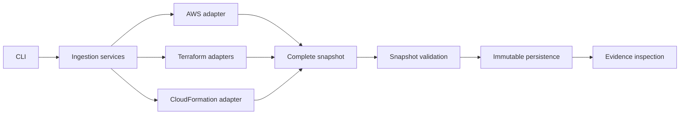

# Phase 2: AWS and infrastructure-as-code ingestion

Archived from [PLAN.md](../../PLAN.md). Steps 10–22 are complete; this file records
how they were planned and verified and is no longer updated.

**Phase 2 milestone:** Collect configured AWS accounts or import an IaC export → normalize and validate a source-specific snapshot → save without overwrite → inspect evidence and limitations.

Each snapshot remains one account and one source kind. Multi-account collection produces separate snapshots, not a merged account tree. Analysis, effective IAM evaluation, graph queries, comparisons, providers, and infrastructure execution remain out of scope.

Steps 10–22 are implemented, including all-supported-services collection with enabled-region discovery and bounded async orchestration around synchronous boto3 collectors, offline Terraform state-export, plan, and CloudFormation import through explicit CLI formats, and phase-closing permissions and offline acceptance; selective service collection remains available. Whole-architecture completeness is limited to the documented supported configuration inventory, not every AWS service.

## Step 10: Extend ingestion-facing snapshot contracts

**Status:** Implemented and verified (580 offline tests). `LocalTarget`, `ExternalTarget`, and `UnresolvedTarget` dependency targets, schema `"1"`/`"2"` support with schema `1` strict-reference loading retained, `ResourceLifecycle` (schema `2`, Terraform plans only), and the `tests/fixtures/snapshots/dependency-targets.json` fixture are in place.

Define discriminated local, external, and unresolved dependency targets before collecting relationships. Local targets must resolve to stored resources; external targets retain known identifiers/account context; unresolved targets require a sanitized reason and source location. All variants require a stored source, source-region grouping, and source-owned evidence. Never invent target resources or parents.

Use a versioned schema change for new relationship and IaC lifecycle fields. Plan schema `2` for new output while retaining schema `1` loading and its strict-reference semantics; specify any in-memory conversion and never rewrite historical files implicitly. Retain unknown AWS types through `UnknownResource` until a dedicated model is warranted. Known-null and unavailable values must remain distinguishable.

**Advice:** Design small local, cross-account, and unresolved-target fixtures first. Do not encode semantic contracts only in generic metadata.

**Acceptance check:** Old fixtures remain readable; new variants round-trip; malformed variants, dangling local endpoints, and invalid citations are rejected. Version diagnostics stay safe and actionable.

## Step 11: Establish adapter boundaries and configured AWS execution

**Status:** Implemented and verified (633 offline tests). `ingestion/requests.py` defines `SourceRequest`, `AwsCollectionRequest`, and strictly validated `AwsAccountConfig`; `ingestion/adapter.py` defines `SnapshotAdapter`, `AdapterContext` (clock, UUID, session seams), and `IngestionError`; `ingestion/aws.py` provides profile/assume-role sessions, STS identity verification, the operation allowlist, and the bounded `OperationRunner`; `services/ingestion.py` selects adapters and validates results. Adapters return one snapshot per configured account. The adapter currently returns a coverage-only skeleton; resource collection and the `collect` command are step 12.

Define typed source requests and an adapter interface returning a complete `ArchitectureSnapshot`. Share utilities for identity, evidence allocation, sanitization, containment, and relationship resolution without introducing a normalized-batch assembly service. Application services select adapters, coordinate work, validate results, and call existing persistence.

Define explicit account configurations using named profiles and optional configured assume-role access, expected account IDs, regions, service selection, bounded concurrency, SDK timeouts, and retries. Use STS to verify identity before resource collection; reject mismatched accounts. Never follow discovered trust principals into additional accounts. Establish the operation allowlist before issuing calls.

Create injected session/client and clock/UUID seams for offline tests. Aggregate paginated outcomes by account/region/service/operation, retaining results when later pages or per-resource detail calls fail. Distinguish failed, incomplete, skipped, unsupported, and successful-zero outcomes. Avoid duplicate aggregate coverage records.

**Advice:** Start with a small request model and shared operation runner, not a plugin framework. Account identity failure must not produce a misleading successful snapshot.

**Acceptance check:** Stubbed identity, account mismatch, profile/role configuration, pagination, exhausted retries, bounded execution, and partial-page preservation behave predictably without real credentials.

## Step 12: Deliver VPC/subnet/EC2 collection end to end

**Status:** Implemented and verified (646 offline tests). `ingestion/ec2.py` normalizes VPCs, subnets, and instances with whole-item and per-fact evidence, VPC → subnet → instance containment, and explicit `unresolved_parent` attributes; `AwsAdapter` collects them per region with per-operation coverage; `collect_and_save` and the thin `collect` command write one new file per account and report partial results. Tag values under secret-named keys are redacted. Other selected services have no collection or coverage yet.

Implement the first complete AWS snapshot using STS plus VPC, subnet, and EC2 operations. Normalize stable physical identities, names, tags, CIDRs, availability zones, and instance configuration with exact source evidence and normalized fact citations. Build VPC → subnet → EC2 containment where supported by observed configuration.

When a parent is unavailable, store the resource once at the appropriate regional root and explain the missing context; do not synthesize parents. Validate the complete snapshot before saving.

Expose a thin `collect` command around reusable collection services. Provide readable/JSON summaries and explicit new output paths. For multiple configured accounts, require distinct destinations and report per-account outcomes without overwriting files or hiding partial failures.

**Advice:** Make this narrow slice usable before expanding the service inventory.

**Acceptance check:** A stubbed collection can be saved and inspected through `evidence`; zero results and mid-collection failure remain distinguishable; multi-account output stays isolated; existing destinations are untouched.

## Step 13: Complete network configuration and attachment evidence

**Status:** Implemented and verified (691 offline tests). Dedicated `RouteTable`, `InternetGateway`, `NetworkAcl`, `SecurityGroup`, and `NetworkInterface` models carry typed routes, rules, entries, and addressing with per-entry fact citations. `ingestion/network/` places them under the VPC/subnet and builds `attached_to` dependencies (kinds in `AttachmentKind`) with local, external, or unresolved targets; the adapter emits schema `"2"`. The fact/relationship-to-operation mapping and permissions are in `docs/network-mapping.md`.

Add route tables and associations, internet gateways, NACLs, security groups/rules, and network interfaces needed to describe EC2 attachments. Retain routes, addressing, ports/protocols, rule references, and association provenance. Store each resource once and express attachments as evidence-backed dependencies rather than duplicated children.

Use explicit external/unresolved targets when referenced resources are outside collection scope or cannot be resolved. Record unavailable parent/detail facts as limitations. Do not derive internet-exposure conclusions during ingestion.

**Advice:** Publish a mapping from each collected fact and relationship to its supporting operation and source path. Extend the operation allowlist and required read-permission documentation with each service slice in steps 13–16, before issuing its calls; apply step 11's per-operation partial-result policy throughout.

**Acceptance check:** Small fixtures demonstrate attachment resolution, missing network parents, unsupported route targets, security-group references, and successful security-group collection with failed route collection.

## Step 14: Collect account-wide IAM configuration

**Status:** Implemented and verified (830 offline tests). Typed IAM roles, instance profiles, and referenced managed policies are stored once per verified account under `global_resources`, using source-provided IDs. The separate IAM runner aggregates bounded, paginated detail reads and preserves partial inventory and successful results. Sanitized trust, inline-policy, and default-version documents have exact request-context evidence; compute/profile/role/policy and trust references use source-owned citations with local, external, or unresolved targets, without effective-access claims. Repeatable `collect --service` supports IAM-only requests without regions and combined EC2/IAM collection while retaining the EC2 default. Permissions, fact/relationship mappings, coverage, and redaction limitations are documented in [docs/iam-mapping.md](../../docs/iam-mapping.md). Full pytest, Ruff lint/format (excluding `.junie`), and whitespace checks passed using `.venv/bin/python`; schema `1` remains readable.

Collect IAM roles, instance profiles, attached/inline policies, relevant policy versions, and trust documents once per account, outside regional loops. Store account-wide resources under `global_resources`; resolve compute/profile/role links after resources are collected. Retain trust principals and conditions, including named external accounts and unresolved principals, without expanding wildcard principals into invented identities.

Do not retrieve credentials, secret material, or perform effective-permission evaluation. Extend the allowlist and read-permission documentation as operations are introduced.

**Advice:** Separate observed trust configuration from proof that a principal can actually assume a role.

**Acceptance check:** Two requested regions still trigger only one account-wide collection; policy/detail failures preserve known roles; regional/global and external relationships remain evidence-backed.

## Step 15: Add load-balancer configuration and targets

**Status:** Implemented and verified (945 offline tests). Regional ALB/NLB inventory, listeners, ALB rules, target groups, registered targets and observed health use six allowlisted ELBv2 reads. Typed ARN-identified resources retain exact request/page/fact citations, sanitized configuration, partial coverage, and evidence-backed forwarding/attachment links. IAM and ELBv2 share bounded detail execution while the EC2 runner remains unchanged. `collect --service elasticloadbalancing` works alone or with EC2/IAM; see [load-balancing-mapping.md](../../docs/load-balancing-mapping.md) for permissions, redactions, and uncertainty boundaries.

Collect ALB/NLB configuration, listeners, listener rules, target groups, and target configuration/status needed to connect the architecture. Preserve schemes, subnets, security groups, ports/protocols, forwarding actions, and target identities. Normalize supported `forwards_to` and attachment relationships, retaining unresolved IP or unavailable targets explicitly.

**Advice:** Evidence should identify the specific listener action or target entry, not merely the load balancer.

**Acceptance check:** Stubbed pagination and per-load-balancer detail failures preserve complete portions; forwarding relationships resolve or explain their unavailable endpoints. No reachability claims are produced.

## Step 16: Add compute, database, and queue configuration

**Status:** Implemented and verified (1,112 offline tests). Focused service-local modules
collect ECS clusters/services/running tasks and referenced task definitions, Lambda
configuration, RDS/Aurora instances/clusters/subnet groups, and SQS configuration/policies.
Typed resources retain exact request/page/fact evidence and observed network, role,
database-cluster/subnet-group, and dead-letter references with local/external/unresolved
targets. Shared bounded execution supports service-specific pagination and partial results;
all reads are allowlisted. Safe source projections exclude environment values, commands,
code, credentials, queue messages, and database contents before evidence construction.
`collect --service` supports each service independently or in combination, preserving
EC2 defaults and immutable persistence. Service mappings and permissions are documented
in `docs/ecs-mapping.md`, `docs/lambda-mapping.md`, `docs/rds-mapping.md`, and
`docs/sqs-mapping.md`. Full pytest, Ruff lint/format (excluding `.junie`), and whitespace
checks passed using the local `.venv/bin/python`; no credentials or network were used.
ECS task inventory is explicitly limited to desired-running tasks; no effective-access
or reachability conclusions are produced.

Expand in small service-local slices: ECS clusters/services/tasks and relevant task-definition configuration; Lambda configuration; RDS/Aurora instances/clusters; and SQS queue configuration/policies. Retain networking, execution/task role references, database endpoints/ports, queue policies, and relevant lifecycle/configuration facts.

Select safe fields before persistence. Never collect workload contents, queue messages, function code, secret values, or database contents. Review environment variables and other sensitive configuration rather than relying exclusively on generic key-name sanitization. Keep unsupported resources explicit and relationships evidence-backed.

**Advice:** Finish each service's mapping, coverage, redaction, and tests before moving to the next.

**Acceptance check:** Each service has paginated/detail-failure cases, exact fact citations, and secret-exclusion assertions. Collection remains bounded and allowlisted.

## Step 17: Collect whole supported architectures with bounded async orchestration

**Status:** Implemented and verified (1,292 offline tests). All seven substeps
deliver typed scope/limits, verified enabled-region discovery, shared SDK budgets,
isolated deterministic assembly, bounded async scheduling, cancellation-safe
collection/persistence, and CLI controls. `collect --all-services` selects all seven
supported families across configured accounts and enabled regions, with explicit
overrides and qualified scope summaries. Selective defaults, account isolation,
source-owned evidence, secret exclusion, and immutable destinations are preserved.
Full pytest, Ruff lint/format (excluding `.junie`), and whitespace checks passed
using `.venv/bin/python`; no credentials or network were used. See
[whole-architecture collection](../../docs/collection-scope.md).

Deliver the following ordered substeps independently, implementing and verifying one before proceeding. Keep the parent planned/in progress until all seven acceptance checks pass. Collect the supported configuration inventory—EC2/network, IAM, ELBv2, ECS, Lambda, RDS/Aurora, and SQS—for explicitly configured accounts. “Entire architecture” does not mean every AWS service, effective access, reachability, or a transactionally consistent AWS snapshot; completeness is relative to the resolved supported scope.

Preserve the complete-snapshot adapter boundary and schema `"2"`: async services coordinate thread-backed synchronous boto3 collectors, while the AWS adapter owns deterministic account assembly. Keep scheduling, scope discovery, and concurrency primitives in focused ingestion modules, `aws.py` limited to adapter composition, `services/ingestion.py` to workflow coordination, and `cli.py` to options/presentation. Reuse `AwsService`, `AwsRegion`, coverage/status and operation enums; add named scope/discovery enums only for real contracts. Never discover or enter additional accounts through trust relationships.

### Step 17.1: Define whole-architecture scope and execution limits

**Status:** Implemented and verified (1,158 offline tests). Typed account requests
support all-service selection and explicit/enabled region scope while retaining
selective defaults and IAM-only behavior. Strict run-wide/account SDK-call limits
and active-account/collector-job limits are defined; execution enforcement remains
step 17.3 and scheduling remains step 17.5. `ingestion/scope.py` defines validated,
credential-free resolved scope for existing snapshot metadata without a schema
change. Request/provenance tests, full pytest, and Ruff checks passed using
`.venv/bin/python`; no discovery, scheduling, or CLI changes were introduced.
See [the scope and limit contracts](../../docs/collection-scope.md).

- Extend typed requests in `ingestion/requests.py` with all-supported-services selection, discovery versus explicit region scope, and validated run-wide/per-account call limits plus active-account/collector-job limits.
- Reuse the enum-backed `COLLECTABLE_SERVICES` definition for all seven service families. Reject all-services plus explicit service selections; preserve EC2 defaults, selective requests, and IAM-only behavior.
- Define resolved-scope data carried into snapshot provenance using existing contracts; avoid a scheduling-only schema bump. Keep configured account/profile isolation and distinct output paths unchanged.

**Advice:** Establish contracts first without changing execution or exposing a CLI option that cannot yet work.

**Acceptance check:** Request tests cover mode conflicts, defaults, invalid limits, explicit overrides, and compatibility with existing selective requests. No AWS calls or scheduling changes are introduced.

### Step 17.2: Resolve enabled regions for verified accounts

**Status:** Implemented and verified (1,199 offline tests). Focused region-scope
resolution runs allowlisted `DescribeRegions` after STS verification, retains
enabled regions and credential-free scope diagnostics, and bypasses discovery
for explicit regions. Bootstrap/authentication endpoints respect configured,
profile, and verified partition context; ambiguous scope, discovery denial, and
unsupported enabled regions raise safe account-level errors without publishing
empty snapshots. SDK-unavailable regional services have per-operation
`unsupported` coverage while successful siblings remain collected. Stubber/fake,
authentication, persistence, and collector regression tests, full pytest, and
Ruff checks passed using `.venv/bin/python`. No shared budgets, async scheduling,
or CLI discovery controls were introduced. **Prerequisite:** Step 17.1.
See [scope discovery and regional availability](../../docs/collection-scope.md).

- Add a focused region-scope module and allowlisted `DescribeRegions` operation in `ingestion/operations.py`; invoke discovery only after STS verification.
- Resolve bootstrap endpoints from explicit/profile/partition context without assuming a commercial endpoint, filter disabled opt-in regions, and bypass discovery for explicit regional scope.
- Retain resolved scope and safe diagnostics. Denial, ambiguous bootstrap, or discovered regions unsupported by `AwsRegion` produce actionable account-level errors rather than silently reduced scans or successful empty snapshots.
- Define how known regional service unavailability is qualified in coverage; unavailable services must not appear as successful zero inventory.

**Advice:** Keep discovery independent of resource normalization and document `ec2:DescribeRegions` permission with this slice.

**Acceptance check:** Stubber/fake tests cover enabled/disabled regions, partitions, explicit overrides, discovery failure, unsupported regions, service availability, and no discovery before identity verification.

### Step 17.3: Enforce shared SDK-call budgets

**Status:** Implemented and verified (1,219 offline tests). Focused concurrency
primitives atomically reserve shared run-wide and per-account SDK-call capacity
through `AdapterContext`, `OperationRunner`, `DetailRunner`, configured assume-role
authentication, STS identity verification, and enabled-region discovery. Permits
remain held through blocking calls and SDK retries and are released on success
or failure; normalization, persistence, and nested scheduling hold none. Request
limits and one budget survive account persistence subrequests. Synchronization
tests prove overlapping nested pools respect both ceilings, safe failures release
capacity, and pagination/coverage regressions remain unchanged. Full pytest and
Ruff checks passed using `.venv/bin/python`; no credentials or network were used.
Async scheduling, isolated assembly, and CLI controls remain later substeps.
**Prerequisite:** Step 17.1. See [shared SDK-call budgets](../../docs/collection-scope.md).

- Add focused concurrency primitives and thread them through `AdapterContext`, `OperationRunner`, `DetailRunner`, and identity/discovery execution.
- Bound actual blocking SDK calls with shared run-wide and per-account permits, including nested detail pools; keep permits held through SDK retries until the underlying call returns.
- Release permits on every success/failure path. Never hold them during nested scheduling, normalization, or persistence. Preserve existing SDK timeout/retry settings and runner coverage semantics.

**Advice:** Introduce the budget under current synchronous orchestration before adding async scheduling; use synchronization tests rather than elapsed-time benchmarks.

**Acceptance check:** Concurrent runner tests prove total/account in-flight limits, no permit leaks or deadlocks, and unchanged pagination, retries, retained-page results, safe errors, and coverage counts.

### Step 17.4: Separate isolated collection from deterministic account assembly

**Status:** Implemented and verified (1,226 offline tests). Focused enum-backed
service/region jobs return owned resources, evidence, coverage, and service-local
dependencies without mutating account trees. `AwsAdapter` collects jobs sequentially,
then assembles copied results in stable order and resolves cross-service links
against complete regional/global inventories using existing helpers. Missing,
duplicate, or unplanned job results are rejected; collected inputs remain unchanged
by assembly or returned snapshot mutations. Fixed clock/UUID tests across all seven
service families and two regions prove reversed/shuffled results preserve containment,
facts, exact citations, coverage ordering, redaction, successful zero results, and
retained pagination/detail failures. Full pytest, Ruff lint/format (excluding `.junie`),
and whitespace checks passed using `.venv/bin/python`; no credentials or network
were used. Async scheduling and CLI controls remain planned for subsequent substeps.
**Prerequisites:** Steps 17.2–17.3. See
[isolated collection and account assembly](../../docs/collection-scope.md).

- Refactor collector dispatch, including `configuration_services.py`, so service/region work returns isolated results instead of mutating shared resource trees, evidence maps, or dependencies.
- Keep execution sequential initially. Have `AwsAdapter` merge in stable service/region order after collection, then build complete indexes and resolve containment and cross-service links, including compute/network/IAM/ELB references.
- Reuse existing normalizers/resolvers; retain one resource and one operation coverage record per account/region/service/operation scope. Do not create a separate assembly service or invent parents, resources, endpoints, or relationships.

**Advice:** Review this as a behavior-preserving refactor before introducing concurrency.

**Acceptance check:** Combined-service regressions and deliberately reordered result inputs preserve normalized facts, containment, references, exact citations, coverage ordering, redaction, and partial results, including pagination/detail failures and successful-zero versus failed/incomplete outcomes (with clock/UUID seams fixed).

### Step 17.5: Schedule bounded async account and collector jobs

**Status:** Implemented and verified (1,241 offline tests). A focused async
coordinator bounds active accounts and run-wide collector jobs around thread-backed
synchronous boto3 work, retaining shared SDK-call budgets and ordered account results.
Session factories and account Session/client preparation are serialized without
locking returned clients' API calls; cross-account Session reuse is rejected and
clock/UUID injection remains supported. IAM runs once per account; assembly waits
for isolated jobs and remains independent of completion order. Identity/discovery
errors isolate accounts, retained API failures qualify coverage, and unexpected
collector/validation errors propagate after siblings settle. Barrier/lock-based
tests, full pytest, Ruff lint/format (excluding `.junie`), and whitespace checks
passed using `.venv/bin/python`; no credentials or network were used.
Async persistence/cancellation and CLI controls remain steps 17.6–17.7.
**Prerequisite:** Step 17.4. See
[bounded async scheduling](../../docs/collection-scope.md).

- Add a focused account-local async coordinator using bounded thread-backed boto3 work; do not add an async AWS SDK dependency.
- Run independent account and service/region jobs concurrently, IAM once per account, respecting both scheduling limits and shared call budgets.
- Preserve dependent collector stages and sequential pagination. Prepare sessions/clients safely, avoiding concurrent boto3 Session mutation and cross-account credential reuse; retain session/client, clock, and UUID injection seams.
- Merge only after each account's selected collector jobs settle. Identity/discovery failure prevents that account's snapshot without stopping others; expected collector/API failures retain qualified siblings. Programming/validation failures must not be converted into successful empty results.

**Advice:** Async workers collect isolated data; the account adapter remains the single assembly owner.

**Acceptance check:** Barrier-based tests demonstrate real overlap, bounded nested calls, IAM single-pass behavior, deterministic completion-order independence, failure isolation, and safe session/client preparation.

### Step 17.6: Deliver async workflows, sync compatibility, and cancellation

**Status:** Implemented and verified (1,265 offline tests). Public
`collect_snapshots_async` and `collect_and_save_async` services support existing
event loops, request-ordered results, independently validated snapshots, expected
account/save failure isolation, and distinct immutable destinations. Existing
synchronous APIs and injected sync-only adapters remain supported; sync wrappers
reject running-loop misuse actionably before starting work. Cancellation stops
later scheduling and SDK reads and asynchronously drains running threads, including
repeated cancellation, while retaining SDK permits and collector slots until completion.
Unfinished collection publishes nothing; started saves settle through the existing
atomic publication commit point, never overwrite, and preserve all committed
files. Synchronization/publication tests, full pytest, Ruff lint/format (excluding
`.junie`), and whitespace checks passed using `.venv/bin/python`; no credentials
or network were used. CLI scope controls and parent milestone completion remain
step 17.7. **Prerequisite:** Step 17.5. See
[async workflows and cancellation](../../docs/collection-scope.md).

- Add async collection and collection-to-persistence service APIs with request-ordered account outcomes; retain existing synchronous CLI/Python wrappers and adapter injection compatibility.
- Async APIs work inside an existing event loop. Sync wrappers must fail actionably rather than attempt a nested event loop when misused there.
- On cancellation stop scheduling, let running SDK threads settle under configured timeouts, retain their permits until completion, and publish no unfinished account snapshot.
- Preserve independently validated immutable snapshots and distinct paths. Define the existing atomic publication commit point as the boundary: already committed files remain intact, including a save that commits while cancellation is being handled. Never overwrite destinations.

**Advice:** Do not equate cancelling an await with stopping a thread or rolling back a committed file.

**Acceptance check:** Tests cover async/sync compatibility, ordered outputs, identity isolation, cancellation before/during calls and publication, permit retention, no-overwrite, and committed-file preservation.

### Step 17.7: Expose all-services collection and verify the milestone

**Status:** Implemented and verified (1,292 offline tests). Thin CLI controls expose
all-service selection, region scope/bootstrap, run/account SDK budgets, active-account
and collector-job limits, and local runner concurrency. A focused presentation
module keeps request parsing and scope summaries out of collector logic. Whole scans
default to enabled-region discovery; explicit regions bypass it, conflicting flags
are rejected before collection, and selective EC2/IAM behavior remains compatible.
Readable/JSON outcomes report resolved supported scope and partial coverage.
Installed-entry-point checks and populated multi-account/multi-region offline journeys
verify all seven families, IAM once per account, retained siblings, exact evidence,
redaction, ordered output mapping, failure isolation, and no overwrite. Full pytest,
Ruff lint/format (excluding `.junie`), documentation, and whitespace checks passed
using `.venv/bin/python`. **Prerequisite:** Step 17.6. See
[CLI controls and supported boundaries](../../docs/collection-scope.md).

- Add thin `collect --all-services` options/presentation and scope/concurrency controls; reject conflicting service flags and preserve existing selective behavior.
- Default whole-architecture mode to enabled-region discovery, allow explicit overrides, and report resolved scope and qualified partial outcomes in readable/JSON output.
- Document supported inventory boundaries, regional availability, read permissions, limits, potentially expensive or throttled scans, and async/sync APIs; no claim of every AWS service or transactional completeness.
- Add installed-CLI and offline multi-account/multi-region journeys through collection, immutable persistence, and evidence inspection. Mark substeps and the parent implemented only after their corresponding checks pass.

**Advice:** Add the user-facing switch only once the underlying workflow is complete; keep `cli.py` presentation-only and selective collection available for targeted runs.

**Acceptance check:** All seven service families collect without repeated service flags, IAM runs once/account, failures preserve valid siblings with partial summaries, secrets remain excluded, and account/output mapping and no-overwrite hold. Run focused/full offline suites, Ruff, and whitespace checks using `.venv/bin/python`, injected clients, and Botocore Stubber; no credentials/network required.

## Step 18: Import Terraform state exports

**Status:** Implemented and verified (1,433 offline tests). Focused modules under
`ingestion/terraform/` parse public `terraform show -json` state exports, resolve
unambiguous account/region context, preserve nested logical addresses and physical
IDs, and construct complete schema `2` snapshots through the existing sync/async
service APIs. Recursive sensitivity masks run before normalization; allowlisted
facts carry exact file JSON-pointer evidence, unsupported types retain safe unknown
summaries, and missing references or unavailable details qualify coverage. Persistence
round trips, immutable destinations, context conflicts, malformed exports, redaction,
and absence of provider/network/execution calls are tested. Full pytest, Ruff
lint/format (excluding `.junie`), and whitespace checks passed using `.venv/bin/python`.
The documented initial mapping covers core EC2/network and IAM identity/configuration
facts; complex rules/routes/policy documents and other types remain explicit
limitations, not silently complete imports. See
[Terraform state mapping](../../docs/terraform-state-mapping.md). Plans and raw-source CLI
selection remain steps 19 and 21 respectively.

Accept state JSON produced by `terraform show -json`, validate supported input format versions, and recursively walk root/child modules. Require supplied account/region context when it cannot be established safely; reject conflicting or mixed-account input rather than silently selecting one context.

Map supported types, preserve full module/resource addresses and physical IDs where present, and retain unsupported summaries as unknown resources with limitations. Use source-file/configuration paths for evidence. Honor Terraform sensitive markers in addition to shared sanitization; do not execute Terraform or contact providers. Only infer relationships supported by exported facts.

**Advice:** Keep state import separate from Terraform backend/internal state-file handling.

**Acceptance check:** Local exports cover nested modules, logical/physical identity, sensitive marked values, unsupported types, incompatible formats, and missing context. Import and persistence require no network calls.

## Step 19: Import Terraform plans with uncertainty and actions

**Status:** Implemented and verified (1,607 offline tests). The separate
`TerraformPlanRequest`/`TerraformPlanAdapter` imports public plan exports through
the existing sync/async services, reusing state mappings, scope validation, evidence,
and immutable persistence. Exact ordered actions and explicit before/after value
scope preserve deletions and both replacement orders without merging prior values
into planned facts. Recursive unknown/sensitive masks run before mapping; unknown
facts have unresolved mask evidence and coverage rather than invented values or
dangling fact citations. Lists containing unknown descendants are conservatively
omitted without remapping indexes. Configuration references resolve only to uniquely
stored after resources; variables, dynamic expressions, and missing targets remain
unresolved. Errored plans fail safely, and deferred/incomplete plans retain qualified
coverage. Focused fixtures and regression tests, full pytest, Ruff lint/format
(excluding `.junie`), and whitespace checks passed using `.venv/bin/python`;
no credentials, Terraform execution, provider contact, or network were used.
See [Terraform plan mapping](../../docs/terraform-plan-mapping.md). Raw-source CLI
selection remains step 21; complex mapping limitations from step 18 still apply.

Add plan JSON ingestion after state mappings are stable. Preserve planned values, references available in exported configuration, unknown-value masks, sensitive masks, and create/update/delete/replacement action sequences through explicit lifecycle contracts defined in step 10.

Represent deleted resources and before/after scope deliberately; do not mislabel proposed configuration as observed state. Unknown facts use unresolved evidence/coverage rather than fabricated values. A fact citation must still point to a stored normalized field or rule.

**Advice:** A missing, unknown, and explicit-null value are different cases; replacement actions are not a simple update.

**Acceptance check:** Fixtures cover create, update, delete, replacement, nested unknowns, sensitive values, and unresolved references while retaining exact logical addresses and action order.

## Step 20: Import CloudFormation JSON/YAML safely

**Status:** Implemented and verified (1,935 offline tests). Focused modules under
`ingestion/cloudformation/` import bounded JSON/YAML declarations with explicit account,
region, stack context, parameters, and sensitive source paths. Restricted PyYAML parsing
rejects arbitrary object tags, duplicate keys, recursive aliases, malformed shapes, and
excessive input. Local intrinsic/condition evaluation preserves unknowns and exact source
provenance without fabricating physical IDs. Core EC2 facts use typed resources; other
types retain allowlisted summaries and mapping limitations. Local declaration references
and explicit unresolved imports/missing targets carry source-owned evidence. NoEcho,
sensitive markers, tag-pair redaction, and safe projections exclude protected values;
no nested templates are fetched and no stacks, macros, or arbitrary code are executed.
Sync/async services, immutable persistence, evidence inspection, equivalent JSON/YAML,
and negative/security cases are verified. Full pytest, Ruff lint/format (excluding
`.junie`), and whitespace checks passed using `.venv/bin/python`. See
[CloudFormation mapping](../../docs/cloudformation-mapping.md) for the supported intrinsic
subset and explicit limitations. Raw-source CLI format selection remains step 21.

Add PyYAML when this adapter begins. Use a safe loader with explicit intrinsic-tag constructors and rejection of arbitrary object construction. Accept supplied parameters and account/region/stack context. Resolve supported literal and local intrinsic expressions with bounded evaluation; preserve unsupported or unavailable expressions as sanitized unresolved evidence and coverage.

Honor `NoEcho` and sensitive source paths. Do not fetch external imports or nested templates automatically. Represent nested stacks as resources; unavailable nested contents and external imports remain explicit limitations/targets. Physical IDs must not be invented from logical IDs. Never deploy stacks or evaluate arbitrary template code.

**Advice:** Publish the supported intrinsic subset and failure/uncertainty rules rather than suggesting full CloudFormation evaluation.

**Acceptance check:** JSON and YAML equivalents normalize consistently; local references, missing parameters, external imports, nested stacks, unsupported intrinsics, malicious tags, and sensitive values have isolated tests.

## Step 21: Extend raw-source CLI ingestion without regressions

**Status:** Implemented and verified (2,104 offline tests). Explicit `ingest --format`
selection exposes snapshot JSON (the backward-compatible default), Terraform state,
Terraform plans, and CloudFormation JSON/YAML through a reusable `ingest_snapshot`
service. Context options reuse existing typed requests and conflict checks; bounded
parameter-file parsing and repeatable sensitive paths support protected template
inputs without inline secret values. Adapters retain source parsing; shared validation
and immutable persistence publish no invalid output and never overwrite destinations.
Readable/JSON summaries preserve snapshot IDs and paths while explicitly qualifying
partial coverage. Both installed entry points run outside the checkout for every
format through persistence and evidence inspection, including safe failures, redaction,
context inference, and no-overwrite checks. Full pytest, Ruff lint/format, documentation
link/example checks, and whitespace checks passed using `.venv/bin/python`;
see [raw-source CLI ingestion](../../docs/raw-source-ingestion.md). Phase closure is verified in step 22.

Extend `ingest` with explicit format selection for project snapshots, Terraform state, Terraform plans, and CloudFormation, plus required context options. Retain the existing project-JSON workflow as the backward-compatible default; avoid guessing ambiguous source formats.

Keep source parsing in adapters and coordination in services. All sources use shared validation, no-overwrite persistence, readable/JSON presentation, safe diagnostics, and documented exit behavior. Invalid inputs publish no output. Partial collection produces a clearly qualified saved result rather than an unqualified success summary.

**Advice:** Maintain one reusable Python API per workflow so future interfaces need no CLI dependency.

**Acceptance check:** Installed entry points run outside the checkout for every source kind; evidence remains inspectable; malformed/context-invalid imports fail safely; output conflicts preserve bytes.

## Step 22: Close phase 2 with permissions and offline acceptance

**Status:** Implemented and verified (2,128 offline tests). The consolidated
[AWS permissions and setup guide](../../docs/aws-permissions.md) publishes all 41
allowlisted operations, the 39-action inventory/discovery policy, separate optional
role assumption, resource-scope constraints, profile/SSO/runtime credential setup,
and supported scope/failure boundaries. Policy-parity tests prevent allowlist drift.
README records each supported service's collected facts and explicit limitations,
links source-format/intrinsic contracts, and documents the phase-closing journeys.
New Botocore Stubber acceptance covers real SDK request validation through partial
collection, immutable persistence, and exact evidence inspection; target-variant
acceptance preserves local/external/unresolved identifiers, reasons and citations.
Existing installed-CLI journeys cover every offline source, schema `1` remains
readable, and partial coverage is never reported as complete. All tests passed
using `.venv/bin/python` on the host and `/opt/venv/bin/python` in the rebuilt Docker
image with networking disabled and no credential mounts. Ruff lint/format
(excluding `.junie`), documentation links, and whitespace checks passed. Real AWS
smoke collection remains opt-in and outside normal pytest/CI; no live account
access was used. Graph/analyzer/provider work remains phases 3–4.

Publish the exact operation allowlist, required IAM actions, resource-scope constraints, profile/SSO/assume-role setup, supported regions/formats/intrinsics, configuration examples, and partial-result behavior. Keep credentials out of images, fixtures, and diagnostics; use runtime credential mounts only for opt-in collection.

Add botocore Stubber and local-file acceptance journeys covering source → validated snapshot → immutable persistence → evidence inspection. Run normal tests with no credentials/network, using `.venv/bin/python` on the host and `/opt/venv` in Docker. Keep real AWS smoke checks opt-in and outside normal pytest requirements.

**Advice:** Reuse the installed-CLI journeys in `tests/acceptance/test_offline_acceptance.py` and the isolated fixture-mutation patterns in `tests/models/test_snapshot_integrity.py`; qualify limitations at every stage, not only in the final summary.

**Completion criterion:** All documented source adapters work end to end, the README service inventory has explicit collected facts and limitations, external/unresolved relationships survive persistence, schema `1` remains readable, and partial coverage never masquerades as completeness. Graph/analyzer/provider work remains phases 3–4.

## Phase 2 decisions and deferred boundaries

**Agreed contracts:** Complete-snapshot adapters own source parsing and construction of a source-specific `ArchitectureSnapshot`; shared helpers provide primitives, not a separate normalized-batch assembly layer. Explicit local/external/unresolved dependency targets are introduced through versioned contracts before adapters emit them. These decisions extend rather than retroactively change phase 1's strict schema `1` references.

**Implemented contracts:** Step 10 defines target/lifecycle field shapes and schema compatibility. Step 11 defines typed account/source requests, not a configuration-file loader. Each service slice documents its exact operation/field mapping; step 17 delivers scope discovery and shared async scheduling limits, step 20 documents the bounded intrinsic subset, and step 22 verifies permissions and offline acceptance. Mapping limitations remain explicit rather than promises of full provider semantics.

**Design anchors:** Future adapters belong under `src/archdiscov/ingestion/`, coordination under `src/archdiscov/services/`, contract extensions under `src/archdiscov/models/`, and thin presentation in `src/archdiscov/cli.py`. Reuse `models/sanitization.py`, `services/snapshots.py`, and `services/evidence.py`; boto3 is already a dependency, while PyYAML waits for step 20. Planned scheduling, scope discovery, and shared call budgets belong in focused ingestion modules, preserving the complete-snapshot AWS adapter boundary. These are future implementation locations, not additions in this documentation update.

**Deferred:** No merged multi-account tree, automatic traversal into trusted accounts, Terraform execution, provider contact for IaC imports, stack deployment, external-template fetching, effective IAM evaluation, reachability conclusions, graph queries, comparisons, or LLM providers. Nested-stack contents and external imports remain explicit limitations unless supplied in a later supported workflow.
